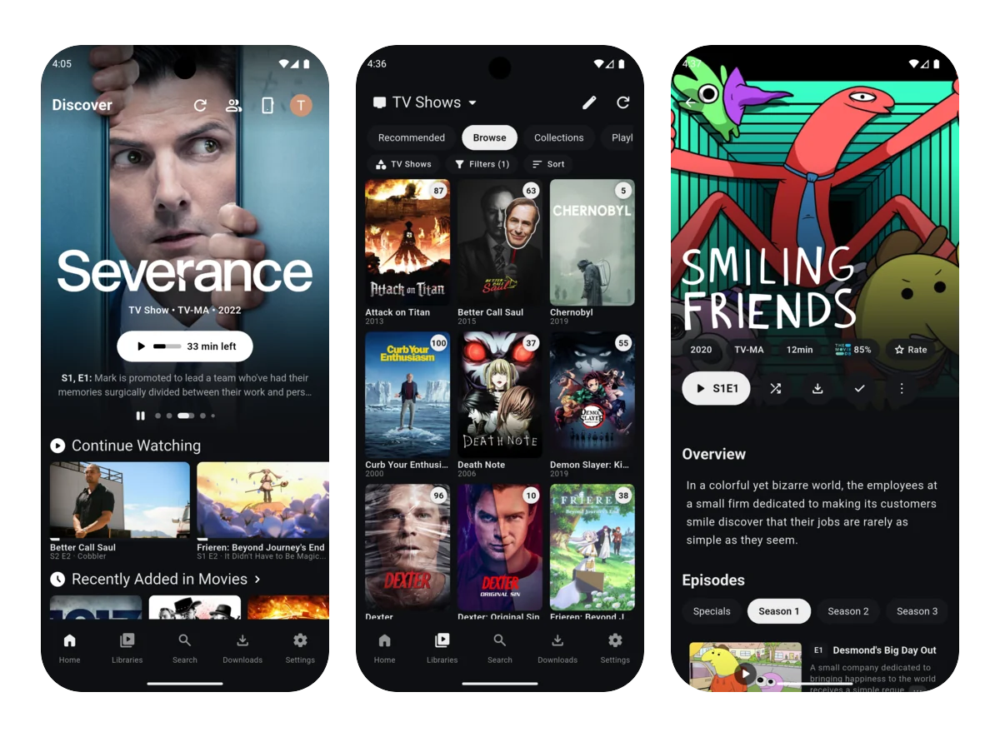

<h1>
  
  Plezy
</h1>

A modern client for Plex, Jellyfin, and Emby on desktop, mobile, and TV. Built with Kotlin Multiplatform, with native interfaces in Compose and SwiftUI.

<p>
  <a href="https://plezy.app">Website</a> ·
  <a href="https://plezy.app/#screenshots">Screenshots</a> ·
  <a href="#download">Download</a> ·
  <a href="CONTRIBUTING.md">Contributing</a> ·
  <a href="LICENSE">License</a>
</p>

<p align="center">
  
</p>

## Download

<a href='https://apps.apple.com/app/apple-store/id6754315964?pt=128238902&ct=GitHub&mt=8'></a>
<a href='https://play.google.com/store/apps/details?id=com.edde746.plezy&referrer=utm_source%3Dgithub%26utm_campaign%3Dreadme_badge'></a>
<a href='https://www.amazon.com/gp/product/B0GK65CVS1'></a>
<a href='https://get.microsoft.com/installer/download/9n5r1s1t68h7?referrer=appbadge&cid=github'></a>

| Platform | Download |
| --- | --- |
| macOS | [DMG (Apple silicon and Intel, macOS 14 or later)](https://github.com/edde746/plezy/releases/latest/download/plezy-macos.dmg) |
| Linux x64 | [.deb](https://github.com/edde746/plezy/releases/latest/download/plezy-linux-x64.deb) · [.rpm](https://github.com/edde746/plezy/releases/latest/download/plezy-linux-x64.rpm) · [.pkg.tar.zst](https://github.com/edde746/plezy/releases/latest/download/plezy-linux-x64.pkg.tar.zst) · [.flatpak](https://github.com/edde746/plezy/releases/latest/download/plezy-linux-x64.flatpak) · [.AppImage](https://github.com/edde746/plezy/releases/latest/download/plezy-linux-x64.AppImage) · [portable tar.gz](https://github.com/edde746/plezy/releases/latest/download/plezy-linux-x64.tar.gz) |
| Linux arm64 | [.deb](https://github.com/edde746/plezy/releases/latest/download/plezy-linux-arm64.deb) · [.rpm](https://github.com/edde746/plezy/releases/latest/download/plezy-linux-arm64.rpm) · [.pkg.tar.zst](https://github.com/edde746/plezy/releases/latest/download/plezy-linux-arm64.pkg.tar.zst) · [.flatpak](https://github.com/edde746/plezy/releases/latest/download/plezy-linux-arm64.flatpak) · [.AppImage](https://github.com/edde746/plezy/releases/latest/download/plezy-linux-arm64.AppImage) · [portable tar.gz](https://github.com/edde746/plezy/releases/latest/download/plezy-linux-arm64.tar.gz) |

<details>
<summary>Install with a package manager</summary>

### macOS — Homebrew

```bash
brew tap edde746/plezy https://github.com/edde746/plezy
brew install --cask plezy
```

### Windows — WinGet

```bash
winget install edde746.Plezy
```

### Linux — Flatpak

Install Flatpak with your distribution's package manager, download the bundle for your architecture above, then run:

```bash
flatpak remote-add --user --if-not-exists flathub https://flathub.org/repo/flathub.flatpakrepo
flatpak install --user flathub org.freedesktop.Platform//26.08
flatpak install --user ./plezy-linux-x64.flatpak
flatpak run com.edde746.plezy
```

On arm64, install `plezy-linux-arm64.flatpak`.

<details>
<summary>Sandbox, playback, and folder access</summary>

- Not on Flathub — the remote supplies the Freedesktop runtime only.
- Video playback needs a Wayland session; a pure X11 session shows the interface but cannot create the video plane.
- No host or home filesystem access; app data lives in `~/.var/app/com.edde746.plezy/`. Downloads go to `Plezy` in your Videos folder; other folders come through the desktop file chooser portal.
- Network, display, audio, and GPU access are enabled, with the Secret Service (account tokens), the screen saver service, and Discord's sockets (Rich Presence, including Flatpak Discord); session-bus access stays filtered.

</details>

### Linux — AppImage

Download the AppImage for your architecture above, then run:

```bash
chmod +x plezy-linux-x64.AppImage
./plezy-linux-x64.AppImage
```

[Gear Lever](https://flathub.org/apps/it.mijorus.gearlever) and AppImageUpdate update it from the latest release. Without FUSE, add `--appimage-extract-and-run`. The AppImage and the portable tar.gz (start `plezy.sh` in the extracted folder) use the system's graphics, audio, font and VA-API libraries, which desktop distributions install; the .deb, .rpm and .pkg.tar.zst packages declare them.

### Arch Linux — Pacman

[Distribution package](https://archlinux.org/packages/extra/x86_64/plezy/).

```bash
sudo pacman -S plezy
```

### Fedora / Red Hat — DNF

[Installation instructions](https://github.com/aldobarr/plezy-rpm) · Community repository by [@aldobarr](https://github.com/aldobarr).

### Nix

[Community package](https://search.nixos.org/packages?channel=unstable&query=plezy) maintained by [@mio-19](https://github.com/mio-19) and [@MiniHarinn](https://github.com/MiniHarinn).

### aerynOS — Moss

[Distribution package](https://github.com/aerynOS/recipes/tree/main/p/plezy).

```bash
sudo moss pad plezy
```

</details>

## Features

###  Browse & Discover
- Libraries, collections, and playlists — video and audio
- Shuffle a whole movie or TV library
- Discover hub — Continue Watching, Next Up, trending, and recommendations
- Continue Watching shows a title held in several libraries or on several servers once, and asks which copy to play
- Cross-server search across every connected Plex, Jellyfin, and Emby server, including actors and directors
- Filtering, sorting, and alphabetical jump navigation
- Folder browsing and folder playback — home-video libraries open in folder view
- Resolution, HDR/Dolby Vision, and audio-format badges on cards and detail pages
- Favorites and unwatched library filters[^mb]
- Extras — trailers, deleted scenes, behind-the-scenes

###  Explore & Requests
- Explore tab — watchlist, trending, popular, and recommendation rows from Plex Discover[^plex], Trakt, MyAnimeList, AniList, Simkl, and Seerr[^connect]
- Search any connected catalog source
- Catalog titles matched back to your own libraries by external ID
- Seerr — request movies and shows with per-season, 4K, and advanced destination options, and see request status inline
- Watchlist sync — add and remove titles on Plex, Trakt, MyAnimeList, AniList, and Simkl from anywhere in the app

###  Playback
- Wide codec support (HEVC, AV1, VP9, and more)
- HDR and Dolby Vision[^hdr]
- Direct play, or transcode presets from 240p/320 kbps to 1080p/20 Mbps
- Multi-version switching with per-version file details
- Full ASS/SSA subtitles with customizable styling
- Online subtitle search & download[^plex]
- Audio & subtitle choices remembered per title, or follow the server's per-episode selections
- Progress sync and resume
- Auto-play next episode with skip intro / skip credits
- Chapter navigation with thumbnail scrub previews
- Playback speed from 0.25x to 8x, audio sync offset, sleep timer (fixed durations or end of video)
- Video zoom 50-200% with pinch, presets, and hotkeys
- Audio passthrough[^pass], output channel limit (5.1 or stereo, with center-channel boost), and loudness normalization
- File Info sheet — every version, file, and stream the server reports
- Ambient lighting and GLSL shader presets[^mpv]
- Picture-in-Picture[^pip]
- Refresh-rate matching[^rrm]
- External player launch (VLC, MX Player, etc.) with progress sync back[^android]

###  Music
- Music libraries — artist, album, and track browsing with square artwork
- Album and artist screens with play, shuffle, and Instant Mix
- Gapless playback with a full play queue — reorder, remove, play next, add to queue
- Now Playing with synced lyrics[^lyrics], persistent mini-player, and sleep timer
- Background playback with lock-screen, media-key, and notification controls[^bgaudio]
- Offline playback of downloaded albums and tracks
- Streaming quality presets — Original, 320, 192, or 128 kbps

###  Live TV & DVR
- Live TV channel browsing, tuning, and favorites
- EPG guide with What's On and per-show schedules
- DVR recording rules, scheduled recordings, and a rememberable recording target library[^plex]
- Multi-server Live TV support where available

###  Downloads & Offline
- Download movies, shows, and music for offline playback[^dl]
- Background queue with pause / resume
- Sync rules for automatic downloads, with per-show "Include Specials"
- Offline browsing with watch state sync-back on reconnect

###  Watch Together
- Rooms on [Open Watch Party](https://openwatch.party) — share a six-character code; friends join from Plezy or another Open Watch Party app
- Everyone plays their own copy from their own server — Plex, Jellyfin, or Emby — matched by catalogue IDs, with a picker when several copies fit
- Synchronized play / pause / seek, host or shared control, room lock, and host handoff
- Public relays by default, or point Plezy at your own self-hosted relay

###  Integrations
- Discord Rich Presence[^desktop]
- Trakt, MyAnimeList, AniList, and Simkl — ratings, watched sync, and real-time scrobbling[^rt]
- Scores from connected trackers on detail pages — Trakt, Simkl, MyAnimeList, and AniList, plus Rotten Tomatoes, Metacritic, Letterboxd, IMDb, and TMDB through MDBList
- Plezy Remote — control desktop and TV from mobile
- Watch Next row and tvOS Top Shelf[^shelf]
- [`plezy://` links](#plezy-links) to open a profile, play a title, or tune a channel from Home Assistant, launchers, or an NFC tag; any movie, show, or episode menu shows its link[^links]

###  Platform & Customization
- Desktop, mobile, and TV — full D-pad, keyboard, and gamepad support
- Multiple servers at once — Plex, Jellyfin, and Emby side by side
- Profiles with per-profile downloads, watch state, and settings; Plex Home switching with PIN
- Jellyfin and Emby local-server discovery and multiple URLs per server; Quick Connect sign-in[^jf]
- TV layout options — full-card artwork, and Force TV mode on desktop
- Customizable keyboard shortcuts[^desktop]
- Metadata and artwork editing
- Settings import/export
- Localized in English plus 21 translations

[^jf]: Jellyfin only.
[^mb]: Jellyfin and Emby only.
[^plex]: Plex only.
[^connect]: Requires connecting the service under Settings > Services.
[^hdr]: In-app HDR toggle on Windows, macOS, iOS, tvOS, and Linux — Linux needs a colour-managed Wayland compositor. Dolby Vision on Android, macOS, and Apple TV.
[^pass]: Desktop, Android TV, and Apple TV.
[^mpv]: Not applied to Dolby Vision on Apple platforms.
[^pip]: Android, iOS, and macOS — not on Android TV or Apple TV.
[^rrm]: Windows, Android, and tvOS.
[^android]: Progress sync on Android.
[^lyrics]: Where your server provides lyrics.
[^bgaudio]: tvOS pauses music when the app is backgrounded.
[^dl]: Not available on tvOS.
[^desktop]: Desktop only.
[^rt]: Real-time scrobbling on Trakt and Simkl; MyAnimeList and AniList update on completion.
[^shelf]: Android TV / Fire TV and tvOS.
[^links]: Android, iOS, macOS, and tvOS.

## plezy:// links

Links start Plezy from outside the app. Any link may add `profile=<profile>`: a profile id, a Plex Home user UUID, or a display name (ignoring case; it must match one profile). Plezy switches to that profile first, and a protected profile still asks for its PIN. A link replaces whatever is playing.

| Link | Does |
|---|---|
| `plezy://open` | Opens Plezy |
| `plezy://play?server=<server>&id=<item>` | Plays one item on one server, any backend |
| `plezy://play?type=movie\|show&tmdb=<n>` | Plays a title from whichever server has it. Use `tmdb`, `tvdb`, `imdb=tt<n>`, or `plex=<hash>` (the Plex GUID without `plex://movie/`) |
| `plezy://live?channel=<channel>` | Tunes a Live TV channel by key, number, or call sign. Optional `server=<server>` and `start=beginning\|live` |

For a show, `mode=next` (the default) plays the next episode to watch, and `mode=shuffle` plays the show shuffled. The menu of any movie, show, or episode has **Show link**, and each profile's menu in **Switch Profile** has **Show profile link**. Both show the link as text and a QR code.

```sh
# Android / Android TV, over adb (Home Assistant: remote.turn_on with activity: plezy://...)
adb shell am start -a android.intent.action.VIEW -d "plezy://play?type=show\&tvdb=81189\&profile=Kids"
# macOS
open "plezy://play?type=movie&tmdb=603"
# Linux (the .deb, .rpm, .pkg.tar.zst and Flatpak register the scheme)
xdg-open "plezy://play?type=movie&tmdb=603"
```

On iOS, use the Open URLs action in Shortcuts.

## Building from Source

### Prerequisites
- JDK 27 and JDK 25 (Gradle finds both through its toolchain resolver)
- The Android SDK for the Android apps; Xcode 27.2 on a Mac for the Apple apps
- A Plex account, or a Jellyfin or Emby server with user credentials

### Setup

```bash
git clone https://github.com/edde746/plezy.git
cd plezy
./gradlew :app-desktop:run              # Windows, Linux
./gradlew :app-android:installDebug     # Android
```

For the Apple apps, generate the Xcode project and run its `Plezy-iOS`, `Plezy-tvOS` or `Plezy-macOS` scheme; [CONTRIBUTING.md](CONTRIBUTING.md) has the details.

<details>
<summary>Code generation</summary>

After changing `relay_protocol.json` or the collation data:

```bash
python3 scripts/codegen/generate_relay_protocol.py
python3 scripts/codegen/generate_ducet_order.py
```

</details>

<details>
<summary>Packaging for Linux</summary>

The packages wrap the desktop app image, `./gradlew :app-desktop:createReleaseDistributable` (`desktop/app/build/compose/binaries/main-release/app/Plezy`: JetBrains Runtime, the app as ProGuard shrank it, libmpv). Run the scripts on Ubuntu 24.04, natively on the image's architecture, with the packaging tools and the libraries the app needs from the host installed; `check-host-deps.py` names any library that is missing or undeclared.

```bash
sudo apt-get install -y ruby rpm binutils libarchive-tools zstd xz-utils zsync file curl \
  liblua5.2-0 libmujs3 libdisplay-info1 libbz2-1.0 libasound2t64 libdrm2 libegl1 libfontconfig1 libfreetype6 \
  libfribidi0 libgbm1 libgl1 libglib2.0-0t64 libgnutls30t64 libharfbuzz0b liblcms2-2 libpipewire-0.3-0t64 libpulse0 \
  libsecret-1-0 libstdc++6 libva-drm2 libva-wayland2 libva-x11-2 libva2 libwayland-client0 libwayland-cursor0 \
  libwayland-egl1 libx11-6 libxext6 libxi6 libxkbcommon0 libxrandr2 libxrender1 libxtst6 zlib1g
sudo gem install fpm -v 1.17.0 --no-document

APP=desktop/app/build/compose/binaries/main-release/app/Plezy
python3 desktop/app/packaging/linux/build-packages.py --app "$APP" --arch x64 --version 2.26.0 --output "$PWD"
bash desktop/app/packaging/linux/build-appimage.sh --app "$APP" --arch x64 --output "$PWD"
python3 -m unittest discover desktop/app/packaging/linux
```

That writes `plezy-linux-x64.deb`, `.rpm`, `.pkg.tar.zst`, `.tar.gz`, `.AppImage` and `.AppImage.zsync`. The Flatpak (`build-flatpak.py`, runtime `org.freedesktop.Platform//26.08`) also takes the Ubuntu libraries libmpv links, unpacked from their packages (`--libs`); its header and the Linux job of [the release workflow](.github/workflows/build.yml) show how, and `check-flatpak.py` checks the installed Flatpak.

</details>

<details>
<summary>Local checks</summary>

The checks CI runs are listed in [CONTRIBUTING.md](CONTRIBUTING.md#checks); for the server and the website:

```bash
scripts/ci_server_checks.sh
scripts/ci_website_checks.sh
```

</details>

## Contributing

See [CONTRIBUTING.md](CONTRIBUTING.md) for development workflow, formatting, tests, and translation guidelines.

## License

Plezy is licensed under [GPL-3.0](LICENSE). The license covers the code, not the Plezy name or logo; forks distributed beyond personal use must follow [TRADEMARKS.md](TRADEMARKS.md).

## Acknowledgments

- Built with [Kotlin Multiplatform](https://kotlinlang.org/multiplatform/), [Compose Multiplatform](https://www.jetbrains.com/compose-multiplatform/) and SwiftUI
- Supports [Plex Media Server](https://www.plex.tv), [Jellyfin](https://jellyfin.org), and [Emby](https://emby.media)
- Playback powered by [mpv](https://mpv.io) via our [mpv-build](https://github.com/edde746/mpv-build) pipeline (started as a fork of [MPVKit](https://github.com/mpvkit/MPVKit); on Android through its mpv-android library, whose Kotlin/JNI glue descends from [libmpv-android](https://github.com/jarnedemeulemeester/libmpv-android))
