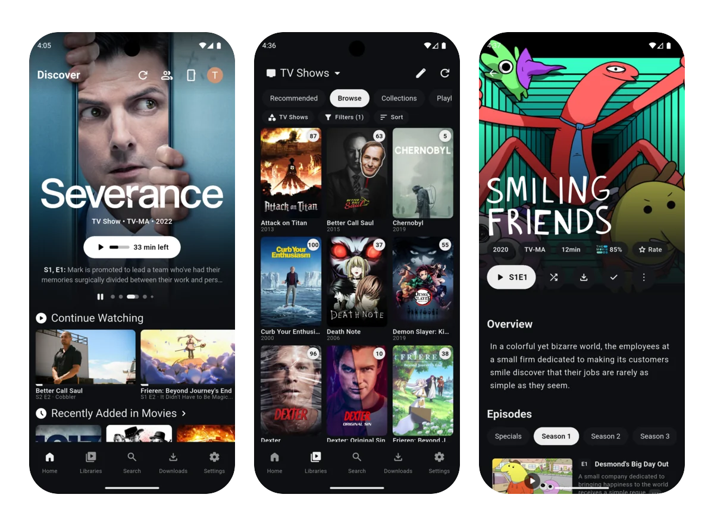

<h1>
  
  PlezyNG
</h1>

A cross-platform media client for Plex, Jellyfin, and Emby, maintained as a fork of [Plezy](https://github.com/edde746/plezy).

## Fork scope and convergence

PlezyNG carries requested features that upstream has declined or has not shipped yet. We aim to keep those changes compatible with upstream and support Plex, Jellyfin, and Emby wherever their APIs allow.

The fork is a maintenance vehicle for these deltas, not a permanent product split. When an equivalent feature is available in Plezy upstream and can be adopted without losing behavior, we will prefer the upstream implementation and retire our duplicate. If the feature set below converges upstream, there will be no remaining PlezyNG-specific capability to maintain.

| Area | Feature requests and upstream work | PlezyNG status |
| --- | --- | --- |
| Downloads | Converted download quality; per-rule quality; auto-download Continue Watching items and remove them when they leave the shelf (#1145, #1413, #1847, #1978, #2181, #2206) | Implemented for Plex, Jellyfin, and Emby |
| Downloads | Local Plex connections (#1447/#2248); download size and storage usage (#2376); manual sync and random episode selection (#1197, #1199) | Implemented in the fork; upstream convergence pending |
| Downloads | Playlist downloads and watched-item cleanup (#1721, #2600, #1413, #2181); orphan cleanup | Playlist downloads and watched-item cleanup are implemented; orphan cleanup remains planned |
| Profiles and privacy | PIN-gate download deletion, settings, and Explore; hide Explore per profile (#1924, #2514) | Planned |
| Audio and subtitles | Remember choices per show; choose tracks before playback; always-on subtitles and preferred-language fetching; per-item sync offsets (#84, #1758, #1956, #2116, #2182, #2346, #2382, #2792) | Per-show memory and scoped sync offsets are implemented locally for all servers; pre-play selection and automatic subtitle fetching remain planned |
| Subtitle controls | Live styling preview (#2347); in-player size and position controls (#95, #689, #2174); load a local subtitle file (#1431) | Live preview, in-player size/position, and local subtitle loading are implemented; other style controls remain in Settings |
| Playback | Swipe-to-seek (#2601), frame stepping (#1584), subtitle-delay hotkeys (#2824), remembered version across episodes (#2563), video playlist repeat (#1757/#1985) | Implemented in the fork; upstream convergence pending |
| Playback | Plex cinema pre-rolls (#970/#2483); random local pre-rolls (#2271); theme music (#791/#2170/#2596) | Plex and local pre-rolls, detail-page theme songs, and home spotlight music are implemented; Jellyfin/Emby cinema intros remain planned |
| Playback | Background video/audio-only mode (#367), mpv equalizer (#2292), local/remote quality presets (#2064), opt-in TheIntroDB fallback (#389, #1110, #1886) | Planned |
| Browsing | Director links (#2762), library item counts (#1516), Watchlist filters (#2725), MDBList Explore lists (#2740), Seerr search results (#2811) | Implemented in the fork; upstream convergence pending |
| Browsing | Search by actor or director (#1517, #2368); random movie or library shuffle (#1561, #2741, #2757); show end time on detail pages (#2671) | People search is implemented across connected servers; random selection and detail-page end time are planned |
| Home screen | Configurable home rows and merged libraries (#1652/#2203); separate Next Up; hide empty libraries, hero art, or backdrops; row sizing and clock controls (#1764, #2498, #2690, #2701, #2723, #2784) | Spotlight theme music is implemented; other listed home controls remain planned |
| Servers and links | Preferred server (#591, #1529, #2720); `plezy://watch` links (#2681); return from external players with synced progress (#2738) | Plex links, Jellyfin/Emby catalog-ID matching, and external-player return sync are implemented; preferred-server selection remains planned |
| Live TV | Timeshift timeline (#2300) | Plex implementation is in the fork; Jellyfin/Emby DVR-window support is planned |
| Search and integrations | Google Cast (#126); new-episode notifications (#1146); content screensaver (#401); Home Assistant and Android automation intents (#823, #1996) | Planned |
| Settings and diagnostics | Save logs to a file (#2496); cloud settings backup (#1795) | Planned |

The list records the fork's active scope. “Implemented in the fork” means PlezyNG carries the behavior while upstream convergence remains pending; platform and server limitations are called out in the feature documentation.

> PlezyNG exists while these requested capabilities are missing from upstream. As upstream adopts them, the corresponding fork delta should disappear. Once the list is fully upstream, the fork should be retired.

<p>
  <a href="https://github.com/edde746/plezy">Upstream Plezy</a> ·
  <a href="https://github.com/snapetech-org/PlezyNG/issues">PlezyNG issues</a> ·
  <a href="#download">Download</a> ·
  <a href="CONTRIBUTING.md">Contributing</a> ·
  <a href="LICENSE">License</a>
</p>

<p align="center">
  
</p>

## Download

PlezyNG builds are published on the [GitHub Releases page](https://github.com/snapetech-org/PlezyNG/releases). The packages below are the current desktop artifacts; mobile and TV builds are distributed separately when available.

| Platform | Download |
| --- | --- |
| macOS | [DMG (x64, arm64)](https://github.com/snapetech-org/PlezyNG/releases/latest/download/plezy-macos.dmg) |
| Linux x64 | [.deb](https://github.com/snapetech-org/PlezyNG/releases/latest/download/plezy-linux-x64.deb) · [.rpm](https://github.com/snapetech-org/PlezyNG/releases/latest/download/plezy-linux-x64.rpm) · [.pkg.tar.zst](https://github.com/snapetech-org/PlezyNG/releases/latest/download/plezy-linux-x64.pkg.tar.zst) · [.flatpak](https://github.com/snapetech-org/PlezyNG/releases/latest/download/plezy-linux-x64.flatpak) · [portable tar.gz](https://github.com/snapetech-org/PlezyNG/releases/latest/download/plezy-linux-x64.tar.gz) |
| Linux arm64 | [.deb](https://github.com/snapetech-org/PlezyNG/releases/latest/download/plezy-linux-arm64.deb) · [.rpm](https://github.com/snapetech-org/PlezyNG/releases/latest/download/plezy-linux-arm64.rpm) · [.pkg.tar.zst](https://github.com/snapetech-org/PlezyNG/releases/latest/download/plezy-linux-arm64.pkg.tar.zst) · [.flatpak](https://github.com/snapetech-org/PlezyNG/releases/latest/download/plezy-linux-arm64.flatpak) · [portable tar.gz](https://github.com/snapetech-org/PlezyNG/releases/latest/download/plezy-linux-arm64.tar.gz) |

<details>
<summary>Install with a package manager</summary>

### macOS — Homebrew

```bash
brew tap snapetech-org/PlezyNG https://github.com/snapetech-org/PlezyNG
brew install --cask plezy
```

### Linux — Flatpak

Install Flatpak with your distribution's package manager, download the bundle for your architecture above, then run:

```bash
flatpak remote-add --user --if-not-exists flathub https://flathub.org/repo/flathub.flatpakrepo
flatpak install --user flathub org.freedesktop.Platform//25.08
flatpak install --user ./plezy-linux-x64.flatpak
flatpak run com.edde746.plezy
```

On arm64, install `plezy-linux-arm64.flatpak`.

<details>
<summary>Sandbox, playback, and folder access</summary>

- Not on Flathub — the remote supplies the Freedesktop runtime only.
- Video playback needs a Wayland session; a pure X11 session shows the interface but cannot create the video plane.
- No host or home filesystem access; app data lives in `~/.var/app/com.edde746.plezy/`. Add host folders through the desktop file chooser portal, and keep download folders writable.
- Network, display, audio, and device access are enabled. `--device=all` (Flatpak 1.14 compatibility) exposes more than GPUs and controllers; session-bus access stays filtered.

</details>

### Arch Linux — Pacman

[Distribution package](https://archlinux.org/packages/extra/x86_64/plezy/).

```bash
sudo pacman -S plezy
```

### Fedora / Red Hat — DNF

[Installation instructions](https://github.com/aldobarr/plezy-rpm) · Community repository by [@aldobarr](https://github.com/aldobarr).

### Nix

[Community package](https://search.nixos.org/packages?channel=unstable&query=plezy) maintained by [@mio-19](https://github.com/mio-19) and [@MiniHarinn](https://github.com/MiniHarinn).

### aerynOS — Moss

[Distribution package](https://github.com/aerynOS/recipes/tree/main/p/plezy).

```bash
sudo moss it plezy
```

</details>

## Features

###  Browse & Discover
- Libraries, collections, and playlists — video and audio
- Discover hub — Continue Watching, Next Up, trending, and recommendations
- Cross-server search across connected Plex, Jellyfin, and Emby libraries
- Filtering, sorting, and alphabetical jump navigation
- Folder browsing and folder playback — home-video libraries open in folder view
- Resolution, HDR/Dolby Vision, and audio-format badges on cards and detail pages
- Favorites and unwatched library filters[^mb]
- Extras — trailers, deleted scenes, behind-the-scenes

###  Explore & Requests
- Explore tab — watchlist, trending, popular, and recommendation rows from Plex Discover[^plex], Trakt, MyAnimeList, AniList, Simkl, and Seerr[^connect]
- Search any connected catalog source
- Catalog titles matched back to your own libraries by external ID
- Seerr — request movies and shows with per-season, 4K, and advanced destination options, and see request status inline
- Watchlist sync — add and remove titles on Plex, Trakt, MyAnimeList, AniList, and Simkl from anywhere in the app

###  Playback
- Wide codec support (HEVC, AV1, VP9, and more)
- HDR and Dolby Vision[^hdr]
- Direct play, or transcode presets from 240p/320 kbps to 1080p/20 Mbps
- Multi-version switching with per-version file details
- Full ASS/SSA subtitles with customizable styling
- Online subtitle search & download[^plex]
- Audio and subtitle track selection with server-provided defaults
- Progress sync and resume
- Auto-play next episode with skip intro / skip credits
- Chapter navigation with thumbnail scrub previews
- Playback speed from 0.25x to 8x, audio sync offset, sleep timer (fixed durations or end of video)
- Video zoom 50-200% with pinch, presets, and hotkeys
- Audio passthrough[^pass], output channel limit (5.1 or stereo, with center-channel boost), and loudness normalization
- File Info sheet — every version, file, and stream the server reports
- Ambient lighting and GLSL shader presets[^mpv]
- Picture-in-Picture[^pip]
- Refresh-rate matching[^rrm]
- External player launch (VLC, MX Player, etc.) with progress sync back[^android]

###  Music
- Music libraries — artist, album, and track browsing with square artwork
- Album and artist screens with play, shuffle, and Instant Mix
- Gapless playback with a full play queue — reorder, remove, play next, add to queue
- Now Playing with synced lyrics[^lyrics], persistent mini-player, and sleep timer
- Background playback with lock-screen, media-key, and notification controls[^bgaudio]
- Offline playback of downloaded albums and tracks
- Streaming quality presets — Original, 320, 192, or 128 kbps

###  Live TV & DVR
- Live TV channel browsing, tuning, and favorites
- EPG guide with What's On and per-show schedules
- DVR recording rules, scheduled recordings, and a rememberable recording target library[^plex]
- Multi-server Live TV support where available

###  Downloads & Offline
- Download movies, shows, and music for offline playback[^dl]
- Background queue with pause / resume
- Sync rules for automatic downloads, with per-show "Include Specials"
- Per-rule download quality, plus automatic Continue Watching downloads with cleanup when an item leaves the shelf
- Converted video downloads for Plex, Jellyfin, and Emby; progressive server transcodes may restart after an interrupted transfer
- Offline browsing with watch state sync-back on reconnect

###  Watch Together
- Rooms on [Open Watch Party](https://openwatch.party) — share a six-character code; friends join from Plezy or another Open Watch Party app
- Everyone plays their own copy from their own server — Plex, Jellyfin, or Emby — matched by catalogue IDs, with a picker when several copies fit
- Synchronized play / pause / seek, host or shared control, room lock, and host handoff
- Public relays by default, or point Plezy at your own self-hosted relay

###  Integrations
- Discord Rich Presence[^desktop]
- Trakt, MyAnimeList, AniList, and Simkl — ratings, watched sync, and real-time scrobbling[^rt]
- Scores from connected trackers on detail pages — Trakt, Simkl, MyAnimeList, and AniList, plus Rotten Tomatoes, Metacritic, Letterboxd, IMDb, and TMDB through MDBList
- Plezy Remote — control desktop and TV from mobile
- Watch Next row and tvOS Top Shelf[^shelf]

###  Platform & Customization
- Desktop, mobile, and TV — full D-pad, keyboard, and gamepad support
- Multiple servers at once — Plex, Jellyfin, and Emby side by side
- Profiles with per-profile downloads, watch state, and settings; Plex Home switching with PIN
- Jellyfin and Emby local-server discovery and multiple URLs per server; Quick Connect sign-in[^jf]
- TV layout options — corner spotlight backdrop, full-card artwork, and Force TV mode on desktop
- Customizable keyboard shortcuts[^desktop]
- Metadata and artwork editing
- Settings import/export
- Localized in English plus 21 translations

[^jf]: Jellyfin only.
[^mb]: Jellyfin and Emby only.
[^plex]: Plex only.
[^connect]: Requires connecting the service under Settings > Services.
[^hdr]: In-app HDR toggle on Windows, macOS, iOS, tvOS, and Linux — Linux needs a colour-managed Wayland compositor. Dolby Vision on Android, macOS, and Apple TV.
[^pass]: Desktop, Android TV, and Apple TV.
[^mpv]: Requires mpv's GPU renderer — unavailable on iOS, tvOS, and macOS, and Android defaults to ExoPlayer.
[^pip]: Android, iOS, and macOS — not on Android TV or Apple TV.
[^rrm]: Windows, Android, and tvOS.
[^android]: Progress sync on Android.
[^lyrics]: Where your server provides lyrics.
[^bgaudio]: tvOS pauses music when the app is backgrounded.
[^dl]: Not available on tvOS.
[^desktop]: Desktop only.
[^rt]: Real-time scrobbling on Trakt and Simkl; MyAnimeList and AniList update on completion.
[^shelf]: Android TV / Fire TV and tvOS.

## Building from Source

### Prerequisites
- Flutter SDK 3.47.0+
- A Plex account, or a Jellyfin or Emby server with user credentials

### Setup

```bash
git clone https://github.com/snapetech-org/PlezyNG.git
cd PlezyNG
flutter pub get
scripts/codegen.sh
flutter run
```

<details>
<summary>Code generation</summary>

After modifying model classes or other generated sources:

```bash
scripts/codegen.sh
```

After modifying translations:

```bash
dart run slang
```

</details>

<details>
<summary>Packaging a Flatpak bundle</summary>

Packages an **already fully resolved Linux release bundle** — pinned libmpv and bundled libraries included, not a Flathub source-build manifest. Run it on Linux, on the same architecture as the bundle, after following the bundle preparation steps in [the Linux release workflow](.github/workflows/build.yml): `flutter build linux` alone does not produce all the required bundled libraries.

Install the packaging tools (Debian/Ubuntu shown) plus the native-architecture SDK and runtime:

```bash
sudo apt-get update
sudo apt-get install -y flatpak flatpak-builder imagemagick
flatpak remote-add --user --if-not-exists flathub https://flathub.org/repo/flathub.flatpakrepo
flatpak install --user flathub org.freedesktop.Platform//25.08 org.freedesktop.Sdk//25.08

BUNDLE_DIR=build/linux/x64/release/bundle
python3 linux/packaging/build-flatpak.py --bundle "$BUNDLE_DIR" --arch x64 --output "$PWD"
```

That writes `plezy-linux-x64.flatpak`, installable with the Flatpak commands above; on arm64, use the prepared arm64 bundle directory and `--arch arm64`. Package from the checkout matching the bundle, since the version comes from `pubspec.yaml`.

Cross-architecture packaging needs native Flatpak tools, a registered binfmt interpreter, and the target SDK/runtime installed with `flatpak install --user --arch=x86_64` (or `aarch64`) — never run Flatpak's namespace tools under emulation. Pass `--arch x64` or `--arch arm64` to the checker and the matching Flatpak architecture to `flatpak run --arch=...`.

Check the installed package against the runtime (not just the SDK), then launch it on a Wayland desktop and exercise streaming, audio, downloads/offline playback, and file chooser portals:

```bash
python3 linux/packaging/check-flatpak.py
```

The check fails on a non-executable entry point or an unresolved bundled ELF dependency. A container without a GPU can use `flatpak run --env=GALLIUM_DRIVER=softpipe com.edde746.plezy` for software-rendered verification; this is not a hardware-decoding or HDR test.

</details>

<details>
<summary>Local checks</summary>

```bash
scripts/ci_checks.sh
```

To install the same pre-commit checks locally:

```bash
scripts/setup_hooks.sh
```

End-to-end tests (Android emulator plus a Dockerized Jellyfin fixture):

```bash
python3 scripts/maestro/run_maestro.py basic
```

</details>

## Contributing

See [CONTRIBUTING.md](CONTRIBUTING.md) for development workflow, formatting, tests, and translation guidelines.

## License

Plezy is licensed under [GPL-3.0](LICENSE).

## Acknowledgments

- Built with [Flutter](https://flutter.dev)
- Supports [Plex Media Server](https://www.plex.tv), [Jellyfin](https://jellyfin.org), and [Emby](https://emby.media)
- Playback powered by [mpv](https://mpv.io) via our [mpv-build](https://github.com/edde746/mpv-build) pipeline (started as a fork of [MPVKit](https://github.com/mpvkit/MPVKit); on Android through its mpv-android library, whose Kotlin/JNI glue descends from [libmpv-android](https://github.com/jarnedemeulemeester/libmpv-android)), Android [ExoPlayer](https://developer.android.com/media/media3/exoplayer), and [libass-android](https://github.com/peerless2012/libass-android)
