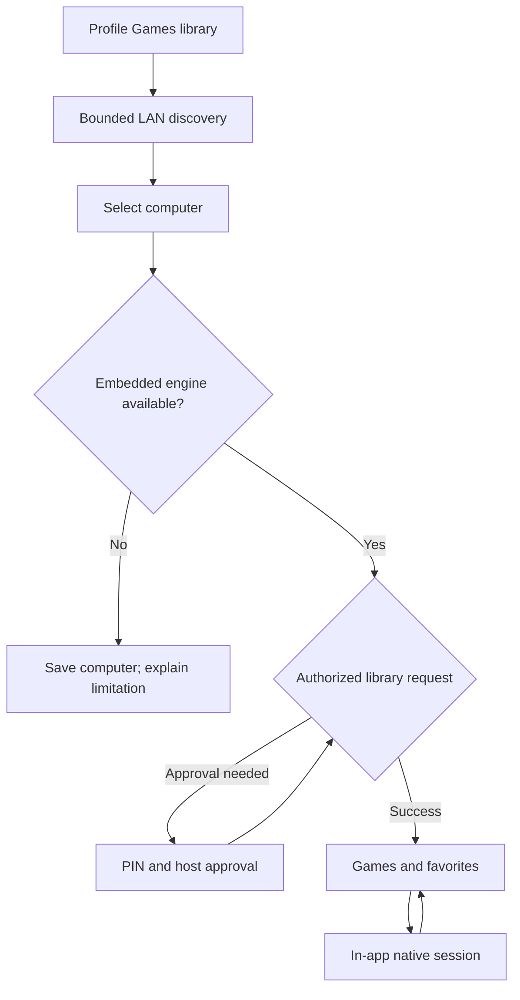

# Games: embedded streaming implementation and rollout

Status: implementation in progress, 2026-10-26. **No stream launches another app.**

## What this change implements

The optional Games category follows PlezyNG's profile preference, navigation rail, poster-card grid, monochrome themes, shared menus and dialogs. The grid shares the media browser’s density, spacing, corner tokens and poster-only TV focus outline, matching the direction discussed in the plezyng.app repository. Recent games, favorites and the full library use the same cards; computer management remains below the library. Authenticated host cover requests use a bounded memory cache and a themed missing-art fallback. It remains accessible when a media server is offline. Games never routes through the movie player. Android Automotive does not expose this category, matching the app's existing interaction restrictions.

The library stores selected computers, host application IDs, favorites and recent launches in the existing profile-scoped repository. It discovers GameStream hosts over mDNS and Steam hosts over bounded UDP discovery. Discovered advertisements are suggestions: selecting one is required before persistence or pairing. Manual IPv4, IPv6 and DNS addresses cover VPNs and networks without multicast. Wake-on-LAN is an explicit action and needs a supplied MAC address.

Android builds include a **source-built Moonlight engine in PlezyNG's APK**. The adapter calls its actual pairing implementation, pins the resulting host certificate, retrieves the authorized application list, and starts its native streaming activity inside PlezyNG. Flutter owns the connection UI; the embedded engine owns low-latency video, audio, controller input and touch controls. Back returns to PlezyNG. It does not install an APK, open a package, launch Steam, invoke a URL scheme, or run a streaming subprocess.

The native source pin and preparation recipe are committed. Android hardware behavior is not certified by Dart tests. See [VALIDATION.md](VALIDATION.md) for the release gates.

## User flow

1. Enable Games for the current profile in Services settings.
2. Open Games. Run one bounded local scan, without preventing manual entry.
3. Choose a computer. An already authorized computer loads its games. Otherwise show a fresh four-digit PIN and the host-approval instructions.
4. For Sunshine, optionally scan the QR on another device to open its PIN page. The code contains the host URL only. The user approves the connection on the host. Host credentials and PIN are not included in a QR or the profile library.
5. The successful native handshake supplies the pinned certificate. Load the real app list. A future tap on a game starts the in-app stream.
6. During a stream, use a physical controller or the native multi-touch controller. Disconnect leaves the host game running; quitting the host game is a separate explicit engine action.

A failed handshake never marks the host as paired. A missing native engine produces an explanation, not an external-app launch. Discovery is not evidence that streaming, HDR, a codec, or authentication is supported.

## Native boundary

`GameStreamingClient` exposes capabilities, pairing, application listing, opening a game and cancellation. Its `com.plezy/games` method-channel implementation passes structured arguments. It advertises only the engine actually compiled into the application. It deliberately has no installed-client fallback.

Android's `GamesChannel` owns a serial worker, pending result, cancellation generation and bounded multicast-lock lifetime. The optional `:moonlight` library exposes a small Java adapter. The source recipe makes upstream activities/services private, removes launcher intent filters and provider exports, and retains PlezyNG's application identity, backup rules and network policy. The stream surface uses the native engine's activity because placing the decoder behind Flutter's ordinary video buffering or a platform-view composition hop would require additional latency validation.

The adapter persists only the host certificate after successful PIN verification. The engine's identity key and certificate stay app-private and are excluded from cloud backup/device transfer. Device pairing is shared across PlezyNG profiles; library visibility is profile-specific. Hiding/deleting a profile is not a host-side revocation. The UI says so. A future profile-specific native trust store would require isolating the upstream engine's identity and preferences as well as the library.

Retiring a profile, disabling the category or disposing its controller cancels unfinished operations. The Dart controller rejects late results and serializes persistence; repository tombstones prevent writes from resurrecting deleted profiles. Native cancellation interrupts the pending HTTP dispatcher without silently unpairing the host. PIN requests also have a deadline. Native error text is not sent to Dart or logged with connection credentials.

## Platform matrix

“Implemented” below means code is present. It does not mean hardware qualification has passed.

| Platform | Games/library | In-app GameStream in this change | Steam / Pyrowave in this change | Next native integration |
|---|---|---|---|---|
| Android phones/tablets | Implemented | Source module, pairing, listing, native activity, touch controls | Discovery only; playback unavailable | Run native/device matrix; refine theme integration |
| Android TV / Fire TV | Implemented | Same source engine; physical input; touch overlay off by default on TV | Discovery only | D-pad, back, 4K/refresh-rate and controller qualification |
| Windows | Implemented | Unavailable | Discovery only | Moonlight common + native decode/presentation/input adapter |
| Linux / SteamOS | Implemented | Unavailable | Discovery only | Moonlight common; VA-API/Vulkan/DRM paths and SDL input, then Steam engine |
| macOS | Implemented | Unavailable | Discovery only | VideoToolbox/Metal/CoreAudio/GameController adapter |
| iOS / iPadOS | Implemented | Unavailable | Discovery subject to LAN permission; playback unavailable | Adapt Moonlight iOS source into app-private native session; touch controls |
| tvOS | Implemented | Unavailable | Playback unavailable | Shared Apple adapter, focus/remote/gamepad testing |
| webOS | Implemented | Unavailable | Playback unavailable | Evaluate native Moonlight-webOS decoder/input components against supported TV APIs |
| Browser | Not a shipping PlezyNG target here | No raw GameStream/UDP engine | Unavailable | Explicit paired WebRTC gateway, if this becomes a product target |

Sunshine, Apollo, Wolf and legacy NVIDIA GameStream use the same broad protocol family, but variant-specific display, input, multi-user and application behavior must be tested independently. We do not label every variant supported solely because discovery succeeds. Legacy hosts get H.264/Stereo/ordinary controller fallback where the native engine actually negotiates it. Legacy GFE's retirement does not itself remove the protocol from Moonlight.

## Steam: legacy, current and beta

The official Steam Link SDK is for applications running **on Steam Link hardware**. Steamworks `ISteamRemotePlay` is a game-side session API. Neither is a general-purpose embeddable Steam Link client. A UI webview or `steam://` command does not satisfy in-app streaming.

An independent native implementation is feasible: **ihslib** implements discovery, authorization and streaming. A recent PS5 client reports real H.264/Opus playback using it and a fork implementing the 2026 PIN-masked X25519 handshake. That project also carries retransmission, packet-window and input fixes. Its observed success is useful evidence, not proof of compatibility with all Steam versions. The referenced fork's `auth` branch no longer resolved during research, but its exact pinned commit was retrievable; reproducible integration must use the commit and audit the patch set.

The next Steam stage is a library port, not a credential scraper:

- Build the pinned ihslib implementation with its supported crypto provider and protobuf-C. Audit the current-auth changes and the PS5 client's transport fixes individually. Run malformed-packet tests with sanitizers before accepting LAN traffic inside the app process.
- Keep the legacy PIN handshake and current X25519 exchange as versioned adapters. Choose from actual peer messages; never downgrade a failed authentication to “legacy” merely to make it connect.
- Start with local PIN pairing and saved device trust. Steam account login/Steam Guard/QR account authorization are distinct flows; they are not supplied by generic OAuth or by a discovery packet. Remote account-backed rendezvous is a separate deliverable and needs verified protocol/API support.
- Connect native decoded frames, audio and input to the same session interface. Expose Big Picture as a real remote session even when a direct app-list API is unavailable. Importing Steam games through Sunshine is useful but does not count as native Steam Remote Play support.
- Qualify current stable, beta and representative older hosts. Record exact host/client builds. Refuse unsupported authentication or codec combinations with an actionable message.

## Pyrowave is a codec, not a replacement discovery protocol

Valve announced Pyrowave in September 2026. The current announcement describes desktop beta availability and Apple/Android Steam Link betas, with SteamRT3 required on Linux. The codec prioritizes latency over bandwidth. Treat its high bandwidth as a reason for runtime qualification and user opt-in, not a reason to force maximum bitrate.

The reference implementation is MIT-licensed. Its Vulkan C API is explicitly unstable. A Metal implementation is also present at the researched revision; upstream labels it a minimally maintained convenience port that may be replaced. Both need an internal wrapper so upstream ABI changes do not leak through the Flutter/native contract.

The current observed protocol definitions contain:

| Field | Meaning |
|---|---|
| `EStreamVideoCodec = 9` | Pyrowave codec identifier |
| `CStreamingClientConfig.enable_video_pyrowave` field 35 | Client enablement |
| `pyrowave_quality_modifier` field 38 | Quality preference |
| `pyrowave_yuv444` field 39 | 4:4:4 option |
| `pyrowave_bitrate_kbps` field 40 | Current bitrate field; default -1 |
| fields 36 and 37 | Obsolete custom-bitrate fields; do not build new settings on these |
| `CNegotiatedConfig.selected_video_codec` | Negotiated codec, unlike a saved user preference |

These definitions establish identifiers, not complete packet reassembly, FEC or decoder interoperability. Do not advertise codec 9 until the native decoder has passed a local capability probe and the stream adapter can handle the received framing. Do not show “Pyrowave active” until the negotiated session and decoder agree.

Proposed policy: **Automatic**, **Compatibility**, **Prefer Pyrowave**. Automatic stays on validated conventional codecs by default. Prefer Pyrowave is an opt-in after host support, a successful Vulkan/Metal decoder probe, a local-network bandwidth test and compatible color/output capabilities. Fallback requires a clean reconnect with an explanation; it must not silently change the host's global Steam settings. HDR and 4:4:4 are separate negotiated capabilities. Hardware Steam Link and older clients must retain conventional codecs rather than receiving codec 9 unconditionally.

## Mobile controls and session quality

The Android module reuses Moonlight's actual controller implementation rather than drawing buttons that never send input. It supports simultaneous touches, sticks/buttons/triggers, configurable layout/opacity, touchpad input and physical controllers. The PlezyNG profile setting controls whether that overlay is shown. TV devices default to physical input. The native controller owns neutralization and input teardown.

For subsequent ports, keep pointer IDs stable, release every button/axis on cancellation/focus loss, support simultaneous stick + button + trigger input, safe areas, handedness, scalable controls, and physical-controller hot-plug. Do not expose a generic overlay until its input backend actually works. Rumble, gyro, microphone, keyboard/IME and multi-controller seats need separate capability flags and tests.

Session statistics should report actual codec, hardware/software decode, resolution, FPS, bitrate, loss, RTT and frame timings from the engine. Do not fabricate them from a preset. Start from conservative H.264 1080p60/stereo and let measured capabilities unlock HEVC, AV1, HDR, higher refresh rates or Pyrowave. Never change the user's host DPI, desktop layout, audio sink, UPnP or firewall settings as an incidental connection step.

## Delivery sequence

1. Review and qualify this Android embedded vertical slice; retain a build switch for constrained distributions.
2. Extract reusable native session interfaces and bring up desktop GameStream adapters, preserving the existing UI and state model.
3. Bring up Apple GameStream and webOS native adapters with platform-specific decoder/input tests.
4. Integrate and harden ihslib for legacy/current local Steam pairing and H.264/Opus sessions.
5. Add Pyrowave Vulkan and Metal wrappers, framing/FEC support, device probes and explicit fallback policy.
6. Implement remote account-backed Steam connectivity only after its authentication and rendezvous requirements are demonstrated. Extend host artwork and integrated session diagnostics across engines.

No platform is marked ready simply because its library compiles. There is no external-app fallback hidden behind these stages.

## Steam library and research evidence

See [STEAM_LIBRARY.md](STEAM_LIBRARY.md) for host inventory versus cloud ownership, authenticated direct game-ID launch, and the pinned ihslib preparation patch. See [SOURCES.md](SOURCES.md) for the primary-source trail.
