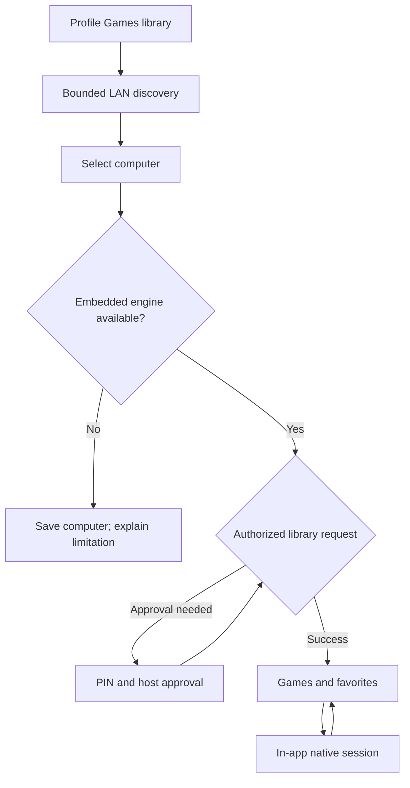

# Games: embedded streaming implementation and rollout

Status: implementation in progress, 2026-10-26. **No stream launches another app.**

## What this change implements

The optional Games category follows PlezyNG's profile preference, navigation rail, poster-card grid, monochrome themes, shared menus and dialogs. The grid shares the media browser’s density, spacing, corner tokens and poster-only TV focus outline, matching the direction discussed in the plezyng.app repository. Recent games, favorites and the full library use the same cards; computer management remains below the library. Authenticated host cover requests use a bounded memory cache and a themed missing-art fallback. It remains accessible when a media server is offline. Games never routes through the movie player. Android Automotive does not expose this category, matching the app's existing interaction restrictions.

The library stores selected computers, host application IDs, favorites and recent launches in the existing profile-scoped repository. It discovers GameStream hosts over mDNS and Steam hosts over bounded UDP discovery. Discovered advertisements are suggestions: selecting one is required before persistence or pairing. Manual addresses cover VPNs and networks without multicast; the current Steam adapter resolves IPv4, while the GameStream address model also accepts IPv6. Steam identification uses the UDP source port, not the separately advertised TCP connect port. Wake-on-LAN is an explicit action and needs a supplied MAC address.

Android builds include a **source-built Moonlight engine in PlezyNG's APK**. The adapter calls its actual pairing implementation, pins the resulting host certificate, retrieves the authorized application list, and starts its native streaming activity inside PlezyNG. Flutter owns the connection UI; the embedded engine owns low-latency video, audio, controller input and touch controls. Back returns to PlezyNG. It does not install an APK, open a package, launch Steam, invoke a URL scheme, or run a streaming subprocess.

Android also includes an experimental **source-built Steam engine** using pinned ihslib, Mbed TLS, protobuf-C and Opus. It implements local PIN pairing, encrypted host-specific device trust, direct game-ID or Big Picture launch, H.264/HEVC video, stereo Opus, one physical/virtual controller and bounded decoder queues. Pyrowave beta support is off by default for every profile. After a profile opts in, Android advertises the codec only if its local Vulkan decoder probe succeeds. It decodes SDR 4:2:0 up to 1080p through synchronous CPU readback and Android Canvas output, and reconnects using a conventional codec if decoding fails. Valve's [beta announcement](https://steamcommunity.com/groups/homestream/discussions/0/564794422009744473/) warns that Pyrowave can use 5–10× the bandwidth of other codecs and recommends gigabit Ethernet; the setting explains this before enabling. The path is experimental and its latency, power use and compatibility have not been device-qualified. The player is a private activity inside PlezyNG. Account linking now uses the server-side Steam OpenID flow; a server-owned Web API key can import visible owned-game metadata into a profile-scoped reference catalog. Private libraries remain unavailable, the catalog is not a host-installed inventory, and its entries use a matching saved Steam host shortcut for launch; account ownership alone supplies no playable route. A server without `STEAM_WEB_API_KEY` still supports identity linking but cannot import the catalog. Steam also exposes a retained `SteamStreamView` to the app-owned Multiview overlay; each surface owns its transport and decoder, while the workspace assigns audio and gamepad input. Full-screen Steam playback uses the same view.

The native source pin and preparation recipe are committed. Android hardware behavior is not certified by Dart tests. See [VALIDATION.md](VALIDATION.md) for the release gates.

## User flow

1. Enable Games for the current profile in Services settings.
2. Open Games. Run one bounded local scan, without preventing manual entry.
3. Choose a computer. An already authorized computer loads its games. Otherwise show a fresh four-digit PIN and the host-approval instructions.
4. For Sunshine, optionally scan the QR on another device to open its PIN page. The code contains the host URL only. The user approves the connection on the host. Host credentials and PIN are not included in a QR or the profile library.
5. GameStream saves the approved certificate and loads the real app list. Steam saves its negotiated device secret and displays a Steam Library card plus user-added shortcuts. A linked Steam account can import visible owned-game names and IDs for reference; the paired host's authenticated library remains the playable list.
6. Full-screen streams use a physical controller or the native multi-touch controller. On Android, Linux and Apple, Steam cards also offer Plezy's in-app Picture-in-Picture workspace surface; focus selects the controller owner and the workspace audio control selects the audible session. Disconnect leaves the host game running; quitting the host game is a separate explicit engine action.

A failed handshake never marks the host as paired. A missing native engine produces an explanation, not an external-app launch. Discovery is not evidence that streaming, HDR, a codec, or authentication is supported.

## Native boundary

`GameStreamingClient` exposes capabilities, pairing, application listing, opening a game and cancellation. Its `com.plezy/games` method-channel implementation passes structured arguments, including a separate `embeddedSurface` capability. Android, Linux and Apple Steam adapters advertise a retained surface; GameStream/Moonlight still owns an Android Activity and process-wide callbacks. Windows and other embedded receivers remain unavailable. Linux and Apple implementation and qualification status is recorded in CONNECTED_EXPERIENCE.md. The adapter deliberately has no installed-client fallback.

Android's `GamesChannel` owns a serial worker, pending result, cancellation generation and bounded multicast-lock lifetime. The optional `:moonlight` library exposes a small Java adapter. The source recipe makes upstream activities/services private, removes launcher intent filters and provider exports, and retains PlezyNG's application identity, backup rules and network policy. GameStream/Moonlight still uses its native Activity. Steam's fullscreen Activity and Multiview pane share `SteamStreamView`; the pane avoids Flutter video buffering but uses Android PlatformView/SurfaceView composition, which still needs frame-latency, clipping, focus and z-order qualification.

The adapter persists only the host certificate after successful PIN verification. The engine's identity key and certificate stay app-private and are excluded from cloud backup/device transfer. Device pairing is shared across PlezyNG profiles; library visibility is profile-specific. Hiding/deleting a profile is not a host-side revocation. The UI says so. A future profile-specific native trust store would require isolating the upstream engine's identity and preferences as well as the library. The workspace stream view closes its native handle and releases held input when the native view is disposed; hiding a pane for another pane's fullscreen presentation may recreate the view and reconnect to the selected host game.

Retiring a profile, disabling the category or disposing its controller cancels unfinished operations. The Dart controller rejects late results and serializes persistence; repository tombstones prevent writes from resurrecting deleted profiles. Native cancellation interrupts the pending HTTP dispatcher without silently unpairing the host. PIN requests also have a deadline. Native error text is not sent to Dart or logged with connection credentials.

## Platform matrix

“Implemented” below means code is present. It does not mean hardware qualification has passed.

| Platform | Games/library | In-app GameStream in this change | Steam / Pyrowave in this change | Next native integration |
|---|---|---|---|---|
| Android phones/tablets | Implemented | Source module, pairing, listing and native activity; no retained GameStream pane | Experimental Steam activity plus retained Multiview surface; PIN, H.264/HEVC/Opus and profile-opt-in, Vulkan-probed Pyrowave SDR 4:2:0 | Build/qualify activity and pane, input/audio handoff, beta codec latency, thermals and power |
| Android TV / Fire TV | Implemented | Same source engine; physical input; touch overlay off by default on TV | Same experimental Steam activity and retained pane; Pyrowave requires profile opt-in and Vulkan decoder support | D-pad, Back, pane focus, beta codec performance, 4K/refresh-rate and controller qualification |
| Windows | Implemented | Unavailable | Discovery only | Moonlight common + native decode/presentation/input adapter |
| Linux / SteamOS | Implemented | Unavailable | Discovery only | Moonlight common; VA-API/Vulkan/DRM paths and SDL input, then Steam engine |
| macOS | Implemented | Unavailable | Discovery only | VideoToolbox/Metal/CoreAudio/GameController adapter |
| iOS / iPadOS | Implemented | Unavailable | Discovery subject to LAN permission; playback unavailable | Adapt Moonlight iOS source into app-private native session; touch controls |
| tvOS | Implemented | Unavailable | Playback unavailable | Shared Apple adapter, focus/remote/gamepad testing |
| webOS | Implemented | Unavailable | Playback unavailable | Evaluate native Moonlight-webOS decoder/input components against supported TV APIs |
| Browser | Not a shipping PlezyNG target here | No raw GameStream/UDP engine | Unavailable | Explicit paired WebRTC gateway, if this becomes a product target |

Steam account linking and owned-game metadata use the shared server-mediated UI and do not provide native streaming playback. Browser/QR behavior still needs qualification on each supported platform.

Sunshine, Apollo, Wolf and legacy NVIDIA GameStream use the same broad protocol family, but variant-specific display, input, multi-user and application behavior must be tested independently. We do not label every variant supported solely because discovery succeeds. Legacy hosts get H.264/Stereo/ordinary controller fallback where the native engine actually negotiates it. Legacy GFE's retirement does not itself remove the protocol from Moonlight.

## Steam: legacy, current and beta

The official Steam Link SDK is for applications running **on Steam Link hardware**. Steamworks `ISteamRemotePlay` is a game-side session API. Neither is a general-purpose embeddable Steam Link client. A UI webview or `steam://` command does not satisfy in-app streaming.

The experimental adapter now builds **ihslib** at `04688d19951c68bedc4370234cc1752043632cb3`. That source includes current PIN-masked X25519 and legacy authorization paths, transaction/source validation, game-ID launch, HID state and tracked video frames. Its exact dependency revisions and build recipe are committed. The older standalone game-ID patch and separately imported PS5 patch set are no longer required. The PS5 client remains an attributed controller implementation reference.

The POSIX transport has a portable C++ lifecycle wrapper and Android JNI frontend. It uses 85-second pairing and 30-second launch/session deadlines, cancellation that wakes waiters, bounded frames/audio and retained frame tickets completed at decoder output. The Android presentation callback means submission to the display surface, not measured screen scanout. Input and renderer callbacks arriving after teardown are ignored safely. Android Keystore encrypts the host secret; backups exclude it. Device trust is shared across app profiles; removing a profile's computer does not revoke the host's authorization.

The adapter supports local device PIN pairing and an independent browser-based Steam OpenID account link. The account flow does not create a Steam streaming session or internet rendezvous. A paired device gets an actual embedded Big Picture route even when catalog import is unavailable. User-added Steam AppID shortcuts send the selected game ID to the host. UI capability checks distinguish playback from account metadata and host inventory.

Conventional streaming is experimental until current stable, beta and representative older hosts are tested. Source compatibility and local regression tests cannot establish every host's handshake, launch or codec behavior. No host settings, firewall or account security controls are changed automatically.

## Pyrowave is a codec, not a replacement discovery protocol

Valve announced Pyrowave in September 2026. The current announcement describes desktop beta availability and Apple/Android Steam Link betas, with SteamRT3 required on Linux. The codec prioritizes latency over bandwidth. Treat its high bandwidth as a reason for runtime qualification and user opt-in, not a reason to force maximum bitrate.

The reference implementation is MIT-licensed. Its Vulkan C API is explicitly unstable. A Metal implementation is also present at the researched revision; upstream labels it a minimally maintained convenience port that may be replaced. Both need an internal wrapper so upstream ABI changes do not leak through the Flutter/native contract.

The current observed protocol definitions contain:

| Field | Meaning |
|---|---|
| `EStreamVideoCodec = 9` | Pyrowave codec identifier |
| `CStreamingClientConfig.enable_video_pyrowave` field 35 | Client enablement |
| `pyrowave_quality_modifier` field 38 | Quality preference |
| `pyrowave_yuv444` field 39 | 4:4:4 option |
| `pyrowave_bitrate_kbps` field 40 | Current bitrate field; default -1 |
| fields 36 and 37 | Obsolete custom-bitrate fields; do not build new settings on these |
| `CNegotiatedConfig.selected_video_codec` | Negotiated codec, unlike a saved user preference |

The pinned decoder accepts concatenated codec packets in a single `push_packet` call. The v1 bitstream document is frozen at 2026-10-03; source remains authoritative. Aurora/Solarflare provide a separate GameStream integration, which does not establish compatibility with Steam's framing or codec fork.

These definitions establish identifiers, not Steam interoperability. The Android adapter advertises codec 9 only when the profile-scoped opt-in is enabled and a local Vulkan decoder probe succeeds; it prefers Pyrowave only when the host offers it. It appends bounded codec blocks without H.264/HEVC start-code rewriting and validates bitstream lengths, dimensions and SDR 4:2:0 color metadata before decode. The preference defaults off, following Valve's default-off guidance for a codec that can use 5–10 times the bandwidth of other streaming codecs. Negotiation has a protocol regression fixture. If initialization, frame validation, decode or Canvas presentation fails after negotiation, the client cancels that session and reconnects with H.264/HEVC.

This first Android path is limited to BT.709 SDR 4:2:0, even dimensions, and 1920x1080. It uses Pyrowave's synchronous CPU readback path (documented upstream as a bring-up path), converts to an Android bitmap, and submits it through a `SurfaceView` Canvas. This keeps presentation in PlezyNG but may cost substantial latency, CPU, memory bandwidth and battery at high resolutions; the Vulkan probe proves decoder creation only, not sustained performance. HDR, BT.2020, 4:4:4, Vulkan-to-surface zero-copy, Metal, other platforms and real Steam-host compatibility are not implemented or claimed. Conventional codecs remain in the advertised list for compatibility. Do not treat Pyrowave as release-qualified until it passes actual Steam stable/beta hosts and phone/TV hardware measurements.

## Mobile controls and session quality

The GameStream Android module reuses Moonlight's actual controller implementation rather than drawing buttons that never send input. It supports simultaneous touches, sticks/buttons/triggers, configurable layout/opacity, touchpad input and physical controllers. The PlezyNG profile setting controls whether that overlay is shown. TV devices default to physical input. The native controller owns neutralization and input teardown.

The Steam adapter implements a separate simultaneous-touch overlay with two sticks, D-pad, face/shoulder/trigger buttons and menu controls, plus a single physical gamepad and basic USB-HID keyboard input. Its current layout and opacity are fixed. Rumble, gyro, multiple controller seats, full IME and physical mouse/wheel coverage are not implemented. It resets input on menu/background/disconnect.

For subsequent ports, keep pointer IDs stable, release every button/axis on cancellation/focus loss, support simultaneous stick + button + trigger input, safe areas, handedness, scalable controls, and physical-controller hot-plug. Do not expose a generic overlay until its input backend actually works. Rumble, gyro, microphone, keyboard/IME and multi-controller seats need separate capability flags and tests.

Session statistics should report actual codec, hardware/software decode, resolution, FPS, bitrate, loss, RTT and frame timings from the engine. Do not fabricate them from a preset. Start from conservative H.264 1080p60/stereo and let measured capabilities unlock HEVC, AV1, HDR, higher refresh rates or Pyrowave. Never change the user's host DPI, desktop layout, audio sink, UPnP or firewall settings as an incidental connection step.

## Delivery sequence

1. Review and qualify this Android embedded vertical slice; retain a build switch for constrained distributions.
2. Extract reusable native session interfaces and bring up desktop GameStream adapters, preserving the existing UI and state model.
3. Bring up Apple GameStream and webOS native adapters with platform-specific decoder/input tests.
4. Qualify and harden the implemented ihslib adapter against legacy/current local Steam pairing and conventional-codec sessions.
5. Optimize and qualify Pyrowave output (prefer a GPU-to-surface path), measure Android power/latency, and validate Steam framing against beta hosts before widening the currently bounded Android experiment; add Metal and other platforms only with their own adapters.
6. Implement authenticated internet rendezvous and native game playback adapters outside Android, with an explicit relay/trust model and platform-specific decoder/input qualification. Extend host artwork and integrated session diagnostics across engines.

No platform is marked ready simply because its library compiles. There is no external-app fallback hidden behind these stages.

## Steam library and research evidence

See [STEAM_LIBRARY.md](STEAM_LIBRARY.md) for host inventory versus cloud ownership, authenticated direct game-ID launch, and the compiled native Steam adapter. See [SOURCES.md](SOURCES.md) for the primary-source trail.
