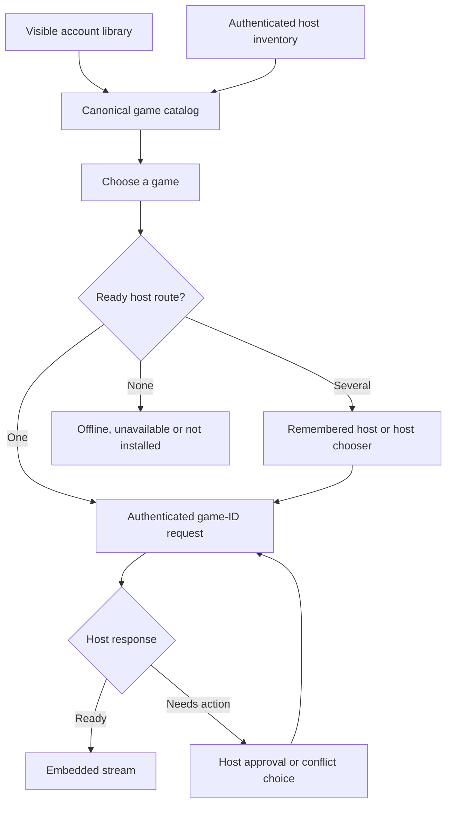

# Steam library and one-tap launch

Research date: 2026-10-26. The desired interaction is **link computer/account once → browse games in PlezyNG → choose a game → play inside PlezyNG**. A linked streaming device, a Steam account identity, an owned-game list and an installed host inventory are separate capabilities.

## Evidence and confidence

| Capability | Evidence | Confidence and limit |
|---|---|---|
| Owned games with names/icons | Valve's `IPlayerService/GetOwnedGames` accepts `steamid`, a Web API key, and `include_appinfo`; visibility controls apply | High that the API exists. This does not identify which host has a game installed or grant private-library access after device PIN pairing |
| Host-specific installation/status updates | `CMsgRemoteClientAppStatus` carries app IDs, installation state, update/cloud status and shortcut metadata | High for the schema. Unknown that a Steam Link-style PIN session alone is authorized for this Steam-to-Steam control channel |
| Direct game launch in a device stream request | `CMsgRemoteDeviceStreamingRequest.gameid`, field 19 | High for the field. Requires an authenticated host, compatible request handling and an actual embedded playback engine |
| Direct launch with progress and conflict results | `CMsgRemoteClientStartStream.app_id` and response launch-task/cloud-conflict fields | High for the schema. This is a separate control path; do not confuse it with device broadcast pairing |
| Current ihslib device pairing | The pinned fork exposes host-specific secret keys and authorization callbacks | Moderate for portability: source and another project's working client exist; PlezyNG has not qualified it on hardware |
| App-specific launch through the pinned ihslib C API | The upstream request struct lacked game ID even though generated protobuf types contain it | Adapter patch prepared and checked against the pinned sources; runtime unverified |

The public metadata route can automatically use the Steam ID returned by a successful authorization where visibility allows it. A product-managed backend may supply a Web API credential; do not put a developer key in the app binary or require every ordinary user to obtain one. Steam OpenID establishes identity; it must not be treated as a grant to read a private library or start streams. Private/Family/non-Steam entries require a separately verified authenticated inventory route.

## Chosen architecture

Use **host inventory as the authority for “Play now.”** Account ownership supplements it; it never turns an uninstalled game into a playable shortcut. The preferred host inventory route is a verified authenticated Steam control channel. If that is unavailable to a paired device, a narrowly scoped optional host helper can read the signed-in host's Steam library manifests and expose a bounded, authenticated inventory. A helper is additional host setup, not a hidden requirement falsely presented as ordinary Steam pairing.

The helper alternative should read `libraryfolders.vdf`, installation manifests, host-local app metadata and explicitly shared non-Steam shortcuts. It must not scan unrelated files, upload the user's whole filesystem, or derive authorization from local-network presence. Pair it separately, pin its certificate, and accept only game IDs from a fresh advertised inventory. If distribution requires a helper, integrate its installer into the host setup flow and clearly label its purpose.

A second optional source can load visible account-owned games. It enriches names/icons and displays “Not installed” entries, with a separate install action only after a verified remote-install control path exists. A denied/private account library is an unavailable source, not an authoritative empty list; preserve cached entries and explain the refresh limitation.

Canonical game identity is the Steam AppID for Steam apps and a host-scoped shortcut ID for non-Steam apps. Preserve 64-bit game IDs as strings or native uint64 values; JavaScript numbers must not round them. Attach zero or more host routes to each game. Do not infer Family Sharing eligibility or bypass parental/host restrictions from an ownership list.

## One-tap behavior

- Show the saved library immediately; refresh host state in the background.
- For one available compatible host, start directly. With several, prefer the user's remembered host if still ready; otherwise show a compact chooser.
- Wake only a host with a known, user-configured MAC and Wake-on-LAN support. Wait for an actual host response with a deadline. A sent magic packet is not proof that the host woke.
- Send the selected game ID through the authenticated native transport. Negotiate codec, audio and input; mount the native session inside PlezyNG.
- Preserve host launch states such as updating, screen locked, busy, parental approval, cloud-save conflict, EULA or launch-option choice. “One tap” must not silently accept agreements or choose between conflicting saves.
- Track recent launch only after a native launch request is accepted. Display actual session connection state separately. Cancellation must stop connection work without launching later from a stale callback.

## Concrete work in this change

The profile-scoped game library, favorites, recent launches, native `games(host)` boundary and game-ID launch arguments are implemented. The Android GameStream adapter already fills this library from a paired host's app list. Steam remains capability-gated because its playback engine and authenticated library source are not connected yet.

`scripts/games/patches/ihslib-game-id.patch` extends the pinned IHS request with a uint64 game ID and serializes the already-defined protobuf field. Zero preserves upstream Big Picture/Desktop behavior. It must be rebuilt with the library and its consumers: this changes the C struct ABI and is not safe to apply to a prebuilt binary. It is a reviewed preparation patch, not a claim that Steam launching works in this release.

## Acceptance tests before enabling Steam library playback

1. Public and private game details; Family Sharing eligibility; free titles; non-Steam shortcuts.
2. Same game on two hosts; host rename/IP change; account switch; profile switch mid-refresh; revoked device key.
3. Large library, missing artwork, partial/delta update, offline refresh and stale cached inventory.
4. Installed/uninstalled/updating/borrowed/busy/locked states; game-ID launch to the selected host.
5. Legacy and current PIN exchanges; current Steam stable and beta; host changes a codec or requests unsupported input.
6. Cloud-save conflict, EULA, parental lock and launch-option prompts without automatic acceptance.
7. Exactly one stream per tap; cancellation before handshake, during launch and after native surface creation.
8. Conventional-codec fallback when Pyrowave is unavailable, without losing selected game or host.

## Sources

- [Valve IPlayerService documentation](https://partner.steamgames.com/doc/webapi/IPlayerService#GetOwnedGames)
- [Valve authentication overview](https://partner.steamgames.com/doc/features/auth)
- [Observed device discovery/stream request schema](https://github.com/SteamTracking/Protobufs/blob/master/steam/steammessages_remoteclient_discovery.proto)
- [Observed remote-client inventory and launch schema](https://github.com/SteamTracking/Protobufs/blob/master/steam/steammessages_remoteclient.proto)
- [Pinned ihslib client API](https://github.com/scaronni/ihslib/blob/f68de5f07e0c27ccea9f47f9f5e38fd92c99919e/include/ihslib/client.h)
- [Pinned ihslib stream request serializer](https://github.com/scaronni/ihslib/blob/f68de5f07e0c27ccea9f47f9f5e38fd92c99919e/src/client/streaming.c)

The observed protobuf repositories are implementation evidence, not a Valve guarantee of a supported public API.
