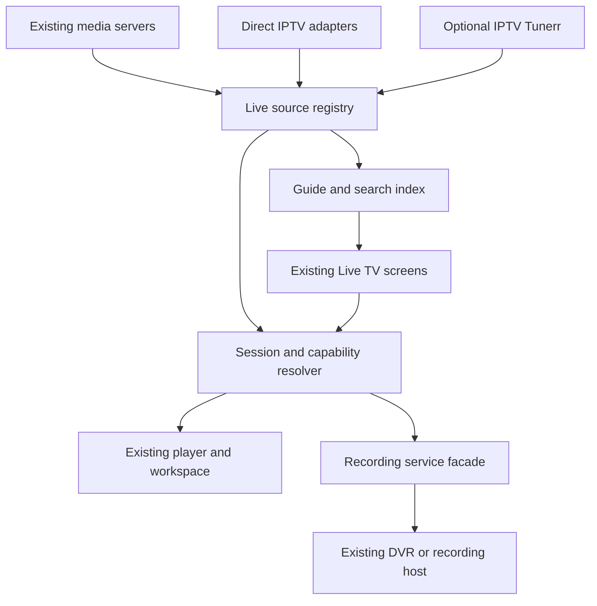
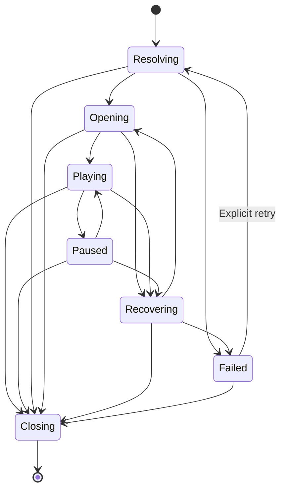

Warning: truncated output (original token count: 45712)
Total output lines: 1498

# PlezyNG IPTV — comprehensive research and implementation plan

Prepared 27 October 2026 in America/Regina. Repository baseline: `snapetech-org/PlezyNG` main at `0d0626cc375b8fa95124775365a6b37e2a03c9be`.

**30 product families · 61 source groups · 18 repository evidence groups · 240 requirements · 42 implementation slices.**

Build IPTV into the existing Live TV experience through a typed source registry. Keep direct playlist/provider playback self-sufficient; use an optional durable service for shared streams and unattended recording. Reuse PlezyNG's guide, player, search, libraries, profile boundaries, themes, icons, menus and focus behavior. Advanced features belong in contextual actions and source details.

This report contains the complete research, design, feature inventory and implementation handoff. The accompanying **PlezyNG-IPTV-Luna-Handoff.zip** contains the same modular documents plus machine-readable requirements and dependencies. Begin implementation with PR00 and PR01 after reconciling the current repository; no application code was changed for this planning request.

That statement records the state when this plan was prepared. Implementation began afterward; the current delivery status is tracked in [DELIVERY.md](DELIVERY.md).

**Confidence:** high in the integration architecture and static repository findings; moderate in qualitative demand ordering; low in effort estimates and unmeasured comparative advantages. Runtime and competitive claims have explicit validation gates.

## Contents

1. [IPTV market research and product decisions](#iptv-market-research-and-product-decisions)
2. [PlezyNG IPTV product and architecture plan](#plezyng-iptv-product-and-architecture-plan)
3. [Numbered IPTV feature and acceptance inventory](#numbered-iptv-feature-and-acceptance-inventory)
4. [Delivery sequence and release validation](#delivery-sequence-and-release-validation)
5. [Luna implementation handoff](#luna-implementation-handoff)
6. [Sources and repository baseline](#sources-and-repository-baseline)

## IPTV market research and product decisions

Research date: 27 October 2026, America/Regina. Target: the existing Live TV experience in `snapetech-org/PlezyNG`. “PlezyTV” is treated as the requested IPTV experience inside PlezyNG, not a new application or brand.

The strongest opportunity is a coherent television system: effortless direct playback, persistent guide and channel organization, honest time controls, recoverable recordings, optional household infrastructure, and the same interaction language as the rest of PlezyNG. Feature count alone is insufficient. Low latency, buffering tolerance, power consumption, device compatibility and simultaneous stream count conflict; the plan makes those tradeoffs explicit.

**Confidence:** high for documented capabilities and inspected repository structure; moderate for the importance of recurring user pain; low for unmeasured performance advantages and delivery estimates. Universal superiority is an ambition, not an established result. The release criteria below define what must be measured before making comparative claims.

### How to interpret the evidence

The survey covers 30 products or product families across dedicated players, media servers, IPTV gateways, virtual-channel systems and subscription-TV experience benchmarks. These are representative coverage, not a claim to have examined every application ever shipped. Official documentation, developer listings, repository code, issue histories and first-person reports are distinguished. Advertised features are not hands-on reliability measurements. Forum reports establish that someone encountered a problem; they do not establish failure rates or universal product defects.

Search results contain many impersonating IPTV brands. The research uses the developer's domain, linked repository or identifiable store listing where possible. Smarters and GSE naming is particularly ambiguous; do not combine similarly named applications into one feature claim. Prices are deliberately omitted because the implementation decision depends on capability, not a transient regional purchase price.

Sources are linked in [06-sources.md](#sources-and-repository-baseline). Each market row gives documented strengths followed by an explicitly inferred design lesson. “Unknown” means unverified, not absent.

### Competitive landscape

| Product or family | What the reviewed sources establish | What PlezyNG should learn and where the boundary lies |
| --- | --- | --- |
| TiviMate | TV-oriented guide, M3U/Xtream/Stalker inputs, favorites, recording, catch-up, multiview and extensive customization. The official listing says it is not optimized for touch devices. [S01](https://tivimate.com/), [S02](https://play.google.com/store/apps/details?id=ar.tvplayer.tv) | Adopt remote efficiency and immediate channel access. User requests for automatic device sync and useful recording errors remain valuable evidence, not proof of current universal defects. Keep touch and desktop first-class. [S31](https://www.reddit.com/r/TiviMate/comments/1wpio0a/would_anyone_else_like_true_cloud_sync_between/), [S35](https://www.reddit.com/r/TiviMate/comments/1qb2a4g/recording_error_logs/) |
| Sparkle TV | Multiple PVR sources, DVR, local timeshift, multiview, subtitle formats, frame-rate matching and TV home integration. [S03](https://www.sparkleplayer.com/), [S04](https://play.google.com/store/apps/details?id=se.hedekonsult.sparkle) | Treat pause/rewind as a core viewing job. Reports request bounded storage, promoting the buffer into a recording and an in-player timeshift toggle. Current resolution of those reports is unknown. [S33](https://www.reddit.com/r/SparklePlayer/comments/1wlsmne/timeshift_toggle/), [S34](https://www.reddit.com/r/SparklePlayer/comments/1th1a2j/dvr_timeshift_buffer_limit/) |
| iMPlayer | Cloud device administration, device sync, local timeshift, catch-up, reminders, multiview, downloads and Trakt integration are advertised. [S05](https://implayer.tv/) | Household setup is already a competitive feature. Prefer a usable local experience with optional coordination; do not require a new hosted account to tune a channel. Cloud-management availability is not proof of conflict-safe sync. |
| IPTVX | Rich VOD presentation, manual EPG assignment, favorites/tags, progress sync, multi-channel viewing, player selection and recording through IPTVX Media Server. Platform support is conditional. [S06](https://iptvx.app/features/) | IPTV can belong inside a polished media library. Reuse Plezy's discovery/detail flows. Verify player-specific casting/PiP behavior rather than assuming every decoder exposes system features. |
| OTT Navigator | Cross-provider grouping and duplicate folding, archive previews when supported, configurable playback and newer recording workflows. Developer FAQ documents platform and storage restrictions. [S07](https://ottnav.github.io/faq.html), [S08](https://ottnav.github.io/changelog.html) | Rich organization is useful, but every expert option need not be visible. Preserve distinct regional feeds when folding duplicates. Its developer's assessment of webOS/Tizen is a product decision, not a universal technical impossibility. |
| Smarters Pro | The identified vendor pages establish multiple playlists, local/network sources, favorites, parental controls and movie/series playback. [S09](https://smarterspro.com/features/) | Familiar source setup and clear content types are useful. Broad claims from unrelated “Smarters” apps are excluded. Do not duplicate the common separate Live/Movies/Series launcher inside PlezyNG. |
| Televizo | Multiple playlists, EPG, catch-up, Chromecast, sorting/search, favorites and track selection; backup/restore and parental controls appear in premium information. [S10](https://play.google.com/store/apps/details?id=com.ottplay.ottplay), [S11](https://televizo.net/premium-version.html) | Keep everyday mobile controls simple and source setup short. DVR depth, cross-device state conflicts and large-lineup performance are unknown from these sources. |
| IPTV Extreme | Multiple EPGs, alias mapping, recording timers, limited-duration capture, reminders, backup/restore, remote support and VOD downloads are advertised. [S12](https://play.google.com/store/apps/details?id=com.pecana.iptvextreme) | Preserve expert repair tools behind source/channel settings. “Includes EPG providers” does not make arbitrary guide data complete or correctly matched. |
| UHF | Apple-focused guide, multi-playlist search, media-server sources, catch-up, cast/PiP, optional sync and a separate recording server. [S13](https://apps.apple.com/ca/app/uhf-love-your-iptv/id6443751726) | A companion recorder can keep TV UI light. Native feel and automatic reconnect are useful patterns; store claims about reliability are not comparative test results. A built-in VPN is optional scope, not a prerequisite for IPTV. |
| Snappier IPTV | Profiles, combined playlists, category/name overrides, metadata correction, sync, recordings, downloads and up to nine simultaneous streams are advertised. [S14](https://apps.apple.com/us/app/snappier-iptv/id1579702567) | Persistent local corrections and per-profile state matter. Nine streams is an advertised upper feature limit, not an appropriate PlezyNG baseline for every TV chipset. |
| GSE SMART IPTV LITE/PRO family | The identified developer listing describes M3U/JSON inputs, XMLTV compression formats, recording, reconnect and broad track/subtitle support. [S15](https://apps.apple.com/ca/app/gse-smart-iptv-lite/id1293450217?mt=12) | Import/export interoperability and compatibility diagnostics matter. Do not conflate this listing with newer similarly named subscription apps. |
| ProgTV/ProgDVB | Recording, scheduler, PiP/mosaic, timeshift, tuner protocols, radio, teletext and detailed channel management are documented. [S16](https://progdvb.com/progtva.html) | Carry forward broadcast essentials, including accessibility tracks and radio. An unbounded buffer is not an acceptable PlezyNG default. Capability depth must coexist with quiet defaults. |
| Formuler MYTVOnline3 | Pinned groups, universal search, backup/restore, PiP, timeshift, concurrent viewing/recording and a sports area are marketed. Refresh documentation separates downloading from applying content updates. [S17](https://www.formuler.tv/mytvonline3), [S18](https://support.formuler.tv/kb/article/210-refresh-mytvonline-3/) | Stable groups and sports discovery are useful. PlezyNG should apply safe catalog changes atomically without demanding a confusing second refresh or disturbing active playback. Hardware-bundled integration is not portable by assumption. |
| Ministra Player | Provider-authorized portal setup, category/favorite navigation, archives, notifications, tracks, subtitles and parental controls are documented. [S19](https://wiki.infomir.eu/eng/ministra-players/ministra-player-android) | Keep portal authentication and token renewal inside an adapter. Provider dialects need compatibility fixtures; portal support cannot be inferred from accepting a URL. |
| Kodi IPTV Simple | Detailed M3U properties, XMLTV, catch-up dialects and timeshift through inputstream components are documented. [S20](https://github.com/kodi-pvr/pvr.iptvsimple) | Use it as an interoperability reference. Separate playlist metadata from executable player directives. Multiple catch-up modes prove that a single guessed URL template is insufficient. |
| IPTVnator | Desktop/web-oriented playlist import, Xtream/Stalker, XMLTV, archive playback, external and experimental embedded players, VOD/downloads and radio are documented. [S21](https://github.com/4gray/iptvnator) | Open issue history gives concrete ingestion and lifecycle test cases. Large-EPG issue #784 was closed after an unanswered retest request; #815's noisy background error was fixed. Neither may be described as an established current defect. [S38](https://github.com/4gray/iptvnator/issues/784), [S39](https://github.com/4gray/iptvnator/issues/815) |
| Fred TV, formerly Open TV | M3U/Xtream import, multiple sources, record-while-watching, remote input, custom channels and restreaming are documented. [S22](https://github.com/Fredolx/open-tv) | Fast desktop entry and low ceremony matter. Performance language is vendor positioning; test speed independently. |
| Channels DVR | Unified live TV/DVR/library, series/team recording, commercial handling, tuner sharing, virtual channels and configurable collections/settings. [S23](https://getchannels.com/live-tv/), [S24](https://getchannels.com/docs/apps/usage/settings/) | Learn DVR durability and household organization. Its multiview documentation explicitly excludes pause/rewind and virtual channels and limits supported devices. That is a precise opportunity, not “no multiview.” [S25](https://getchannels.com/docs/apps/usage/multiview/) |
| Plex Live TV/DVR | Tuner-based live TV, recording, guide mapping, quality preferences and commercial detection. Recording requires Plex Pass in the reviewed documentation. [S26](https://support.plex.tv/articles/115007689648-watching-live-tv/) | Preserve existing Plezy Plex integration. Direct IPTV must not require a tuner-emulation/Plex detour. Do not imply that a proxy is officially supported by Plex merely because it emulates a tuner. |
| Jellyfin Live TV | M3U/network tuner inputs, XMLTV, recording and radio are documented. [S27](https://jellyfin.org/docs/general/server/live-tv/) | Preserve self-hosted choice and current adapters. An open web-client issue illustrates confusing seek ranges; Plezy already has a more explicit timeline model to extend. [S37](https://github.com/jellyfin/jellyfin-web/issues/4840) |
| Emby Live TV | M3U tuners, guide sources and manual channel mapping are documented. [S28](https://emby.media/support/articles/Live-TV.html) | Build against advertised user/server capabilities and entitlement state. Avoid making Plezy depend on administrative configuration access merely to watch. |
| NextPVR | Whole-home DVR with guide, recordings, search, remote-oriented UI and web scheduler across server platforms. [S29](https://nextpvr.com/) | Reuse established DVRs where users have them. A new native management adapter is later scope; standard streams are the first interoperability path. |
| Tvheadend | HTSP exposes subscriptions and timeshift operations; documented server APIs include timeshift. [S30](https://docs.tvheadend.org/documentation/development/htsp/client-to-server-rpc-methods) | Server-owned buffering offers real capability beyond a playlist. Native HTSP needs protocol/version tests; M3U/XMLTV is a simpler initial bridge with reduced semantics. |
| xTeVe | M3U/XMLTV merge/export, channel mapping/filtering, adjustable tuner count and stream buffering/relay. [S45](https://github.com/xteve-project/xTeVe) | A gateway can make incompatible servers usable, but is not a complete client UX. Keep orchestration and guide repair out of the ordinary viewing surface. |
| Threadfin | Builds on xTeVe with channel/filter organization and a RAM buffer, retaining mapping, merge/export and relay functions. [S46](https://github.com/Threadfin/Threadfin) | Make persistent channel identity survive upstream reorder and refresh. RAM buffering and DVR retention solve different jobs. |
| Dispatcharr | Multi-source curation, proxy/failover, shared upstream streams, EPG matching, VOD, DVR, archive support, output profiles and access control. [S47](https://dispatcharr.github.io/Dispatcharr-Docs/) | Reliability infrastructure already exists in this market. Its documentation distinguishes proxy recovery from redirect handoff; release notes show why session ownership and recording identity require regression coverage. [S48](https://dispatcharr.github.io/Dispatcharr-Docs/troubleshooting/), [S49](https://github.com/Dispatcharr/Dispatcharr/releases) |
| ErsatzTV | Custom channels from personal media, EPG/scheduling, server integration and transcoding. [S50](https://ersatztv.org/) | Virtual channels are proven, not novel. Treat generated schedules as television, with explicit provenance and timezone behavior. The reviewed site distinguishes Legacy maintenance; verify the chosen branch before adopting code. |
| Tunarr | Builds scheduled channels from media libraries and publishes tuner/M3U output; supports programming and filler concepts. [S51](https://tunarr.com/) | Offer “Make a channel” from an existing collection when a capable server exists. Leave station engineering in its administration UI. |
| YouTube TV | Team/show library recording, partial-recording replacement, custom multiview and sports views are documented. Stats can be aligned to delayed playback. Official multiview pages differ on some package restrictions. [S52](https://support.google.com/youtubetv/answer/13418774?hl=en), [S53](https://support.google.com/youtubetv/answer/7129564?hl=en), [S54](https://support.google.com/youtubetv/answer/9119412?hl=en) | Use as an interaction benchmark, not an arbitrary-playlist backend. Spoiler-safe sports context needs timed event data. Recheck entitlement rules rather than importing contradictory package claims. |
| Fubo | Contextual multiview entry, selectable audio and fullscreen return are documented; availability varies by device/content. [S55](https://support.fubo.tv/hc/en-ca/articles/360051428731-How-does-Multiview-work-on-Apple-TV) | Preserve a simple remote path: add a view, choose audio, enlarge, return. Content-specific restrictions show why UI must expose capability per session. |

IPTV Tunerr is a related project to reuse, rather than a competitor: its documented ingest, guide repair, stable channel DNA, recovery, publishing and virtual-channel features form a possible optional service tier. The plan does not assume that its existing operator endpoints are a stable, scoped consumer API. [S56](https://github.com/snapetech-org/iptvtunerr/blob/main/docs/explanations/architecture.md), [S57](https://github.com/snapetech-org/iptvtunerr/blob/main/README.md)

### User requests and observed failure patterns

Status is stated as of the reviewed evidence. An old request with no confirmed resolution is **unknown**, not automatically still missing. Proposed responses below are design decisions, not claims that competitors cannot implement them.

| Evidence | Request or problem | Status and confidence | PlezyNG response |
| --- | --- | --- | --- |
| TiviMate September 2026 request [S31](https://www.reddit.com/r/TiviMate/comments/1wpio0a/would_anyone_else_like_true_cloud_sync_between/) | Automatic sync of favorites, ordering, hidden groups, history and progress across TVs | First-person request; current fulfillment unknown; moderate | Optional profile sync with stable identities and conflict handling, not backup-file shuffling |
| TiviMate October 2024 discussion [S32](https://www.reddit.com/r/TiviMate/comments/1g9umso/) | Resume VOD on another device without remembering the timestamp | Historical corroboration; moderate | Unify qualified VOD progress with existing continue-watching flows |
| Sparkle September 2026 request [S33](https://www.reddit.com/r/SparklePlayer/comments/1wlsmne/timeshift_toggle/) | Toggle timeshift from player controls | Current request; resolution unknown; moderate | Contextual pause-buffer mode with clear storage scope |
| Sparkle May 2026 report [S34](https://www.reddit.com/r/SparklePlayer/comments/1th1a2j/dvr_timeshift_buffer_limit/) | Buffer grows while a stick remains awake after the display turns off | Report, not independently reproduced; moderate | Hard byte/time/free-space caps and platform-aware background policy |
| Same report [S34](https://www.reddit.com/r/SparklePlayer/comments/1th1a2j/dvr_timeshift_buffer_limit/) | Save already buffered content when recording starts | Request; current resolution unknown; moderate | Promote retained segments and disclose the earliest saved time |
| TiviMate January 2026 report [S35](https://www.reddit.com/r/TiviMate/comments/1qb2a4g/recording_error_logs/) | A partial recording has an error marker without a useful explanation | First-person report; moderate | Show duration captured, missing intervals, reason and recovery action |
| TiviMate April 2026 report [S36](https://www.reddit.com/r/TiviMate/comments/1sx7ixr/longer_recording_time_wont_play/) | Long recording has broken duration and seeking | Report; cause not established; moderate | Segment ledger, discontinuity-aware index and partial-file recovery |
| Jellyfin web #4840 [S37](https://github.com/jellyfin/jellyfin-web/issues/4840) | Clickable programme bar exceeds actual rewind window | Open in retrieved issue; high for status | Render programme time and playable range separately |
| IPTVnator #784 [S38](https://github.com/4gray/iptvnator/issues/784) | Large guide import terminates and stale refresh status misleads | Closed 16 October after no retest response; high for history, unknown current defect | Bounded streaming parse, transactional publish and last-success timestamps |
| IPTVnator #815 [S39](https://github.com/4gray/iptvnator/issues/815) | Background EPG failures repeatedly interrupt the user | Maintainer says fixed; high | Quiet partial loading and actionable source-level status |
| IPTVnator #1400 [S40](https://github.com/4gray/iptvnator/issues/1400) | Portal fails when IPv6 DNS exists but IPv6 routing does not | Report; current fix status unverified; moderate | Address-family fallback and source-level network diagnostics |
| IPTVnator issues index [S41](https://github.com/4gray/iptvnator/issues) | Advertised HLS fails without MPEG-TS fallback; removed EPG leaves old programmes | Listed request/report; verify issue before attribution; moderate | Negotiated output fallbacks and source-generation invalidation |
| Channels failover request [S42](https://community.getchannels.com/t/channel-failover/37465) | Prefer a source but switch when it becomes untunable | Historical request; current native status unknown; moderate | Explicit equivalent-feed sets and bounded recovery |
| Channels multiview discussion plus current docs [S43](https://community.getchannels.com/t/ability-to-view-multiple-streams-at-once-multiview/29391), [S25](https://getchannels.com/docs/apps/usage/multiview/) | Multiview with uncomplicated audio/focus; pause/replay desired | Basic multiview now shipped; pause/rewind excluded in docs; high | Reuse workspace and then qualify independently buffered panes |
| Channels current feature index [S44](https://community.getchannels.com/c/channels-dvr/feature-requests/27) | Cached logos, EPG override, source/quality-aware recordings, subtitle defaults, virtual-channel hours and metadata repair | Requests visible; individual resolution not established; moderate | Durable overrides, metadata provenance and context-specific advanced options |
| OTT Navigator FAQ [S07](https://ottnav.github.io/faq.html) | Platform background/startup and file-picker restrictions | Developer-documented constraints; high | Do not promise scheduled recording on a suspended TV app |
| Formuler refresh instructions [S18](https://support.formuler.tv/kb/article/210-refresh-mytvonline-3/) | Downloaded channel updates require an apply/restart action | Documented workflow; high | Atomic refresh with focus and playing-session preservation |
| Dispatcharr troubleshooting [S48](https://dispatcharr.github.io/Dispatcharr-Docs/troubleshooting/) | Redirect mode cannot provide the same ongoing failover as proxy mode | Documented mode limit; high | One recovery owner; explain direct versus managed playback capability |
| Dispatcharr release notes [S49](https://github.com/Dispatcharr/Dispatcharr/releases) | In-progress recording seeks, disconnect leaks, guide edits changing bookings and retry exhaustion required fixes | Resolved examples in release notes; high | Turn the failure classes into tests rather than label the product broken |
| YouTube TV sports documentation [S54](https://support.google.com/youtubetv/answer/9119412?hl=en) | Sports context aligned to delayed viewing without spoilers | Existing capability; high | Timed event feeds, never live scores over a delayed game by default |
| Snappier listing [S14](https://apps.apple.com/us/app/snappier-iptv/id1579702567) | Rename/category/metadata corrections persist and synchronize | Existing competitive capability; high for listing | Preserve user overlays across upstream refreshes |
| IPTVX documentation [S06](https://iptvx.app/features/) | Repair channel-to-guide assignment manually | Existing capability; high | Make matching inspectable and reversible with a compact preview |

### Features that are difficult for concrete reasons

| Capability | Why it is hard | Decision |
| --- | --- | --- |
| Identical controls on every platform | Decoder surfaces, background execution, storage and audio routing differ | Shared interaction contract; qualify the underlying action per platform |
| Four or more arbitrary streams | Decoder/session/bandwidth limits, native surface composition and audio ownership | Two-stream baseline already matches existing code; four-stream expansion requires an admission broker and device proof |
| Rewind before tuning | Those bytes must exist in a provider archive, shared recorder or prior local buffer | Never invent history from the guide; distinguish archive from timeshift |
| Seamless provider failover | Feeds differ in programme, ad insertion, timing, codecs and region | Same-feed automatic recovery first; equivalent-feed switch may restart at live with an explicit notice |
| Reliable recording on a sleeping phone or TV | App process and storage may be unavailable | Prefer an always-on recording service; device capture is explicitly limited |
| One provider connection shared across devices | Requires a relay and coordinated authentication; separate clients cannot manufacture a shared session | Optional server lease authority; direct mode reports that other apps are outside its knowledge |
| Automatic EPG repair | Names collide; regional feeds and +1 channels look similar | Deterministic matching plus review; never let a fuzzy guess silently drive recordings |
| Sports ending detection and key plays | Requires reliable event data mapped to broadcast time and resilient to overtime/postponement | Advanced service feature with bounded fallback padding; no fabricated event markers |
| Provider-agnostic archives | M3U/Xtream/portal templates and time zones are inconsistent | Adapter capability and compatibility fixtures per dialect |
| Household sync without losing edits | Deletions, reorders, offline edits and changing provider IDs conflict | Versioned operations, tombstones, deterministic ordering and explicit divergent-progress choice |
| Credentials on cast devices and across redirects | Many receivers cannot repeat arbitrary headers; credentials can leak between hosts | Scoped gateway leases or tested direct receiver support |
| “All DRM” | Playback requires supported licensed platform paths and provider authorization | Typed capability, supported handoff where available; no universal DRM promise |

“Too complex” in a community reply is not proof that a feature cannot be built. In particular, the older Channels multiview discussion describes interaction complexity, and the product subsequently shipped a constrained implementation. That is evidence for staged engineering, not abandonment. [S43](https://community.getchannels.com/t/ability-to-view-multiple-streams-at-once-multiview/29391), [S25](https://getchannels.com/docs/apps/usage/multiview/)

### Product priorities derived from the evidence

1. Make setup, live tuning, guide correctness and failure recovery excellent before adding sports dashboards or more panes.
2. Make channels stable objects that survive imports, provider renames and source replacement.
3. Make every time-related action truthful: buffered, archived, recorded, estimated and live are different states.
4. Keep advanced capability discoverable where it is used, with no new primary navigation destination.
5. Reuse existing services and UI owners, including the related Tunerr project, without making direct playback depend on them.
6. Measure reliability, task success, accessibility and clutter alongside headline feature coverage.

**Recommendation confidence: high** for this ordering. The exact comparative performance and the fraction of users who need each advanced feature remain unknown until benchmark and usability work is completed.

## PlezyNG IPTV product and architecture plan

### The intended experience

Add a provider once. Its channels appear in the existing Live TV guide. Search finds channels and programmes alongside existing media. Watching uses the current player, remote controls, tracks, themes and multiview workspace. Past programmes offer Replay only when playable history exists. Recording uses an existing server or an optional recording host, with clear results and recovery. Provider movies and series can join Libraries without creating a second media application inside PlezyNG.

**Architecture recommendation confidence: high.** Detailed API shapes below are proposed contracts; they are not assertions that those APIs already exist. Runtime compatibility and performance remain moderate or unknown until qualified.

### Decisions to preserve

| Decision | Reason | Consequence |
| --- | --- | --- |
| One Live TV destination | It already exists and owns the correct viewer flow | No new IPTV, Providers or Sports primary navigation tab |
| Direct playback is self-sufficient | A playlist should not require Plex or another server | M3U/XMLTV and Xtream work with a local profile |
| Advanced server support is optional | Shared streams and durable recording need persistent infrastructure | Add Tunerr/other services through the same source setup flow |
| Adapt existing Live TV contracts | Plex/Jellyfin/Emby must retain behavior | Extract source resolution; do not replace the entire player or invent fake media servers |
| User edits overlay imported data | Refresh must not erase organization | Separate upstream snapshots, identity aliases and profile overrides |
| Time is evidence-based | Guide time does not prove captured media exists | Keep confirmed, estimated, stale and unknown time distinct |
| One owner per live session and recording | Duplicate recovery loops leak sessions and interrupt recordings | Every operation carries source, session, generation and lease identity |
| Two-video baseline | Existing coordinator has two native slots | Reuse it; four-plus streams are a separately qualified expansion |
| Quiet defaults, contextual detail | The user explicitly wants minimal additive UI | Details and advanced settings hold repair and diagnosis; normal playback stays clean |
| No universal capability flags | Provider, account, protocol, player and device differ | Compute effective capabilities for the actual operation |

### What exists and what changes

At baseline `0d0626cc375b8fa95124775365a6b37e2a03c9be`, PlezyNG already has a substantial Live TV system. Extend these owners rather than building parallel ones. The exact baseline links are B01–B18 in the source ledger.

| Existing owner | Preserve | Required extension |
| --- | --- | --- |
| `lib/screens/livetv/live_tv_screen.dart` | Guide, What's On, Recordings, favorites and tab restoration | Consume a combined source registry; derive What's On from non-Plex EPG; maintain capability-based tabs |
| `lib/screens/livetv/tabs/guide_tab.dart` | Existing row geometry, virtualized lists, focus and time navigation | Query visible channel/time windows, source-independent references, groups and archive actions |
| `guide_search_sheet.dart` | Compact guide search and companion-remote input | Indexed programme search rather than loading huge lineups into repeated client scans |
| `program_details_sheet.dart`, `record_options_sheet.dart`, `livetv_recording_actions.dart` | Shared details and recording affordances | Capability-driven Replay, Start over, Remind, Record and alternate-source actions |
| `lib/media/live_tv_support.dart` | Backend-neutral sessions and optional DVR behavior | Direct adapters plus granular capability result; normalize new recording payloads at a facade |
| `lib/media/live_tv_timeline.dart` | UTC seconds, time accuracy, seek clamping and programme intervals | Direct HLS, local buffer and archive timeline adapters without weakening existing invariants |
| `lib/utils/live_tv_player_navigation.dart` | Canonical launch and zap flow | Remove mandatory media-server lookup for direct sources |
| `lib/screens/video_player/parts/live_tv.dart` | Current player state, reconnect, teardown and controls | Resolve a typed live source; use one recovery owner and renewable session transport |
| `lib/providers/multi_server_provider.dart` | Existing server availability and transient-error behavior | Wrap it as one registry input; do not make it own unrelated playlist persistence |
| `lib/services/playback_coordinator.dart`, `lib/multiview/*` | Two video leases, audio focus and workspace restoration | Provider-connection admission, direct live descriptors and later larger-capacity qualification |
| `lib/screens/settings/add_connection_screen.dart` | Existing profile-scoped connection entry | Add one IPTV source option using the same grouped rows; generalize the row's leading icon instead of reusing its current share fallback |
| `lib/services/credential_vault.dart` | Keystore-backed encrypted secrets and lost-key behavior | Protect every IPTV secret field, including credentials embedded in URL paths/query and request headers |
| `lib/database/*`, `lib/profiles/*` | Drift, profile ownership, identity mutation and teardown | New IPTV tables and profile joins using existing profile IDs and lifecycle boundaries |
| `lib/media/search_hit.dart`, `lib/screens/search_screen.dart` | Heterogeneous typed hits and existing ranking UI | Add live-channel, airing and IPTV-VOD hits; retain provenance and correct activation routes |
| `lib/sources/universal_media_input.dart` | Safe one-off stream/playlist opening | Reuse URI validation where suitable; build a dedicated persistent IPTV importer rather than removing its current 1,000-item/2 MiB limits globally |
| `lib/media/playback_copy_ranking.dart` | Explainable source ranking and edition safety | Reuse reasoning patterns; live equivalence is a separate contract, not a reason to transplant VOD positions |

### A precise UI contract

#### Add a source

Entry: **Settings → Connections → Add connection → IPTV**. Profile detail offers the same action for its selected profile. A source-free local profile is supported. Do not require a media-server sign-in, account migration or a new global onboarding wizard.

The flow has three conceptual steps, compressed into existing adaptive screens/sheets where space permits:

1. **Connect.** Choose Playlist address/file, Provider account, or IPTV Tunerr. A pasted address is classified with a bounded probe. Xtream fields are server address, username and password. A playlist can include a signed URL; keep the entire sensitive transport description encrypted. Display a friendly source name separately. Reveal advanced headers, endpoint trust and protocol options only when needed.
2. **Choose content.** Show a preview with channel/group counts, guide availability and any skipped malformed entries. Existing provider groups are available; users can include a subset before expensive artwork/VOD hydration. Default to Live TV. Offer “Include movies and series in Libraries” only when the provider exposes them. Keep this off until selected. Do not auto-enable every provider category or inflate Home with all groups.
3. **Finish.** Commit only a validated snapshot, enter the existing Guide with the selected source/filter and put focus on the first usable channel. Guide fetching may continue quietly. Missing EPG does not block watching. A compact source status can say “Channels ready · Guide updating.”

Cancellation removes staged metadata and transient secrets. A failed refresh never removes the previous working source. Editing a provider address offers an update of the existing connection, preserving identity, rather than encouraging duplicate account creation.

Phone-assisted setup extends the existing authenticated companion-remote pairing. A TV QR code carries only an expiring pairing handle, never provider credentials. The phone reviews the target device/profile before submitting; pairing approval already established by the existing flow is reused. Do not introduce a separate remote protocol.

#### Live TV guide

Keep Guide, What's On and Recordings. Guide remains the first stable view. What's On becomes available whenever sufficiently usable current programme data exists, using the current artwork-led card treatment. Recordings appears for recordable sources or retained recordings/schedules; a transient server outage must not make the user's recordings disappear from navigation.

Normal guide chrome consists of the existing tab chips and actions, with **one compact filter entry** showing a selected group or Favorites. The filter sheet owns groups, source, language, country and quality filters. Source grouping remains available; a merged lineup is optional and never a silent migration of existing users. Do not render permanent provider-colored chips, codec labels, latency meters, sports scores or failure badges on every row.

Channel cells use current logos, title/number and favorite treatment. Programme cells show the title, time and the existing restrained status treatment where necessary. Dense guide cells should not gain a row of icons; Replay or Record is primarily discovered in programme details. Selected/focused content keeps the current focus decoration.

Moving horizontally keeps the selected broadcast-time anchor; moving vertically selects the programme intersecting that time on the next channel. “Now” returns to current guide time without retuning playback. Refresh keeps the selected channel, temporal anchor, scroll position and focused action whenever the object still exists. Removed channels get a stable nearest-neighbor fallback, not focus at the top of the application.

Guide gaps say “No programme information.” They are not fake show titles and are not used to infer episode identity. Channels can still play. A source-level guide status is available in the menu; repeated background failures do not produce repeated snackbars.

#### Channel and programme actions

| Selection | Primary action | Secondary/contextual actions |
| --- | --- | --- |
| Channel or current programme | Watch live | Start over when proven available; Record; Favorite; Open mini player; More |
| Past programme with an available archive | Replay | Record/save archive when supported; programme details |
| Past programme without playable history | Programme details | Find another airing or existing library copy; no false Play action |
| Future programme | Programme details | Record; Remind me; Other airings |
| In-progress recording | Watch from beginning or Resume | Watch live; Stop recording with clear scope |
| Partial/failed recording | Play saved portion if usable | Why it stopped; Retry from archive; Find another airing; Delete |
| Channel with equivalent alternatives | Normal Watch action | Choose source; Prefer this source; inspect equivalence |

Known unsupported actions are omitted from ordinary menus. A recoverable temporarily unavailable action may remain disabled with a short explanation in details. Do not show a dense checklist of missing features to ordinary viewers. “Record” never silently means “set a reminder.”

#### Player

Keep the existing player and auto-hiding controls. Use the existing live status/timeline and common track menus. Add a compact mini-guide through the current channel/browse action. Channel up/down and numeric entry follow the current filtered ordering, including favorites. Previous channel is per profile/session and never bypasses restrictions.

Time labels distinguish **Live**, a measured/estimated delay, and **Replay**. Do not display precise seconds behind live when the mapping is unknown. “Go live” selects the backend's actual playable edge, not the device wall-clock timestamp. Seeking never includes unavailable history. Add a buffer-protection preference within existing Playback settings: warn only when switching would irreversibly discard retained viewing history under the selected policy. Do not ask a confirmation for every ordinary zap.

A recovery attempt uses one unobtrusive player state. If a different equivalent feed is adopted, show one brief source-change explanation. If continuity is unknown, tell the viewer that playback resumed live. Do not claim a seamless transition that skipped or repeated content.

Multiview entry uses the existing **Open mini player** and workspace/session controls. A contextual **Add channel** chooser can select an empty existing slot. UI focus and audible ownership remain distinct: browsing the guide must not accidentally change audio. A channel may be fullscreen and then return to its previous layout without opening another provider session.

#### Search, Home, Libraries and Downloads

Global Search combines distinct typed results. Channel activation watches live; airing activation opens programme details or a validated Replay; future items never tune a random channel as a substitute. Show source provenance on detail/alternate-source UI, not as a permanent decorative badge everywhere.

Home may expose one compact **Live now** shelf after the user has established favorites/recent viewing or explicitly enabled it in Home layout. Unconfigured users see no IPTV tiles. Live recents are not “Continue Watching”: an expired live timestamp cannot be resumed. Continue Watching accepts recordings, VOD and genuinely addressable replay items only.

Opted-in movies and series join the existing library picker, card/detail UI and download actions. Keep the provider copy identity, edition and provenance even when matching TMDB metadata. Wrong-poster correction persists as an overlay. Watch-state/scrobble integration requires confidently matched media identity; a channel title or ambiguous EPG string is not enough.

Completed, validated offline recordings/VOD appear in Downloads using existing ownership and cleanup patterns. A channel cannot be “downloaded” as if it were a finite movie. Recording and downloading are distinct operations, with different state and cancellation semantics.

#### Settings and icons

Reuse `monoTheme`, `MonoTokens`, `AppIcon`, `Symbols.*_rounded`, `AppMenuButton`, `OverlaySheet`, `FocusedScrollScaffold`, existing confirmation/snackbar helpers and Slang localization. New icon choices must come from the current set: live television for the source type, search, star, record, history/replay, schedule/reminder, tune/filter and existing mini-player symbols. Reuse exact existing symbols where the action already exists; do not add a new icon package or alter branding.

Put source address, guide sources, group inclusion, channel overrides and repair under that source's detail. Put live buffer/latency defaults under existing Playback settings, with channel overrides in More. Put notification preferences under the existing appropriate settings surface. Put synchronization with existing backup/account settings when that capability is implemented. Retain Appearance as the only owner of font sizing, contrast, reduced motion and theme.

Use progressive disclosure: ordinary rows first; Advanced contains request headers, catch-up templates, clock offsets, output preferences and diagnostic export. A technical setting appears only when the relevant adapter supports it. Provider trademarks remain unmodified and confined to connection/service affordances.

### Source architecture

#### Registry rather than a fake media server

Introduce `LiveTvSourceRegistry` as the aggregate presentation/runtime boundary. A `ServerLiveTvSource` wraps each existing server/DVR pair from `MultiServerProvider`; a `DirectIptvSource` wraps M3U/Xtream; a `TunerrLiveTvSource` uses a verified service contract. All expose the existing live session behavior through adapters.

Do not implement a giant `MediaServerClient` full of empty movie/library methods simply to make IPTV fit. `Connection.kind` is currently a `MediaBackend`, and the existing vault only recognizes selected backend fields. Adding a string to JSON without addressing those contracts would lose data or leave secrets unprotected.

Preferred initial persistence is dedicated `IptvSources` plus `ProfileIptvSources` tables, referencing existing profile IDs and vault references. Reuse profile activation/teardown and the visible Add connection flow. Do not build a second user/profile system. Existing media-server connection tables remain unchanged in the first direct-source milestone. A later general connection abstraction is optional, not prerequisite scope.

Define a typed `LiveSourceRef` with server/DVR and direct-connection variants. Add explicit source references at channel/programme boundaries while retaining legacy server fields for backward compatibility until callers migrate. All new canonical keys use the source-qualified reference. Never manufacture a Plex/Jellyfin server ID for a direct playlist.

Change live navigation to pass a `LiveTvLaunchContext` containing source ref, channel ref, presentation data, filtered channel list and start intent. The current player still owns native construction, disposal, controls and observers. Live presentation must not trigger VOD watch-state or server-specific calls through a fabricated `MediaItem`. Refactor that narrow assumption before adding direct adapters, with unchanged existing-server tests.

#### Proposed capability contract

`LiveCapabilities` describes source-advertised operations and constraints. `EffectiveLiveCapabilities` combines them with profile permissions, account status, platform/backend support, storage, transport and current resource admission. Values use supported/unsupported/unknown/temporarily-unavailable with a reason, not a boolean that pretends unknown means true.

Capabilities include guide, archive range, restart, native live seek window, local buffer, recording-now, scheduled recording, series rules, growing-recording playback, subtitle/audio formats, multiview admission, casting, background behavior and source management. Query the relevant current session again before an action; setup-time detection is not permanent authority.

Core adapter operations are: obtain channel page, fetch schedule window, search indexed metadata, create a live/replay session, resolve a fresh transport lease, report timeline, recover or replace session, and close/discard idempotently. Recording remains an optional separate interface. Source refresh, access expiry and removal increment generation; stale results cannot repopulate another profile or revive a removed source.

#### Source types and sequencing

| Source | Initial path | Additional behavior and release gate |
| --- | --- | --- |
| Remote/local M3U plus XMLTV | Native direct adapter | Typed metadata, gzip guide, safe refresh and saved overrides |
| Xtream-compatible service | Native direct adapter | Account validation, live/VOD/series, negotiated output and provider archive dialect tests |
| Plex/Jellyfin/Emby | Existing adapters through registry | Preserve favorites and current DVR session behavior |
| IPTV Tunerr | Standard M3U/XMLTV first, versioned authenticated API when verified | Shared leases, recording, guide provenance and managed recovery |
| Dispatcharr/Threadfin/xTeVe | Standard M3U/XMLTV/tuner output | No assumption of native administration APIs; management adapters are optional |
| HDHomeRun/NextPVR/Tvheadend | Existing media-server bridge or documented stream output first | Direct native discovery/HTSP/recording adapters after protocol qualification |
| Stalker/Ministra | Later native dialect adapter | Authorized account/device data; renewal/paging fixtures and maintenance budget |
| UDP/RTP/RTSP/RTMP | Platform-tested native transport or server remux | No blanket promise across webOS/Tizen/casting; surface supported alternatives |
| DASH and protected streams | Supported native/backend path only | Manifest, license session and platform entitlement must all be supported |

M3U playlist files and HLS manifests both use similar extensions. Probe content safely: an HLS master/media playlist is a stream, not hundreds of television channels. Preserve this distinction for redirected URLs and content-type errors.

### Data ownership and identity

| Entity | Stable identity and responsibility |
| --- | --- |
| `IptvSource` | UUID, profile bindings, adapter kind, friendly name, encrypted transport reference, configuration revision |
| `SourceSnapshot` | Source ID, generation, fetched time, successful validation time, ETag/hash, import statistics and active revision |
| `ProviderChannel` | Source ID plus provider's stable ID when available; raw metadata stays separate from overrides |
| `LogicalChannel` | User/curated equivalence group of provider channels; may have a regional/edition qualifier |
| `ChannelAlias` | Old-to-current provider identity mapping with provenance, confidence and reversible history |
| `ChannelOverride` | Profile-scoped name/order/visibility/favorite/group/EPG/source preference, independent of snapshot |
| `EpgSource` and `EpgMapping` | Guide identity, refresh status and source-qualified mapping; manual choice outranks automatic match |
| `ProgrammeAiring` | Source/channel/event identity, UTC interval, metadata provenance and archive eligibility |
| `ProgrammeRevision` | Timing/title/episode changes associated with an airing; recording identity survives bounded guide corrections |
| `StreamVariant` | Protocol, credential reference, codec hints, region/edition, measured quality and expiry; not a raw URL identity |
| `PlaybackLease` | Source/profile/session/generation, one upstream allocation, expiry and resource reservations |
| `BufferSegment` | Session/epoch/discontinuity, interval mapping, path, integrity state and reference count |
| `RecordingRule` | Source-qualified series/event/manual criteria, target host, policy revision and ownership |
| `RecordingJob` | Idempotency key, reserved resources, scheduled interval, attempt state and immutable event snapshot |
| `RecordingAsset` | Committed media segments/index, captured intervals, gaps, completion outcome and storage ownership |
| `IptvVodItem` | Provider identity plus edition-qualified metadata match; distinct from a channel or broadcast airing |
| `SyncOperation` | Profile/device/revision, entity key, operation, tombstone and conflict metadata; no raw credentials |

`tvg-id` identifies a guide mapping within a namespace; it is not automatically a globally unique channel ID. Names and numbers are mutable presentation. Signed URLs are transport, not identity. `+1`, regional news, language tracks, alternate commentary, blackouts and local advertising can make apparent duplicates materially different.

When provider IDs are absent, retain a source-local generated key and matching record built from multiple stable attributes. Name normalization alone cannot merge channels. Import previews show suspected additions/removals and offer identity repair. Replacing a provider connection preserves logical favorites only after confirmed mapping. Never silently attach a child's allowed favorite to a newly substituted unrestricted feed.

Store high-volume channel/EPG indexes in Drift/SQLite with appropriate source/profile/channel/time indexes and FTS where available. Confirm FTS support in the bundled SQLite on every target; use a bounded indexed fallback if unavailable. Import on an isolate with bounded batches. Keep secrets outside searchable columns. Database schema migrations, key-loss recovery and tvOS cache-eviction recovery are first-class acceptance criteria.

### Guide ingestion and matching

Download into a staged generation; enforce encoded and decompressed byte, time, nesting, field-length and programme-count limits. Reject external entities and remote DTD expansion. Support XMLTV plain/gzip first; ZIP is optional and must have archive-entry/path/expansion limits. The parser streams records rather than building an unbounded DOM. Limits are configurable expert policy with a clear error, never silent truncation advertised as success.

Index selected channels and a bounded time horizon first. Proposed default cache: 24 hours of history plus seven days ahead; extend retained past guide only when archive/recording features need it. Preserve the last successful generation while a new one imports. Publish atomically after validation; a cancelled, timed-out or empty-invalid import cannot wipe the guide or mark refresh successful.

Timestamp handling follows XMLTV, including UTC when no explicit timezone is supplied. [S59](https://github.com/XMLTV/xmltv/blob/master/xmltv.dtd) Preserve original values and allow an explicit per-source correction for demonstrably broken feeds. Distinguish display timezone, programme timestamp interpretation and provider archive timezone. Test America/Regina, DST-changing regions, half-hour offsets, missing zones, midnight crossings and clock changes. Do not apply the same correction twice during replay URL construction.

Matching order: pinned manual mapping; exact source-qualified guide ID; maintained explicit alias; normalized exact name with compatible region/language; suggested fuzzy candidates requiring confirmation. The user sees programme examples before accepting a repair. Store match provenance and confidence. EPG sources merge per mapped channel/time interval with explicit precedence; different guides cannot blindly union duplicate airings. Missing end time is displayed conservatively and never used as a precise recording duration without a fallback policy.

Schedule reads query intersecting intervals, not only programmes whose start lies after the request boundary. Use half-open programme intervals `[start, end)`; the timeline's playable seek grid has its own inclusive final target. Retain programme snapshots referenced by recordings even after ordinary guide retention expires.

### Playback, time and recovery

Maintain separate coordinates: player-relative time, media timestamps/discontinuity epoch, programme UTC, buffer interval, provider archive interval and the observed playable live edge. A guide start time is not an anchor for the first decoded frame. HLS programme-date-time can establish a mapping, but discontinuities and provider semantics still require validation. [S58](https://www.rfc-editor.org/rfc/rfc8216.html), [S60](https://developer.android.com/media/media3/exoplayer/live-streaming)

Reuse `LiveTvTimeAccuracy` and the existing adoption point. Requested seek time is intent; only the adopted player's observed position establishes landing. A source change invalidates an old mapping. If mapping is unknown, show relative buffer position or Replay without a fabricated exact broadcast-time label. Handle paused content that ages out by explaining the retained boundary and offering the earliest available point or live.

Suggested session state machine:

Every callback checks session generation, current profile and source ownership. Rapid channel zaps cancel obsolete work and discard any session obtained after cancellation. A new session must not be adopted until its slot/connection is reserved. Teardown releases after native disposal and closes the provider session exactly once.

Recovery order: refresh an expired transport lease when appropriate; bounded retry of the same variant; negotiate a compatible variant of the same channel; use an explicitly equivalent alternative if allowed; stop with a useful diagnosis. Authentication/authorization errors are not retried forever. Honor server retry hints, use jittered backoff and a total elapsed budget. Reset transient-failure history after sustained healthy playback, but do not forget a durable user preference.

The relay owns upstream failover in managed mode; the client owns its connection to that relay. Avoid independent client and relay loops simultaneously cycling provider variants. Direct mode cannot guarantee coordinated connection limits across unrelated applications. “Unknown external usage” is a legitimate state.

Default playback policy is Balanced. Low delay and Extra buffer are optional presets under existing Playback settings, with bounded per-channel overrides. Do not promise low-latency HLS when the provider only supplies conventional segments or progressive TS. Codec fallback, HDR signaling, deinterlacing, audio passthrough, subtitle selection and frame-rate matching use current player owners and real device capabilities.

### Timeshift and archive

Three mechanisms have different ownership: a provider's archive, a backend's capture window, and a client/server ring buffer. Represent them separately even when the user sees the same Replay or Start over action.

Provider archives use explicit dialect adapters: UTC versus local timestamps, duration units, template substitutions, query/path encoding, archive retention and whether the currently airing programme is available. An archive duration field alone does not prove a specific programme is playable. Probe the selected replay on demand, not every channel continuously. Expired replay positions offer another airing or a retained recording.

Local buffering uses bounded segment files, a time index, reference counting and a hard quota. Initial product default is off unless a capable backend already supplies timeshift; offer to enable it when a direct-stream viewer first uses Pause/Start over and the platform can support it. Enabling gives a plain-language duration/storage choice. Proposed desktop/TV preset is up to 60 minutes with a 2 GiB cap and a minimum free-space reserve; the first limit reached wins. Recalibrate defaults from device tests. At 8 Mbit/s, one hour is approximately 3.6 GB before overhead, so the UI must not promise a full hour under a 2 GiB cap.

Never run a second provider pull merely to maintain a buffer when the active session can feed it. A segment used by a recording cannot be evicted until that recording has its own durable reference/copy. Buffer-to-recording promotion saves only retained intervals and states the actual start. Source failover creates an explicit discontinuity; uncertain continuity becomes a gap, not silent timestamp rewriting.

Storage pressure shortens or stops buffering before it damages an active recording. Background/screen-off policy is platform-specific and user-visible at setup. A TV display turning off is not proof that its streaming stick stopped; conversely, app suspension is not a recording service. Do not leave a hidden pane consuming provider c…15712 tokens truncated…nce backed by device evidence |
| M7 | Additional portals/tuners, experimental TV ports, compositing, sports context and optional assistance | Core contracts and explicit feasibility gates | Estimate each independently | Ship only capabilities that pass their gate |

M0–M3 totals roughly **18–31 engineering weeks**. M0–M6 totals roughly **42–73 engineering weeks**, before independently scoped M7 work. These are planning ranges, not a prediction of Luna's coding speed. More generated code does not eliminate device qualification, API compatibility work or recording-soak time.

### Repository layout and ownership

Recommended handoff placement is `docs/plezyng/iptv/`, alongside existing feature documents. These files are currently a planning package; no code branch or repository changes were made for this request.

Use new `lib/iptv/` packages for adapters, catalog/import, guide storage, playback policies, archives, buffer, recording facade and optional sync. Keep visible UI in the current screen owners where practical; a few source-setup/repair sheets can live in `lib/screens/iptv/`. Avoid pushing the entire feature into `LiveTvScreen` or another large manager.

Tunerr changes belong in its own repository and must carry a pinned API/version compatibility test. A PlezyNG release cannot assume a matching unreleased server has reached the user. Standard M3U/XMLTV operation remains available when the extended API is missing.

Dependencies are explicit in `implementation-slices.json`. `requirements.json` maps all 240 requirements to exactly one lead slice. Reuse files and interfaces identified in the baseline; proposed filenames may change after M0, but ownership and acceptance conditions should remain stable.

### Hard release gates

1. Existing Plex/Jellyfin/Emby Live TV and ordinary VOD remain functional, including favorites, subtitles, session cleanup, profile transitions, DVR rules and native video-slot ownership.
2. No source credential appears in plaintext persistence, exported logs, crash reports, QR codes, diagnostics, thumbnails or ordinary backup. Tests use sentinel tokens in authority, path, query and headers.
3. Cancelled imports/opens and retired profiles cannot publish new state. Source deletion invalidates pending work. No leaked upstream connection or decoder slot remains after a completed teardown.
4. Guide/recording identity survives ordinary provider reorder/rename and EPG time corrections. Ambiguous cross-provider identity is never silently merged.
5. Every offered seek/replay/recording action has a real capable owner and valid retained/archived range. No fabricated rewind window or “scheduled” local job on a platform unable to execute it.
6. Remote, keyboard, touch and assistive-technology flows are tested. Large text and narrow layouts preserve primary actions. Existing themes and icons remain authoritative.
7. Storage/time/connection/decoder budgets hold under stress. A low-resource device gracefully rejects extra capability without interrupting active recording or unrelated media.
8. New native paths are built on compatible private ephemeral JIT runners and tested on declared device classes. Missing private capacity is a blocker for that target; no GitHub-hosted fallback.

### Proposed measurable budgets

These are initial acceptance targets to calibrate in M0, **not measured current performance or competitor results**. Preserve the original target and record an evidence-based amendment if a target changes. Report medians and p95, sample count, device, app/build, player, stream/codec and network profile.

| Metric | Initial controlled target | Measurement condition |
| --- | --- | --- |
| Open cached guide | p95 ≤300 ms to useful interactive rows | Typical fixture; already-loaded app; no network wait included |
| Local guide/channel search | p95 ≤150 ms after debounce | Indexed typical fixture; query and render measured separately |
| Guide interaction | Under 1% of measured frames exceed 33 ms on 60 Hz target | Sustained remote/scroll traversal after warm-up; report initial load separately |
| First live frame | p50 ≤1.2 s, p95 ≤2.5 s | Controlled LAN source with 1-second segments/GOP and healthy authentication |
| Equivalent-feed recovery | p95 ≤6 s after an injected complete stall | Known compatible alternate; configured stall detection included |
| Small provider refresh | No loss of current focus or playback | Catalog replacement while browsing and watching |
| Import working memory | Incremental importer memory ≤150 MiB on target TV class | Streamed large guide, bounded chunks; total app memory reported separately |
| Teardown correctness | Zero surviving managed leases after 1,000 completed zaps | Include cancellations, failed starts, profile switches and native disposal |
| Scheduler idempotency | One job per accepted idempotency key | Timeouts, repeat requests, guide updates and host restart |
| Recording integrity | Every saved gap/partial outcome detectable in fixture suite | No assertion of perfect capture when the upstream is unavailable |
| Existing-flow regression | No >10% p95 slowdown without reviewed evidence | Same device/build configuration and matched pre/post fixture |
| Ordinary guide clutter | Zero new primary destinations; no persistent technical row badges | Visual review in each shipped theme/layout |

Real providers get a separate observational report: startup, interruptions/hour, recovery duration, guide coverage, timestamps and account limits. Do not blame every upstream failure on the client or claim the client fixes unavailable content. Compare direct mode and managed mode independently, since a server relay changes the system under test.

#### Comparative validation

Benchmark the strongest relevant implementations by task and platform. Use TiviMate and Sparkle for remote-first viewing, IPTVX/UHF for Apple integration, Channels for durable DVR, and Dispatcharr for managed-stream recovery. This is a proposed comparison set, not an assertion that those products are universally best. Record exact product version, paid/free feature tier, device/OS, provider account, player mode and server hardware. Recheck documentation when testing begins.

Use the same synthetic playlist, guide and transport faults where the product supports them. When a product cannot accept the same source, report a separate workflow comparison rather than a misleading speed rank. Test at least 30 cold/warm launches or zaps per controlled case and a four-hour playback soak per representative transport, followed by a 24-hour recorder recovery/retention run before the durable-DVR milestone. Report sample counts and uncertainty; these runs detect common failures, not annual reliability.

Compare source setup, first watch, guide navigation, favorite organization, guide repair, cross-source search, pause/replay, recovery, recording conflicts, partial-recording diagnosis, multiview audio/focus, accessibility, storage and background behavior. Capture task completion and user actions alongside timings, interruptions, memory, power/thermal behavior and connection use. A feature checklist cannot substitute for a working remote interaction.

Maintain a per-platform scorecard with **better / equivalent / worse / unavailable / not tested**, linked to reproducible evidence. “Better” requires a meaningful measured or observed advantage on the named task. Record regressions and tradeoffs openly. The first core release must improve its selected priority tasks and preserve existing PlezyNG behavior; broad superiority claims wait for the corresponding comparisons.

### Principal risks and owners

| Risk | Lead owner | Early proof or mitigation |
| --- | --- | --- |
| Direct IPTV leaks server-only assumptions through the player | Client playback | PR01 typed launch seam and unchanged backend regression suite before importer UI |
| Provider dialect diversity overwhelms maintenance | Adapter owner | Versioned fixtures, narrow advertised compatibility and source-specific capability results |
| Large guides exhaust TV memory or block input | Catalog/guide | Streaming staged import, indexed window queries and low-resource hardware measurements |
| A channel rename or guide edit corrupts favorites/recordings | Identity and DVR | Separate imported data, overlays and event revisions; conflict fixtures before release |
| Local buffering drains storage or exceeds provider limits | Playback/storage | One pull per owned session, hard quotas, lifecycle policy and ledger-based cleanup |
| Tunerr's operator API does not meet client requirements | Service integration | Versioned scoped API contract; standard stream/guide fallback; no guessed endpoints |
| Expanded multiview works on desktop but fails on TVs | Native player | Keep two-slot baseline; per-backend decoder/compositor qualification before expansion |
| Scheduled capture is advertised without a durable host | Recorder | Host capability and lease reconciliation are release gates, not a UI toggle |
| Synchronization resurrects deleted sources or wrong progress | Sync/profile | Tombstones, edition-qualified identity, deterministic conflicts and offline replay fixtures |
| The feature set makes Plezy feel like an administration console | Product/UI | Existing-surface contract, screenshot review in current themes, remote task testing and contextual advanced settings |
| Native build/device capacity is unavailable | Release owner | Inventory private JIT capacity in M0; qualify targets independently and disclose the exact blocked gate |

### Fixture corpus

The harness should synthesize data and streams locally so it is repeatable and contains no production credentials. Maintain a manifest with seed, duration, expected result and feature requirements. Tests should assert externally meaningful invariants rather than repeat implementation details.

| Family | Required cases |
| --- | --- |
| Lineups | 100 channels/20k airings; 2k/250k typical; 20k/2m large; hostile 100k/5m input that must stay bounded or fail clearly |
| Playlist syntax | BOM, CRLF, Unicode, escaped quotes, malformed records, relative URLs, repeated IDs, rotating query tokens, oversized logos, HLS master/media ambiguity |
| Account protocols | Valid, expired, banned, rate-limited, string/numeric mixed fields, missing categories, pagination, credential rotation, output disagreement |
| XMLTV | Gzip, bad compression, entity/DTD payloads, missing stop, overlaps, duplicates, partial timestamps, multiple languages, huge text and truncated transfer |
| Time | UTC/no zone, America/Regina, DST spring/fall, half-hour offset, provider clock skew, device clock change, programme spanning midnight |
| Streams | HLS TS/fMP4, progressive TS, missing segment, key/manifest expiry, redirect, audio-only, discontinuity/PTS reset, incorrect content type and unsupported codec |
| Networks | Offline start, broken IPv6, DNS change, 401/403/404/429/5xx, slow first byte, stall after healthy play, Wi-Fi/route change, shared-source outage |
| Resources | One/two provider connections, denied extra decoder, low disk, full disk, revoked storage access, source unavailable during recording, relay restart |
| Ownership | 1,000 zaps, cancelled opens, concurrent profile switch, sign-out, stale callbacks, cast replacement, pane close and recording cancellation |
| Sync | Concurrent favorites/order changes, stale backup, device removal, tombstones, simultaneous progress and explicit reset, incompatible edition |
| Permissions | Restricted profile through search, recents, deep link, alternative source, preview, notification, cast and restored multiview |

### User journeys that must pass

| Journey | Required outcome |
| --- | --- |
| A new local-profile user adds one M3U | Channels play in existing Live TV; missing EPG is clear; no account or empty library scaffolding is required |
| A TV user adds Xtream through an already paired phone | Correct device/profile receives protected configuration; no secret appears on the TV or QR |
| A household combines two providers and an existing Plex DVR | Duplicate numbers remain unambiguous; favorites, native server behavior and recording targets remain intact |
| A user watches a game 20 minutes late | Only available history is seekable; Go live is reliable; notifications and sports content do not reveal live results |
| A provider stalls while a recording and another pane are active | Recovery owns only the failing session; budget is respected; partial capture remains understandable |
| A provider refresh renames channels and shifts a programme | Organization survives, the right single job is updated and large/ambiguous changes are surfaced |
| The recording host restarts mid-programme | Job reconciliation recovers what it can, reports the gap and does not create duplicates |
| A user switches to a restricted profile during import/playback | Previous sessions and callbacks retire; source metadata cannot flash into the new profile |
| A user is offline or the backend is down | Valid downloaded recordings/VOD remain available; cached guide is honest; nonexistent replay is not offered |
| Two devices edit favorites offline | Reconnection preserves both legitimate edits and honors deletions according to the documented conflict rule |

Run a small directional usability study with at least ten participants spanning remote, touch, keyboard and accessibility needs. Target at least nine completing source setup and an appropriate watch/replay/record task without external instructions. Measure actions, completion, confusion and recovery; do not turn a small study into a statistically universal superiority claim.

### Platform qualification

| Target | Minimum evidence before claiming support |
| --- | --- |
| Linux desktop | Wayland real video-plane playback, scale/window changes, audio devices and sleep/resume; pure X11 is not an existing supported video path |
| Windows | Native build, DPI/multi-monitor movement, audio device changes, teardown and storage permissions |
| macOS | Native build, secure storage, sleep/resume, HDR/track behavior and permission prompts |
| Android mobile/tablet | Touch, lifecycle, storage selection, foreground/background limits and decoder pressure |
| Android/Google/Fire TV | Low-resource and stronger TV devices, remote-only setup, display-off behavior, CEC where relevant and provider connection release |
| iPhone/iPad | Suspension, expiring transport, downloads, receiver handoff and native PiP only where the current backend supports it |
| Apple TV | Remote focus, suspend/resume, purgeable storage recovery and actual simultaneous decoder/surface behavior |
| webOS | Current experimental path and a specifically supported LG model/firmware; no inference from generic Linux or emulator results |
| Tizen | Current experimental port, packaging/signing and real model/firmware qualification before enablement |

The user's Linux desktop is a useful development target, but it is not a low-resource-TV proxy. The existing webOS/Tizen qualification constraints in PlezyNG remain in force. Unsupported platforms retain their working existing features while new IPTV capability is gated.

### Rollout and rollback

First land behavior-preserving source/identity changes behind an internal flag. Then enable direct IPTV for controlled fixtures and selected test devices. Expand to qualified native platforms before enabling optional buffer/recording features. Keep separate switches for direct import, archive dialects, local buffer, managed DVR and larger multiview.

Schema migration is additive first. Preserve old source/favorite formats long enough for a rollback reader or explicit export. Do not downgrade a database blindly or delete new data when disabling a feature. A broken optional server contract disables its advanced actions while leaving compatible M3U/XMLTV viewing available.

Every release ledger entry records commit, build, server version, platform/device, automated evidence, manual evidence, known limitations and rollback behavior. “Implemented,” “tests passed,” “device qualified” and “released” are distinct. A CI pass does not demonstrate a hardware decoder, working physical remote, or unattended recording.

### Open decisions with defaults

| Decision | Default that allows work to proceed | Evidence needed to change it |
| --- | --- | --- |
| Naming | Existing PlezyNG Live TV; no new PlezyTV brand | Explicit product naming decision |
| Connection storage | Dedicated IPTV source/profile tables; shared visible setup flow | A narrow general connection abstraction with lower migration risk |
| Import scale | Bounded parser and configured limits; typical/large fixtures above | Measurements showing safe higher defaults |
| Recorder | Existing backend DVR or optional always-on Tunerr-compatible host | Verified device/service alternative with equivalent durability |
| Sync | Local-first; optional service; no automatic credential upload | Explicit account/storage choice and proven conflict model |
| Multiview | Existing two-video slots | Per-backend and per-device four-stream proof |
| Guide defaults | UTC-correct interpretation, 24-hour history and seven-day horizon | Provider archive requirements or measured memory constraints |
| Buffer defaults | Existing backend buffer when present; direct local buffer opt-in | Storage/lifecycle tests supporting a safer automatic default |
| Sports metadata | Standard EPG first; optional timed data later | Reliable licensed/authorized data source and timing validation |
| Tunerr API paths | Discover/define a versioned client contract in its repository | Do not guess paths from operator pages or hardcode undocumented APIs |

These defaults are sufficient to start implementation. Only a genuinely blocking incompatibility should interrupt the build; ordinary implementation choices should be recorded and resolved within the stated constraints.

### Ordered implementation slices

These are dependency-ordered review units, not a promise that every unit fits one small PR. Split native/backend work further when a review would span unrelated ownership. A requirement has one lead slice in the machine-readable map; cross-cutting gates continue to apply to every later change. All paths marked new are proposals. No listed PR has been opened by this planning task.

#### PR00 Pin baseline and measure current behavior

**Milestone:** M0. **Depends on:** none. **Requirements:** 220, 224, 225.

**Touchpoints:** `AGENTS.md`; `DESIGN.md`; `UX-CONTRACT.md`; `docs/plezyng/iptv/DELIVERY.md (new)`; `docs/plezyng/multiview/DELIVERY.md`.

**Exit gate:** Record exact revision, available device/build evidence and baseline timings; reconcile stale multiview status; preserve private JIT policy.

#### PR01 Extract source identity and the live launch seam

**Milestone:** M1. **Depends on:** PR00. **Requirements:** 006, 025, 073, 109, 168, 169, 178, 181, 182, 213.

**Touchpoints:** `lib/media/live_tv_support.dart`; `lib/models/livetv_channel.dart`; `lib/models/livetv_program.dart`; `lib/utils/live_tv_player_navigation.dart`; `lib/providers/live_tv_source_registry.dart (new)`; `lib/screens/video_player/parts/live_tv.dart`.

**Exit gate:** Existing server guide, favorite, tune, seek and DVR tests still pass; direct source fake reaches the current player without a fabricated server.

#### PR02 Persist profile-bound IPTV sources and protected secrets

**Milestone:** M1. **Depends on:** PR01. **Requirements:** 017, 205, 215, 222, 223.

**Touchpoints:** `lib/database/app_database.dart`; `lib/database/tables.dart`; `lib/services/credential_vault.dart`; `lib/iptv/storage/ (new)`; `lib/profiles/profile_connection_cleanup.dart`.

**Exit gate:** Upgrade, rollback flag, lost key, source removal and profile-switch cancellation preserve existing data; secret sentinels never enter plaintext columns.

#### PR03 Build bounded transport and fixture infrastructure

**Milestone:** M1. **Depends on:** PR02. **Requirements:** 013, 020, 206, 207, 208, 209, 221.

**Touchpoints:** `lib/iptv/transport/ (new)`; `lib/iptv/import/ (new)`; `test/iptv/fixtures/ (new)`; `test/iptv/fake_provider/ (new)`.

**Exit gate:** Limits, XML entities, decompression, hostile directives, redirects, LAN trust and cancelled imports have deterministic tests.

#### PR04 Import and refresh M3U lineups

**Milestone:** M2. **Depends on:** PR03. **Requirements:** 001, 002, 004, 005, 014, 015, 016, 019, 021, 022, 023, 167.

**Touchpoints:** `lib/iptv/adapters/m3u_source.dart (new)`; `lib/iptv/import/ (new)`; `lib/sources/universal_media_input.dart`.

**Exit gate:** Local/remote sources classify HLS correctly; invalid refresh preserves last-good data; identity survives reorder and secret URL rotation.

#### PR05 Add Xtream live source adapter

**Milestone:** M2. **Depends on:** PR04. **Requirements:** 003.

**Touchpoints:** `lib/iptv/adapters/xtream_source.dart (new)`; `lib/iptv/transport/ (new)`.

**Exit gate:** At least two fixture dialects cover account state, paging, malformed response and output enumeration; no account secrets in diagnostics.

#### PR06 Integrate source setup and basic organization

**Milestone:** M2. **Depends on:** PR04, PR05. **Requirements:** 007, 008, 010, 026, 027, 028, 216.

**Touchpoints:** `lib/screens/settings/add_connection_screen.dart`; `lib/screens/profile/profile_detail_screen.dart`; `lib/screens/iptv/ (new)`; `lib/screens/livetv/reorder_favorites_sheet.dart`.

**Exit gate:** Three-step setup, cancel, edit credentials, favorites and hide groups work with local profiles and normal back/focus behavior.

#### PR07 Build the XMLTV index and correct time queries

**Milestone:** M2. **Depends on:** PR03, PR04. **Requirements:** 037, 039, 042, 043, 044.

**Touchpoints:** `lib/iptv/epg/ (new)`; `lib/services/live_tv_program_guide.dart`; `lib/database/ (new IPTV tables)`.

**Exit gate:** Timezone, missing-end, overlapping-airing and large-import fixtures pass; last-good guide survives kill/restart during staging.

#### PR08 Connect direct sources to the existing guide

**Milestone:** M2. **Depends on:** PR01, PR06, PR07. **Requirements:** 049, 050, 051, 052, 053, 057, 059, 162.

**Touchpoints:** `lib/screens/livetv/live_tv_screen.dart`; `lib/screens/livetv/tabs/guide_tab.dart`; `lib/screens/livetv/program_details_sheet.dart`; `lib/navigation/navigation_tabs.dart`.

**Exit gate:** Direct and existing server channels coexist; offline source status, filters, day jump and focus survive refresh without a new primary tab.

#### PR09 Deliver direct playback and truthful basic time controls

**Milestone:** M2. **Depends on:** PR05, PR08. **Requirements:** 061, 063, 067, 068, 074, 075, 083, 084, 085, 088.

**Touchpoints:** `lib/media/live_tv_support.dart`; `lib/screens/video_player/parts/live_tv.dart`; `lib/screens/video_player/live_tv_session_state.dart`; `lib/media/live_tv_timeline.dart`; `lib/iptv/playback/ (new)`.

**Exit gate:** Controlled HLS/TS play, tracks, 1,000 rapid zaps and failed starts leak no slots; unsupported history is never seekable.

#### PR10 Qualify access rules and all input modes

**Milestone:** M2. **Depends on:** PR08, PR09. **Requirements:** 183, 184, 185, 186, 187, 188, 189, 190, 210, 211.

**Touchpoints:** `lib/screens/livetv/`; `lib/focus/`; `lib/i18n/en.i18n.json`; `lib/screens/profile/`.

**Exit gate:** Remote, keyboard, touch, screen-reader, large-text and RTL journeys pass; restricted content cannot leak through search or details.

#### PR11 Ship core only on qualified platforms

**Milestone:** M2. **Depends on:** PR10. **Requirements:** 193, 194, 195, 196.

**Touchpoints:** `Existing native player adapters`; `Existing private JIT workflows`; `docs/plezyng/iptv/PLATFORMS.md (new)`.

**Exit gate:** Build and device ledger covers declared platforms; unsupported targets remain gated; existing VOD and media-server Live TV smoke tests pass.

#### PR12 Add durable lineup overlays and reviewed equivalence

**Milestone:** M3. **Depends on:** PR11. **Requirements:** 018, 029, 030, 031, 032, 033, 034.

**Touchpoints:** `lib/iptv/catalog/ (new)`; `lib/screens/iptv/channel_organization_screen.dart (new)`; `Existing selection/menu primitives`.

**Exit gate:** Renames, favorites and user groups survive provider churn; regional/+1 variants do not auto-merge; bulk actions are reversible.

#### PR13 Deliver inspectable guide repair

**Milestone:** M3. **Depends on:** PR11. **Requirements:** 038, 040, 041, 045, 046, 047, 048.

**Touchpoints:** `lib/iptv/epg/ (new)`; `lib/screens/iptv/guide_mapping_sheet.dart (new)`; `lib/services/live_tv_program_guide.dart`.

**Exit gate:** Manual mapping wins, rollback works, and invalid fuzzy matches cannot create recording identity; retention preserves recording snapshots.

#### PR14 Implement replay and restart adapters

**Milestone:** M3. **Depends on:** PR13, PR09. **Requirements:** 097, 098, 099, 100, 101, 103, 104, 105, 106, 108.

**Touchpoints:** `lib/iptv/archive/ (new)`; `lib/screens/livetv/program_details_sheet.dart`; `lib/media/live_tv_timeline.dart`.

**Exit gate:** Each archive dialect passes UTC/local-time, encoding, retention, seek, expiry and programme-boundary tests.

#### PR15 Add resource admission and bounded variant recovery

**Milestone:** M3. **Depends on:** PR12, PR09. **Requirements:** 024, 062, 076, 077, 078, 079, 081, 082, 201, 212, 218.

**Touchpoints:** `lib/iptv/playback/ (new)`; `lib/services/playback_coordinator.dart`; `lib/media/live_tv_support.dart`.

**Exit gate:** One/two-connection scenarios, IPv6 failure, expired URLs and equivalent-feed fallback behave correctly; one recovery owner is enforced.

#### PR16 Build local ring buffering with explicit lifecycle

**Milestone:** M3. **Depends on:** PR15, PR14. **Requirements:** 086, 087, 089, 090, 091, 093, 094.

**Touchpoints:** `lib/iptv/buffer/ (new)`; `lib/media/live_tv_timeline.dart`; `lib/screens/video_player/live_tv_seek.dart`; `Platform storage/lifecycle adapters`.

**Exit gate:** Quotas and segment leases hold under 24-hour capture simulation; disk-full, eviction, PTS reset and suspend do not corrupt recorded references.

#### PR17 Qualify broadcast playback quality

**Milestone:** M3. **Depends on:** PR15. **Requirements:** 064, 065, 066, 069, 070, 202.

**Touchpoints:** `Existing native player adapters`; `lib/screens/settings/playback_settings_screen.dart`; `lib/iptv/playback/ (new)`.

**Exit gate:** AFR, HDR signaling, deinterlace, track/delay overrides and latency presets have codec/device-specific results; no unsupported broad badge.

#### PR18 Add discovery, mini-guide and reminders quietly

**Milestone:** M3. **Depends on:** PR13, PR14. **Requirements:** 054, 055, 056, 058, 060, 157, 158, 160, 161, 164, 166, 191, 192, 234.

**Touchpoints:** `lib/screens/livetv/`; `lib/media/search_hit.dart`; `lib/screens/search_screen.dart`; `lib/services/deep_links/`; `Existing Home and shortcut owners`.

**Exit gate:** Search activation, future reminders, typed deep links, virtual-channel inputs and Home opt-in work; no duplicate recents/continue-watching semantics.

#### PR19 Admit IPTV into the existing two-video workspace

**Milestone:** M3. **Depends on:** PR15, PR16, PR17. **Requirements:** 133, 134, 135, 136, 137, 139, 144, 198.

**Touchpoints:** `lib/multiview/`; `lib/services/playback_coordinator.dart`; `lib/screens/video_player/`.

**Exit gate:** One pane may fail or close without disturbing the other; audio ownership, return, accessibility and connection caps hold on qualified devices.

#### PR20 Finish source diagnostics and mature-live qualification

**Milestone:** M3. **Depends on:** PR12, PR13, PR14, PR15, PR16, PR17, PR18, PR19. **Requirements:** 214, 219, 226, 228.

**Touchpoints:** `lib/screens/iptv/source_detail_screen.dart (new)`; `Existing logs/diagnostics UI`; `docs/plezyng/iptv/COMPATIBILITY.md (new)`.

**Exit gate:** Redacted support bundle and dialect matrix exist; mature-live release gate passes with clear implemented versus device-qualified status.

#### PR21 Define and implement the optional managed-service contract

**Milestone:** M4. **Depends on:** PR20. **Requirements:** 080, 096, 180, 217.

**Touchpoints:** `lib/iptv/adapters/tunerr_source.dart (new)`; `lib/iptv/contracts/ (new)`; `IPTV Tunerr API/session packages (separate repository)`.

**Exit gate:** Versioned capability/auth/session contract is tested against a pinned Tunerr build; shared stream leases and standard-output fallback are demonstrated.

#### PR22 Build durable scheduler and conflict workflow

**Milestone:** M4. **Depends on:** PR21. **Requirements:** 110, 111, 112, 113, 114, 115, 117, 118, 119.

**Touchpoints:** `lib/iptv/recording/ (new)`; `lib/screens/livetv/record_options_sheet.dart`; `Recording-host scheduler (separate repository)`; `Existing backend DVR adapters`.

**Exit gate:** Retry-after-timeout, host restart, duplicate series jobs, padding conflicts and explicit preemption tests pass.

#### PR23 Finalize recoverable capture and recording playback

**Milestone:** M4. **Depends on:** PR22, PR16, PR14. **Requirements:** 092, 107, 116, 120, 121, 122, 123, 124, 127, 128.

**Touchpoints:** `Recording-host capture/index/storage modules`; `lib/screens/livetv/tabs/recordings_tab.dart`; `lib/screens/livetv/livetv_recording_actions.dart`; `lib/iptv/recording/ (new)`.

**Exit gate:** Buffer promotion, growing seeks, gaps, source loss, low disk and cancellation preserve playable assets and never sever unrelated viewer leases.

#### PR24 Integrate opt-in IPTV catalogs with existing media browsing

**Milestone:** M5. **Depends on:** PR20, PR05. **Requirements:** 009, 145, 146, 147, 148, 149, 155, 159.

**Touchpoints:** `lib/iptv/catalog/ (new)`; `Existing library/catalog/detail owners`; `lib/media/search_hit.dart`; `lib/screens/search_screen.dart`.

**Exit gate:** Movies/series appear in existing flows; persistent manual metadata corrections and edition-safe alternate sources pass.

#### PR25 Unify progress, offline media and radio

**Milestone:** M5. **Depends on:** PR24, PR23. **Requirements:** 072, 102, 130, 150, 151, 152, 153, 154, 156, 163.

**Touchpoints:** `Existing Downloads and progress owners`; `lib/iptv/catalog/ (new)`; `Existing audio and tracker owners`.

**Exit gate:** Verified downloads, reset-vs-stale progress, expired replay, source changes and tracker eligibility are tested without treating live channels as finite media.

#### PR26 Recover recordings from archives or later airings

**Milestone:** M5. **Depends on:** PR23, PR25. **Requirements:** 125, 126, 129.

**Touchpoints:** `Recording-host repair modules`; `lib/iptv/recording/ (new)`; `Existing playback marker UI`.

**Exit gate:** Replacement is verified before old asset removal; incompatible editions are rejected; commercial skips remain reversible.

#### PR27 Implement optional household sync and portable backup

**Milestone:** M5. **Depends on:** PR25, PR12. **Requirements:** 035, 036, 170, 171, 172, 173, 174, 175, 176, 177.

**Touchpoints:** `lib/iptv/sync/ (new)`; `Existing backup/account settings`; `Existing profile and credential owners`.

**Exit gate:** Concurrent reorders, tombstones, revocation, offline edits and progress conflicts pass; device-specific settings stay local.

#### PR28 Extend authenticated companion setup and tuning

**Milestone:** M5. **Depends on:** PR27. **Requirements:** 011, 165.

**Touchpoints:** `lib/services/companion_remote/`; `lib/screens/companion_remote/`; `lib/screens/settings/add_connection_screen.dart`.

**Exit gate:** Pairing handles expire, target profile is explicit, secrets never appear in QR/logs, and stale remote commands cannot tune.

#### PR29 Qualify receiver handoff and discovery

**Milestone:** M6. **Depends on:** PR28, PR21, PR19. **Requirements:** 179, 199, 200.

**Touchpoints:** `Existing cast services`; `lib/services/companion_remote/lan_discovery_service.dart`; `lib/iptv/transport/ (new)`.

**Exit gate:** Direct versus relay casts use proven receiver capabilities; live handoff releases/retains the correct leases and timeline intent.

#### PR30 Expand multiview only after native resource proof

**Milestone:** M6. **Depends on:** PR19, PR23, PR27. **Requirements:** 138, 140, 141.

**Touchpoints:** `lib/multiview/`; `lib/services/playback_coordinator.dart`; `Every affected native player backend`.

**Exit gate:** Four-stream admission, saved layouts and independent replay pass on each enabled device class; two-stream fallback remains intact.

#### PR31 Add followed sports and bounded recording automation

**Milestone:** M6. **Depends on:** PR22, PR18. **Requirements:** 131, 132, 229, 230, 233.

**Touchpoints:** `lib/iptv/sports/ (new)`; `Existing details/What's On`; `Recording-host rule modules`.

**Exit gate:** Team matching and schedule changes are auditable; delayed viewers do not receive live score spoilers; overtime stops at a cap.

#### PR32 Create virtual channels from existing collections

**Milestone:** M6. **Depends on:** PR21, PR24. **Requirements:** 235.

**Touchpoints:** `Existing collection menus`; `lib/iptv/adapters/tunerr_source.dart (new)`; `Capable virtual-channel host`.

**Exit gate:** One reviewed collection proposal creates a channel with stable guide identity and an undo/delete route; advanced controls stay server-side.

#### PR33 Run comparative release qualification

**Milestone:** M6. **Depends on:** PR25, PR26, PR27, PR28, PR29, PR30, PR31, PR32. **Requirements:** 227.

**Touchpoints:** `docs/plezyng/iptv/BENCHMARKS.md (new)`; `docs/plezyng/iptv/DELIVERY.md (new)`; `Controlled benchmark fixtures`.

**Exit gate:** Matched-task evidence supports only measured claims; capability matrix, regression and accessibility gates pass.

#### PR34 Qualify optional portal and DVR management adapters

**Milestone:** M7. **Depends on:** PR33. **Requirements:** 012, 240.

**Touchpoints:** `lib/iptv/adapters/ (new)`; `Per-provider protocol fixtures`.

**Exit gate:** Each adapter has a maintainer/version policy and capability-specific contract tests; standard M3U/XMLTV remains a fallback.

#### PR35 Qualify experimental platforms and specialized transports

**Milestone:** M7. **Depends on:** PR33. **Requirements:** 071, 197, 203, 204.

**Touchpoints:** `webOS/Tizen/native adapters`; `Existing external-player handoff`; `lib/iptv/transport/ (new)`.

**Exit gate:** Hardware/firmware, multicast and protected-playback combinations get independent evidence; no blanket cross-platform enablement.

#### PR36 Add efficient seek thumbnails

**Milestone:** M7. **Depends on:** PR14, PR16, PR23, PR33. **Requirements:** 095.

**Touchpoints:** `lib/iptv/buffer/ (new)`; `Archive adapter thumbnail capabilities`; `Existing timeline preview UI`.

**Exit gate:** Thumbnail time mapping is correct and generation cannot steal recording or decoder capacity.

#### PR37 Prototype aligned and server-composited multiview

**Milestone:** M7. **Depends on:** PR30, PR33. **Requirements:** 142, 143.

**Touchpoints:** `lib/multiview/`; `Optional host compositor`; `Timeline capability adapters`.

**Exit gate:** Measure clock overlap, latency and control loss; ship only supported modes with explicit fallback to independent panes.

#### PR38 Prototype time-aligned sports context and key plays

**Milestone:** M7. **Depends on:** PR31, PR33. **Requirements:** 231, 232.

**Touchpoints:** `lib/iptv/sports/ (new)`; `Optional timed-event host`.

**Exit gate:** Known broadcast offsets, delays and missing event data cannot leak spoilers or invent seek markers.

#### PR39 Extend advanced virtual-station programming

**Milestone:** M7. **Depends on:** PR32, PR33. **Requirements:** 236, 237.

**Touchpoints:** `Virtual-channel host modules`; `Existing collection/source details`.

**Exit gate:** Broadcast hours, filler and mixed-media schedules preserve provenance, valid timing and ordinary viewer UI.

#### PR40 Evaluate natural-language discovery

**Milestone:** M7. **Depends on:** PR18, PR33. **Requirements:** 238.

**Touchpoints:** `Existing search entry`; `Optional query interpreter`.

**Exit gate:** Assistance proposes inspectable queries/rules and never silently changes a source, access policy or recording.

#### PR41 Evaluate optional in-app VPN demand and feasibility

**Milestone:** M7. **Depends on:** PR33. **Requirements:** 239.

**Touchpoints:** `Platform network prototype only`; `Product decision record`.

**Exit gate:** Compare against OS VPN routing; ship/no-ship decision records platform coverage, maintenance cost and viewer benefit before production integration.

## Luna implementation handoff

Implement IPTV as an extension of PlezyNG's existing Live TV and media experience. The planning baseline is `snapetech-org/PlezyNG` main commit `0d0626cc375b8fa95124775365a6b37e2a03c9be`. The current branch may have advanced. This packet contains 240 numbered requirements, 42 dependency-ordered implementation slices, a 30-product research survey and 61 source groups.

### Read first

1. Current repository `AGENTS.md`, `DESIGN.md` and `UX-CONTRACT.md`.
2. [02-product-and-architecture.md](#plezyng-iptv-product-and-architecture-plan), particularly the source registry, typed live launch and time/identity invariants.
3. [04-delivery-and-validation.md](#delivery-sequence-and-release-validation) and `implementation-slices.json` for the work sequence.
4. Relevant rows in [03-requirements.md](#numbered-iptv-feature-and-acceptance-inventory) or `requirements.json` for each slice.
5. [01-research.md](#iptv-market-research-and-product-decisions) and [06-sources.md](#sources-and-repository-baseline) when a product decision or protocol assumption needs evidence.

### Start with PR00 and PR01

Inspect the current default branch and working tree. Create an isolated feature branch/worktree so unrelated work remains intact. Record the exact starting SHA and reconcile changes since the planning baseline. Do not overwrite a newer implementation to match this plan mechanically.

Check whether source, IPTV or live-session refactors already exist. Inspect the current multiview implementation and reconcile its delivery ledger: the planning baseline contained two-video slot code while its documentation still referenced an earlier draft branch and pending device qualification. Code presence is not proof that every target is released or verified.

First make the existing source path adaptable: introduce typed source references and a registry that wraps existing server/DVR sources, then pass a live launch context to the current player. Prove unchanged Plex/Jellyfin/Emby behavior before direct IPTV is added. Do not make an IPTV `MediaServerClient` with dozens of unsupported library methods. Do not assign a fake Plex/Jellyfin `serverId` to a playlist.

Then land protected persistence and bounded ingestion. The current connection model is media-backend-specific, and the credential vault's field protection is explicit. Reusing the visible Add connection screen does not make an arbitrary IPTV config automatically safe to persist. Use the proposed dedicated source/profile tables unless current code offers a better narrow abstraction, and record that decision.

### Non-negotiable integration constraints

- Keep one existing Live TV destination with Guide, What's On and Recordings. Add one IPTV source option in existing profile-scoped setup. Reuse existing player, theme, typography, icons, focus, menus, sheets and snackbars.
- Keep direct M3U/XMLTV and Xtream playback usable without a media-server account or Tunerr host.
- Keep canonical identities separate from mutable channel names, channel numbers and signed stream URLs. Preserve user overrides across provider refreshes.
- Preserve the existing timeline's confirmed/estimated/stale/unknown distinctions. A requested seek is not evidence of where playback landed.
- Maintain one adoption/recovery owner per session, generation-check async callbacks, and release each upstream/native lease exactly once after disposal.
- Reuse the two-video workspace. Do not raise a Dart counter to claim four-stream support without native-slot, compositor, provider-capacity and device evidence.
- Use a durable host for promised unattended recording. Keep local capture's platform limits explicit.
- Treat provider M3U/XMLTV, logos and metadata as untrusted data. Never execute playlist-supplied commands or arbitrary player options.
- Profile restrictions apply before preview/search/deep-link/failover/casting. A favorite or stored layout cannot bypass current permission.
- Use compatible private ephemeral JIT runners. The repository forbids GitHub-hosted jobs and automatic hosted fallback.

### Work and reporting discipline

Implement the slices in dependency order, splitting a large native or backend slice into smaller reviewable changes when needed. Keep an evolving `docs/plezyng/iptv/DELIVERY.md` with requirement IDs and the states designed, implemented, automated-tested, device-qualified and released. Do not mark a whole feature complete from its happy-path UI.

For every slice, record the concrete before/after behavior, affected source/platform scope, tests actually run, remaining device evidence and rollback behavior. Update the machine-readable requirement status only when the corresponding acceptance condition is met. If a requirement is deferred, give its reason and prerequisite; do not erase it from the inventory.

Reuse current test infrastructure and run the meaningful affected tests, analyzer and required checks. Existing tests such as `live_tv_capability_contract_test.dart`, `live_tv_playback_session_test.dart`, `live_tv_program_guide_test.dart`, backend favorites/program/DVR tests and multiview coordinator tests are regression anchors. Confirm current paths before invoking them. Do not claim this planning task ran those application tests.

Use synthetic fixture credentials and local generated streams for deterministic tests. Add tests for cancellation, malformed input, expired tokens, provider caps, bad clocks, duplicate identities, profile switching and recorder crashes. Perform native builds and real-device qualification before enabling that platform/capability. Document unavailable infrastructure precisely and continue independent work that does not depend on it.

Treat the Tunerr client API as a separate compatibility contract. Its repository documents substantial capabilities but does not establish every proposed endpoint. Verify or implement versioning, scoped auth, lease ownership, DVR idempotency and events on both sides. Never hardcode a guessed API merely to satisfy a mock.

### Done means

The existing application feels the same until IPTV is configured. New users can connect and watch with minimal friction. Advanced users can repair and organize sources without corrupting identity. Playback, replay and recording state is truthful. Failures leave understandable, recoverable state. All enabled platforms have relevant evidence. The requirements and delivery ledger agree about what is actually shipped.

Start with the core path through M2, then M3. Preserve the broader plan for M4–M7 rather than trying to implement 240 requirements in one change. **Confidence: high** in this sequencing; validate platform and provider assumptions at the milestone gates.

## Sources and repository baseline

Retrieved 27 October 2026 in America/Regina. Dates in issue rows describe the underlying event where known, not the search engine's crawl date. Official listings establish advertised capability, not measured quality. User reports are qualitative evidence. Links with current `main` content can change; PlezyNG code references below are pinned.

### Market and user evidence

| ID | Source | Evidence type and use |
| --- | --- | --- |
| S01 | [TiviMate official product](https://tivimate.com/) | Developer feature inventory; TV-first intent |
| S02 | [TiviMate developer listing](https://play.google.com/store/apps/details?id=ar.tvplayer.tv) | Inputs, guide and device scope |
| S03 | [Sparkle official product](https://www.sparkleplayer.com/) | DVR, timeshift, multiview and source list |
| S04 | [Sparkle developer listing](https://play.google.com/store/apps/details?id=se.hedekonsult.sparkle) | Tracks, subtitles, AFR and TV integration |
| S05 | [iMPlayer official product](https://implayer.tv/) | Device management, synchronization and premium feature inventory |
| S06 | [IPTVX feature guide](https://iptvx.app/features/) | Catalog, guide repair, conditional sync/casting and server recording |
| S07 | [OTT Navigator developer FAQ](https://ottnav.github.io/faq.html) | Grouping, folding, archive preview, recording and platform constraints |
| S08 | [OTT Navigator changelog](https://ottnav.github.io/changelog.html) | Evolving guide, backup and customization features |
| S09 | [Smarters Pro vendor features](https://smarterspro.com/features/) and [product page](https://smarterspro.com/) | Narrow vendor-identified feature claims; unrelated namesakes excluded |
| S10 | [Televizo developer listing](https://play.google.com/store/apps/details?id=com.ottplay.ottplay) | Mobile/player capability inventory |
| S11 | [Televizo premium description](https://televizo.net/premium-version.html) | Backup/restore and controls |
| S12 | [IPTV Extreme developer listing](https://play.google.com/store/apps/details?id=com.pecana.iptvextreme) | EPG aliases, timers and recording |
| S13 | [UHF developer listing](https://apps.apple.com/ca/app/uhf-love-your-iptv/id6443751726) | Apple client and companion-server features |
| S14 | [Snappier IPTV developer listing](https://apps.apple.com/us/app/snappier-iptv/id1579702567) | Profiles, metadata overrides, sync, recordings and advertised nine-stream limit |
| S15 | [GSE SMART IPTV LITE developer listing](https://apps.apple.com/ca/app/gse-smart-iptv-lite/id1293450217?mt=12) | Identified GSE family, formats and recording |
| S16 | [ProgTV official features](https://progdvb.com/progtva.html) | Broadcast, recording, radio, PiP and timeshift inventory |
| S17 | [MYTVOnline3 official product](https://www.formuler.tv/mytvonline3) | TV interaction, sports, PiP and timeshift |
| S18 | [Formuler refresh documentation](https://support.formuler.tv/kb/article/210-refresh-mytvonline-3/) | Download/apply refresh workflow |
| S19 | [Ministra Player Android documentation](https://wiki.infomir.eu/eng/ministra-players/ministra-player-android) and [installation prerequisites](https://wiki.infomir.eu/eng/ministra-players/ministra-player-android/installation-and-setup/how-to-install-ministra-player-application) | Portal controls and provider compatibility |
| S20 | [Kodi IPTV Simple repository](https://github.com/kodi-pvr/pvr.iptvsimple) | M3U metadata, catch-up and timeshift dialect reference |
| S21 | [IPTVnator repository](https://github.com/4gray/iptvnator) | Desktop/web/player/source inventory and experimental boundaries |
| S22 | [Fred TV repository, formerly Open TV](https://github.com/Fredolx/open-tv) | Source import, recording, remote control and custom channels |
| S23 | [Channels Live TV](https://getchannels.com/live-tv/) and [library features](https://getchannels.com/library/) | DVR/television/library patterns |
| S24 | [Channels settings documentation](https://getchannels.com/docs/apps/usage/settings/) | Source stacking, buffer protection and optional sections |
| S25 | [Channels multiview documentation](https://getchannels.com/docs/apps/usage/multiview/) | Device limits; no pause/rewind or virtual channels in this mode |
| S26 | [Plex watching Live TV](https://support.plex.tv/articles/115007689648-watching-live-tv/) and [DVR settings](https://support.plex.tv/articles/225877347-live-tv-dvr/) | Tuner path, recording entitlement and recording options |
| S27 | [Jellyfin Live Broadcast](https://jellyfin.org/docs/general/server/live-tv/) and [setup guide](https://jellyfin.org/docs/general/server/live-tv/setup-guide.html/) | M3U/XMLTV/server workflow |
| S28 | [Emby Live TV setup](https://emby.media/support/articles/Live-TV.html) and [channel mapping](https://emby.media/support/articles/Live-TV-Channel-Mapping.html) | M3U and manual guide matching |
| S29 | [NextPVR official product](https://nextpvr.com/) | Whole-home DVR and scheduler |
| S30 | [Tvheadend HTSP RPC](https://docs.tvheadend.org/documentation/development/htsp/client-to-server-rpc-methods) and [timeshift API](https://docs.tvheadend.org/documentation/development/json-api/api-description/timeshift) | Server subscription and timeshift capabilities |
| S31 | [TiviMate automatic cloud-sync request](https://www.reddit.com/r/TiviMate/comments/1wpio0a/would_anyone_else_like_true_cloud_sync_between/) | First-person request, 25 September 2026; search-accessible thread content, direct fetch unavailable |
| S32 | [TiviMate Sync Watch discussion](https://www.reddit.com/r/TiviMate/comments/1g9umso/) | Historical cross-device resume request, 22 October 2024 |
| S33 | [Sparkle timeshift-toggle request](https://www.reddit.com/r/SparklePlayer/comments/1wlsmne/timeshift_toggle/) | First-person request, 20 September 2026 |
| S34 | [Sparkle DVR timeshift buffer limit](https://www.reddit.com/r/SparklePlayer/comments/1th1a2j/dvr_timeshift_buffer_limit/) | Report and buffer-promotion request, 18 May 2026 |
| S35 | [TiviMate recording error logs](https://www.reddit.com/r/TiviMate/comments/1qb2a4g/recording_error_logs/) | First-person partial-recording diagnosis problem, January 2026 |
| S36 | [TiviMate longer recording playback](https://www.reddit.com/r/TiviMate/comments/1sx7ixr/longer_recording_time_wont_play/) | First-person duration/seek problem, April 2026 |
| S37 | [Jellyfin web issue 4840](https://github.com/jellyfin/jellyfin-web/issues/4840) | Open seek-range UX issue; opened 5 October 2023; open state rechecked |
| S38 | [IPTVnator issue 784](https://github.com/4gray/iptvnator/issues/784) | Large guide-import reports; closed 16 October 2026 after no retest response, not proof the feature was rejected as impossible |
| S39 | [IPTVnator issue 815](https://github.com/4gray/iptvnator/issues/815) | Maintainer-confirmed fix for repeated background EPG errors; closed completed 23 September 2026 |
| S40 | [IPTVnator issue 1400](https://github.com/4gray/iptvnator/issues/1400) | IPv6 routing/portal failure report; fix status unverified |
| S41 | [IPTVnator issue index](https://github.com/4gray/iptvnator/issues) | Index evidence for issue 1513 and time-offset complaints; narrower than full issue verification |
| S42 | [Channels channel failover request](https://community.getchannels.com/t/channel-failover/37465) | Historical redundant-source recovery request, September 2023 |
| S43 | [Channels multiview request discussion](https://community.getchannels.com/t/ability-to-view-multiple-streams-at-once-multiview/29391) | Historical demand and community discussion of UI/audio complexity; basic feature later shipped |
| S44 | [Channels feature-request index](https://community.getchannels.com/c/channels-dvr/feature-requests/27) | Qualitative current demand themes; individual request completion unverified |
| S45 | [xTeVe repository](https://github.com/xteve-project/xTeVe) | Gateway, mapping, merge/export and relay baseline |
| S46 | [Threadfin repository](https://github.com/Threadfin/Threadfin) | xTeVe-derived capabilities and RAM buffer |
| S47 | [Dispatcharr official docs](https://dispatcharr.github.io/Dispatcharr-Docs/) | Current proxy, DVR, EPG, VOD and access-control inventory |
| S48 | [Dispatcharr troubleshooting](https://dispatcharr.github.io/Dispatcharr-Docs/troubleshooting/) and [system settings](https://dispatcharr.github.io/Dispatcharr-Docs/system/) | Proxy/redirect distinction, timeouts and stream-profile limitations |
| S49 | [Dispatcharr releases](https://github.com/Dispatcharr/Dispatcharr/releases) | Resolved lifecycle, DVR, EPG-identity and failover examples |
| S50 | [ErsatzTV official product](https://ersatztv.org/) | Scheduled personal channels and EPG; Legacy maintenance notice |
| S51 | [Tunarr documentation](https://tunarr.com/) and [channel properties](https://tunarr.com/configure/channels/properties/) | Virtual television and on-demand scheduling distinction |
| S52 | [YouTube TV multiview help](https://support.google.com/youtubetv/answer/13418774?hl=en) and [custom multiview announcement](https://support.google.com/youtubetv/thread/429032394) | Custom live multiview; package restrictions differ between these sources |
| S53 | [YouTube TV recording help](https://support.google.com/youtubetv/answer/7129564?hl=en) | Team/show recording, partial replacement and playback entry |
| S54 | [YouTube TV sports views](https://support.google.com/youtubetv/answer/9119412?hl=en) | Time-aligned statistics and key plays |
| S55 | [Fubo multiview help](https://support.fubo.tv/hc/en-ca/articles/360051428731-How-does-Multiview-work-on-Apple-TV) | Contextual entry, audio ownership and fullscreen/return behavior |
| S56 | [IPTV Tunerr architecture](https://github.com/snapetech-org/iptvtunerr/blob/main/docs/explanations/architecture.md) | Current related-project layers; fetched file blob SHA `3daf8dc8a1727ee9be46e85e011b4a0099e3bb8a` |
| S57 | [IPTV Tunerr README](https://github.com/snapetech-org/iptvtunerr/blob/main/README.md) | Related-project capability scope; fetched README blob SHA `385b09e1616250956f651ed98f9a0f092106812b` |
| S58 | [HLS RFC 8216](https://www.rfc-editor.org/rfc/rfc8216.html) | Programme-date-time, discontinuities and playlist semantics |
| S59 | [XMLTV DTD](https://github.com/XMLTV/xmltv/blob/master/xmltv.dtd) | Timestamp format; absent explicit timezone defaults to UTC |
| S60 | [Android Media3 live streaming](https://developer.android.com/media/media3/exoplayer/live-streaming) | Moving live window, relative position and live offset |
| S61 | [Media3 codec capability reference](https://developer.android.com/reference/androidx/media3/exoplayer/mediacodec/MediaCodecInfo) | Decoder instance count is an upper bound, not a successful-admission guarantee |

### PlezyNG source baseline

Remote `main` was checked with `git ls-remote`; local inspected HEAD matched it at `0d0626cc375b8fa95124775365a6b37e2a03c9be`, a 27 October 2026 evening commit in the user's timezone. A read-only archive of this revision was inspected. No application changes, builds or runtime device tests were performed for this planning task.

The source links below are precise baseline evidence. Later code may supersede them. Luna must reconcile the current branch before editing. Existing multiview delivery documents refer to an earlier draft branch and pending qualification even though the inspected `main` contains the implementation; treat that discrepancy as a required status check, not proof of deployment.

| Baseline | Inspected code and implication |
| --- | --- |
| B01 | [DESIGN.md](https://github.com/snapetech-org/PlezyNG/blob/0d0626cc375b8fa95124775365a6b37e2a03c9be/DESIGN.md) and [UX-CONTRACT.md](https://github.com/snapetech-org/PlezyNG/blob/0d0626cc375b8fa95124775365a6b37e2a03c9be/UX-CONTRACT.md): Mono tokens, platform typography, shared menus/sheets, focus and profile contracts |
| B02 | [Live TV screen](https://github.com/snapetech-org/PlezyNG/blob/0d0626cc375b8fa95124775365a6b37e2a03c9be/lib/screens/livetv/live_tv_screen.dart): Guide, Plex-gated What's On and capability-gated Recordings |
| B03 | [Live TV support](https://github.com/snapetech-org/PlezyNG/blob/0d0626cc375b8fa95124775365a6b37e2a03c9be/lib/media/live_tv_support.dart): session, favorites and optional DVR contracts; some DVR payloads remain Plex-shaped |
| B04 | [Timeline](https://github.com/snapetech-org/PlezyNG/blob/0d0626cc375b8fa95124775365a6b37e2a03c9be/lib/media/live_tv_timeline.dart): UTC seconds, explicit accuracy, seek-window bounds and programme intervals |
| B05 | [Live player navigation](https://github.com/snapetech-org/PlezyNG/blob/0d0626cc375b8fa95124775365a6b37e2a03c9be/lib/utils/live_tv_player_navigation.dart): current entry assumes a reachable server and creates a backend-specific placeholder |
| B06 | [MultiServerProvider](https://github.com/snapetech-org/PlezyNG/blob/0d0626cc375b8fa95124775365a6b37e2a03c9be/lib/providers/multi_server_provider.dart): source discovery and last-good availability under transient errors |
| B07 | [Guide](https://github.com/snapetech-org/PlezyNG/blob/0d0626cc375b8fa95124775365a6b37e2a03c9be/lib/screens/livetv/tabs/guide_tab.dart) and [guide search](https://github.com/snapetech-org/PlezyNG/blob/0d0626cc375b8fa95124775365a6b37e2a03c9be/lib/screens/livetv/guide_search_sheet.dart): existing virtualized rows and source grouping; guide search loads a bounded schedule then filters in memory |
| B08 | [PlaybackCoordinator](https://github.com/snapetech-org/PlezyNG/blob/0d0626cc375b8fa95124775365a6b37e2a03c9be/lib/services/playback_coordinator.dart) and [workspace controller](https://github.com/snapetech-org/PlezyNG/blob/0d0626cc375b8fa95124775365a6b37e2a03c9be/lib/multiview/workspace_controller.dart): two video slots, audio ownership and shared workspace |
| B09 | [Multiview delivery ledger](https://github.com/snapetech-org/PlezyNG/blob/0d0626cc375b8fa95124775365a6b37e2a03c9be/docs/plezyng/multiview/DELIVERY.md): implementation exists, platform qualification is not established by this document |
| B10 | [Universal media parser](https://github.com/snapetech-org/PlezyNG/blob/0d0626cc375b8fa95124775365a6b37e2a03c9be/lib/sources/universal_media_input.dart): bounded one-off playlist parser; does not provide a persistent IPTV account, EPG database or Xtream adapter |
| B11 | [Add connection](https://github.com/snapetech-org/PlezyNG/blob/0d0626cc375b8fa95124775365a6b37e2a03c9be/lib/screens/settings/add_connection_screen.dart), [Connection](https://github.com/snapetech-org/PlezyNG/blob/0d0626cc375b8fa95124775365a6b37e2a03c9be/lib/connection/connection.dart), [connection registry](https://github.com/snapetech-org/PlezyNG/blob/0d0626cc375b8fa95124775365a6b37e2a03c9be/lib/connection/connection_registry.dart): shared setup UX, but current connection type is media-server-specific |
| B12 | [Credential vault](https://github.com/snapetech-org/PlezyNG/blob/0d0626cc375b8fa95124775365a6b37e2a03c9be/lib/services/credential_vault.dart): OS-keystore-backed encryption; current field protection has backend-specific allowlists |
| B13 | [App database](https://github.com/snapetech-org/PlezyNG/blob/0d0626cc375b8fa95124775365a6b37e2a03c9be/lib/database/app_database.dart): Drift, protected identity mutations and tvOS recovery |
| B14 | [SearchHit](https://github.com/snapetech-org/PlezyNG/blob/0d0626cc375b8fa95124775365a6b37e2a03c9be/lib/media/search_hit.dart) and [SearchScreen](https://github.com/snapetech-org/PlezyNG/blob/0d0626cc375b8fa95124775365a6b37e2a03c9be/lib/screens/search_screen.dart): typed heterogeneous results; no direct IPTV hit type at baseline |
| B15 | [Navigation tabs](https://github.com/snapetech-org/PlezyNG/blob/0d0626cc375b8fa95124775365a6b37e2a03c9be/lib/navigation/navigation_tabs.dart): one existing Live TV destination, conditional visibility |
| B16 | [Playback copy ranking](https://github.com/snapetech-org/PlezyNG/blob/0d0626cc375b8fa95124775365a6b37e2a03c9be/lib/media/playback_copy_ranking.dart): network-aware ordering is explicitly not authority to switch editions or transfer progress |
| B17 | [AGENTS.md](https://github.com/snapetech-org/PlezyNG/blob/0d0626cc375b8fa95124775365a6b37e2a03c9be/AGENTS.md): private ephemeral JIT runners only; no hosted fallback |
| B18 | [README](https://github.com/snapetech-org/PlezyNG/blob/0d0626cc375b8fa95124775365a6b37e2a03c9be/README.md): current platform claims, experimental webOS/Tizen qualifications and existing live deep links |

No competitor binary was reverse engineered, no proprietary app code was copied, and no live provider account was probed. Compatibility fixtures and controlled runtime comparisons remain implementation/release work.
