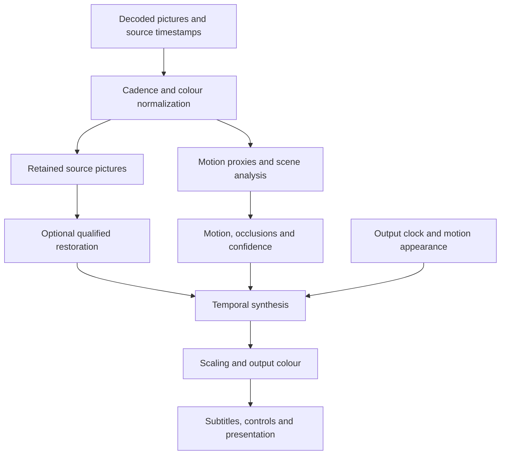

# Architecture and algorithms

This document specifies the target architecture. The current PR implements mpv temporal convolution and an experimental FFmpeg
`minterpolate` adapter with settings, scoped startup and generated-rate negotiation.
This narrow adapter is not the proposed native pipeline and is not evidence of
qualified motion compensation, restoration or native-platform engines. Confidence
is high in the timing architecture, moderate in the synthesis/restoration approach,
and unknown for per-device throughput and TV superiority until
[qualification](qualification.md).

## Current experimental FFmpeg adapter

The MCI option appends a uniquely labelled mpv `lavfi` video filter that invokes
FFmpeg `minterpolate` on decoded pictures. FFmpeg provides block-based motion
estimation/compensation, scene-change detection and output-rate configuration.
Fast/Balanced/High select motion-search cost; they do not provide a strength dial or
scene-confidence policy equivalent to the target architecture. The filter may cause
CPU pixel-format conversion or hardware-decoder readback, and its HDR/Dolby Vision
behavior, seeking, live-stream performance and A/V timing are not qualified. Missing
or rejected filters fall back to temporal blending; runtime overload is not yet
measured or automatically governed. Treat all MCI use as experimental until the
qualification protocol passes on the shipped artifacts and devices.

## 1. Pipeline and ownership

Processing begins with decoded, timestamped pictures, not screenshots of the
Flutter window. The logical order is:

1. Decode; classify actual field order/cadence; deinterlace or inverse-telecine
   exactly once where appropriate. Preserve PTS, durations and discontinuities.
2. Resolve source-specific colour interpretation, including qualified Dolby
   reshaping/FEL composition where applicable, into a documented working space.
3. Retain clean source pictures and build cheaper motion-analysis proxies.
4. Detect scene boundaries, exposure flashes, occlusions and cadence changes;
   estimate bidirectional motion and uncertainty.
5. If explicitly selected and qualified, restore source blur with temporal
   consistency checks. Never sharpen first and mistake halos for recoverable detail.
6. Synthesize the requested motion position, using the selected temporal look,
   reconstruction engine and confidence policy.
7. Scale once to the viewport, apply the chosen tone/gamut mapping once, and
   dither for the actual output. Some colour operations must be placed earlier
   for a specific backend; the adapter must declare and test the complete order.
8. Composite separate subtitles/OSD/UI and ambient lighting from the processed
   image at the correct media time; present through the existing native surface.

Analysis normalization does not become the output colour transform. Full-size
linear floating-point working buffers are a correctness option, not an obligation
to allocate every stage at full size. Use formats validated for that route.

Create `native/video/motion/` with a versioned C ABI and a C++ implementation.
It owns bounded frame references, analysis, motion engines, a timing planner and
metrics. Backend adapters own decode texture import/export, GPU synchronization
and presentation. Keep a CPU reference implementation for correctness tests.

Do not implement this solely as a `.hook` shader: multi-frame lifetime, generated
timestamps, output scheduling and access to pre-OSD pixels require engine support.
Do not replace the player with a standalone converter or a second hidden video
window. Do not allow Dart and the native engine to run competing clocks.

## 2. Contracts

### Frame and configuration records

| Record | Required fields/invariants |
| --- | --- |
| `MotionFrame` | ABI version; session ID; source epoch; frame ID; signed 64-bit PTS/duration and rational timebase; decoded geometry/SAR/orientation; scan type; colour/range/chroma siting; HDR metadata provenance; resource handle; ready fence; release callback; source/synthetic provenance |
| `MotionCapabilities` | Adapter/engine build IDs; real backend/VO; supported operations; formats/bit depths; import/export types; output mode list with rational Hz; timing observation type; max dimensions; memory budget; protected-content restriction; qualified tuple IDs |
| `MotionConfiguration` | Version; preset/look values; engine/quality choice; target-rate policy; restoration/scaling settings; resource limits; picture-format priority; scope; revision and session/source epoch |
| `MotionDecision` | Requested and effective configuration; output clock domain/rate; source bracket; synthesis time; selected engine; full-resolution versus upscaled result; measured/estimated distinction; reasons for every degradation |
| `MotionOutput` | Intended presentation deadline; content sampling time; source frame IDs; generated/repeated flag; ready fence; colour metadata; immutable epoch; release callback |
| `MotionStatus` | State; effective rate/look/engine; generated and repeated counts; p50/p95/p99 timings; missed deadlines; queue depth; memory and copy volume; restoration status; display evidence; qualification ID and reason codes |

Expose `getMotionCapabilities`, `configureMotion`, `getMotionStatus`,
`resetMotionHistory` and `disposeMotion` through existing per-session channels.
Configuration returns an acknowledgment with its accepted revision and effective
values. Missing method/ABI returns unsupported, not a fabricated success.
Emit status at at most 2 Hz normally, up to 10 Hz while diagnostics is visible.

Configuration validation occurs in Dart and again at the native boundary. Reject
NaN/Inf, zero denominators, overflowing pixel counts, impossible timestamp ranges,
unknown unsafe schema versions and out-of-range budgets before allocation.
The native entry point is not an arbitrary mpv command or shader loader.

### State machine

`unsupported`, `bypass`, `probing`, `warming`, `active`, `limited`, `recovering`,
`suspended`, `failed` are distinct observable states. `limited` still presents
video but may apply only cadence correction. `failed` describes the processing
module; it need not terminate playback. State transitions carry a reason and epoch.

Prepare resources before activation. Commit configuration at a safe presentation
boundary; retain the prior pipeline until the new one is ready. Invalidating a
source, seek, track/angle switch, discontinuity, new surface or device must cancel
old work. Release GPU resources only after their owning fences complete; use
bounded waits and device-loss teardown, never wait forever in a UI callback.

First/last frames, pauses and seeks display source pictures until sufficient
history exists. Never interpolate a still after pause, beyond EOF, across a cut,
between different files, across an ad insertion, or across a scene discontinuity.

## 3. One presentation clock

Maintain four separate quantities: encoded/container rate, normalized source
cadence, synthesized content sampling times, and actual wall-clock output cadence.
The source rate after IVTC/deinterlacing is not the display refresh rate.

Use integer/rational arithmetic with checked wide intermediates. For a stable
output clock, output deadline `D[n] = D0 + n / Fout`. Map that wall-clock time
through the playback-rate/audio synchronization mapping to media time `T[n]`.
For bracketing source PTS `P[i] <= T[n] < P[i+1]`, the full-smooth interpolation
phase is `u = (T[n] - P[i]) / (P[i+1] - P[i])`. Generate at this phase directly.
Never derive VFR times from frame numbers or round 24000/1001 to 24.

Use actual PTS even when the nominal frame-rate field is wrong. Validate monotonic
presentation order after decoder reordering; handle legitimate gaps and duplicate
PTS explicitly. Audio-only playback does not start the motion module.

| Source/output example | Required behavior |
| --- | --- |
| 24 -> 120 | Five output intervals/source interval; original plus four intermediates in full smoothing |
| 30 -> 120 | Original plus three intermediates |
| 24 -> 144 | Original plus five intermediates |
| 24 -> 60 or 30 -> 144 | Arbitrary interpolation phases; not alternating arbitrary frame duplication |
| 25/50 -> 100 | Preserve 50 Hz family when supported; 120 is not universally best |
| 24000/1001 -> 120000/1001 | Exact fivefold relation; no accumulated float drift |
| 24000/1001 -> 120 | Resample at actual output timestamps; do not slowly drift or periodically reset a counter |
| 60 -> 30 output limit | Cannot preserve all temporal samples; prefer a supported higher mode; otherwise expose the limit |
| VFR and speed != 1 | Bracket actual media times after rate mapping; fixed output Hz is not multiplied twice |

When no generation is selected, use established source scheduling and best
compatible output timing. A cadence-only mode cannot make 24 evenly spaced unique
frames fit into fixed 60 Hz without repetition, temporal mixing, speed change or
new frames. Report that fact instead of labelling the result judder-free.

### Negotiation

Create `MotionPresentationCoordinator` as the single owner of refresh decisions.
It builds a `PresentationPlan` consumed by existing Android/Windows/Apple matching
code. The plan distinguishes `sourceCadence`, `requestedOutputRate`,
`effectiveOutputRate`, `synthesisRate` and `displayObservedRate`.

Resolve conflicts in this order: valid picture-format path and existing user
format preference; explicit output-mode constraint; sustainable rate; motion look;
quality; power. Do not choose 4K120 SDR over 4K60 HDR unless the user selected that
format tradeoff. Preserve resolution unless explicit resolution matching/scaling
policy allows a change. Do not switch HDMI modes mid-shot for load regulation.

The output rate sent to Android's surface vote must reflect the synthetic output
when active. Its current `container-fps * rateFactor * speed` path must not override
it. Likewise, rate inference must not misclassify generated frames as deinterlacing.
On Windows preserve exact refresh numerator/denominator through enumeration and
selection; the current Dart service uses integer refresh values in several places.

On Wayland and mobile, a mode request can be refused. Observe presentation feedback
where available; distinguish submitted frame, compositor presentation, and physical
scanout. Without scanout evidence, report the narrower observation. Do not infer
120 distinct frames from a 120 Hz display callback alone.

Reuse `FrameRateMatcher`'s startup hold and stale-token cancellation, Android's
pause suppression and decoder refresh, and Windows' mode/HDR restoration. A source
change may require a new plan; a slider change does not justify an HDMI blackout.
Window moves, hotplug, rotation, minimize, VRR and external-display changes trigger
capability reevaluation. Fixed-rate output is the initial qualification target;
VRR is an additional tested route, not a cure for low source frame rate.

### A/V synchronization and latency

Playback speed and pitch stay as requested. Lookahead delays availability, so
schedule the complete timeline with sufficient startup buffering, not video alone.
Do not permanently modify the user's audio/subtitle offset to hide pipeline latency.
Keep audio as the existing master where required; use display timing observations
to resample video positions. Do not resample compressed audio passthrough or quietly
turn it into PCM. Any display-resample option needs a PCM-compatible route and the
existing audio policy. Test TrueHD/DTS/AC3/EAC3 paths and Apple audio routes.

Proposed added-lookahead caps: 150 ms for ordinary VOD, 80 ms for Sports/live;
actual decoder/network buffering is separately reported. Source intervals longer
than the cap cause a declared fallback. Live latency is additive and visible.
Interactive Moonlight/Steam sessions bypass this movie-oriented bidirectional
pipeline. Their latency constraints require a different design.

Watch Together uses the displayed media timestamp, not completion time of inference.
Negotiate startup readiness using existing session semantics; rate corrections,
seeks and leader changes flush affected motion history without advancing a stopped
session. Resume positions, watched markers and chapters remain source-media times.

## 4. Synthesis engines and scene policy

### Selected engines

**Portable flow:** deterministic multiscale bidirectional block matching, subpixel
refinement, forward/backward consistency, occlusion masks, edge-aware flow upsampling
and two-sided motion-compensated reconstruction. Implement a CPU oracle and GPU
kernels; use the current FFmpeg `minterpolate` adapter as an integration baseline
and comparison, not as a replacement for the bounded native engine or an assumed
real-time 4K engine. A cheap/global-motion-only engine is not sufficient for layered
motion and must never be passed off as full reconstruction.

**Neural:** integrate a native RIFE adapter. Benchmark Practical-RIFE 4.25.lite
for efficiency and 4.25 for quality against a known ncnn RIFE graph. Pin source,
weights, export graph, precision and hashes. Support arbitrary timesteps; cache
pair features only when the model exposes a valid reusable representation. Do not
assume all RIFE graphs share an API or that the newest model always looks best.

Use ncnn/Vulkan as the first cross-vendor neural runtime on Linux/Windows/Android.
Optional TensorRT acceleration is an additional NVIDIA route. On Apple use a
qualified Core ML/Metal export with a Metal classical fallback; MoltenVK/ncnn is a
benchmark candidate, not an assumed zero-copy bridge into an AVFoundation layer.
Model output must match its reference sufficiently at non-midpoint phases and in
linear/HDR tests. No CUDA-only dependency may gate the AMD baseline.

**Research comparison:** run VIDUE joint deblur/interpolation offline on permitted
SDR clips to determine whether it outperforms the modular design enough to justify
a later production adapter. Its published results do not establish real-time 4K,
HDR correctness, arbitrary output times or film-look preservation.

### Uncertainty and cuts

Use a consensus of low-resolution histogram/edge changes, warp residuals and
forward/backward flow. A neural network's output is not itself a confidence score.
Calibrate confidence against withheld reference frames. Include static texture,
compression noise and grain in the test set; exclude known black bars from global
scene statistics without cropping the displayed picture.

On a hard cut, select the correct side of the cut at the target PTS and reset
history. Never create a crossfade by averaging two shots. A flash is not
automatically a cut: compare structural continuity and exposure-normalized flow;
retain the flash at the source time and bypass uncertain synthesis. Dissolves are
authored transitions; do not sharpen or segment them into hard cuts.

Occlusion-aware reconstruction selects valid warped samples. Low-confidence
regions may use a temporally consistent source fallback with feathered boundaries;
mask growth and transitions must not create rubber edges or alternating patches.
When a large/important region is unreliable, reduce smoothing for the whole shot
or interval and report it. Frame fallback follows the clock; it does not reset it.
No guarantee of artifact-free interpolation is implied by a confidence threshold.

Animation retains held drawings and mixed cadence by default. Detect duplicate
frames only when evidence is strong; do not treat every static shot as telecine.
Preserve intentionally low-rate faces against animated backgrounds, stop-motion,
credits, and graphic overlays. Automatic classification is bounded by the selected
preset; it never escalates Original into generated motion.

## 5. Cinema appearance without full smoothing

The soap-opera effect is partly the perception of high temporal resolution, not
just an interpolation defect. Better optical flow alone cannot remove it. Cinema
must optimize restrained motion, not maximize distinct-frame count.

Implement three distinct temporal policies:

- `source`: existing source scheduling, no synthesized positions.
- `continuous`: sample the reconstructed scene at every output timestamp.
- `restrained`: the explicit source-anchored timing curve below, qualified as a
  proposed perceptual method, not established superior technology.

For a source interval with normalized phase `u` in [0,1], use:

`q_s(u) = s*u + (1-s)*smoothstep(clamp((u-(1-w))/(w), 0, 1))`,

where `smoothstep(x)=3*x*x-2*x*x*x`, `s = smoothness/100`, and
`w = 0.10 + 0.90*s`. This holds closer to the first source position and catches up
near the next original at low strength; at `s=1`, `q_s(u)=u`. At `s=0`, **bypass**
the curve and use the exact established source scheduler. For each output sample
use `P[i] + q_s(u)*(P[i+1]-P[i])` as synthesis time, while retaining the correct
output deadline and source-media playback clock. Never implement this control by
alpha-blending an unwarped original with a moving object at a second position.

This monotone curve preserves interval endpoints but deliberately retains some
within-interval unevenness and may produce objectionable acceleration pulses.
It is an implementable experiment with a blocking perceptual gate. Compare it
against full synthesis at a lower compatible distinct cadence (e.g. 48 at 96/144 Hz
or 60 at 120 Hz) and against ordinary source playback. Do not silently switch to
one of those methods under the same preset/version: record the chosen algorithm
and version after trials. If neither meets the Cinema acceptance gate, keep Cinema
unqualified and ship the other qualified presets with accurate descriptions.

Use one temporal curve per shot initially. Independently retiming every object can
break contact and occlusion relationships. Optional pan-sensitive strength changes
use robust global-motion evidence, bounded preset limits, a minimum one-second
transition, and hysteresis. Preserve the same engine/model and sampling clock
during the change. Never infer camera intent from a semantic label alone.

Preserve captured motion blur in Cinema. Do not add a blanket blur layer to hide
bad motion and claim improved clarity. An advanced exposure-simulation research
control may integrate several reconstructed samples in linear light with a stated
shutter interval; it can add blur, cannot subtract baked exposure, and is excluded
from release presets unless separately qualified. Do not label a guessed shutter
angle as the original camera setting.

Track `contentSampleOffset = synthesisTime - mediaTime` separately from clock/A/V
error. Restrained timing deliberately changes the sample position within a source
interval; reporting only the unchanged playback clock could conceal a visible
lip-motion shift. Bound the offset to that source interval, and measure audiovisual
events against Original as well as the intended temporal curve. This is another
reason not to use independent per-object retiming in the initial implementation.

## 6. Camera-blur restoration and scaling

### Restoration

Implement an optional NAFNet deblur adapter (start with the documented GoPro-width32
family; benchmark a larger model separately). Use a pinned verified export in the
same bounded inference infrastructure. The model is image-oriented: film/video
temporal consistency is an additional requirement, not an existing capability.

Apply it to source frames once, before generating intermediate frames. Run the
restorer in its documented input domain, initially SDR only. Compute its proposed
residual and limit it using a blur-evidence mask, motion/occlusion confidence,
local contrast bounds and temporal consistency after motion alignment. Reintroduce
no residual across a cut. Suppress restoration on grain-only texture, burned-in
text, unresolved occlusion or uncertain blur. The user strength scales the bounded
residual, not an arbitrary sharpening amount.

Record unmodified source reference, restored picture and final output in the
debug harness. Require real-blur as well as synthetic-blur tests: GoPro-style
benchmarks do not establish suitability for graded movies. If restored source
frames shimmer relative to generated frames, bypass restoration for the segment.
It is acceptable for the experimental restorer to decline a clip; falsely calling
sharpening deblur is not acceptable.

HDR restoration requires its own model-domain handling and tests; do not apply an
SDR-trained 0..1 RGB model directly to PQ values, clip highlights to fit it, or run
tone-map/inverse-tone-map pretending that information was retained.

### Spatial scaling and processing resolution

Keep three separate dimensions: source picture, analysis/inference resolution,
and output viewport. Quarter/half-resolution **flow estimation** with full-size
warping is different from generating a low-resolution RGB frame and upscaling it.
Expose the latter as reduced processing resolution. Scale vectors into source
coordinates with correct crop, rotation, SAR and chroma alignment.

Preferred efficient route: low-resolution analysis, full-size source retention,
edge-aware flow refinement, full-size reconstruction, one final scaler. RIFE's
lower internal flow scale may still reconstruct at full size; validate that exact
model option instead of assuming all resolution controls mean the same thing.
If the neural result itself is downscaled, originals and generated frames need
matched spatial response to avoid alternating sharp/soft pictures. Do not silently
soften originals in Original; make the efficiency tradeoff visible.

Reuse the existing scaler/shader presets and their HDR exclusions. Motion occurs
before separate OSD and before optional sharpening/upscaling. Coordinate ownership
with `ShaderService`, which currently clears/rebuilds `glsl-shaders`, and
`VideoFilterManager`, which owns zoom/crop. Do not erase the FEL filter, custom
filters, subtitle configuration or ambient-lighting chain. Unknown custom temporal
filters create an explicit conflict and disable managed generation for that session
unless the user resolves it; do not silently overwrite their configuration.

Avoid independent tiled interpolation without a validated overlap/context scheme;
objects crossing tiles are a common artifact source. Pad to model alignment and
crop back exactly, never crop 2160 lines to a nearby height for convenience.

## 7. HDR and Dolby Vision

Separate source format, working colour representation and output signaling.
Retain 10/12-bit source precision in adequately precise intermediates and test
BT.709, BT.2020, PQ, HLG, limited/full range and chroma siting. Motion proxies can
use a stable compressed luminance representation; their tone/exposure statistics
must remain consistent across the source pair to avoid false motion.

For HDR10/HLG, prefer flow estimated from analysis proxies but warp the original
high-precision colour planes. Neural RGB synthesis needs colour-domain qualification;
fallback to the classical high-precision route if its highlights or gamut fail.
Avoid duplicate tone mapping and per-frame peak-estimation pumping. Dynamic metadata
such as HDR10+ requires explicit treatment for synthetic frames, not blind copying.

Dolby Vision decisions:

1. Native DV remains the preferred picture path under `preserve_source_format`.
   If its decoded pixels/metadata cannot be processed correctly, bypass generation.
2. A user-selected processed HDR10/SDR route must resolve DV colour semantics
   before temporal processing. Profile 5 is not ordinary HDR10. P7 FEL needs
   paired BL/EL reconstruction before interpolation; never interpolate layers
   independently or use an EL-discarding conversion under a full-FEL label.
3. Existing FEL work places composition in the renderer. Obtain an explicit
   intermediate image **after** composition and **before** final output transforms;
   a stock FFmpeg filter earlier in decode cannot supply this image. The engine
   patch must expose it, with per-source RPU association and a pixel test.
4. Generated frames do not have author-provided RPU. For processed HDR10/SDR,
   consume relevant DV transforms upstream and signal the derived output honestly.
   Native DV output with generated metadata is a separately qualified capability,
   never enabled merely because the TV displays a Dolby Vision badge.
5. Pinned production and experimental engines have different patch/qualification
   states. Preserve both build locks and their evidence. A motion change cannot
   silently replace the production engine with the FEL experiment.

Keep output transitions explicit and transactional, preserve existing HDR fallback
policy, and test SDR/HDR monitor moves, TV Game Mode format limits and PiP changes.

## 8. Platform adapters

| Platform/current route | Required implementation | Initial honest limit |
| --- | --- | --- |
| Linux: embedded libmpv render API on a Wayland video plane; separate experimental opengl-next path | Engine-side normalized-frame hook and output timing; same plane/render executor; GPU interop or measured bounded staging; preserve HDR transaction | First qualify SDR; do not set `vo=gpu-next` to create another window |
| Windows: mpv gpu-next with native display/HDR management | Engine/VO frame queue adapter; same D3D output; rational DXGI mode/timing; same-device interop with Vulkan inference where supported | CPU/GPU copies count in budget; no zero-copy claim until proven |
| Android mpv: MediaCodec plane normally, GPU paths for specific cases | Explicit texture-accessible decoder/output route; generation before Surface submission; rebuild AAR; unified surface-rate vote; subtitle/PiP parity | Opaque/native DV/secure surfaces and tunneled paths may prevent processing |
| Android ExoPlayer alternative | Separate Media3 video-processing adapter with bounded multi-frame scheduling and audio coordination, or an explicit user-selected mpv route | Never silently change backend or feed frames through a one-in/one-out effect and claim FRC |
| macOS/iOS/tvOS: custom mpv avfoundation VO, AVSampleBufferDisplayLayer | Hook decoded pixel buffers before enqueue; Metal texture processing/export; correctly timed CMSampleBuffer output; existing audio, PiP and external-display behavior | Apple shader support is currently absent; SDR/HDR/DV each need independent qualification |
| webOS: video_player_drm/native video plane | Probe documented decoded-frame access and app presentation limits; implement only APIs that exist on the tested runtime | Cadence/status or a compatible prepared stream until raw-frame access and throughput are proven |
| Tizen: video_player_videohole/native playback | Same evidence-driven native adapter investigation; preserve store/homebrew route separation | A 120/144 Hz panel is not evidence of a high-rate application surface |
| Cast/external player | Receiver capability/derived-version selection if supported | Local processing does not follow a URL handoff |

For GPU interop, match adapter identities; enumerate supported external memory and
semaphore types; document texture ownership, layout transitions and fence ordering.
Start with bounded staging for functional reference if needed, but qualify its
true end-to-end cost. Do not move frames through Flutter textures unnecessarily.
Apple export must preserve meaningful colour attachments for the new pixels;
copying all original DV attachments onto altered pixels is not a solution.

## 9. Hardware scaling and governor

Tier labels describe measured capability, not a GPU-brand list:

| Tier | Eligible behavior after measurement |
| --- | --- |
| T0 Timing | Existing playback plus cadence planning/diagnostics; no raw-pixel requirement |
| T1 Efficient | Reduced-resolution analysis and classical full-size warping at a sustainable rate |
| T2 Neural | Qualified small-model interpolation, with full-size or explicitly disclosed reduced-size output |
| T3 High | Larger neural model/refinement at the selected source/output tuple |
| T4 Restoration | Qualified restoration plus interpolation with enough remaining budget |

Calibrate using bundled generated clips, then observe the actual playback workload.
Key results by GPU/device/driver, engine/model/export hashes, decoder, input size,
format, output rate, display and power state. Invalidate after relevant changes.
CPU, GPU, memory, thermal limits and other video sessions all count. Never run a
long benchmark automatically at first launch; offer a short test and continue
conservative observation during ordinary opted-in playback.

Starting engineering budget, subject to measurement: reserve 20% of frame time for
scheduling variance; admit a candidate only when the end-to-end p95 fits 80% of its
output period and p99 fits the full period, including decode/import/export/render.
Account for burst work within a source interval, not just average inference FPS.
An amortized RIFE estimate does not prove four intervening deadlines can be met.

Use a hard memory reservation before activation. Initial additional-memory caps:
256 MiB on constrained devices, 512 MiB on mobile, 1536 MiB on desktop, each further
limited to 15% of reported available budget; unknown budget uses the smaller safe
cap. These are proposed caps, not a claim that a given model fits. Fall back a tier
if scratch tensors, weights, imports and history do not fit. One 3840x2160 RGBA16F
image is about 63.3 MiB; five retained images already use about 316 MiB before
model tensors. Keep decoder references bounded to avoid exhausting surface pools.

Governor order: drop optional restoration/refinement; select a qualified cheaper
model; lower analysis resolution; lower the distinct generation rate to a stable
compatible cadence; finally bypass generation. Respect manual locks, but prevent
unbounded work; report a temporary effective fallback without rewriting the saved
request. Quality changes do not change the selected look strength.

Suggested hysteresis: degrade after two consecutive missed deadlines or sustained
budget failure over 500 ms; recover only after 30 seconds of headroom and at a
safe boundary. Thermal/device-loss signals bypass the delay. Do not oscillate
quality every frame. Keep HDMI mode stable during normal downgrades; if no acceptable
cadence is available, retain correctly timed source playback and report the limit.
Never present an obsolete generated frame just because it finished late.

In multiview, reserve budgets centrally; prioritize the focused/main video,
then the companion. Do not double-allocate the full GPU budget per session. PiP,
background, battery-saver and remote-streaming modes have explicit limits and
restoration is disabled there initially. Pause drains inference while retaining
only the picture/history needed for an efficient resume.

## 10. Packaging, local execution and prepared versions

Create `tools/motion-engine/` for reproducible engine patches, model conversion,
golden outputs and build manifests. Pin source commits and model SHA-256 values;
retain code/model notices and export provenance. Do not ship a Python/PyTorch
runtime with the app. Use a fixed operator allowlist and bounded tensor shapes;
never load arbitrary pickle files or execute model-supplied code at playback time.
Bundled engine ABI and advertised features must agree; a wrapper cannot claim a
feature absent from the shipped library/AAR/framework.

Optional model packs are validated and atomically installed, retain a known-good
version, and can be deleted from Settings. Offline playback works without a model
download using qualified classical processing or ordinary playback. Compilation
caches are keyed by device/driver/model; no arbitrary path or network URL can be
injected through imported settings. Logs omit media URLs/tokens and captured pixels
unless the user explicitly exports a diagnostic recording.

An optional companion mode prepares a separate derived version on an explicitly
configured machine. It uses authenticated, scoped jobs, cancellation, quotas and
source/output hashes. It never overwrites originals, creates native-DV claims,
uploads media to an unselected cloud service, or exposes an unauthenticated LAN
transcoder. Keep audio tracks/subtitles/chapter times and label output colour/rate.
Output profiles are negotiated against the receiving device's actual decoder and
presentation limits. A 60 fps prepared stream cannot create 120 fps inside an app
that only presents 60; the TV may repeat it. This route includes its own encode
quality/latency/storage tests and remains optional to desktop/local completion.
