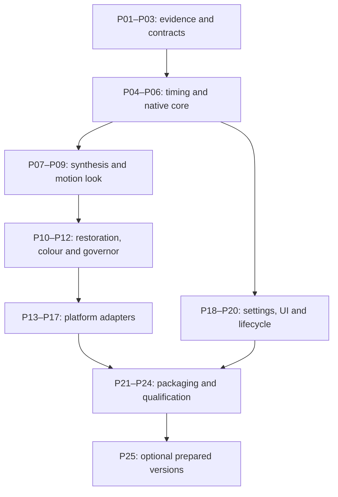

# Implementation work packages

The runtime subset below is implemented in this PR; the 25 full work packages are
not complete. Check a package complete only with its implementation and required
evidence. A blocked hardware qualification is not the same as unimplemented code.
A settings surface or successful property write does not complete the full feature.

## Current delivery in this PR

- Adds typed Original, Cinema, Balanced, Smooth, Animation, Sports and Custom
  profiles. The default stays Original.
- Adds portable preset, kernel and threshold preferences plus global/library/title
  scope for the preset.
- Adds Playback Settings and in-player controls, including custom temporal kernel
  and threshold selection.
- Applies mpv display synchronization, temporal convolution, a bounded hardware
  decoder surface reserve and renderer-status reporting. It restores the player's
  pre-feature options when Original is selected.
- Restricts the implementation to mpv renderer paths and reports unsupported native
  outputs. It does not report requested refresh as measured presentation.

This delivers useful cadence-blending controls; it does not implement any of the
full native frame-processing packages. Motion-compensated interpolation, scene and
occlusion analysis, camera-blur restoration, capability-qualified scaling, native
Android/Apple/TV adapters, measured performance telemetry, model packaging and TV
comparison remain incomplete. This PR has no device qualification evidence.

## 1. Verified repository integration map

Design inventory snapshot: `af547078ff70df271b04fd35474b8caf7619fa6d`. The source map
below records the original integration survey. The implementation touched only
paths confirmed on this PR branch; later main changes still need reconciliation
before follow-on native-engine work.

| Existing owner/path | Observed behavior and required integration |
| --- | --- |
| `lib/mpv/player/player.dart` | Player API, setVideoFrameRate, real backend query, HDR support and companion-session factory. Add typed optional motion capability/config/status contracts without assuming every Player supports them. |
| `lib/mpv/player/player_base.dart`, `player_native.dart`, `platform/player_*.dart` | Per-session channels, source ownership and timeline semantics. Carry epoch/config revisions and preserve lifecycle/rate behavior. |
| `lib/screens/video_player_screen.dart` and `parts/playback_open.dart`, `playback_start.dart`, `playback_reload.dart`, `playback_services.dart`, `lifecycle.dart` | Own startup, shader service and app-managed mpv options. Attach/detach the coordinator once and preserve first-frame and paused-start behavior. |
| `lib/screens/video_player/frame_rate_matcher.dart`, `player_output_format.dart`, `parts/display_matching.dart` | Source-derived rate, startup negotiation and Android decoder refresh. Accept an explicit PresentationPlan, not another competing source-rate guess. |
| `lib/services/display_mode_service.dart`; `windows/runner/mpv/display_mode_manager.*` | Windows mode/HDR matching and restoration. Extend exact rational modes; retain original-mode restoration when transactions fail. |
| `android/app/src/main/kotlin/com/edde746/plezy/mpv/PresentedFrameRate.kt`, `SurfaceFrameRateVote.kt`; `shared/FrameRateManager.kt`, `DisplayModeSelector.kt` | Existing source/field/IVTC rate inference and surface votes. Separate source analysis from generation; avoid multiplying output FPS by playback speed again. |
| `lib/services/shader_service.dart`, `video_filter_manager.dart`, `lib/providers/shader_provider.dart`, `lib/models/shader_preset.dart` | Shader rebuild, HDR skips, zoom/crop, scaling presets and ambient lighting. Preserve their ownership; motion is not a new single-frame GLSL preset. |
| `lib/services/settings_service.dart`, `settings_binding_owner.dart`, `settings_mutation_service.dart`, `settings_export_service.dart`, `scoped_player_prefs.dart` | Typed preference storage, one effect owner, export/reset and shared scoped store. Add schema migration and omit device calibration from portable settings. |
| `lib/screens/settings/playback_settings_screen.dart`; `lib/widgets/video_controls/sheets/video_settings_sheet.dart`; `lib/widgets/setting_tile.dart` | Existing playback/settings surfaces and help/focus styling. Add one integrated Motion & clarity entry and dedicated content widget. |
| `lib/widgets/video_controls/widgets/performance_overlay/` | Extend existing stats model/service/UI with measured motion data instead of a new permanent overlay. |
| `lib/screens/sources/source_player_screen.dart` | Standalone source playback must use the same capability/settings/controller contract as server playback; inspect its lifecycle when wiring it. |
| `linux/runner/mpv/mpv_player.cc`, `plane_render_executor.*`, `wayland_video_surface.*` | Embedded rendering and HDR output. Retain render-thread ownership and plane lifecycle; do not launch a windowed VO. |
| `windows/runner/mpv/mpv_player.cpp` | gpu-next setup, HDR workaround and labelled FEL filter. Extend the engine without overwriting existing filters. |
| `android/app/src/main/kotlin/com/edde746/plezy/mpv/MpvPlayerCore.kt`; `exoplayer/ExoPlayerCore.kt` | Different native output routes, shader arbitration, rate reporting and fallback. Implement backend-specific adapters, not a shared optimistic boolean. |
| `shared/apple/MpvPlayer/MpvPlayerCoreBase.swift`; `ios/Runner/MpvPlayer/`, `macos/Runner/MpvPlayer/` | AVFoundation VO, sample-buffer layer, audio, PiP and external displays. Add engine-level pixel-buffer processing before enqueue. |
| `lib/mpv/player/platform/player_webos.dart`, `player_tizen.dart`; vendored TV video plugins | Native media surfaces. Determine decoded-frame access and real submitted cadence before claiming local processing. |
| `mpv-build.lock.json`; `tools/dv-engine/engine.lock.json`, `adapters.lock.json` | Production engine artifacts and separate experimental FEL sources. Pin the new patch/build identities and prove patch parity rather than replacing one lock with the other. |
| `docs/maintainers/dv-platform-buildout.md`, `dv-native-ports.md`, `webos-tv.md`, `tizen-tv.md` | Existing evidence and restrictions remain authoritative until superseded by new measurements. Link resulting motion capability reports here. |

The production mpv-build lock names `edde746/mpv-build` at
`582f6d6e748a87a1536bf5cdad0af97b75725ffb` in this snapshot. Do not assume upstream
latest has PlezyNG's audio/subtitle/AVFoundation patches. The separate FEL lock's
qualification flags and narrative handoff can differ in age; reconcile evidence
instead of upgrading a flag merely because another document says a graph ran.

New paths below are **proposed**, not existing APIs. Use an isolated implementation
branch and small reviewable commits. Read the current repository instructions;
the planning PR does not authorize altering workflow triggers or runner policy.

## 2. Package dependency map

Platform work can begin once interfaces stabilize; each platform still depends on
the engine/colour features it advertises. This graph describes dependencies, not
an instruction to spawn agents or a requirement to wait for every port before
validating the first real embedded playback route.

## 3. Work packages and done criteria

### P01 — Baseline and evidence manifest

- Capture current main SHA, engine locks and actual backend/VO per target.
- Add `tools/motion/` harness specification, generated-source fixtures and a
  versioned result schema under `testdata/motion/`. Baseline Original on the same
  hardware and content intended for processing tests.
- Record source/actual presented frame identities, A/V error, HDR route, CPU/GPU,
  memory, power and thermal behavior. Store unknown values as null with reasons.
- Done: reproducible local report with Original results and no motion engine
  claiming activity. Device access gaps are listed by exact target.

### P02 — Typed app and native contracts

- Add proposed `lib/models/motion_configuration.dart`, `motion_capabilities.dart`,
  `motion_status.dart`, plus `native/video/motion/include/plezy_motion.h`.
- Implement versioned serialization, defaults, value bounds, session/epoch/config
  revision guards and explicit unsupported responses across all Player backends.
- Add fake adapters that exercise lifecycle and failures; fake frames are confined
  to tests and cannot satisfy a production capability probe.
- Done: unsupported platforms play normally; malformed/late messages cannot apply
  to another session; round-trip and ABI mismatch tests pass.

### P03 — Capability probes and model manifest

- Add `lib/services/motion_capability_service.dart` and native probes for actual
  formats, import/export, timing observation, output modes and memory budget.
- Define `tools/motion-engine/models.lock.json` and engine feature manifest with
  precise code/weights/export/license/hash provenance. Fetch and hash chosen model
  artifacts during implementation; do not invent hashes in this plan.
- Separate build availability, runtime eligibility and physical qualification.
- Done: the same GPU with different VO/format/driver can return different truthful
  capability outcomes. A model/ABI mismatch produces a useful fallback reason.

### P04 — Rational timing and display coordinator

- Add `native/video/motion/timeline.*` and proposed
  `lib/services/motion_presentation_coordinator.dart`/`presentation_plan.dart`.
- Implement exact PTS bracketing, speed mapping, field/IVTC separation and
  output-deadline calculation; integrate existing display negotiation ownership.
- Fix integer-only mode representation where it loses fractional precision.
  Feed effective synthetic cadence into Android votes and Windows/Apple requests.
- Done: TIM tests in qualification pass; source matching cannot undo generated
  output; source changes and display restoration retain current behavior.

### P05 — Bounded native frame queue and GPU resource adapters

- Implement `frame_queue.*`, `gpu_resources.*`, cancellation/fences and resource
  accounting. CPU reference + actual platform handles, with explicit copy paths.
- Pre-reserve memory, bound outstanding decoder surfaces, and reject unsupported
  protected/opaque frame access. Avoid full-frame Dart copies and disk frames.
- Done: distinct source IDs pass through the embedded output; all error/seek/dispose
  paths release ownership; queue starvation and device loss recover without hangs.

### P06 — Source normalization and scene analysis

- Implement cadence classifier, scene-cut/flash detector, duplicate/held-drawing
  analysis, black-bar exclusion and colour-aware proxy generation.
- Reuse existing decoder deinterlace/IVTC output; do not deinterlace twice.
  Test mixed film/video and broken/missing nominal FPS metadata.
- Done: actual cuts cannot blend; flashes/dissolves and intentional holds survive;
  interlaced sports retain field cadence and first/last frames remain correct.

### P07 — Portable classical synthesis

- Implement `engines/classical/`: multiscale bidirectional flow/block matching,
  subpixel refinement, confidence, occlusions and full-resolution reconstruction.
- CPU oracle first, then GPU kernels. Compare against held-out ground truth and
  FFmpeg minterpolate; use source fallback where evidence is inadequate.
- Done: embedded playback generates measurable intermediate object positions,
  arbitrary phases work, and difficult occlusion tests have bounded artifacts.
  Document the measured resolution/rate limit; CPU completion alone is insufficient.

### P08 — RIFE adapter and model conversion

- Implement `engines/rife/` with ncnn/Vulkan and a reference conversion harness.
  Evaluate 4.25.lite/4.25 and a known older ncnn graph, pin the winner per tier.
- Implement any required operator/export changes explicitly. Validate non-midpoint
  time input, padding, range/order, FP16/FP32 differences and model license notices.
- Avoid recursive midpoint-only conversion as the production arbitrary-rate path.
  Reuse pair features only when supported by the chosen graph.
- Done: portable AMD/Intel/NVIDIA route executes real frames; converted outputs
  agree with the reference within documented tolerances; packaged model is verified.

### P09 — Temporal look and artifact control

- Implement source, continuous and candidate restrained policies from architecture.
  Include alternative lower-cadence synthesis for the perceptual comparison.
- Add whole-shot bounded pan assistance, conservative fallback and animation hold
  protection. Do not blend displaced objects to implement the Smoothness slider.
- Done: mathematical invariants pass and Cinema passes the film-look gate against
  both Original and TV low smoothing. If the proposed curve fails, tune/select the
  measured alternative and revise the versioned preset; do not ship a false claim.

### P10 — Source-blur restoration

- Add `engines/restoration/` with an actual NAFNet export, blur mask, bounded
  residual, temporal consistency and grain/text/occlusion protection.
- Evaluate VIDUE offline as a joint-method reference. Keep restoration experimental
  and SDR-only until independent HDR qualification exists.
- Done: restoration changes actual pixels, improves designated blurred references,
  and passes temporal/clean-source negative tests. Failing clips visibly fall back;
  an unconnected toggle or sharpening filter is not completion.

### P11 — Scaling, HDR and DV composition

- Add the ordered processing graph and shader/filter ownership contract; preserve
  source-resolution detail and correctly map reduced analysis coordinates.
- Qualify HDR10/HLG precision, colour metadata, output signaling and tone mapping.
- Implement explicit post-FEL/pre-output intermediate access in the experimental
  engine before claiming combined FEL + generation. Preserve native DV bypass and
  the opt-in derived HDR10/SDR alternatives.
- Done: colour/FEL tests pass per route; no silent format downgrade, EL discard,
  double tone map, filter clobber or native-DV label on derived HDR output.

### P12 — Resource governor and calibration

- Implement `resource_governor.*` with deadlines, memory reservation, headroom,
  thermal/power state, hysteresis and multi-session budgets.
- Short generated benchmark + actual playback observations; invalidate caches
  by engine/model/driver/device/output tuple. Restore saved requests after temporary
  limits without overwriting preferences.
- Done: overload degrades coherently without queue growth or alternating quality;
  every fallback is visible in status; no per-frame HDMI switching.

### P13 — Linux and Windows embedded delivery

- Build reproducible engine patches and integrate into the existing libmpv plane
  and Windows gpu-next path. Preserve hardware decode when compatible; include
  all upload/readback costs where staging is necessary.
- Prove presentation timing and generated pixels in the app, then qualify Linux
  AMD/Intel/NVIDIA and Windows D3D combinations independently.
- Done: G2/G3 embedded SDR qualification on at least one desktop target; HDR and
  other GPU combinations have individual reports. No second native video window.

### P14 — Android mpv delivery

- Implement the texture-accessible decode/GPU route and Surface scheduling;
  coordinate current MediaCodec plane selection, shader state and DV policies.
- Build and integrate the actual AAR for supported ABIs, update verified artifact
  selection, and keep the original/native route as a user-preserving fallback.
- Done: physical-device generated-frame evidence and audio/subtitle/PiP/rotation/
  hotplug tests. Emulator-only evidence is labelled as such; protected/native-DV
  restrictions produce honest unavailability rather than a silent backend change.

### P15 — Android ExoPlayer delivery

- Inspect the pinned Media3 frame processor's multi-frame/output scheduling
  contract. Implement a bounded renderer/frame-processor adapter with explicit
  frame release times and audio coordination, not a one-in/one-out filter wrapper.
- If the current decoder route cannot expose pixels, offer the existing mpv backend
  as an explicit setting and record the Exo route as unsupported for generation.
- Done: either actual qualified Exo-generated frames or a documented, tested
  capability restriction plus working explicit mpv selection; no fake Exo support.

### P16 — Apple delivery

- Extend the custom mpv AVFoundation VO to process pixel buffers before display
  enqueue; native Metal classical path and qualified neural export.
- Preserve AVSampleBuffer timing, VideoToolbox decode, colour attachments,
  external displays, audio and PiP. Native DV and HDR must pass their own tests.
- Done: real macOS/iOS/tvOS builds and device reports per supported route. A Swift
  UI option, a separate experiment app or a Metal texture demo is not integration.

### P17 — Native-TV and receiver capabilities

- Inspect/document APIs exposed by the actual webOS/Tizen plugins/SDK; measure
  app frame submission, decoder limits, raw-frame access and processed output.
- Implement eligible native processing only when those contracts exist. Otherwise
  provide cadence/status, precise reasons and a receiver-compatible prepared option.
- Done: every target has a tested positive capability or an evidence-backed
  restriction. State the unavailable SDK/API/device explicitly; do not invent a
  native hook or infer an app's ceiling from HDMI/panel marketing.

### P18 — Persistence and settings integration

- Add typed motion prefs, migration, reset/export and scoped resolution; integrate
  one binding owner. Keep calibration/model-cache paths out of portable backups.
- Register runtime updates with epoch guards and native acknowledgments. Preview
  is session-only; imported settings cannot bypass model or picture-format policy.
- Extend existing agent-settings discovery/commands with the same types, bounds,
  supported state and application timing. Debug automation uses the existing
  authenticated VM-service contract, not an added unauthenticated control API.
- Done: scope precedence, missing identity, rapid edits, profile changes, reset,
  backup import and rejected activation all retain correct saved/effective states.

### P19 — User-facing presets and controls

- Build proposed `lib/widgets/video_controls/sheets/motion_settings_sheet.dart`
  and shared settings content using existing components, tokens and navigation.
- Implement exact help, availability states, six presets, Custom, advanced controls,
  comparison/revert and per-scope apply. Keep unsupported controls explanatory.
- Done: keyboard/touch/remote and screen-reader tests pass; large text/RTL/CJK work;
  no permanent playback button or hidden-op behavior; all strings localized.

### P20 — Full playback lifecycle and feature interactions

- Wire server and standalone sources, offline downloads, playlist/episode changes,
  live TV, Watch Together, PiP and multiview. Flush/hold/restart appropriately.
- Preserve audio passthrough, rate changes, subtitles, chapters, seeking, paused
  starts, media controls and source ownership. Exclude interactive game streaming.
- Done: INT cases pass with production player paths, including failed processing
  activation/recovery. No regression hidden behind a successful motion unit test.

### P21 — Diagnostics and reproducible build artifacts

- Extend existing stats overlay; add redacted export with timing/colour/model
  provenance. A screenshot alone cannot attest presented cadence or FEL correctness.
- Extend existing debug playback status with requested/effective motion state and
  evidence type; an accepted setting remains distinct from verified active output.
- Produce pinned native libraries/AAR/frameworks and model notices; verify packaged
  feature manifests. Build portable/no-neural variants for unsupported hardware.
- Done: clean installs and upgrades run the claimed engines, offline fallback works,
  and exported reports contain actual measured vs requested states.

### P22 — Automated correctness and robustness qualification

- Implement TIM/SYN/BLR/COL/RES/INT/UX tests from qualification; use generated or
  properly redistributable fixtures. Run sanitizers/fuzzing for native boundaries.
- Use only compatible private ephemeral JIT runners; keep accelerator/hardware
  jobs manual/explicit and isolated. Do not enable automatic hosted fallback.
- Done: reports identify exact engine/model/source/builds, failures are fixed,
  and unsupported tests are recorded rather than represented as passed.

### P23 — Physical playback and thermal qualification

- Test output rates, source-rate families, SDR/HDR, audio and two-hour sessions
  on a representative matrix. Include user AMD hardware as a target, not as an
  assumed performance guarantee. Record adapter/driver/OS/display identities.
- Done: stable timing, bounded memory and visible graceful fallback; physical
  scanout claims have suitable capture evidence. Establish per-tuple supported tiers.

### P24 — TV comparison and release decision

- Run the controlled/blinded protocol, including low-SOE Cinema and maximum-motion
  comparisons separately. Review artifacts at full speed as well as slow motion.
- Publish results, preset versions and qualified scope; update setup/help and
  support matrix. Original remains available and reversible.
- Done: claim wording follows measured evidence; Cinema is not released as
  film-preserving if the perceptual gate failed. There is no blanket “beats all TVs”.

### P25 — Optional prepared-version companion

- Implement authenticated job submission, permission-scoped source access, version
  manifest/cache key, cancellation/quotas, derived-file labeling and receiver
  capability negotiation. Reuse existing DV companion concepts where appropriate.
- Preserve originals, source-media timing, audio/subtitle/chapter tracks and
  source version switching. Test interrupted jobs, stale outputs and encoder loss.
- Done: a constrained client plays a correctly labelled derived version at a
  supported rate with measured encode quality; no original overwrite or open proxy.
  This optional path is not a prerequisite for shipping qualified local desktop work.

## 4. Concrete first implementation slice

Implement P01–P08 and the minimum P12/P13/P18–P21 integration needed to play a
generated 1080p SDR sequence through the actual embedded desktop player. Use a
fixed 24 -> 120 or 24 -> 60 example with known intermediate object positions, real
audio and separate subtitles. Demonstrate source/generation/output counters and
frame captures, pause/seek/cut/reset and graceful overload. Then complete P09's
perceptual work and move through HDR/restoration/platform packages.

Do not bypass the current renderer's ownership by forcing `vo`, ship CPU file
conversion as the product, or write every platform's UI before any real generated
frame reaches the screen. Conversely, after the first slice works, the remaining
packages remain open and must not be described as complete.

## 5. Required implementation handoff record

Each implementation report lists: branch/commit; completed package IDs; modified
engine/model hashes; code checks; real-device checks; exact effective route and
formats; remaining failures/unsupported combinations; and the next uncompleted
package. Confidence is high only for observed results, moderate for supported
inferences, and unknown for untested hardware/perceptual claims. Keep qualification
records in `docs/maintainers/motion-qualification/` when they actually exist.
