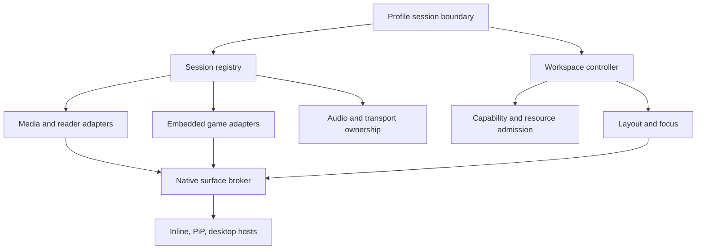
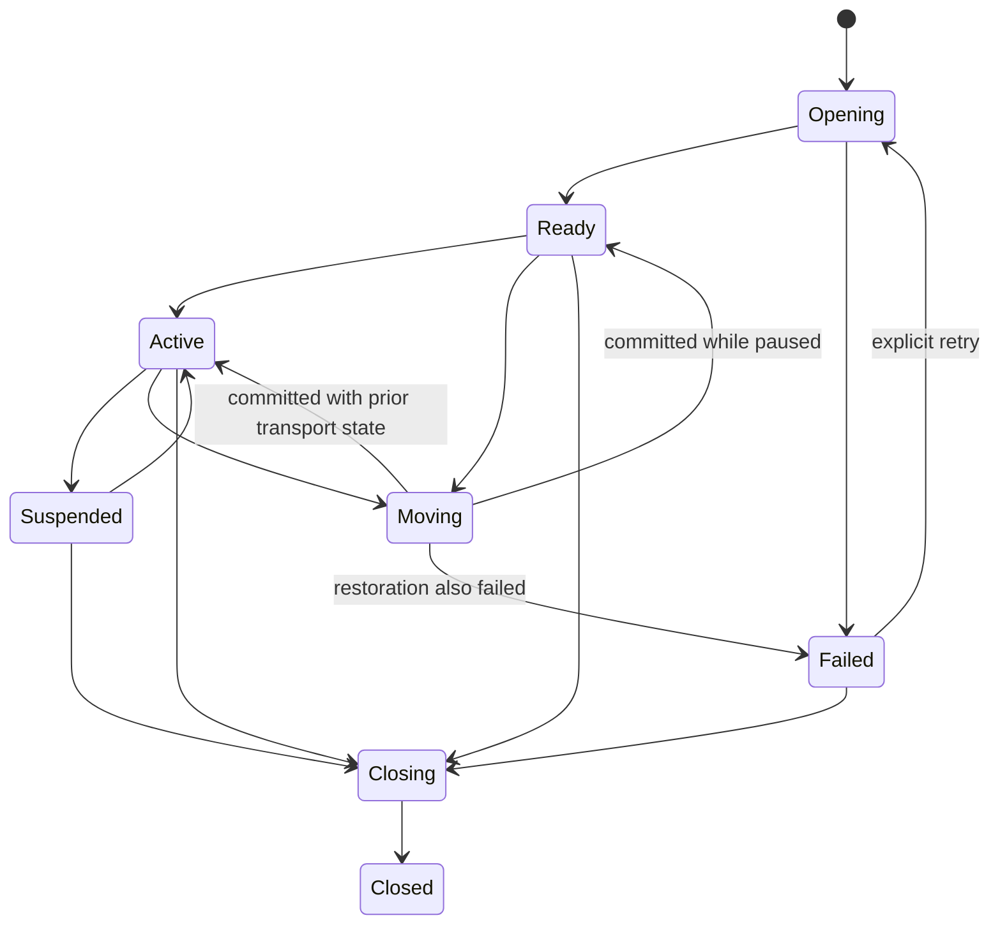

# Session and presentation architecture

Proposed types/files in this document do not exist unless explicitly identified as current. Use the repository's Provider, immutable model, testing, serialization and logging conventions. Do not add a second application state framework.

## Ownership model



`ProfileSessionScreen` owns one registry and workspace controller under its keyed profile boundary and above its content navigator. A session owns content lifetime. A surface host owns presentation lifetime. A route owns navigation only. Widget disposal must not dispose a moved media session.

Do not move services above the profile boundary to make them persistent. Authentication/profile dialogs are root overlays that cover all windows/surfaces. Switching/deleting profiles cancels pending operations, neutralizes input, flushes progress, exits PiP, closes secondary windows, and retires native resources before the next profile can use them.

## Data contract

Use typed immutable identifiers, not a raw URL or a global “current player.” Minimum proposed records:

| Record | Required fields/meaning |
|---|---|
| SessionKey | profile ID + opaque session UUID + generation; generation changes when a native lifetime is replaced |
| ContentRef | provider/source ID, canonical item ID, edition/version, content kind; no auth headers or signed URL in persisted state |
| SessionSnapshot | state, content identity, locator/timeline, seek range, play/pause, tracks, source connection status, recoverable error, revision |
| PresentationBinding | session key, window/host ID, surface lease ID, view role, bounds/clip/scale, visibility, revision |
| WorkspaceSnapshot | schema version, profile, ordered sessions, layout tree, placements, parked descriptors, audio/transport owner IDs, preferences |
| ReaderCheckpoint | EPUB CFI/href/progression; PDF physical page + normalized offset/zoom; comic stable page ID + spread/panel + reading direction |
| GameCheckpoint | host/app reference and UI settings only; active transport is retained in memory, never serialized as a resumable authenticated connection |
| CapabilityResult | supported/unsupported/unknown/temporarilyUnavailable, reason code, constraints, evidence/version and offered alternatives |

Identity must distinguish two episodes, editions, source servers, and multiple views of the same item. Default opening an already-open content identity promotes that session instead of creating a duplicate writer. An explicit future comparison view can be read-only with one authoritative progress writer.

Logical state and native presentation are independent:



Moving is a presentation transaction, not permission to resume paused media. Store the pre-move transport state and restore it precisely. Rollback normally returns to the previous state; a failure state is only for an unrecoverable original session, not any failed attempt to add another pane.

## Proposed interfaces

The following is an interface sketch, not compilable implementation or a generated API commitment. Final types should follow local conventions.

```dart
abstract interface class WorkspaceSession {
  SessionKey get key;
  ContentRef get content;
  ValueListenable<SessionSnapshot> get snapshot;
  SessionCapabilities get capabilities;
  Future<SessionCheckpoint> checkpoint();
  Future<CommandResult> dispatch(SessionCommand command);
  Future<SurfaceLease> acquireSurface(SurfaceTarget target);
  Future<void> releaseSurface(SurfaceLease lease);
  Future<void> suspend(SuspendReason reason);
  Future<void> close(CloseReason reason);
}

abstract interface class SurfaceBackend {
  Future<SurfaceProbe> probe(SurfaceRequest request);
  Future<PreparedSurface> prepare(SurfaceRequest request);
  Future<SurfaceAck> commit(PreparedSurface surface, int layoutRevision);
  Future<void> rollback(PreparedSurface surface);
}

abstract interface class WorkspaceAdmission {
  Future<AdmissionDecision> plan(WorkspaceCommand command);
  Future<ResourceReservation> reserve(AdmissionPlan plan);
}
```

`SessionCommand` is a sealed typed family: play/pause/seek/selectTrack, reader navigation/zoom, game input activation/release, presentation and close. Unsupported commands return typed reasons. Do not use a universal string map that lets a reader accidentally consume a video seek or lets a stale game command hit another host.

Every asynchronous command carries session generation, request ID and relevant layout/content revision. Native events carry session generation, event sequence and native instance ID. Reject stale/duplicate/out-of-order state updates; explicitly handle terminal events. Errors are stable localized reason codes; native URLs/credentials are redacted.

## Atomic layout and swap transactions

1. Resolve content identity and latest workspace revision; reject an obsolete request.
2. Compute legal layout and capabilities for the entire combination, not merely each item alone.
3. Reserve memory/decoder/surface/audio resources without destroying the existing session.
4. Prepare the target surface/reader host and wait for acknowledged readiness. Persist logical reader anchor before unavoidable WebView recreation.
5. Release game/pointer capture and freeze layout commands, not transport clocks. Update native geometry/host binding in a transaction identified by revision.
6. Commit only after all required surfaces acknowledge. Publish layout, focus and tray changes together; preserve play/pause and audio ownership.
7. Release old surface leases and unused reservations. Roll back on failure or timeout; do not report success while a new surface is black.

Use a single serialized workspace command queue with bounded preparation deadlines and cancellation. Coalesce drag/resize geometry to the latest revision. A second Swap can supersede a queued first swap, but cannot interleave native detach/attach operations. Closing, profile teardown and process interruption cancel pending transactions and release every reservation.

A surface move within one engine must keep the same native media instance. Cross-window relocation uses either a native retained session with a new host, or a qualified native broker shared by UI engines. If an adapter only supports checkpoint/reopen, report that in its capabilities and UI; it does not pass the seamless-transfer gate.

## Native player isolation

The current implementation keeps the legacy primary channels and adds isolated companion channels: `com.plezy/mpv_player` / `com.plezy/mpv_player/workspace`, `com.plezy/exo_player` / `com.plezy/exo_player/workspace`, and one plugin/core/event owner per channel on Apple, Windows and Linux. Audio-only MPV remains on `com.plezy/mpv_audio_player`; system PiP remains its separate singleton platform capability. `PlaybackCoordinator` leases a slot synchronously before asynchronous session arbitration and releases it only after its owner has disposed the core. `PlayerBase` event-owner and retirement safeguards remain scoped to each channel. The fixed companion route is an interim two-slot contract; any future slot growth should move to explicit session IDs or a native registry.

Keep channel registration isolated and verify that the primary and companion instances have separate cores, event sinks, surfaces and retirement state. If workspace capacity grows beyond two native video slots, introduce a native session factory/registry with explicit instance IDs instead of adding more fixed channels. Old calls continue to resolve to the primary instance.

Each native session owns its core, decoder, event sink, HTTP/source state, subtitle renderer, surface binding, timers, observers and retirement task. A disposal for A cannot cancel B's event stream, audio device, PiP delegate or surface. Add operation generation checks at both ends; an ID is not enough if it is reused. Avoid unbounded dispatch queues from multiple 60 Hz property streams.

Audio ownership, display-mode switching, window fullscreen, OS media controls and application-wide audio sessions remain coordinated shared resources. They do not become independently configurable per player merely because decoder instances are independent.

## Surface composition and rendering

`Video` currently places native output using rectangles. New `SurfacePlacement` must express window/view identity, physical bounds, device scale, clip, z-order, visibility and occlusion. Update the native host for every relevant layout/scroll/scale change, including moving between displays. A Flutter `ClipRRect`, `Opacity`, `Offstage` or `Stack` does not prove a native plane obeys it.

Prefer nonoverlapping native rectangles for side-by-side playback. Float requires verified clipping and z-order with Flutter chrome, WebViews and dialogs. If unsupported, offer side by side or preserve a static checkpoint; never leave video drawing above a profile PIN prompt. A rectangular media viewport inside a rounded token-styled frame is acceptable where safe native rounded clipping is unavailable.

Keep decoded frames on the existing native path whenever possible. Avoid CPU readback, screenshot-based previews, re-encoding through Flutter, and implicit second decoders. Release a view's old lease before final native destruction, but keep the transport/session alive during a supported move. Only one host may render a given session unless explicit mirroring is implemented and admitted.

HDR, Dolby Vision, passthrough and display matching require combination-level capability decisions. In-app split/pop-outs use the desktop's current refresh mode; only an explicitly fullscreen main session can own display-mode/HDR switching. The secondary session never switches the display. Different frame rates remain independent. Restore the previous display setting exactly once when its owner relinquishes it.

Do not route experimental FEL output through an unqualified compositor. Query the existing DV/output policy, preserve base-layer/compatibility distinctions and the reported actual output mode. If a target requires tone mapping, SDR, or a source transcode, name the quality change before applying it. Native PiP must retain captions or offer the in-app mode when they cannot be rendered; no silent subtitle loss.

## Audio and media controls

`WorkspaceAudioCoordinator` holds audible set (one by default), logical gain/mute for each session, transport owner, duck policy, OS audio focus/session and output-mode constraints. Multiple decoders do not each acquire competing OS audio focus. Wrap the existing media-controls manager with one app-level routing policy; extend native tvOS sessions only where the platform requires them.

Single-audible mode keeps an accompanying video muted, not necessarily paused. Audiobooks/narration default to paused while inaudible. Theme-song playback and preview autoplay are suppressed while an explicit workspace media session is active. Music queue operations affect only the owning music session. Sleep timers are session-scoped; “Stop all at bedtime” is a separate explicit workspace action if implemented.

For mixing, first implement per-session decoded PCM gain through the existing native backends and shared OS output where supported. If a backend needs an application mixer, it must provide bounded ring buffers, timestamp/drift handling, sample-rate/channel conversion and a limiter/headroom policy; do not add a mixer merely to render two gain sliders. Keep at most two audible streams initially. Refuse mixing on passthrough/exclusive or per-stream-gain-less backends; propose a decoded output switch and preserve the old output on cancellation/failure. On iOS, one AVAudioSession category and interruption policy serves all app sessions; `mixWithOthers` alone is not an in-app mixer.

Calls, alarms, headphone unplug, route changes and focus loss flow through one coordinator. Duck/pause every applicable session; restore only sessions that were playing before interruption and are still allowed. Do not resume a session the user paused during the interruption. Track audio ownership changes separately from transient UI focus.

## Reader and game adapters

Extract publication identity/progress/preferences/annotations and persistence from `PublicationReaderScreen` into a retained session. The view controller can stay attached to one stable host during in-app changes. If a platform view cannot move, checkpoint logical position and reconstruct it transactionally. Do not derive EPUB progress from pixel scroll offsets after reflow. Do not store a comic's temporary decoded bitmap as its only resume state.

Each reader owns its loopback document route, authorization generation, cache lease, controller and event namespace. TTS/read-along ownership remains coordinated; no second reader may overwrite the other's narration stop callback. Hidden readers stop tickers, prefetch and text-to-speech unless an explicit background narration policy permits it. Annotation writes are flushed on close/teardown and never discarded on a failed presentation move.

`GameWorkspaceAdapter` must extend the actual Games engine interface with retained session handle, embedded surface attach/detach/resize, real pause capability (possibly false), mute/gain capability, input release, transport diagnostics and disconnect. Native activity launch does not satisfy the embedded-surface contract. Extract the engine session from the activity or build an app-internal composite host with an equivalent interface. A composite host must still display and control real companion content, not just draw a fake tile above the game.

A single `InputRouter` grants an exclusive game-control lease. `WorkspaceGameInputBinding` connects an embedded surface to `GamepadService`: the focused game receives raw button, axis and connection events, while app-navigation key synthesis is suspended for that lease. The lease is active only while that selected pane still owns Flutter focus and is not in Move mode, so dialogs, the session tray, positioning controls and other routes suspend raw controller delivery. On Windows and Linux, mapped native key events are captured while the game owns input; adapters can route them through `onNativeKeyEvent` for keyboard controls, and the service de-duplicates them against matching raw controller events. Without a keyboard handler, raw gamepad events still pass once and mapped keys stay out of app navigation. Releasing the lease, losing window focus, backgrounding the app or disconnecting a controller invokes the binding's reset callback so the engine can release held controls. The engine adapter remains responsible for releasing its own held controls on overlay, swap, profile change and window destruction. A timed lease expiry provides a final release safeguard. Do not use screenshot capture or inject input into other applications to simulate embedding.

## Persistence, progress and source behavior

Persist layout descriptors and checkpoints atomically in the existing profile store; schema version and migrator required. Do not persist native handles, DRM sessions, credential-bearing URLs, pairing secrets, page text, or private thumbnails in generic preferences. Window bounds are normalized and clamped to current monitors. Credentials remain in existing vaults.

One authoritative progress writer per session/content identity emits through existing server/offline/cloud sync paths. A layout move produces no playback-ended event, duplicate scrobble, artificial completion or seek. A video continues its usual reporting while actually playing, including a deliberately muted visible video. A parked/hidden paused session stops advancing. Reader reflow/restore is not reading progress until the reader reports a settled logical locator. Preserve existing rewind/conflict policies rather than replacing remote progress with a local maximum.

Plex/Jellyfin/Emby streams, transcode IDs, Live TV tuner leases, heartbeat timers and source proxy routes are per session. Refuse a second stream cleanly if server limits deny it. Closing one pane stops only its associated server session. Watch Together keeps one explicitly joined session; adding a second video never silently joins or issues commands to the same room. Cast/external-player sessions are remote routes, not embeddable local surfaces; represent them as a controller or offer a separate item.

Downloads, lending expiry, revoked providers and cloud-source failures use existing authorization and caching semantics. Restore workspace descriptors paused and reauthorize each source before opening. A source failure is local to its pane unless it invalidates the entire profile. Do not auto-pair/relaunch games during restore.

## Resource admission and degradation

Admission takes content/backend/surface/output requirements plus codec profile, resolution, frame rate, HDR path, thermal state, available memory, measured decoder capacity, foreground/background rules and current reservations. Capability is not a platform-wide Boolean or a hard-coded Android-versus-desktop switch.

Initial policy: two visible sessions; up to four only for large, qualified layouts. One game-input session; one native PiP lease per workspace unless a platform adapter explicitly models otherwise; one audible owner or two mixed decoded streams. These are conservative product defaults and can be lowered by runtime limits. Native allocation failure always wins over optimistic metadata.

On pressure: stop hidden animation/prefetch first; lower companion visualization refresh; request lower companion stream quality only under existing quality policy; then offer or automatically apply a previously chosen park policy. Preserve the foreground game's latency and the audible session. Never silently drop FEL/HDR, lose reader text, or disconnect a game as the first optimization. A protected foreground session cannot be evicted to make room for an optional companion.

Record local diagnostics for admitted/denied combination, reason, resource lifetime, dropped frames and transfer latency. Redact titles/source URLs by default in shared logs; detailed traces are opt-in. No new telemetry service is required.

## Invariants

1. One registry entry per live session generation; one authoritative progress writer per content session.
2. One owner per surface lease, game-input lease and display-mode lease.
3. A stale event/close/cancel cannot mutate a successor or another profile.
4. Failing to add or move content cannot stop an existing healthy session.
5. Muting is not stopping; hiding is not watching; moving is not reopening.
6. Every command either commits with a new revision, rolls back, or ends with a visible localized failure.
7. Denied/unknown capabilities cannot be represented as working controls.
8. Profile teardown covers every window and native plane before new-profile content appears.
9. Closing the application releases streams, native surfaces, audio focus, server/tuner leases and game input exactly once.
10. Legacy single-player behavior remains testable throughout migration and can be selected when Multiview is disabled.
