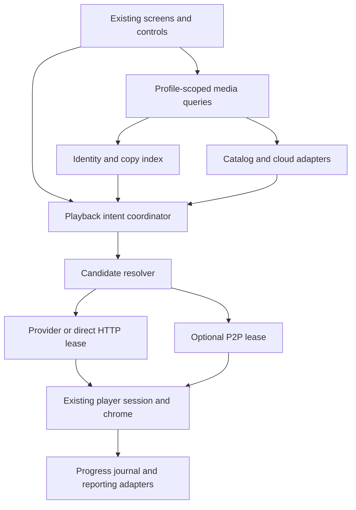
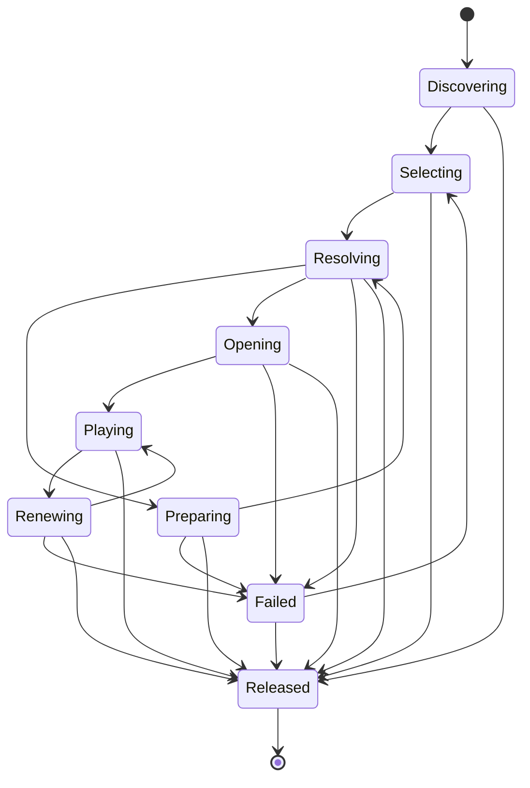

# Architecture and integration contracts

All new types and paths below are proposed. Existing paths were checked against
`a7b172b00ff437eb431fb5d3e7b8b758f4a5c422`. Confidence: high for that inventory;
moderate for the amount of refactoring until implementation tests exercise it.

## Existing foundations and concrete gaps

| Existing code | Reuse | Required change |
| --- | --- | --- |
| `lib/screens/settings/add_connection_screen.dart` | Grouped provider cards and target profile | Generalize its server-only option model for cloud/add-on routes |
| `lib/screens/settings/services_settings_screen.dart` | Service settings hub | Add shortcuts to the same connection records |
| `lib/services/catalog/catalog_source.dart` | CatalogSource, CatalogHubSource, CatalogPage, CatalogDetail | Dynamic installation identity; episode/stream capability interfaces |
| `lib/models/catalog/catalog_item.dart` | External IDs, distinct entry/canonical identity | Remove fixed-enum assumptions from instance addressing; preserve anime-season entry semantics |
| `lib/providers/catalog_sources_provider.dart` | Lifecycle and profile-generation guards | Enumerate dynamic installations, not one instance per enum |
| `lib/services/catalog/catalog_library_matcher.dart` | Existing server copy matching | Return source-aware matches without weakening server behavior |
| `lib/sources/source_models.dart` | FileSource, SourceEntry, PublicationFile, ContentLease | Cloud service kinds/capabilities; typed opaque file references; richer leases |
| `lib/sources/source_transport.dart` | Bounded HTTP and redirect credential stripping | Destination-aware policy and account scheduler; response-envelope parsing remains adapter-owned |
| `lib/sources/source_controller.dart` | Profile-bound adapters, inventory, metadata enrichment | Register cloud adapters and account-backed source projections; preserve generations |
| `lib/sources/source_database.dart` | SourceDatabase/SourceRepository, profile-keyed records | Add transactional remote-media tables; current inspected schema version is 9 |
| `lib/sources/content_access.dart` | Content access, ranges, downloads, encrypted renewal | Add only qualified provider renewal recipes; audit transitive fetches |
| `lib/sources/source_playback.dart` | Standalone playback, progress, native video-slot ownership | Integrate through shared video session/chrome without losing publication playback |
| `lib/services/playback_source_resolver.dart`, `playback_context.dart` | Server/download resolution and reporting | Introduce typed playback target dispatch; do not fabricate a server client |
| `lib/services/credential_vault.dart`, `credential_key_store.dart` | AES-GCM encryption and OS-kept keys | New credential records and clearing rules; no plaintext fallback |
| `lib/services/trackers/device_code_auth_service.dart` | Cancellation/polling pattern | Extract generic result/session type; current base returns TrackerSession |
| `lib/widgets/device_code_dialog.dart` | QR, readable URL/code and Cancel | Use provider-specific auth sessions without duplicating dialog UI |
| `lib/services/deep_links/` | Parsed commands and launch boundary | Add validated import intents and auth callback routing; preserve existing schemes |
| `lib/sources/media_extension.dart` | Declarative extension precedent | Keep existing search extension format; add a separate Stremio adapter, not an incompatible schema replacement |

`MediaServerClient` is a large server contract. It is not the extension point
for a cloud account that cannot implement playlists, metadata editing, server
transcoding and Plex/Jellyfin reporting. Likewise, `CatalogSourceId` is a fixed
enum today, and `CatalogItemDetailScreen` looks up its own source through that
enum. Merely adding `stremio` to the enum would collapse distinct installations.

## Architecture shape



There is no mandatory new network backend. Account traffic goes from the
device to the chosen provider; add-on requests go to configured add-on hosts;
media bytes go from the qualified source to the player or local content gateway.

Keep server and source storage identities intact. A small `UnifiedMediaQueries`
facade composes server queries, cloud inventory and catalog queries into the
existing presentation widgets. It must not require copying whole Plex/Jellyfin
libraries into another database. Existing server launch/reporting remains an
adapter behind a typed dispatch point.

## Domain model

Use immutable value types with explicit serialization versions. Avoid passing
raw provider JSON beyond the protocol parser.

| Proposed type | Minimum fields / invariant |
| --- | --- |
| `ProviderAccount` | profile ID, local UUID, provider key, remote account identity if exposed, display name, credential reference, auth state, capability revision |
| `AddonInstallation` | profile ID, UUID, reported manifest ID/version, encrypted transport reference, safe display origin, resource grants, order, configuration generation |
| `CatalogSourceKey` | tagged built-in ID or add-on installation UUID; never just a remote manifest ID |
| `MediaIdentity` | media kind, normalized external IDs, episode identity, edition/timeline evidence, fallback scoped opaque ID |
| `MediaCopyRef` | stable local copy ID, owner profile, server/source/account/installation reference, native item/file IDs, fingerprint and provenance |
| `StreamCandidate` | candidate ID, identity claim, transport descriptor, safe display metadata, source order, quality facts with evidence, availability observation |
| `AvailabilityObservation` | ready/needsPreparation/unknown/unavailable, observedAt, expiresAt, provider/account scope and reason |
| `PlaybackIntent` | random operation ID, profile generation, requested identity/episode, explicit or automatic choice, resume policy, allowed acquisition actions |
| `ResolvedPlaybackLease` | content lease, stable copy reference, lifetime/renewal handle, origin/header grants, seek/size/container capabilities, egress binding, release handle |
| `PreparationJob` | local operation key, provider job ID when known, target file, ownership, state, timestamps, reconciliation status, failure reason |
| `PlaybackFailure` | typed reason, safe localized action, retry eligibility/time; no raw URL, token or response body |

Transport descriptors are a sealed union: `directHttp`, `cloudFile`,
`hostedLink`, `torrent`, `remotePreparedFile`, `externalAction`, `unsupported`.
Raw signed URLs and configured manifest URLs belong in secret-bearing in-memory
values or encrypted payloads, not serializable display models. A descriptor
identifies what can be resolved; it does not imply permission to start a job.

### Capability interfaces

Use narrow interfaces rather than one provider class with dozens of no-ops:

```text
AccountAuth: begin / poll-or-complete / refresh-if-supported / disconnect
CloudInventory: page / hydrate / changes-if-supported
CatalogDiscovery: hubs / page / search / detail / episodes-if-supported
StreamDiscovery: candidates(identity, playbackContext, cancellation)
AvailabilityProbe: observe(candidates)                 [read-only]
StreamResolver: resolve(candidate, intent, cancellation)
PreparationManager: reconcile / start / observe / cancel-owned
LeaseRenewer: renew(sameCopy, currentLease, cancellation)
ProgressSink: acknowledge(events)                     [optional]
```

Every method receives or captures an account/profile generation and a
cancellation scope. Mutating methods additionally require a `PlaybackIntent`
or an explicit user action. Browsing cannot manufacture that authority.
Network API clients are account-scoped and shared by their adapters; disposal
is owned once by the account registry, not by every catalog view.

## Identity, deduplication and file selection

Identity hierarchy is explicit, not a fuzzy-title union:

1. Exact external ID plus media kind; episodes additionally need series ID and
   verified season/episode or an equivalent mapped absolute episode ID.
2. Verified ID mappings can unite provider identities; store the mapping source,
   confidence and revision. A conflicting mapping does not overwrite the first.
3. Unmapped objects retain `(installation/source UUID, type, opaque ID)`.
4. Filename/year matching proposes a match. Low confidence stays separate and
   supports Match title / Undo match. Never auto-merge by title alone.

Preserve existing `CatalogItemIds.entryKey` behavior for anime/season entries;
series-level IMDb equality is insufficient to merge them. Handle specials,
absolute numbering, double episodes, alternate cuts, remakes and live channels
separately. Chapters, subtitle offsets and resume position belong to a compatible
timeline/edition, not merely the movie name.

A cloud job is not itself a movie. Index its playable files as separate copies,
retain its container relation, exclude sample/trailer files from automatic
selection, and group season packs without dropping the original file browser.
Select by native file ID + validated path/size/episode mapping. A missing
Stremio `fileIdx` never justifies selecting the largest file of an episodic pack.
Torrent index, provider file ID, sorted UI row number and file byte offset are
different values. Include padding entries in the torrent metadata mapping.

Candidate deduplication uses transport identity: verified hash plus file identity
for torrents, account/file identity for cloud, and an installation-scoped opaque
URL fingerprint for HTTP. Do not strip signed query parameters to decide that
two URLs are equivalent. Coalesce presentation without erasing alternate
providers, access scopes or fallback choices.

## Persistence and migration

Extend `SourceDatabase` through the next available schema version at
implementation time; do not assume 10 remains free. Add tables through its
existing migration mechanism and repository boundary:

| Proposed table | Key and payload |
| --- | --- |
| `stream_accounts` | `(profile, account_id)`; safe metadata plus vault ciphertext/credential ref |
| `addon_installations` | `(profile, installation_id)`; encrypted full transport/config; safe origin, manifest metadata, grants and ordering |
| `media_identities` / `media_identity_aliases` | Profile-scoped canonical ID and aliases, type/episode/edition, match provenance |
| `media_copy_refs` | `(profile, copy_id)`; source/account reference, native IDs, validated fingerprint, optional encrypted locator |
| `preparation_jobs` | `(profile, operation_id)` plus uniqueness for account/candidate/file intent while active; provider IDs, ownership and state |
| `remote_media_cache` | `(profile, installation-or-account, resource_key, configuration_generation)`; bounded sanitized payload and expiry |
| `playback_receipts` | Profile + event/session ID; canonical identity, copy, position/timeline, explicit completion/reset, acknowledgements |

These names are logical schema proposals. Reuse existing entries/progress/events
and downloads tables when their semantics fit; do not duplicate publication
bytes or run two independent progress writers. A remote-media repository wraps
the existing source repository and adds identity/projection lookups.

Cloud `FileSource` projections reference one account record; account credentials
do not get duplicated in each source. `ProviderAccount` is the authorization
owner, `FileSource` its browse projection, and each `AddonInstallation` owns its
configured transport. Deduplicate native account links by a verified provider
account ID within the profile where available; never deduplicate by email alone
across profiles. For secret URL duplicate detection use a device-keyed HMAC,
not a plaintext secret or a reversible transport string in an index.

Migrate built-in catalog preferences to tagged `CatalogSourceKey` values while
accepting legacy names on read. Preserve built-in enum IDs for brand/labels if
useful; replace equality, settings keys and source lookup where instance identity
is needed. Unknown stored provider IDs become unavailable records that can be
removed/reconnected; they must not crash `values.byName` parsing.

Perform schema/backfill and initial account/source creation in transactions.
Backfill is restart-safe; interrupted enrichment does not discard inventory.
Maintain a revisioned scan generation, committing deletions only after a full
successful snapshot. A failed page is not evidence that unseen files vanished.
Disable feature reads before rollback; retain additive tables and old server
IDs. Do not downgrade a database in place or restore stale entire databases
over newer watch events.

Exclude credentials, full manifest URLs, raw candidate responses, NNTP details
and signed leases from ordinary settings export/cloud backup. A separate
explicit encrypted export needs its own key-exchange design. Existing encrypted
publication sync does not automatically authorize new credential replication.

## Playback lifecycle



`Released` covers cancellation, profile switch, source disconnect and player
teardown. Every async completion checks intent ID, generation and lifecycle
state before changing UI, storing progress or opening a decoder. Releasing a
player does not automatically delete a provider job or cloud file.

Resolve only on explicit Play, download or a permitted preparation action.
Check eligibility before creating a remote job. Reconcile an existing job by
account/hash/file identity; single-flight resolution per account and candidate
prevents double taps from issuing duplicate POSTs. A timed-out mutation enters
`outcomeUnknown` reconciliation, not blind retry. Persist the intent and job
mapping before subsequent file-selection calls. Never clean up a job merely
because its hash resembles an app-created one; require ownership evidence.

After resolution, open the existing Player/native engine via a shared
`VideoPlaybackTarget` dispatch: server media, file-source media or remote lease.
Extract common controls/session coordination incrementally. Server reporting,
server transcoding and server queues remain server adapters. Remote sessions
use local progress and optional trackers; they never send fabricated Plex IDs.
Use actual player media properties to refine capabilities after opening.

Every native fetch must respect lease origin/header grants. Dart validation
alone is insufficient when mpv, FFmpeg, ExoPlayer or another engine follows
redirects, nested HLS/DASH playlists, segments, keys or subtitle URLs. For a
target lacking enforceable request policy, serve the selected stream through
the existing content gateway extended to enforce the same policy, or mark that
stream unsupported. Verify the gateway supports that format before routing it.
No account API bearer token is attached to a CDN stream unless the documented
stream endpoint specifically requires it under an origin-bound grant.

Lease renewal reacquires the same file, updates expiry and egress binding, and
single-flights concurrent 401/403/expiry failures. Distinguish expired signed
URL from expired account auth and deleted file. Try one renewal and one reopen
of the same copy; do not loop. If the file revision, size or timeline changed,
do not stitch bytes or silently restore a foreign timestamp. Track/subtitle
preferences survive a compatible reopen; generated numeric track IDs may not.

Account egress policy matters for VPN changes, cellular/Wi-Fi transitions,
casting and PiP. Invalidate IP-bound leases on a relevant network change.
Avoid pre-opening several streams to benchmark them. Resolve for the receiving
device only where supported; otherwise explain casting unavailability. Do not
route through a new server simply to conceal multiple-IP use.

### Progress, queue, PiP and multiview

Use one progress writer per playback session. It emits journal events keyed by
profile, logical identity, copy/edition, session ID and monotonic event sequence.
Local progress/Continue Watching commits first; optional tracker/server sinks
acknowledge independently. Apply existing completion thresholds, manual unwatched
actions and reset semantics. Do not invent a new threshold for cloud video.

A replay/reset is not overwritten by a stale larger timestamp; avoid “max position
wins.” For cross-device conflicts retain both event histories and use explicit
revision/reset causality; divergent same-episode resumes require a choice.
Do not mark every server copy watched merely because a cloud copy completed
unless that cross-source sync behavior is explicitly enabled. Source removal
can preserve canonical history while withdrawing the inaccessible copy.

Next episode carries exact episode identity and permitted source preferences,
not a URL or list index. Give each PiP/multiview slot its own lease, progress
writer, cancellation and decoder ownership. Reuse existing slot limits; apply
per-account connection budgets in addition. Closing one slot cannot cancel a
shared account client or the other slot. Watch Together exchanges identity and
timeline commands, never a debrid credential or signed lease; each participant
resolves through their own access. Leave unsupported combinations explicit.

## Network and credential trust boundaries

Keep approved native provider origins, account auth origins, imported add-on
origins and returned media/artwork/subtitle origins as separate grants.
Configured URL paths may contain secrets without recognizable query names;
the existing `sourceCredentialParameter` regex is not sufficient to sanitize
Stremio transports. Redact the whole configured path/query and API request body
in logs, crash breadcrumbs, diagnostics, recent URLs, clipboard history and
analytics. Dart cannot guarantee zeroization of immutable strings; minimize
lifetime and references instead of claiming secure erasure.

Require HTTPS for public add-ons. A user-entered private/self-hosted endpoint
can receive a specific LAN grant using the existing insecure-connection consent
pattern where appropriate; do not globally disable TLS verification or treat
all LAN hosts as trusted. Resolve and validate IPv4/IPv6 addresses, reject
loopback/link-local/metadata/private targets for public installations, and bind
the connection to the validated address while preserving TLS SNI/Host. Repeat
checks on redirects and DNS changes. Native provider CDN destinations require
documented destination policy and public-address validation, not arbitrary LAN
access. Bound redirects; never forward credential headers across origins.

Use resource budgets for JSON, images, XML, subtitles, torrent metadata,
archives and decompression. Disable XML external entities in future indexer
clients. Reject header control characters and restricted headers (`Host`,
connection/hop-by-hop, content length and arbitrary cookies). Permit only the
small compatible request-header set with an installation-scoped origin grant;
special Authorization/Cookie use needs an explicit supported credential route.
`proxyHeaders.response` cannot inject CORS, cookies or cache headers into the
app's gateway. Never execute add-on expressions, arbitrary regex engines or
shell commands from manifests.

Validate OAuth state, redirect origin/path, one-time code use, PKCE where
actually supported, and auth-session/profile binding. Never reuse a tracker
OAuth proxy without adding a reviewed provider contract. Use provider-native
flows for QR whenever possible. Any new phone-to-TV secret transfer must use
authenticated encryption, single-use session binding, expiry and replay
protection; existing companion discovery alone does not establish this.

Profile switches cancel pending auth, discovery, media leases and jobs' local
observers, clear in-memory credentials and scoped caches, and dispose adapters.
Remote jobs may remain on the provider and be reconciled upon returning.
PIN/Explore restrictions also apply to Home/Search/Find Next/deep-link entry;
no hidden catalog can leak titles through another projection. Treat unknown
ratings according to the restricted profile's policy, not as unrestricted.

## Scheduling, caching and budgets

These are initial tunable targets, not provider guarantees or measured results:

| Work | Initial policy |
| --- | --- |
| Search | 300 ms debounce; cancel superseded query; total 6 requests in flight, max 2 per origin; cached/local results first |
| Detail / candidate discovery | 2 s soft budget to offer first useful choices; 8 s interactive deadline; preserve slow-source retry; cap 100 normalized candidates per add-on and 300 per intent |
| Catalog pages | 50 visible items per app page; translate to provider pagination; prefetch at most one next page |
| Inventory | First page before enrichment; 2 hydration calls per account; pause bulk scans during active startup and on metered networks |
| Cache TTL defaults | Manifests 24 h; catalog 15 min; metadata 24 h; negative availability 15 s; positive observations at most 60 s or provider TTL, whichever is shorter |
| Cache bounds | 32 MiB remote JSON budget per active profile and LRU eviction; artwork uses existing bounded cache; no durable resolved-stream cache |
| Parsing | 1 MiB manifest; 4 MiB decompressed response; depth 32; 100 installed add-ons as an initial guarded ceiling with clear UI error |
| Retries | Read-only transient requests: at most two retries with jitter; Retry-After wins; no retry of permanent auth/schema failures; mutations reconcile first |
| Circuit breaker | Three consecutive transient failures pause the origin for 30 s; a user retry performs one half-open probe |
| Job polling | Provider interval/backoff first; active viewing foreground only; stop on cancellation, suspension or terminal state |

Respect shorter upstream cache directives and authenticated no-store responses.
Separate public metadata from personalized/account-specific data. Cache keys
include profile, account/installation, configuration generation, locale and
resource parameters. Secret-bearing results stay in memory or encrypted cache
with bounded TTL; invalidation on disconnect/reconfiguration is mandatory.

Batch supported cache checks, honor partial responses and map missing entries
to unknown. An HTTP 429 does not become a cached “no streams” result. Protect
playback/auth work from scan starvation with priority queues. Parse large bounded
responses off the UI isolate. Keep row updates incremental and focus-stable.

## Optional P2P and remote preparation boundary

Keep native engine code behind a small C ABI/FFI or platform-channel adapter,
with isolate-safe ownership and explicit disposal. The app owns policy; the
engine owns networking and piece integrity. Engine events have session/epoch
IDs so stale callbacks cannot reopen a player.

The byte bridge implements bounded GET/HEAD and RFC range behavior, selected
file size/offset mapping, timeouts and cancellation. Bind to loopback only,
use unguessable per-session capability paths, reject unrelated origins and
methods, and close on teardown. Never expose a general file server. Maintain
a disk quota and free-space reserve shared with existing download accounting;
temporary and completed pieces count once. Validate sparse-file allocation and
crash cleanup, not just logical file sizes.

Seek cancels obsolete piece deadlines and prioritizes the requested region plus
container/index data. Do not claim full availability of unverified bytes or
return zero-filled missing data. Handle unavailable peers, metadata stalls,
low space, changing interfaces and private tracker rules with typed failures.
Native packaging, notices, sandbox entitlements and target memory budgets are
part of the work package. A user-owned remote bridge remains an alternate
`remotePreparedFile` route without requiring local native P2P.
