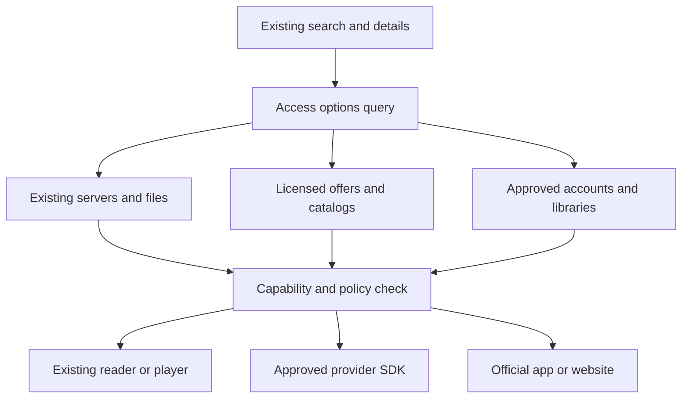

# Architecture and integration contracts

Status: live partner and availability delivery remains gated. Shipped code includes a curated external-destination directory, Google Books public search, OpenSubsonic/Subsonic music sources, podcast RSS/Atom sources, OPML transfer, and a limited integration layer. `integration_contracts.dart` contains provider definitions, safe external targets and deny-by-default commerce policy; `integration_preferences_store.dart` and `integration_identity_store.dart` store non-secret profile-scoped preferences and reversible confirmed crosswalks. `integration_offers.dart` adds non-secret connection and evidence projections, normalized licensed-offer provenance, and a bounded no-cache availability lookup boundary. There is still no universal account registry, production availability adapter, licensed-offer cache or backend endpoint. **High-confidence design recommendation:** continue adding capabilities and projections around existing owners; avoid a new universal player or wholesale database rewrite.

## Boundaries

Catalog browsing must work without obtaining playback leases. Reading an offer never initiates a checkout, loan, provider download job or account mutation. All access routes retain their original data owner and provenance.

## Domain contracts and future target models

The following table records the target model. `IntegrationConnectionRef`, `IntegrationAccessEvidence`, `LicensedOffer`, `LicensedOfferSource`, and the `AvailabilityProvider` boundary now ship as non-persistent Dart contracts. Provider-owned account state, licensed-offer caching, live adapters, and the remaining target rows are still gated; implement those only for a concrete approved provider.

| Type | Minimum fields / purpose | Invariant |
| --- | --- | --- |
| `ProviderDefinition` | Stable provider ID, display name/localized aliases, domains, media kinds, marks, support links, capability descriptors, region/channel policy reference | Definition has no user secret; brand names may change without changing IDs. |
| `IntegrationConnectionRef` | Profile ID, connection ID, provider ID, generation, connection state, consent version | Non-secret projection only; account replacement retires old async work in the provider-owned service. A selected subscription is not a connection. |
| `ServicePreference` | Profile ID, provider, country, user-selected subscription/tier/channel, preferred destinations | Self-reported preference, never verified entitlement. No password requested for a launch-only provider. |
| `EntityRef` | Typed media kind, provider/source namespace, original native ID, optional edition/episode/issue refs | Keep `MediaItem`, `CatalogItem`, `SourceEntry` and game keys authoritative. Adapter references project them into this layer. |
| `ExternalIdentifier` | Namespace, value, entity kind, provenance, match method, confidence, validation timestamp | ISBN, ASIN, TMDB movie, TMDB TV, IMDb, EAN, ISRC, MBID and Steam AppID are not one untyped string space. |
| `EntityRelation` | From/to refs; work-edition, adaptation, translation, season-episode, omnibus-contains, release-recording | Relations support navigation; do not automatically merge progress or rights. |
| `LicensedOffer` | Stable offer and optional product IDs, content/edition ref, seller, territory, source currency/minor-unit price, offer kind, required tier/add-ons, source provenance and expiry | Shipped in-memory normalized offer; no credential, purchase URL, ownership claim or persistence. A null price is unknown, not zero. |
| `IntegrationAccessEvidence` | Connection/local-copy ref, entitlement kind, evidence source, verification state, due/expiry, allowed actions | Shipped action-limited projection; `verified`, `selfReported`, `unknown`, `expired` and `revoked` stay distinct. A verified library loan requires an expiry. |
| `AccessTarget` | Tagged union: existing server item, existing source file, approved SDK item, official external destination, supported license acquisition | A target cannot become a native media URL without a resolver attesting that capability. |
| `FulfillmentCapability` | Read/play/preview, offline, cast, PiP, background, seek, rate, multiview, progress export, DRM/SDK requirements | All optional capabilities default absent/unknown. An external destination has no native offline capability. |
| `ActionPolicyDecision` | Action, provider, platform, distribution channel, storefront country, account/content evidence, allowed/denied/unknown, explanation, policy version | Recheck immediately before dispatch; server-provided data cannot activate a prohibited executable or expand local policy. |
| `ExternalLaunchRecord` | Local profile, entity, provider, intent, launch timestamp, return timestamp if observed | Never changes owned status, watched state, loan state or progress. URLs are not analytics payloads. |
| `PendingProviderOperation` | Owner/generation, action, operation/idempotency ID if supported, state, reconciliation ref, timestamps | A lost response is indeterminate until reconciled; do not retry a financial or circulation mutation blindly. |

Use explicit enums/unions, not a pile of booleans whose combinations imply unsupported states. Separate *capability available in a contract* from *capability configured here* and *capability qualified on this device*. For example, MusicKit availability in the ecosystem is not a qualified Linux playback adapter.

## Adapter interfaces

Prefer small optional interfaces:

- `ProviderCatalog`: search, detail and curated rows with pagination, cancel token, locale and country.
- `AvailabilityProvider`: resolve typed IDs to offers; batch only where the upstream permits it. The shipped `AvailabilityLookupService` bounds provider count/deadline, scopes each request to its adapter, and isolates invalid or failed providers; live adapter behavior remains provider-specific.
- `MerchantProvider`: exact product lookup, regional links, price freshness and accepted affiliate policy.
- `ProviderAccount`: supported sign-in, account details, token renewal and disconnect.
- `EntitlementProvider`: read the user's library/loans/subscriptions only when an API actually supports it.
- `LendingProviderAdapter`: borrow/hold/return/cancel and explicit provider-advertised actions.
- `ProviderPlaybackAdapter`: resolve only authorized native/SDK targets, with independent capability reporting.
- `ProgressAdapter`: map proven playback or explicit user actions to provider-supported progress semantics.

Do not extend `MediaServerClient` with dozens of no-op merchant methods. Do not assume `CatalogSource.supportsWatchlist` means a provider can store book reading state. Keep authenticated SDK clients owned by their connection/session service, as current catalog adapters already do.

## Repository mapping

| Proposed change | Existing integration point | Review constraint |
| --- | --- | --- |
| `lib/integrations/` contracts/registry/policy/query | `lib/providers/catalog_sources_provider.dart`, active profile provider, `SourceController` generation | Reconcile with remote-stream branch names before creating parallel account infrastructure. |
| Optional catalog identity key | `lib/models/catalog/catalog_item.dart`, `CatalogSource`, catalog preferences | Fixed built-in IDs remain compatible; dynamic installations need composite keys, not one value per brand. Coordinate with remote-stream R06. |
| Contextual access rows/sheet | `catalog_item_detail_screen.dart`, `media_detail_screen.dart`, `sources/source_detail_screen.dart`, media-detail action owners | Existing Play/Read primary action keeps its behavior when no new access options exist. |
| Remote search leg | `lib/media/search_hit.dart`, `screens/search_screen.dart`, `catalog_search_screen.dart` | Preserve per-leg failures/cancellation; keep nonplayable catalog hits distinct from server/source hits. |
| Service directory/detail | `screens/settings/services_settings_screen.dart`, existing connect screens and grouped rows | One connection appears once; Files/Lending/Games shortcuts point to the same owner. |
| New lending adapters | `lib/lending/lending_service.dart`, public-library screens, gateway | Refactor incrementally behind an interface; retain OverDrive behavior and disabled release flag. |
| Podcast/OpenSubsonic | Existing music/source playback owners and publication library where semantically suitable | Introduce show/episode or music contracts as needed; do not label a music collection an audiobook. |
| SDK transport bridge | `PlaybackCoordinator`, music playback service, platform packages | One audio/output lease; provider restrictions override generic chrome capabilities. |
| Marks and copy | `assets/provider_marks/`, provider mark widgets, Slang sources | Record official provenance; no unlicensed scraped logos or hardcoded production English. |
| Confidential provider gateway | Existing Go `server/` OAuth infrastructure; existing Python lending gateway remains separate initially | Deployment approval and secrets are operational tasks, not client configuration checked into git. |

## Identity and matching

Resolve exact provider IDs first, then explicit crosswalks. For books, normalize valid ISBN-10/13 checksums and retain format/language/publisher/edition. Never equate a print ISBN with an audiobook solely by title. Match audiobook narrator, abridgement and duration when available. For video, include movie/show/season/episode kind and numbering source; director's cuts and dubbed/anime seasons can diverge. Music uses recording/release/track identities; games use platform/edition/DLC distinctions.

Fuzzy title/creator/year matches are suggestions with confidence and a reversible user confirmation. Keep conflicting candidates visible; do not auto-add paid offers to the wrong edition. A merge record stores its origin and supports undo. Original file fingerprints continue to own exact progress. No CFI, page number, audio timestamp or movie position migrates between editions without a separately verified mapping.

## Persistence and migrations

Add versioned tables/records for provider preferences, account references, offer cache, ID crosswalks and operation receipts. Choose the owning database after reconciling current main and remote-stream persistence; do not hardcode a next schema number in advance. Keep provider secrets in the existing vault, public settings in normal preferences, and cached licensed data separated by source license and retention rules.

Cache key includes entity, provider, country, language, offer type and relevant subscription channel. Patron-specific availability is scoped to the connection/library and cannot enter a shared global cache. Price observations record source currency and timestamp; currency conversion for display never changes the merchant charge.

Migrations must preserve all existing sources, profile PINs, tracker state, downloads, annotations and offline manifests. Disconnect removes live credentials and remote account projections; it must not delete independently imported owned files/history. Profile deletion follows the existing full cleanup contract. Expired loans revoke licensed offline use according to the provider DRM system, not a custom date flag that can be bypassed by opening a cached file.

## Requests, authentication and backend services

Public API keys/IDs are not all secrets; follow each provider's documented public-client model. Confidential signing keys, affiliate network API secrets, Amazon Creators credentials and partner-level library secrets stay in a backend. User tokens use the vault and supported PKCE/device/hosted flows. Do not invent generic OAuth for services that publish API keys or no consumer auth at all.

A proposed Go service extension can expose versioned endpoints for provider definitions, normalized availability and merchant offers. Define schemas before implementing names; illustrative resources are `/integrations/v1/providers`, `/integrations/v1/offers` and a provider-scoped auth callback. It must not be an open URL fetcher or a content-stream relay. Existing local/server media remain usable during gateway failure.

For server-fetched URLs: allowlist partner hosts, validate resolved destinations and redirects, block private/link-local/cloud-metadata addresses, bound bytes/decompression/time, and strip credentials across origins. User-configured LAN/NAS adapters are an intentional separate trust boundary and must not be globally broken by this internet-gateway policy. Rendering remote cover art follows the same credential isolation rules.

OAuth callbacks bind state, redirect, profile, connection, generation and one-time verifier. Refresh is single-flight per account; rotation is atomic. Account switching while the browser is open must retire the old attempt. QR pairing contains a short-lived capability for the intended operation, not the library-card PIN. After sign-out or key-store failure, show reconnect/retry states without overwriting recoverable encrypted data.

The shipped `AvailabilityLookupService` queries at most eight explicitly selected providers, applies a five-second default deadline (maximum 15 seconds), validates exact entity/territory/channel/source/freshness, isolates provider failures, and permits one short transient retry. HTTP 429 is surfaced with a bounded retry time and is not retried. It does not cache offers or implement a circuit breaker. A production backend must add partner-specific rate limits, retention-approved cache TTL/purge controls and circuit breaking before it is enabled. Keep local results independent of network calls, never query every provider per keystroke, and fetch offers on detail demand.

## Fulfillment and playback

Native authorized files reuse `ContentLease`, `SourceTransport`, `SourcePlayback` and existing player/reader routes. Signed links are transient and refreshed through the owning adapter. Store a renewable recipe only when the existing protected transfer path supports it. Do not hand provider credentials to cross-origin cover requests, publication JavaScript or generic external intents.

An official SDK creates a provider-owned playback session registered with `PlaybackCoordinator`. It reports actual state and declares supported commands. Disabled controls disappear or have truthful explanations: no generic Downloads, casting, rate, DSP, screenshots, PiP or Watch Together merely because another player supports them. SDK teardown participates in profile changes, audio focus, backgrounding and multiview admission. Protected services cannot enter multiview through a generic video-texture assumption.

External targets launch via a verified HTTPS universal/app link where supported. Maintain explicit per-platform destinations and fallback behavior; do not synthesize undocumented URL schemes. A failed app launch offers the official site. If the platform has no browser/handler, offer a permitted companion handoff or explain that it must be opened elsewhere. QR is not a workaround for prohibited purchase steering. Return to the same detail/focus/scroll location; no fake success callback.

Readium LCP is a separate certified-reader project with yearly fees and platform/SDK integration. The current Foliate/PDF reader cannot consume a protected license just because OPDS can enumerate it. [S12](SOURCES.md#s12) Adobe/ACSM, Kindle/Audible protection, FairPlay, Widevine and PlayReady are distinct systems; do not create a generic “DRM supported” flag. [S04](SOURCES.md#s04), [S13](SOURCES.md#s13), [S15](SOURCES.md#s15)

## Transactions, tracking and notifications

Borrow/hold/cancel/return use current explicit confirmations and provider-advertised actions. Revalidate availability immediately before mutation. If a request times out after dispatch, reconcile loans/holds with the server before offering retry. Purchases remain at the merchant; no card data or generic checkout is added. A later verified entitlement, user-directed import or signed documented receipt is needed to change the library.

Only existing native playback events or actual SDK events may feed tracker/progress adapters. Imported files get their own edition identity; re-opening an external service can create a recent-launch shortcut but not Continue Watching at a fabricated timestamp. Optional manual “Mark watched/read” stays an explicit user action and uses existing mutation owners.

Due dates and price/availability alerts are optional subscriptions. Do not poll all libraries or advertise background notifications until a real supported scheduler/push path exists. This PR creates no automation. Provider callbacks must be verified and deduplicated before reaching a user profile.

## Observability and recovery

Collect provider ID, action category, policy/version, sanitized failure class, latency, request/credit count and cache state. Exclude card numbers, account tokens, private feed URLs, full reading histories and raw OAuth URLs. Affiliate analytics use non-identifying campaign/sub-ID values; purchases are reconciled against network reports, never inferred from client clicks.

Keep per-provider feature flags and a signed/versioned configuration mechanism if remote revocation is needed. Remote configuration may narrow capabilities, not execute code or silently grant a new permission. When terms/access expire, disable the affected offers/API and purge licensed cache as required while preserving user-owned media and unrelated services.
