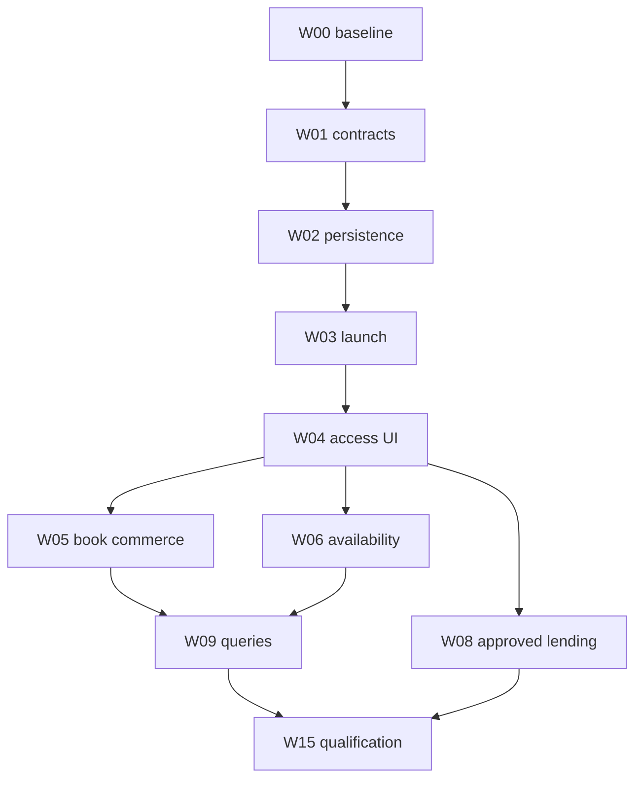

# Luna implementation plan

Everything below is **planned**. This PR contains research and specifications only. Use a dedicated implementation PR branch, preserve concurrent work, and do not enable partner-gated features from fixtures alone.

## First session

1. Read current `AGENTS.md`, `DESIGN.md`, `UX-CONTRACT.md`, this folder, `docs/LENDING_SETUP.md`, `docs/plezyng/connected-media/DELIVERY.md`, `docs/games/STEAM_LIBRARY.md` and the current remote-stream handoff.
2. Fetch current main and active integration branches. Record exact SHAs and compare the debrid/Stremio account/source work with the contracts proposed here. Do not reset or overwrite another agent's branch.
3. Create an implementation branch from the agreed current base. Reuse this assessment as documentation; no need to cherry-pick unrelated integration implementations blindly.
4. Inventory existing tests and dependency injection around profiles, catalogs, sources, playback, lending, navigation and service settings. Reuse fake HTTP/clock/platform seams.
5. Implement one coherent access-options vertical slice with an existing native copy, an external destination and a store offer. It must work with all partner capabilities disabled and contain no production API secrets.
6. Commit small packages with exact evidence. Keep a provider capability/qualification ledger and update it in every subsequent implementation PR.

## Work packages

Effort estimates are **low confidence**, in engineering-day equivalents including review and local verification, not agent runtime or calendar promises. Business approval, device availability and major upstream changes are additional unknowns. Optional breadth is not all required for the first release.

| ID | Package / dependencies | Concrete deliverable | Exit criteria / estimate |
| --- | --- | --- | --- |
| W00 | Reconcile baseline; none | Source/branch map; choose shared ownership with remote-stream work; record current schemas and existing tests | No duplicate account stores or conflicting catalog-key migration; 1–2 days |
| W01 | Capability contracts and fixtures; W00 | Provider definitions, typed entity/offer/evidence/target models, policy inputs, fake providers and sanitized fixtures | Unknown capability cannot imply Play, own, download or connected; malformed/ambiguous IDs rejected; 4–7 days |
| W02 | Persistence/profile lifecycle; W01 | Additive preferences/offer-cache/identity storage, vault references, cancellation, disconnect and migration | Upgrade/restart/switch/delete/key-loss tests preserve existing data; 4–6 days |
| W03 | External destination dispatch; W01/W02 | Shared launcher, allowed HTTPS/app destinations, fallback and return-to-detail state | Launch cannot update watched/owned/loan state; cold/warm link and profile-cancel tests; 3–5 days |
| W04 | Access rows and service preferences; W01/W02/W03 | Existing detail/source chooser + Settings Services + country/subscription preferences | Existing native route unchanged; truthful labels; remote/focus/large-text/RTL checks; 4–7 days |
| W05 | Book commerce/import slice; W04 | One approved merchant adapter first, second behind same interface; format/edition chooser, disclosed links and existing file import guidance | Libro/Kobo or other approved fixture/live route; no account-sync claim; DRM/protected-file handoff; policy/attribution tests; 5–8 days |
| W06 | Licensed availability slice; W04 | Supplier bake-off, one approved availability adapter, title/episode/territory offers and query cache | CA sample evidence; correct channel/rental/price semantics; no private API or fabricated deep links; 4–7 days plus vendor access |
| W07 | Existing-source maintenance; W00 | Audiobookshelf current-auth compatibility; OPDS acquisition classification; chosen presets and import reliability | Versioned auth fixtures, protected acquisition excluded from owned files, existing sources retained; 4–8 days |
| W08 | Lending expansion; W02/W04/W07 | OverDrive release qualification; then approved Hoopla adapter or Palace pilot, each separate PR | Live sandbox auth/circulation/expiry/reconciliation/fulfillment evidence; gate remains closed otherwise; 8–15 days excluding approval |
| W09 | Unified query projections; W04/W05/W06 | Remote catalog search leg, Explore/Find Next integration, exact crosswalks and reversible matching | Local results survive remote failures; bounded traffic; no cross-edition progress merge; 7–12 days |
| W10 | Open audio; W02/W04/W07 | OpenSubsonic music vertical slice and podcast RSS/OPML slice, independently reviewable | Real catalog → play → progress → offline where supported; private-feed isolation; 8–15 days |
| W11 | Official music SDK pilot; W02/W04 | Apple Music first; optional TIDAL/Qobuz/SoundCloud after access decisions | Actual SDK/auth/audio ownership on each enabled target; capability-specific controls; 10–20 days for one qualified provider family |
| W12 | Reading/history integrations; W02/W09 | Hardcover token/GraphQL slice, explicit exports/imports, optional Letterboxd export | Dry-run preview, conflict/undo, opt-in writes, no export of protected text; 6–12 days |
| W13 | Games/retailer extension; W05 | GOG or Fanatical approved offers on existing game detail; canonical activation-platform/edition mapping | Store product never becomes a playable host shortcut; regional-key/DLC fixtures; 5–9 days |
| W14 | Devices/live/DRM research; W00 and relevant owners | Separate bounded spikes for HDHomeRun/TV server, Home Assistant control or LCP certified-reader feasibility | Written go/no-go, actual protocol/device evidence, costs and exact unsupported targets; 8–15 days per selected combined tranche; LCP implementation separately estimated |
| W15 | Release qualification and operator docs; selected packages | Cross-platform matrix, partner/policy decisions, licenses/attribution, recovery/rollback, evidence manifest | All enabled cells proven or disabled; owner review, private-JIT checks where appropriate; 5–10 days |

The first broad access/commerce/availability release is W00–W06 plus W15: **30–52 engineering days**, low confidence, excluding external approvals. A smaller release can stop after one merchant and external launch without enabling a paid availability backend. W07 can address existing-source reliability independently. W08–W14 are separate incremental product decisions, not prerequisites for useful handoff-only streaming support.

## Dependencies and release slices

The graph summarizes the main release path; the work-package table is authoritative for all dependencies. Partner research may proceed while implementation continues, but no approval is inferred from elapsed time.

## Implementation details by tranche

### W00–W02: avoid duplicate foundations

Current main has fixed `CatalogSourceId` and separate `SourceEntry` identities. Remote-stream planning already proposes dynamic catalog keys and account registries. Decide whether that work has landed before changing types. Add adapters/projections around existing values first; migrate persisted catalog selections only with backward readers and fixture coverage.

Use the existing profile provider/`SourceController` generation patterns and vault. Do not reuse server `ProfileConnectionRegistry` rows for unrelated merchant preferences. The registry must distinguish service definition, user-selected subscription, authenticated account and catalog installation. Store no tokens in `FileSource.options`, analytics or offer caches.

Initial fixtures must include one title with native and external access, a work with three different book formats, two conflicting ISBNs, a provider channel offer, a revoked account, stale price, unavailable handler and an unsupported protected file. These tests target integration boundaries, not trivial getters.

### W03–W06: first useful experience

Build the shared access-options query over existing local/server results plus fake external/merchant results. Add the compact section to the existing detail owners; use the existing adaptive source chooser if it can represent external actions without pretending they are playable copies. Otherwise add a small shared access sheet, keeping the native source picker intact.

Use approved official links with explicit per-platform fallback. Before adding production tracking, implement the action-policy evaluator from COMMERCIAL: the same offer can be visible as metadata yet not be permitted as a purchase action on a particular build/storefront. No QR or redirect bypass.

For the first merchant choose whichever of Libro.fm/Kobo/eBooks.com/Apple has actual property approval and usable data. If none is approved, complete neutral model/UI/fixture work and ordinary permitted official handoffs; record the missing approval instead of putting a fake affiliate ID into the app. Do not scrape store results to manufacture a catalog.

For availability, execute the proposed sample comparison and select one provider. Put confidential API credentials in the existing Go backend extension only when needed. Do not require a backend for reading local files. Persist upstream attribution and cache deletion rules. Implement exact title links before enabling a provider badge on a title.

### W07–W08: libraries and owned books

Audit Audiobookshelf against current JWT guidance and supported server releases. Preserve working token entries; provide a migration/reconnect path without deleting histories. Use actual current server behavior and official maintained source when the old API site contradicts it.

Keep OPDS browse/acquisition separate from lending/auth. Explicitly recognize supported direct files, samples, borrow/buy/subscribe links and license documents. A provider's protected acquisition never goes through the unrestricted owned-file download path. Test content type, extension mismatch, redirect, expiry and no duplicate import.

OverDrive uses the existing activation document. The required maintainer application is already described there; check its status rather than sending another request. Hoopla requires its own credentials and patron-auth contract. Reuse circulation UI structure only where semantics agree; do not reuse OverDrive token/scopes or make unsupported hold actions appear.

Palace/Cantook/cloudLibrary integrations require a concrete institution/vendor agreement. Implement one approved pilot before building a generic “all libraries” adapter. A library-authenticated OPDS feed can be useful without native DRM playback.

### W09–W13: broader connections

Generalize progressive search only after useful detail-level offers work. Keep provider leg errors isolated and cached local sources first. Cross-media relations belong in detail navigation, while exact-copy deduplication requires the correct edition/episode/game identity.

For OpenSubsonic, negotiate server capabilities and reuse the actual music session owner. For podcasts, use feed GUID/enclosure/version identity, encrypted private feeds and explicit OPML import/export. Existing Audiobookshelf podcast support can be an initial route if qualified; do not duplicate its owner.

For MusicKit or other SDKs, implement a single supported native platform first and prove audio focus and profile teardown before enabling more. A Flutter UI bridge is not a cross-platform audio engine. Spotify's mixed-service/commercial restrictions make it a business gate before implementation, not simply another adapter task.

Tracker imports begin with preview-only/read-only behavior. Optional writes use idempotency/conflict handling, clear consent and existing tracker queue concepts. Source-file progress remains authoritative for local resume; tracker status is a separate projection. Game offers use the existing grid/detail and never imply host installation.

### W14–W15: bounded experiments and release

Every spike ends with supported targets, implementation/deployment cost, unresolved questions and an explicit go/no-go. Do not leave a partially implemented protected-player toggle visible. LCP feasibility must cover certificate fees, certified binaries, secure license handling, offline expiry, format coverage and distribution compatibility before estimating a full reader integration.

Release only the exact provider/platform/channel cells with evidence. Preserve working noncommercial integrations even if affiliate approval is delayed. Record policy/source freshness, accessible focus/labels, native package hashes and a recovery route for revoked access or unavailable backend services.

## Owner and dependency ledger

| Decision | Owner | Safe work while pending | Blocks |
| --- | --- | --- | --- |
| Data supplier/license/budget | Product/business owner | Interfaces, fixtures, sample harness, neutral detail UI | Production availability API and licensed images |
| Merchant property approval | Business owner | Offer schema, policy evaluator, explicit imports and permitted untracked destinations | Tracking/commission-enabled links for that surface |
| OverDrive/Hoopla/library access | Business/institution owner | Gateway tests, auth/circulation fixtures, existing handoffs | Live native circulation and release flag |
| DRM/SDK certification | Business/platform owner | Isolated SDK feasibility, external fallback | Protected internal playback/offline support |
| Database/catalog coordination | Luna plus owner of active integration work | Read-only reconciliation and additive contract design | Conflicting schema/key changes |
| Device/storefront qualification | Platform owner | Automated fixtures and desktop tests | Claims for untested native targets and store releases |

No messages, applications, payments, deployments or agreements were sent/accepted by this assessment.

## Commit and PR discipline

Use coherent PRs for contracts/persistence, launch/UI, each merchant/feed, each lending adapter and each SDK. Explain user-visible behavior and evidence; do not call a fixture-only provider supported. Avoid broad format churn, dependency upgrades or unrelated player rewrites. Preserve `AGENTS.md` private-JIT policy. Do not dispatch CI or a release merely to prove a documentation change.

For an implementation PR, run meaningful affected tests, formatting, analyzer/localization and required repository checks under the current instructions. CI results must identify the exact tested SHA and private runner workflow. Missing capacity is a blocker, not permission to switch to hosted runners. Manual device results require model/OS/build, account/library sandbox and reproducer.

## Copyable handoff prompt

> Implement PlezyNG's service-integration roadmap starting with W00–W04 in `docs/plezyng/service-integrations/IMPLEMENTATION.md`, then a single approved book-commerce/availability slice. Read the audit, architecture, UX, commercial gates, source register and validation plan first. Reconcile current main with the debrid/Stremio work before changing registries or catalog IDs. Preserve all existing native source/player/profile/design owners. Do not claim external playback, purchases, entitlements or partner approval from links, fixtures or browser returns. Keep blocked provider capabilities disabled and record the exact missing evidence. Use a dedicated PR branch, commit/push reviewable checkpoints, and follow current `AGENTS.md` private-JIT rules. Update delivery/qualification evidence with exact SHAs and tests; do not merge to main or deploy as part of a planning-only authorization.
