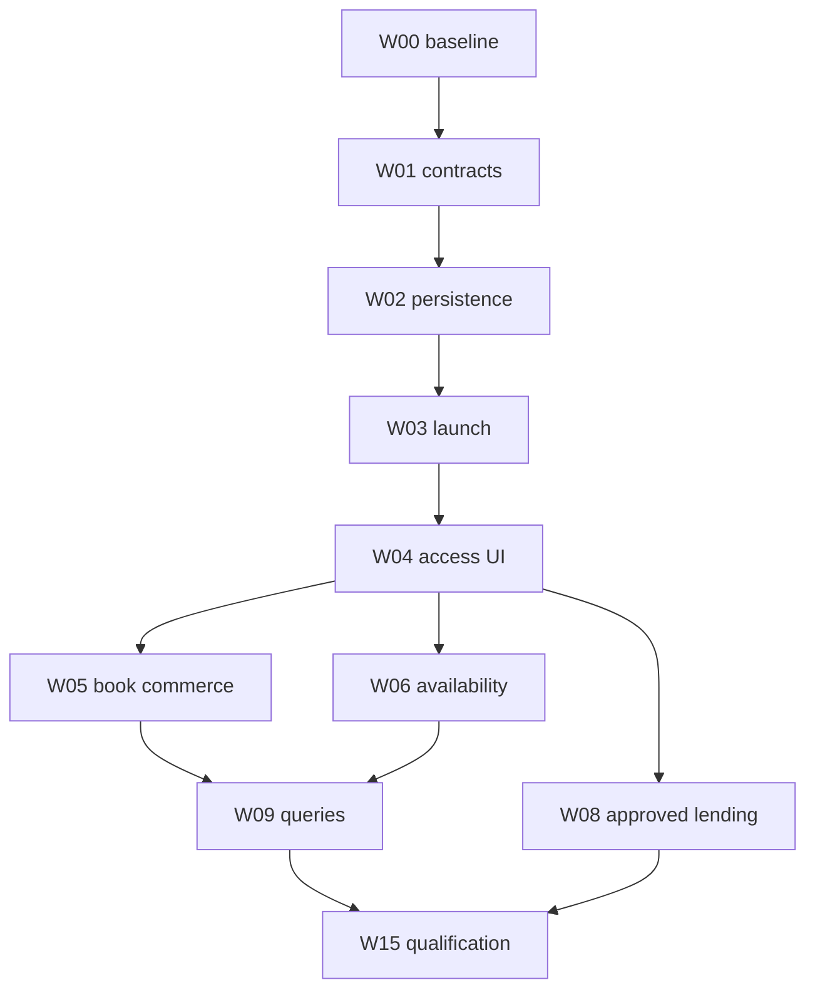

# PlezyNG service integration implementation and delivery record

Status updated **2026-10-28** for closeout branch `codex/service-roadmap-closeout-final-20261028`, based on current `main` at `6fba6ab6d0c257c20b9470adf39dea13ffa6495f`. It preserves the current debrid/Stremio, remote-streaming, IPTV, player, and profile work while reconciling the service roadmap with the code already delivered.

Current main contains the Watchmode server connector and contextual availability rows, plus an iOS Apple MusicKit catalog/playback pilot inside the existing Links flow. It also includes the official storefront and affiliate link broker, inline comic access, Open Library/Google Books, OverDrive behind its explicit flag, OpenSubsonic/Subsonic, podcasts/OPML, connected catalog search, Hardcover, Trakt-to-Letterboxd export, and exact Steam links. This closeout reconciles those deliveries without inferring provider account, entitlement, purchase, loan, or playback from a link or catalog row.

Code within the selected first-release scope is **implemented but unqualified** until local build/analyzer evidence, private-JIT results where applicable, partner setup, and device/provider checks are recorded. No tests, analyzer, platform build, live API, or device qualification were run for this closeout. Watchmode and MusicKit remain disabled until their exact setup requirements are met.

## Closeout context

The closeout branch starts from current `main` at `6fba6ab6d0c257c20b9470adf39dea13ffa6495f`. It preserves the merged debrid/Stremio, remote-streaming, IPTV, player, and profile work while adding only the service integration closeout. Provider-owned credentials and user data stay in their existing service owners.

Code-level work for the selected first-release scope is complete. Remaining work is activation and qualification: partner/property approvals, deployment secrets, Apple app configuration, and live provider/device evidence. Institution-specific circulation and certified DRM remain explicit no-go items for this release, with supported official handoffs and local-source flows preserved.

## Work packages

Effort estimates are **low confidence**, in engineering-day equivalents including review and local verification, not agent runtime or calendar promises. Business approval, device availability and major upstream changes are additional unknowns. Optional breadth is not all required for the first release.

| ID | Package / dependencies | Concrete deliverable | Exit criteria / estimate |
| --- | --- | --- | --- |
| W00 | Reconcile baseline; none | **Reconciled:** this closeout branch starts from current main `6fba6ab6d0c257c20b9470adf39dea13ffa6495f`, which includes PRs #58–#60; the debrid/Stremio and remote-streaming owners are preserved | Keep those existing account/source owners authoritative; no duplicate catalog key or account registry is introduced |
| W01 | Capability contracts and fixtures; W00 | **Contract baseline delivered:** stable entity identities and relations, safe handoff targets, deny-by-default commercial policy, non-secret `IntegrationConnectionRef`, action-limited `IntegrationAccessEvidence`, normalized `LicensedOffer`/money/provenance types, and an `AvailabilityProvider` boundary. Synthetic adapter/policy fixtures are added. Connection persistence and credentials remain with existing service owners; no universal account registry was introduced. | Unknown evidence/capabilities cannot imply playback, ownership, download or connection; malformed, expired, ambiguous and out-of-scope rows are rejected; platform/device qualification remains |
| W02 | Persistence/profile lifecycle; W01 | **Profile-store behavior covered by regression fixtures:** country/provider/tier preferences and confirmed crosswalks stay profile-scoped, clear reversibly, reject malformed values and refuse silent remaps; existing profile deletion and logout cleanup remain the lifecycle owners | Provider connection lifecycle remains service-owned; no licensed-offer cache is persisted before retention rights. Live profile-switch and key-loss qualification remain |
| W03 | External destination dispatch; W01/W02 | **Delivered for curated official links:** title-prefilled HTTPS destinations, official-host policy validation, marketplace-aware routing, profile-scoped country preference, preferred-provider ordering, exact Steam AppID routing, platform launcher fallback and return to the existing detail route | Warm/cold link and platform handler qualification remain; dispatch never updates watched/owned/loan state; 3–5 days |
| W04 | Access rows and service preferences; W01/W02/W03 | **Delivered in existing flows:** profile-scoped country/provider ordering and plan notes; inline comic store actions beside Read; Watchmode title rows in the existing media-detail Links route; optional Apple Music search/play in the existing music Links route. Links never assert account entitlement or purchase completion. | Partner data/entitlement rows beyond Watchmode, plus accessibility/device qualification, remain gated; 4–7 days |
| W05 | Book commerce/import slice; W04 | **Handoff and tracking code delivered:** public Open Library/Google Books results and OPDS/source books preserve validated ISBNs; existing comic details include title-aware official purchase/rent/reader links and a deny-by-default server broker for DriveThru, Awin/Fanatical, FlexOffers, eBooks.com, Bookshop.org, Kobo/Rakuten, and Gumroad. | Merchant/property approvals and credentials activate only their matching links. Feeds, prices, order status, checkout, and purchase-to-owned sync remain outside the shipped handoff path; protected content stays with its seller. |
| W06 | Licensed availability slice; W04 | **Watchmode connector and existing-flow UI delivered, disabled by default:** exact typed TMDB movie/TV ID and profile country; key remains on the relay; 5-second upstream timeout, 30 requests/minute per client, at most 50 rows, bounded six-hour in-memory cache capped at 256 title-region keys, safe HTTPS provider URLs and curated-host dispatch. | Enable only with a current commercial plan, approved terms, relay secret, and live region/title checks. Watchmode links do not verify subscriptions, guarantee playback, or complete purchases; cancellation requires cache purge. |
| W07 | Existing-source maintenance; W00 | **Code and synthetic fixtures delivered:** Audiobookshelf legacy login and JWT refresh/rotation paths; OPDS JSON/Atom open-access/sample parsing, known file-extension fallback, first-supported format selection for mixed-format entries, and the Project Gutenberg preset. Generic purchase acquisitions are excluded from native file imports. | Fixture suite is pending private-JIT execution; supported server versions, feed redirects and device playback still require live qualification |
| W08 | Lending expansion; W02/W04/W07 | **OverDrive implementation already delivered** through the existing lending gateway and native flows, behind `ENABLE_OVERDRIVE=false`; official Libby handoff stays available. No Hoopla or Palace adapter is shipped. | OverDrive application/sandbox/production/branding approvals remain external. Hoopla needs a signed API license, library-specific IDs/credentials, privacy and display permissions, and explicit written permission for any income derived from its API/data; Palace needs a concrete library/vendor agreement and DRM decision. |
| W09 | Unified query projections; W04/W05/W06 | **Partially delivered:** connected Plex Discover, Trakt, MAL, AniList, Simkl and MDBList title search alongside server, Files and Seerr; bounded provider requests, isolated failures, provider filters, exact same-kind ID deduplication, reversible user-confirmed catalog-to-server crosswalks, and bounded Find Next sampling from connected catalogs | Explore continues to show the user-selected catalog source; no cross-edition progress merge; provider/runtime qualification remains; 7–12 days |
| W10 | Open audio; W02/W04/W07 | **Initial code slice delivered:** OpenSubsonic/Subsonic catalog and stream adapter, RSS/Atom episode adapter, HTTPS OPML import/export, Music shelf, and local progress/offline integration. Continue server-version and audio-format qualification. | Existing source/player/progress/offline owners reused; private feed URL/credentials encrypted; OPML export disclosed and confirmed. Server-specific fixtures and device playback qualification remain. |
| W11 | Official music SDK pilot; W02/W04 | **iOS MusicKit pilot delivered in code:** explicit catalog search, user-selected track, authorization/subscription checks, ApplicationMusicPlayer, stop control, local PlezyNG audio handoff, and profile-switch teardown in the existing music Links flow. Compile-time flag defaults off; other platforms retain official handoff. | Enable only after MusicKit App Service/signing setup and signed-device qualification for authorization, subscription loss, interruptions, background, and profile switch. No revenue share is implied by MusicKit. |
| W12 | Reading/history integrations; W02/W09 | **Hardcover and history-export code delivered:** profile-scoped API token, encrypted shelf snapshot with undo, exact ISBN matches projected beside existing source details, confirmed additions only for a unique Hardcover edition, previewed status/page-position writes with remote/local rechecks and guarded undo, and full-logout cleanup of the token/snapshot/undo state; protected text is never exported. Trakt movie history can be exported to a previewed, local-only Letterboxd import CSV; repeat plays and available TMDB/IMDb IDs are retained, and large exports are split below the import size limit. | Live token-scope/mutation and device file-save qualification remain; CSV import is a manual handoff with no Letterboxd account connection; 6–12 days total |
| W13 | Games/retailer extension; W05 | **Handoff and affiliate link code delivered:** exact Steam AppID routing with title-search fallback, plus the current Fanatical/Awin broker path and direct-link fallback. | Merchant acceptance, advertiser IDs, exact surface approval, and any optional product-feed terms remain external gates; no game ownership, key delivery, or host installation is inferred. |
| W14 | Devices/live/DRM research; W00 and relevant owners | **Research decisions delivered:** no Home Assistant adapter for this release; retain existing Cast/remote-control actions. No native HDHomeRun adapter; retain existing Live TV/M3U paths until a selected device and DVR/EPG contract justify it. No LCP reader; retain official fulfillment handoff. | Reopen only with a selected use case plus local-device evidence, vendor license where required, and a funded LCP certification/rights path. |
| W15 | Release qualification and operator docs; selected packages | **Setup and qualification records delivered:** Watchmode, MusicKit, affiliate/lending gates, and W14 decisions are documented. Code paths remain fail-closed until configured. | No test/build/live-provider/device evidence is recorded for this closeout; attach exact private-JIT/build/device receipts before release claims. |

The first broad access/commerce/availability release is W00–W06 plus W15: **30–52 engineering days**, low confidence, excluding external approvals. A smaller release can stop after one merchant and external launch without enabling a paid availability backend. W07 can address existing-source reliability independently. W08–W14 are separate incremental product decisions, not prerequisites for useful handoff-only streaming support.

## Dependencies and release slices

The graph summarizes the main release path; the work-package table is authoritative for all dependencies. Partner activation and qualification may proceed while code remains fail-closed; no approval is inferred from elapsed time.

## Implementation details by tranche

### W00–W02: avoid duplicate foundations

Current main keeps fixed `CatalogSourceId` and separate `SourceEntry` identities; the active debrid/Stremio account/source owner remains separate. Delivered integrations wrap existing source/profile/player owners. Do not introduce a duplicate account registry or migrate persisted keys without a backward reader and fixture evidence.

Use the existing profile provider/`SourceController` generation patterns and vault. Do not reuse server `ProfileConnectionRegistry` rows for unrelated merchant preferences. The registry must distinguish service definition, user-selected subscription, authenticated account and catalog installation. Store no tokens in `FileSource.options`, analytics or offer caches.

The authored synthetic fixtures cover the new integration contracts and selected profile/source boundaries. The broader acceptance matrix remains the qualification checklist; no fixture suite or release result is represented as executed in this closeout.

### W03–W06: first useful experience

Existing detail and Links routes own external handoffs; local playback and reader actions remain primary. Comic purchase/rental/reader options are embedded beside the existing Read action. Video availability rows are loaded on demand from the exact TMDB ID and profile country in the current detail Links flow. The Watchmode key stays server-side, result rows clear while country changes, and only curated official HTTPS hosts can open. The UI does not convert a catalog response into a subscription entitlement or playback action.

The comic link broker applies per-network/per-surface approval gates and falls back to the official merchant URL when credentials or tracking are unavailable. Users see a short commission disclosure beside eligible links. The code does not collect payment or claim that a checkout succeeded. Public catalog sale information remains limited to the source-supplied purchase link and price; protected content stays in the seller's fulfillment flow.

For availability, Watchmode is the implemented connector. The operator must have a currently suitable commercial plan and comply with its retention/deletion terms before setting the approval gate and API key. The server uses a bounded in-memory cache and exposes no image data. No additional supplier is enabled until its own terms, source quality, and region behavior are approved.

### W07–W08: libraries and owned books

Audiobookshelf now logs in through the current JWT endpoint when username/password are supplied, stores access and rotating refresh tokens through the encrypted profile vault, refreshes before expiry, and retries one unauthorized request after renewal. Existing bearer token/API-key credentials remain accepted. OPDS also carries checksum-validated ISBN-10/13 identifiers into book-detail storefront handoffs. Validate the response shape and refresh behavior against supported server versions and reverse proxies; keep source identities and reading/listening history intact.

Keep OPDS browse/acquisition separate from lending/auth. Only explicit `open-access` and `sample` relations enter the file path; generic acquisition, borrow, buy, subscribe and license links are excluded because their fulfillment may be protected or licensed. The sample relation is carried through cached source models and shown as a localized preview label. When one entry advertises several files, use the first recognized supported format for its shelf kind while retaining every file option. The source form offers the public Project Gutenberg OPDS endpoint as a preset. External fulfillment handoffs use the existing official destination directory and never import protected content. Qualify content type, extension mismatch, redirect, expiry and duplicate-import behavior before release.

OverDrive uses the existing activation document and remains disabled until assigned credentials, scopes, environments, IDs, and branding terms are approved. Hoopla requires a separate signed license, library-specific access, and explicit commercial-use permission; do not reuse OverDrive tokens/scopes or expose unsupported circulation actions.

Palace/Cantook/cloudLibrary integrations require a concrete institution/vendor agreement. Implement one approved pilot before building a generic “all libraries” adapter. A library-authenticated OPDS feed can be useful without native DRM playback.

### W09–W13: broader connections

Connected-catalog Search and bounded Find Next are delivered with isolated provider failures, source chips, exact same-kind ID suppression, and confirmed catalog-to-server crosswalks. Keep local/server results first; preserve distinct edition, episode, and game identities.

For OpenSubsonic, the initial adapter uses API-key or legacy MD5 auth, artist/album/search endpoints and the existing music session owner; qualify named server versions and formats before broad support claims. For podcasts, the initial RSS/Atom adapter uses feed-scoped GUID/enclosure identity, encrypted private feeds and explicit OPML import/export. Existing Audiobookshelf podcast support remains a separate route; do not duplicate its owner. Global Search federates every connected non-Seerr catalog with source chips and exact same-kind external-ID deduplication. Find Next uses the active Explore provider's bounded rows and one bounded row from each remaining connected provider; request failures/timeouts are isolated. A profile-confirmed catalog-to-server crosswalk suppresses that duplicate in Search and Find Next and can be removed from Settings → Services → Linked catalog titles. It relates the work only; progress, ownership and access stay separate.

The iOS MusicKit pilot is implemented as one platform-specific native bridge and remains disabled by default. It keeps Apple as the protected audio owner, stops PlezyNG's local music session before Apple playback, and stops on profile switch. Signed-device/audio qualification is still required. Spotify, TIDAL, Qobuz, SoundCloud and other SDKs remain separate partner decisions; one SDK's approval does not grant another provider's rights.

The current tracker slice delivers Hardcover shelf projection and guarded status/page sync plus a previewed local Trakt-to-Letterboxd movie CSV export. It does not connect a Letterboxd account or mutate local reading progress from a remote shelf. Source-file progress remains authoritative; tracker status is a separate projection. Missing Hardcover entries are added only for one exact ISBN edition, and guarded changes retain undo. Game offers use the existing grid/detail and never imply ownership or host installation.

### W14–W15: bounded experiments and release

W14 is closed with bounded no-go decisions for this release. Home Assistant REST control is technically feasible, but no high-value entity/action was selected beyond the existing Cast, remote-stream, and deep-link controls. HDHomeRun offers local discovery/lineup routes, but no target tuner, model/DRM lineup, DVR/EPG rights, or licensed native discovery dependency has been selected. Readium LCP requires a certified reading-system path, fees, rights, secure license handling, and distribution qualification; there is no generic protected-EPUB fallback. Existing IPTV/Live TV, official service handoffs, and supported local readers remain the supported paths.

Release only the exact provider/platform/channel cells with evidence. Preserve working noncommercial integrations if affiliate approval is delayed. Record policy/source freshness, accessible focus/labels, native package hashes, and a recovery route for revoked access or unavailable backend services. The Watchmode and Apple MusicKit setup documents contain their activation checklists; neither feature flag or environment approval variable is enabled by default.

## Owner and dependency ledger

| Decision | Owner | Safe work while pending | Blocks |
| --- | --- | --- | --- |
| Data supplier/license/budget | Product/business owner | Interfaces, fixtures, sample harness, neutral detail UI | Production availability API and licensed images |
| Merchant property approval | Business owner | Offer schema, policy evaluator, explicit imports and permitted untracked destinations | Tracking/commission-enabled links for that surface |
| OverDrive/Hoopla/library access | Business/institution owner | Gateway tests, auth/circulation fixtures, existing handoffs | Live native circulation and release flag |
| DRM/SDK certification | Business/platform owner | Isolated SDK feasibility, external fallback | Protected internal playback/offline support |
| Database/catalog coordination | Luna plus owner of active integration work | Read-only reconciliation and additive contract design | Conflicting schema/key changes |
| Device/storefront qualification | Platform owner | Automated fixtures and desktop tests | Claims for untested native targets and store releases |

No messages, applications, payments, deployments or agreements were sent/accepted by this assessment.

## Commit and PR discipline

Use coherent PRs for contracts/persistence, launch/UI, each merchant/feed, each lending adapter and each SDK. Explain user-visible behavior and evidence; do not call a fixture-only provider supported. Avoid broad format churn, dependency upgrades or unrelated player rewrites. Preserve `AGENTS.md` private-JIT policy. Use the repository's normal verification path for code changes and affected suites for follow-up work.

For an implementation PR, run meaningful affected tests, formatting, analyzer/localization and required repository checks under the current instructions. CI results must identify the exact tested SHA and private runner workflow. Missing capacity is a blocker, not permission to switch to hosted runners. Manual device results require model/OS/build, account/library sandbox and reproducer.

## Code-level closeout

The delivered scope includes the source-backed handoffs, comic merchant broker, Watchmode availability connector, and iOS MusicKit pilot described above. Provider and merchant activations remain fail-closed until the exact agreement, property approval, keys, and runtime evidence exist. Do not treat official search links, API metadata, or a click as playback, entitlement, completed purchase, successful loan, or earned commission.

No tests, analyzer, platform build, live provider request, relay deployment, or device qualification was run for this closeout. Follow the root `AGENTS.md` private-JIT policy before recording any automated validation result.

## Comic commerce runtime

The official comic destination directory and purchase handoff are implemented in lib/services/external_access_directory.dart and lib/screens/external_access_screen.dart. The screen optionally resolves a tracked URL only after the user taps a storefront. server/comic_commerce.go implements /commerce/comic-link, enforces provider host/path allowlists and a per-IP limit, keeps Awin/FlexOffers credentials server-side, and falls back to direct retailer URLs when any partner capability is unavailable. The purchase/rent policy remains deny-by-default for actual acquisition; this code opens the retailer.

The runtime includes configuration paths for DriveThruComics, Fanatical/Awin, Renta!/FlexOffers, eBooks.com and Bookshop.org ISBN affiliate links, Kobo/Rakuten deep links, optional Humble/FlexOffers, Gumroad Discover links, and creator-approved Gumroad product links. GlobalComix creator payouts and Comics Plus library access are official handoffs only; neither is presented as a PlezyNG sales commission. See the comic commerce setup document for deployment configuration and partner gates.
