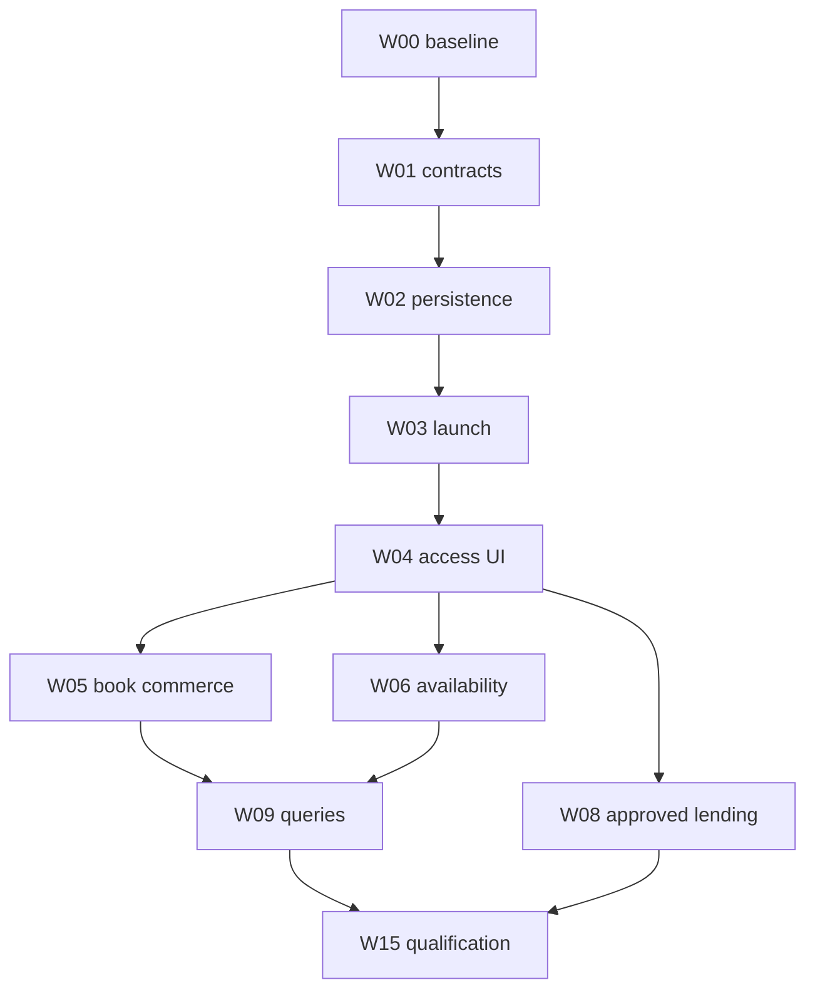

# Luna implementation plan and delivery record

Status updated **2026-10-28** for follow-up branch `codex/integration-plan-code-completion-20261028` based on `main` `1c7acf1e88b91d4cd60ae314195c326e57d0a656`; PR #52 is already merged. The branch adds non-secret connection/evidence contracts, normalized licensed-offer provenance, bounded no-cache availability lookup, profile-store regression fixtures, Audiobookshelf legacy/JWT refresh fixtures, and OPDS JSON/Atom acquisition fixtures. Existing PR #52 code adds official destination handoffs for video, rentals, books, audiobooks, comics, music and games; title-prefilled launch flows; exclusions for Netflix, Prime Video and Disney+; Open Library/Google Books catalog search; OpenSubsonic/Subsonic music browsing and playback; podcast RSS/Atom sources and OPML import/export; profile-scoped preferences and reversible confirmed identity crosswalks; connected-catalog search; Hardcover exact-edition shelf matching, guarded sync and undo; exact Steam game-store links; and local previewed Trakt-to-Letterboxd CSV export. The fixture suites have not yet run; no live provider or device qualification is claimed. Licensed availability remains gated until a supplier and server-side terms are approved.

This remains a handoff/public-catalog slice with a limited set of partner-gated affiliate-link implementations, not a universal provider-account, entitlement, playback, comparison-shopping or affiliate platform. Existing local files, media servers, trackers, OPDS and lending continue through their current owners. The follow-up supplies contracts and synthetic fixtures, not a live provider or data source. Those fixture suites still require execution on an authorized private JIT runner. Do not claim partner-gated features based on search fixtures or official links alone.

W03 has curated, policy-checked official handoffs. W04 has profile-scoped country and preferred-provider ordering plus optional user-entered plan labels; these preferences do not imply account linkage or entitlement. W05 preserves validated ISBN-10/ISBN-13 values from Open Library, Google Books and OPDS and uses them for edition-aware official store searches with title/creator fallback; approved merchant feeds/tracking remain gated. W09 federates global Search across connected catalog sources with local/server/Files and Seerr results, exact cross-catalog IDs, profile-confirmed catalog-to-server matches, and bounded Find Next sampling from connected sources; the Explore tab itself keeps its existing selected-source model. W10 adds initial OpenSubsonic and podcast feed playback through existing sources; OPML intentionally imports HTTPS feeds only. W12 adds Hardcover shelf import, exact ISBN edition matching, source-detail status projection, confirmed missing-entry adds, and guarded status/page-position writes with undo. It also exports paginated Trakt movie history to previewed, local-only Letterboxd import CSV files, preserving repeat watches and splitting files below the import size limit. W13 uses an exact Steam AppID when available and title search otherwise. Remaining packages still need upstream access, platform/device qualification or business approval as stated below. Synthetic fixture suites are authored for the code-level gaps and are pending private-JIT execution.

## First session

1. Read current `AGENTS.md`, `DESIGN.md`, `UX-CONTRACT.md`, this folder, `docs/LENDING_SETUP.md`, `docs/plezyng/connected-media/DELIVERY.md`, `docs/games/STEAM_LIBRARY.md` and the current remote-stream handoff.
2. Recheck the current main and active integration branch SHAs recorded below before touching shared catalog/source types. The debrid/Stremio account/source work remains separate; do not reset or overwrite its branch.
3. Create an implementation branch from the agreed current base. Reuse this assessment as documentation; no need to cherry-pick unrelated integration implementations blindly.
4. Inventory existing tests and dependency injection around profiles, catalogs, sources, playback, lending, navigation and service settings. Reuse fake HTTP/clock/platform seams.
5. Extend the delivered handoff slice only through supported public/approved routes. Keep store offers, affiliate tracking, service accounts and playback capability separate.
6. Keep the provider capability/qualification ledger current. This PR's new code is not live-provider qualified; follow-up work must add evidence instead of unsupported capability claims.

## Work packages

Effort estimates are **low confidence**, in engineering-day equivalents including review and local verification, not agent runtime or calendar promises. Business approval, device availability and major upstream changes are additional unknowns. Optional breadth is not all required for the first release.

| ID | Package / dependencies | Concrete deliverable | Exit criteria / estimate |
| --- | --- | --- | --- |
| W00 | Reconcile baseline; none | **Reconciled:** audited the active debrid/Stremio branch at `497a98886d18c80291409c9289bda48c8a67682f` (12 commits beyond merge base `2d08006cea19c6a661aed457a1f104c4e74cdfaa`) and current `main`; kept its account/source ownership separate because its broad source/search changes are not part of this PR | Recheck the branch before touching its registries; no duplicate debrid account store or catalog-key migration is introduced here |
| W01 | Capability contracts and fixtures; W00 | **Contract baseline delivered:** stable entity identities and relations, safe handoff targets, deny-by-default commercial policy, non-secret `IntegrationConnectionRef`, action-limited `IntegrationAccessEvidence`, normalized `LicensedOffer`/money/provenance types, and an `AvailabilityProvider` boundary. Synthetic adapter/policy fixtures are added. Connection persistence and credentials remain with existing service owners; no universal account registry was introduced. | Unknown evidence/capabilities cannot imply playback, ownership, download or connection; malformed, expired, ambiguous and out-of-scope rows are rejected; platform/device qualification remains |
| W02 | Persistence/profile lifecycle; W01 | **Profile-store behavior covered by regression fixtures:** country/provider/tier preferences and confirmed crosswalks stay profile-scoped, clear reversibly, reject malformed values and refuse silent remaps; existing profile deletion and logout cleanup remain the lifecycle owners | Provider connection lifecycle remains service-owned; no licensed-offer cache is persisted before retention rights. Live profile-switch and key-loss qualification remain |
| W03 | External destination dispatch; W01/W02 | **Delivered for curated official links:** title-prefilled HTTPS destinations, official-host policy validation, marketplace-aware routing, profile-scoped country preference, preferred-provider ordering, exact Steam AppID routing, platform launcher fallback and return to the existing detail route | Warm/cold link and platform handler qualification remain; dispatch never updates watched/owned/loan state; 3–5 days |
| W04 | Access rows and service preferences; W01/W02/W03 | **Partially delivered:** searchable Settings Services directory; profile-scoped country and preferred-provider choices influence official title searches; optional user-entered plan labels are shown as notes only; comic storefront actions are embedded in source-backed comic details beside the existing Read action, with featured destinations and an inline View All expansion; existing tracker/Seerr/Hardcover account settings retain their service owners | Verified entitlement and non-comic unified detail access remain partner/data gated; large-text/RTL/device qualification remains; 4–7 days |
| W05 | Book commerce/import slice; W04 | **Partial code delivered:** public Open Library/Google Books results and OPDS/source books retain validated ISBNs; comic detail now offers title-aware official purchase/rental/reader handoffs and a server-side approval-gated affiliate-link broker for DriveThru, Awin, FlexOffers, eBooks.com, Bookshop.org, Kobo/Rakuten and Gumroad. Existing imported-file flow remains the fulfillment path. | Approved merchant catalogs/feeds, purchase attribution/reporting, no account-sync claim, DRM/protected-file handoff and partner qualification remain external-gated; 5–8 days total |
| W06 | Licensed availability slice; W04 | **Reusable code boundary delivered; production slice gated:** normalized offer/money/provenance/evidence types and an adapter registry/lookup service now validate exact entity, source, territory, distribution channel and freshness; query at most eight explicitly selected adapters with a five-second default deadline (15-second hard cap), isolate timeouts/schema failures, and allow one short transient retry. HTTP 429 returns a bounded retry time. A Watchmode-specific adapter and title rows are implemented behind server-side credentials and an explicit commercial-approval flag; its bounded six-hour in-memory cache is supplier-specific. The rows do not verify a user entitlement, and no purchase action is enabled. | Watchmode plan and app-use approval, regional evidence, correct channel/rental/price semantics, retention/attribution terms and live qualification remain external gates. Confidential keys stay server-side; no private API or fabricated deep links |
| W07 | Existing-source maintenance; W00 | **Code and synthetic fixtures delivered:** Audiobookshelf legacy login and JWT refresh/rotation paths; OPDS JSON/Atom open-access/sample parsing, known file-extension fallback, first-supported format selection for mixed-format entries, and the Project Gutenberg preset. Generic purchase acquisitions are excluded from native file imports. | Fixture suite is pending private-JIT execution; supported server versions, feed redirects and device playback still require live qualification |
| W08 | Lending expansion; W02/W04/W07 | Existing OverDrive native code remains behind `ENABLE_OVERDRIVE=false`; this work adds no library connector. Hoopla adapter or Palace pilot requires separate approved access | Live sandbox auth/circulation/expiry/reconciliation/fulfillment evidence; gate remains closed otherwise; 8–15 days excluding approval |
| W09 | Unified query projections; W04/W05/W06 | **Partially delivered:** connected Plex Discover, Trakt, MAL, AniList, Simkl and MDBList title search alongside server, Files and Seerr; bounded provider requests, isolated failures, provider filters, exact same-kind ID deduplication, reversible user-confirmed catalog-to-server crosswalks, and bounded Find Next sampling from connected catalogs | Explore continues to show the user-selected catalog source; no cross-edition progress merge; provider/runtime qualification remains; 7–12 days |
| W10 | Open audio; W02/W04/W07 | **Initial code slice delivered:** OpenSubsonic/Subsonic catalog and stream adapter, RSS/Atom episode adapter, HTTPS OPML import/export, Music shelf, and local progress/offline integration. Continue server-version and audio-format qualification. | Existing source/player/progress/offline owners reused; private feed URL/credentials encrypted; OPML export disclosed and confirmed. Server-specific fixtures and device playback qualification remain. |
| W11 | Official music SDK pilot; W02/W04 | Official music title handoffs and OpenSubsonic/Subsonic files are available. An iOS-only Apple MusicKit catalog/playback pilot is implemented behind `ENABLE_APPLE_MUSICKIT=true`; no other native subscription SDK is shipped | Actual SDK/auth/audio ownership on each enabled target; capability-specific controls; 10–20 days for one qualified provider family plus eligibility/access decisions |
| W12 | Reading/history integrations; W02/W09 | **Hardcover and history-export code delivered:** profile-scoped API token, encrypted shelf snapshot with undo, exact ISBN matches projected beside existing source details, confirmed additions only for a unique Hardcover edition, previewed status/page-position writes with remote/local rechecks and guarded undo, and full-logout cleanup of the token/snapshot/undo state; protected text is never exported. Trakt movie history can be exported to a previewed, local-only Letterboxd import CSV; repeat plays and available TMDB/IMDb IDs are retained, and large exports are split below the import size limit. | Live token-scope/mutation and device file-save qualification remain; CSV import is a manual handoff with no Letterboxd account connection; 6–12 days total |
| W13 | Games/retailer extension; W05 | **Partial:** exact Steam AppID storefront routing for Steam games, with safe title-search fallback; Fanatical/Awin game storefront search links now use the existing affiliate broker behind a separate approval gate and direct-link fallback. | GOG/Fanatical approved product feeds, title-level offers, canonical activation-platform/edition mapping and regional key/DLC data remain partner-gated; 5–9 days |
| W14 | Devices/live/DRM research; W00 and relevant owners | Separate bounded spikes for HDHomeRun/TV server, Home Assistant control or LCP certified-reader feasibility | Written go/no-go, actual protocol/device evidence, costs and exact unsupported targets; 8–15 days per selected combined tranche; LCP implementation separately estimated |
| W15 | Release qualification and operator docs; selected packages | Implementation/validation ledger updated with code-complete boundaries, partner gates, and the private-JIT evidence requirement | External provider, legal, device and release evidence remain open; keep unqualified cells disabled and attach exact commits/build/device receipts after authorized runs |

The first broad access/commerce/availability release is W00–W06 plus W15: **30–52 engineering days**, low confidence, excluding external approvals. A smaller release can stop after one merchant and external launch without enabling a paid availability backend. W07 can address existing-source reliability independently. W08–W14 are separate incremental product decisions, not prerequisites for useful handoff-only streaming support.

## Dependencies and release slices

The graph summarizes the main release path; the work-package table is authoritative for all dependencies. Partner research may proceed while implementation continues, but no approval is inferred from elapsed time.

## Implementation details by tranche

### W00–W02: avoid duplicate foundations

Current main has fixed `CatalogSourceId` and separate `SourceEntry` identities. Remote-stream planning already proposes dynamic catalog keys and account registries. Decide whether that work has landed before changing types. Add adapters/projections around existing values first; migrate persisted catalog selections only with backward readers and fixture coverage.

Use the existing profile provider/`SourceController` generation patterns and vault. Do not reuse server `ProfileConnectionRegistry` rows for unrelated merchant preferences. The registry must distinguish service definition, user-selected subscription, authenticated account and catalog installation. Store no tokens in `FileSource.options`, analytics or offer caches.

Initial fixtures must include one title with native and external access, a work with three different book formats, two conflicting ISBNs, a provider channel offer, a revoked account, stale price, unavailable handler and an unsupported protected file. These tests target integration boundaries, not trivial getters.

### W03–W06: first useful experience

Build the shared access-options query over existing local/server results plus fake external/merchant results. Add the compact section to the existing detail owners; use the existing adaptive source chooser if it can represent external actions without pretending they are playable copies. Otherwise add a small shared access sheet, keeping the native source picker intact.

Use approved official links with explicit per-platform fallback. Before adding production tracking, implement the action-policy evaluator from COMMERCIAL: the same offer can be visible as metadata yet not be permitted as a purchase action on a particular build/storefront. No QR or redirect bypass.

For the first merchant choose whichever of Libro.fm/Kobo/eBooks.com/Apple has actual property approval and usable data. If none is approved, complete neutral model/UI/fixture work and ordinary permitted official handoffs; record the missing approval instead of putting a fake affiliate ID into the app. Do not scrape store results to manufacture a catalog.

For availability, execute the proposed sample comparison and select one provider. No executable availability adapter ships in this slice. Put confidential API credentials in the existing Go backend extension only after the provider, license and cache terms are approved. Do not require a backend for reading local files. Persist upstream attribution and cache deletion rules. Implement exact title links before enabling a provider badge on a title.

### W07–W08: libraries and owned books

Audiobookshelf now logs in through the current JWT endpoint when username/password are supplied, stores access and rotating refresh tokens through the encrypted profile vault, refreshes before expiry, and retries one unauthorized request after renewal. Existing bearer token/API-key credentials remain accepted. OPDS also carries checksum-validated ISBN-10/13 identifiers into book-detail storefront handoffs. Validate the response shape and refresh behavior against supported server versions and reverse proxies; keep source identities and reading/listening history intact.

Keep OPDS browse/acquisition separate from lending/auth. Only explicit `open-access` and `sample` relations enter the file path; generic acquisition, borrow, buy, subscribe and license links are excluded because their fulfillment may be protected or licensed. The sample relation is carried through cached source models and shown as a localized preview label. When one entry advertises several files, use the first recognized supported format for its shelf kind while retaining every file option. The source form offers the public Project Gutenberg OPDS endpoint as a preset. External fulfillment handoff is still a separate feature. Qualify content type, extension mismatch, redirect, expiry and duplicate-import behavior before release.

OverDrive uses the existing activation document. The required maintainer application is already described there; check its status rather than sending another request. Hoopla requires its own credentials and patron-auth contract. Reuse circulation UI structure only where semantics agree; do not reuse OverDrive token/scopes or make unsupported hold actions appear.

Palace/Cantook/cloudLibrary integrations require a concrete institution/vendor agreement. Implement one approved pilot before building a generic “all libraries” adapter. A library-authenticated OPDS feed can be useful without native DRM playback.

### W09–W13: broader connections

Generalize progressive search only after useful detail-level offers work. Keep provider leg errors isolated and cached local sources first. Cross-media relations belong in detail navigation, while exact-copy deduplication requires the correct edition/episode/game identity.

For OpenSubsonic, the initial adapter uses API-key or legacy MD5 auth, artist/album/search endpoints and the existing music session owner; qualify named server versions and formats before broad support claims. For podcasts, the initial RSS/Atom adapter uses feed-scoped GUID/enclosure identity, encrypted private feeds and explicit OPML import/export. Existing Audiobookshelf podcast support remains a separate route; do not duplicate its owner. Global Search federates every connected non-Seerr catalog with source chips and exact same-kind external-ID deduplication. Find Next uses the active Explore provider's bounded rows and one bounded row from each remaining connected provider; request failures/timeouts are isolated. A profile-confirmed catalog-to-server crosswalk suppresses that duplicate in Search and Find Next and can be removed from Settings → Services → Linked catalog titles. It relates the work only; progress, ownership and access stay separate.

For MusicKit or other SDKs, implement a single supported native platform first and prove audio focus and profile teardown before enabling more. A Flutter UI bridge is not a cross-platform audio engine. Spotify's mixed-service/commercial restrictions make it a business gate before implementation, not simply another adapter task.

Tracker imports begin with preview-only/read-only behavior. Trakt movie history now has a user-confirmed local Letterboxd CSV export; it includes movie plays and calendar dates, excludes TV episodes and ratings, and does not upload or connect to Letterboxd. Optional tracker writes use idempotency/conflict handling, clear consent and existing tracker queue concepts. Source-file progress remains authoritative for local resume; tracker status is a separate projection. Hardcover page-position export is limited to an existing active read, an exact ISBN edition and a known local page, and uses a remote/local recheck with undo. Missing shelf entries are added only when ISBN lookup returns one exact Hardcover edition. Game offers use the existing grid/detail and never imply host installation.

### W14–W15: bounded experiments and release

Every spike ends with supported targets, implementation/deployment cost, unresolved questions and an explicit go/no-go. Do not leave a partially implemented protected-player toggle visible. LCP feasibility must cover certificate fees, certified binaries, secure license handling, offline expiry, format coverage and distribution compatibility before estimating a full reader integration.

Release only the exact provider/platform/channel cells with evidence. Preserve working noncommercial integrations even if affiliate approval is delayed. Record policy/source freshness, accessible focus/labels, native package hashes and a recovery route for revoked access or unavailable backend services.

## Owner and dependency ledger

| Decision | Owner | Safe work while pending | Blocks |
| --- | --- | --- | --- |
| Data supplier/license/budget | Product/business owner | Interfaces, fixtures, sample harness, neutral detail UI | Production availability API and licensed images |
| Merchant property approval | Business owner | Offer schema, policy evaluator, explicit imports and permitted untracked destinations | Tracking/commission-enabled links for that surface |
| OverDrive/Hoopla/library access | Business/institution owner | Gateway tests, auth/circulation fixtures, existing handoffs | Live native circulation and release flag |
| DRM/SDK certification | Business/platform owner | Isolated SDK feasibility, external fallback | Protected internal playback/offline support |
| Database/catalog coordination | Luna plus owner of active integration work | Read-only reconciliation and additive contract design | Conflicting schema/key changes |
| Device/storefront qualification | Platform owner | Automated fixtures and desktop tests | Claims for untested native targets and store releases |

No messages, applications, payments, deployments or agreements were sent/accepted by this assessment.

## Commit and PR discipline

Use coherent PRs for contracts/persistence, launch/UI, each merchant/feed, each lending adapter and each SDK. Explain user-visible behavior and evidence; do not call a fixture-only provider supported. Avoid broad format churn, dependency upgrades or unrelated player rewrites. Preserve `AGENTS.md` private-JIT policy. Use the repository's normal verification path for code changes and affected suites for follow-up work.

For an implementation PR, run meaningful affected tests, formatting, analyzer/localization and required repository checks under the current instructions. CI results must identify the exact tested SHA and private runner workflow. Missing capacity is a blocker, not permission to switch to hosted runners. Manual device results require model/OS/build, account/library sandbox and reproducer.

## Copyable handoff prompt

> Continue the PlezyNG integration roadmap from current `main`. Existing code includes the shared typed integration contracts, profile-scoped service preferences and confirmed crosswalk storage; connected-catalog global Search; Hardcover shelf snapshot, exact-edition adds and guarded status/page sync; country-aware official storefront handoffs; and exact Steam AppID links. PR #60 brought Debrid/Stremio into `main`; do not duplicate those account/source stores. The Watchmode slice now supplies exact-TMDB, region-scoped availability rows through a server relay and a bounded six-hour in-memory cache; keep it disabled until the plan and app use are approved. The iOS MusicKit catalog/playback pilot is behind `ENABLE_APPLE_MUSICKIT=true` and still needs signed-device qualification. Neither integration establishes a user entitlement. No other native subscription-video providers, Hoopla/Palace circulation, approved merchant feeds or conversion reporting are included. Read the audit, architecture, UX, commercial gates, source register and validation plan. Preserve existing native source/player/profile/design owners. Do not claim purchases, entitlements, affiliate commissions or partner approval from links or fixtures. Keep blocked capabilities disabled, record missing evidence, and follow current `AGENTS.md` checks and private-JIT runner policy.

## Comic commerce runtime

The official comic destination directory and purchase handoff are implemented in lib/services/external_access_directory.dart and lib/screens/external_access_screen.dart. The screen optionally resolves a tracked URL only after the user taps a storefront. server/comic_commerce.go implements /commerce/comic-link, enforces provider host/path allowlists and a per-IP limit, keeps Awin/FlexOffers credentials server-side, and falls back to direct retailer URLs when any partner capability is unavailable. The purchase/rent policy remains deny-by-default for actual acquisition; this code opens the retailer.

The runtime includes configuration paths for DriveThruComics, Fanatical/Awin, Renta!/FlexOffers, eBooks.com and Bookshop.org ISBN affiliate links, Kobo/Rakuten deep links, optional Humble/FlexOffers, Gumroad Discover links, and creator-approved Gumroad product links. GlobalComix creator payouts and Comics Plus library access are official handoffs only; neither is presented as a PlezyNG sales commission. See the comic commerce setup document for deployment configuration and partner gates.
