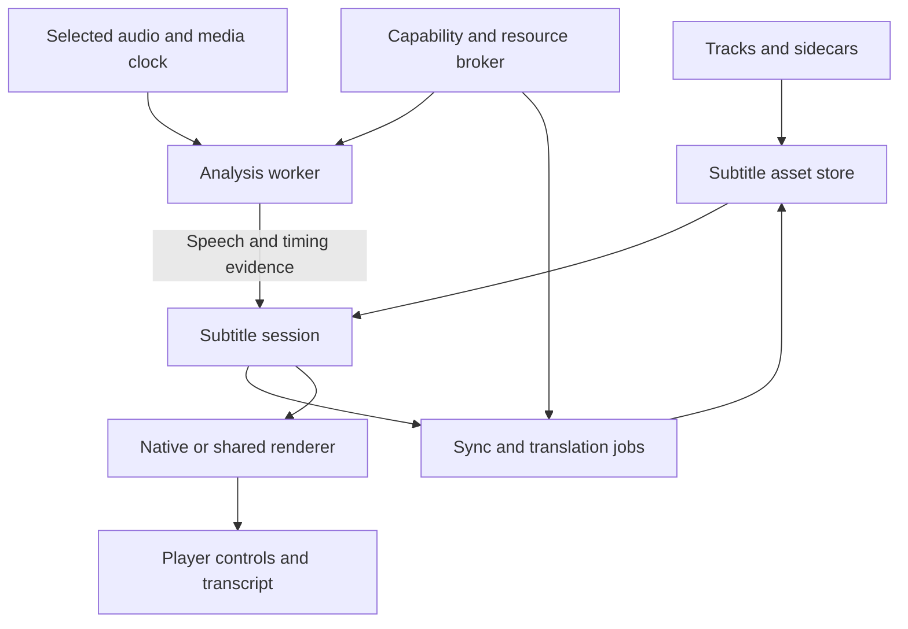

# PlezyNG subtitle implementation plan

Prepared for Keith on October 28, 2026, UTC. The initial source audit is pinned to `snapetech-org/PlezyNG` main at `7c27c543aacd988258d6964c4b2046707a5b737c`; PR #53 opened against `8e24382c96deca0cd13e762e021ab80b95173fe8`. The implementation and requirements are updated against the live PR branch, which has merged main through `d6e5dad2dffa0c7fce351641972e62ffeb07fd83`. Source links preserve the initial audit context. Source presence is not device qualification; performance targets below are proposed acceptance gates, not measured results.

The catalogue contains **132 tracked requirements across ten work packages**, with existing-code mappings, competitor evidence, native-backend choices, and release gates. All requirements are in scope for this implementation effort; the work-package order records technical dependencies, not deferred approval phases. ASR means speech recognition; VAD means voice activity detection; SDH means subtitles for deaf and hard-of-hearing viewers; PTS means media presentation timestamps. RTF is processing time divided by audio duration, so lower is faster.

**Recommendation — confidence high:** extend PlezyNG's existing subtitle selection, rendering, download, and timing code. Add a shared subtitle session and document model, automatic synchronization, local transcription, translation, and optional companion processing. Preserve existing playback and UI ownership. Start with reliable timing and track identity, then CPU generation, Radeon acceleration, translation, and platform expansion.

**Feasibility — confidence high:** CPU and GPU subtitle generation are practical. NPU acceleration is practical on supported device/runtime/model combinations. **Performance on Keith's devices — confidence unknown until benchmarked.** **Demand ranking — confidence moderate:** the evidence shows recurring requests across projects, not a representative market survey. **Advanced audiovisual interpretation — confidence low:** usable prototypes are plausible, but accuracy cannot be promised.

# 1 What PlezyNG already has

The correct starting point is an established subtitle system. Rebuilding track selection or replacing libass would create avoidable regressions. The table distinguishes working code paths from settings, engine capabilities, and proposed additions.

| Existing area | Verified source and behavior | Extend or repair |
| --- | --- | --- |
| Shared player abstraction | `Player`, `PlayerBase`, `PlayerNative`, and platform implementations expose tracks, selection, properties, and events. [C01] | Introduce explicit subtitle capabilities and an analysis interface without another player owner. |
| Primary and secondary subtitles | `TrackSheet` selects primary and secondary tracks, provides numbered badges, and clears secondary when appropriate. `PlayerNative.selectSecondarySubtitleTrack` writes `secondary-sid`. [C02] [C03] | Make secondary selection discoverable, add independent timing/style, and qualify every renderer. This is an extension, not a new mpv feature. |
| Backend differences | ExoPlayer, Tizen, and webOS return `supportsSecondarySubtitles == false`; mpv inherits true and implements selection. [C04] | Add per-operation support results; do not promise all-platform dual subtitles from the existing Boolean. |
| Manual timing | `SyncOffsetControl` offers a ±10-second slider, 50 ms subtitle steps, 1-second held steps, and ±60-second absolute limits. Audio uses 10 ms steps. [C05] | PR #53 adds exact signed millisecond entry, MPV cue-step alignment, independent secondary delay, and bounded two-anchor linear-drift calibration for the active MPV text subtitle. The calibration applies a scoped timestamp multiplier and delay; image subtitles and unsupported players do not expose it. The drift dialog previews without saving and restores the prior delay/rate on cancel; one-step Undo restores the prior saved rate/delay until another timing edit or item change. Standalone MPV OpenSubtitles assets also persist calibrated delay/rate by profile, source edition, file fingerprint, subtitle digest, and selected audio descriptor; changing audio reapplies only its matching correction or neutral timing for an uncalibrated stream. One-cue alignment and corrected SRT/VTT plus safe ASS/SSA export are implemented for standalone MPV VOD. Piecewise cut repair and automatic selected-audio alignment remain. |
| Timing persistence | `PlayerSyncOffsets` tracks what is actually applied; `ScopedPlayerPrefs` supports off/global/library/title scopes and resets on item changes. [C06] | Add edition/audio/subtitle-qualified correction records. The new subtitle timestamp multiplier uses the existing off/global/library/title scope; a title-level offset or rate is still insufficient for different cuts or downloaded subtitle releases. |
| Semantic preferences | `SubtitlePreference` separates item-local identity from cross-item `SubtitleIntent`; language and effective forced status are hard matching requirements. [C07] | A selected subtitle now carries explicit SDH/CC title-marker parity across library episode changes and saved show preferences, declining mismatched tracks so the server fallback remains available. This is title-based because the shared server/native contracts lack a dedicated hearing-impaired field. Ordered languages, regional script, origin, and generated-track intent remain open. Never carry raw native IDs across episodes. |
| Server and native reconciliation | `TrackManager`, `TrackSelectionService`, and `PlaybackSubtitleResolver` reconcile native tracks, source rows, sidecars, transcodes, and burned subtitles. [C07] [C08] | Keep these authorities. Add derived assets and explicit source/audio identities rather than bypassing them. |
| Selection races | Track management waits for late subtitle discovery, retires automatic selection after user action, and tracks session transitions. [C08] | Apply the same generation guards to analysis, translation, OCR, and downloads. |
| Server search | `SubtitleSearchSheet` calls backend search/download. Jellyfin/Emby adapters normalize language, hash-match, forced, hearing-impaired, and provider metadata; provider setup and server permissions still govern availability. [C09] | Unify result ranking and error states without making every server behave like Plex. |
| Automatic preferred-language download | `_fetchPreferredSubtitleIfNeeded` already searches when enabled, ranks perfect matches ahead of other results, downloads, rediscovers the source stream, and builds a sidecar. It skips offline/live, explicit preferences/off, and existing server selections. [C10] | Reuse it; improve confidence, provenance, nonblocking startup, and fallback to generation. Do not list automatic download as wholly missing. |
| Standalone source search | `OpenSubtitlesClient` and `StandaloneSubtitleSearchSheet` support API-key-backed direct search/download, including title IDs and SDH/forced result metadata. [C11] | PR #53 previews bounded SRT/VTT/ASS/SSA cue times and lines before applying a direct OpenSubtitles candidate. It persists applied OpenSubtitles text assets for MPV VOD in app-managed storage, bound to profile, source item, selected edition, and current file fingerprint; it records language/forced/SDH metadata, verifies SHA-256 on restore, and caps each file at 8 assets / 20 MiB. Delay/rate corrections are saved per selected audio descriptor and reapplied after audio-track changes. For exact local or cached files with a known matching byte size, search also sends the OpenSubtitles moviehash and ranks provider hash matches first. Release fingerprint matching and network-only source hashing remain open. |
| Source subtitle lifetime | `SourcePlayback.applyExternalSubtitle` attaches a bounded external track to MPV. [C12] | PR #53 keeps matching MPV VOD assets in an atomic, profile-scoped source-edition/file cache with manifest recovery and content verification. Delay/rate corrections are stored by subtitle digest and selected audio identity. Transient/live and non-MPV playback remain session-only; custom subtitle roots, server-library attachment, and cross-device sync remain open. Corrected SRT/VTT and safe simple ASS/SSA export is available for imported standalone MPV VOD assets. |
| Local subtitle import | The track sheet previously hid ExoPlayer despite an existing native `addSubtitleTrack` path; its shared `command` adapter did not route `sub-add`. Tizen/webOS command handlers were no-ops. [C02] | PR #53 adds a format capability contract and routes local SRT/ASS/SSA/VTT to ExoPlayer VOD, bounded SRT/VTT overlays to Tizen/webOS, and keeps mpv’s existing formats. It scans bounded ZIP archives and materializes only backend-supported entries; paired IDX/SUB imports require both files. Live ExoPlayer attachment and direct paired IDX/SUB validation remain open. Android and TV device behavior is not qualified. |
| In-player appearance | `InPlayerSubtitleStyleSheet` exposes font size and vertical position. [C13] | This PR now exposes text color, bold/italic, outline size/color, and background opacity/color in-player for MPV and ExoPlayer, while unsupported TV backends hide the style action. Independent primary/secondary targeting and presets remain. The sheet now includes a one-tap reset to stored defaults. |
| Full appearance settings | `SubtitleStylingScreen` already provides ASS override choices, render-resolution choices, font size/color, position, margins/anchoring, bold/italic, outline, and background with preview. [C14] | Reuse existing settings and preview. Add legibility controls and apply/error acknowledgement. |
| ASS and bitmap rendering | mpv/libass and Android's libass atlas/rendering code provide substantial native rendering infrastructure. Android also has PGS parsing and subtitle geometry tests. [C15] | Preserve ASS drawing, overlap, fonts, positioning, and karaoke. Derived plain-text views must not silently destroy the original track. |
| Android subtitle delay | ExoPlayer forwards `sub-delay` into `setSubtitleDelay`; native text and ASS rendering account for that offset. `AssLatencyCalibrator` concerns overlay/video presentation latency. [C15] | Keep presentation calibration separate from dialogue-to-cue alignment. The calibrator is not automatic subtitle synchronization. |
| Tizen and webOS | Tizen implements SRT/VTT sidecars with bounded reads and a timed caption path; webOS selects native indexed subtitle tracks and forwards subtitle sync. Both lack secondary selection. [C04] | Qualify bitmap/styled/native tracks separately; implement shared generated-text overlays only where surfaces, clocks, PiP, and exports permit. |
| Downloads | Supplementary subtitle downloads are already resolved and stored per media part, with retry and cleanup integration. [C16] | Include original/translated/generated assets, fonts, revision manifests, and incomplete-job recovery. |
| Visibility and burned text | Existing controls distinguish hiding an overlay from changing a subtitle burned into a server rendition. [C17] | Keep this distinction in all new actions. Hide cannot remove pixels from an already encoded video. |
| GPU and native foundations | Native video output, hardware decoding, libass compositing, and DV work are present. The reviewed source does not establish a general speech-inference runtime, model registry, PCM analysis API, or production NPU subsystem. [C01] [C15] [C18] | Add an inference layer and resource broker. Video decoding support does not imply ASR support. |

Two baseline corrections matter. First, the `Player` factory and `SettingsService.useExoPlayer` select **mpv by default on Android**, with ExoPlayer opt-in; a README footnote still says otherwise. Second, source-path subtitle search and media-server playback are separate flows today. The new subsystem must serve both, without assuming a `MediaItem` exists for every source. [C01] [C12] [C19]

Open PR #40 at `5e1985066d1aecaeb6a4fa240f5203a846d8cae5` adds motion controls and an FFmpeg `minterpolate` adapter. It is not a shipping general neural/NPU inference layer. Open PR #43 at `cabeb731919b11da1a76bf6119feb4e9af96295d` changes shared player/source controls, bookmarks, and looping. Reconcile both before editing overlapping files; neither is part of this main snapshot. [C20] [C21]

## Platform baseline

| Playback path | Existing subtitle path | First AI implementation | Main qualification gap |
| --- | --- | --- | --- |
| Linux and Windows mpv | Native track selection, secondary track, libass, property-based timing/style | Native CPU worker plus Vulkan; optional HIP/CUDA builds | PCM access, display-plane integration, resource contention, sandbox packaging |
| macOS and iOS/tvOS mpv integration | MPVKit/libmpv with Apple-specific video output; subtitle plumbing remains native | CPU/Metal first; Core ML/ANE adapter independently benchmarked | PiP, AVFoundation composition, memory/thermal/background limits; no assumption that mpv GPU filters are available |
| Android mpv | Primary/secondary mpv path | CPU; Vulkan where qualified; optional vendor NPU later | Decoder/passthrough coexistence, process lifetime, device/driver variability |
| Android ExoPlayer | Native text plus custom ASS rendering; primary only; PR #53 routes local SRT/ASS/SSA/VTT import through the existing Media3 re-prepare path, preserving the current position on VOD | Analysis decoder or approved PCM tap; generated-text renderer | Live external attachment, dual renderers, clock mapping, hardware offload; no Android device qualification in this PR |
| Tizen | Native video, remote sidecars, and local SRT/VTT overlay import (PR #53; not device-qualified) | Companion-generated or precomputed captions first | Hardware/firmware timing, PiP, and limited CPU/storage/API access |
| webOS | Native indexed track selection/sync plus local SRT/VTT text overlay import (PR #53; not device-qualified) | Companion/precomputed output for generation | Overlay timing/placement, PiP, and supported devices/firmware |
| Cast/external player | Receiver owns rendering and often fetches media independently | Export/serve compatible sidecar or explicit burn-in/transcode | Local Flutter overlays do not travel to the receiver |

# 2 What competitors do well and where the opportunity remains

These are documented capabilities and bounded gaps, not claims that every version or device behaves identically.

| Client or tool | What to borrow | Limitation or lesson for PlezyNG |
| --- | --- | --- |
| Plex | Automatic speech-activity-based synchronization; familiar language defaults and subtitle search. | Documented auto-sync requires analysis and Plex Pass entitlements, handles external SRT, analyzes the primary audio track, and has limitations around large offsets and inconsistent cuts. PlezyNG can support the actual selected audio and non-Plex sources. [W01] |
| Infuse | Low-friction subtitle downloads and broad format coverage in an integrated media-library player. | Repeated dual-subtitle and automatic-sync requests identify opportunities. Request threads establish demand; they do not prove every current Infuse build lacks every proposed feature. [W02] [W03] [W04] |
| mpv | Dual tracks, timing offsets, timestamp scaling, cue navigation, ASS support, and scriptable commands. | Secondary rendering has styling and bitmap-position caveats. Engine capability needs a discoverable UI and reliable persistence. PlezyNG already uses this foundation. [W05] |
| IINA | A native interface around mpv, provider plugins, online subtitle search, and clickable-subtitle extensions. | Plugin features are not the same as built-in cross-platform behavior. Borrow provider interfaces and word lookup without depending on user-installed scripts. [W06] |
| Kodi | Forced/language/hearing-impaired preferences, custom subtitle directories, extensive style controls, HDR UI-luminance control. | Text styling cannot restyle bitmap glyphs. Preference breadth needs understandable controls. Keep Keith's separate subtitle directory possible. [W07] |
| VLC | Delay shortcuts and a bookmark-audio/bookmark-subtitle/apply workflow that is more usable than guessing offsets. | A demonstrated or early-access AI feature is not a universally delivered desktop/mobile feature. Videolabs' current AI plugin page explicitly says it is not generally available. [W08] [W09] |
| Jellyfin clients | Server metadata and provider integration; web and native clients serve different use cases. | Dual-subtitle demand persists in Desktop; historical Android TV offset requests show the cost of uneven client support. Avoid treating the entire ecosystem as one feature set. [W10] [W11] |
| Emby | Server-driven manual and automatic subtitle downloads with provider plugins and matching controls. | Downloads depend on server configuration and permissions; discovery does not itself solve timing, wrong editions, or generation. [W12] |
| MPC-HC | Efficient native rendering, optional libass, WebVTT, manual/automatic subtitle search, and configurable player controls. | Its Windows desktop model is not a portable mobile/TV implementation. Useful quality and power-user reference. [W13] |
| Subtitle Edit | Rich editing, waveform timing, OCR, translation, speech recognition, format conversion, and batch work. | It is an authoring workflow. PlezyNG's opportunity is to make selected capabilities work safely during playback, then offer advanced editing on demand. [W14] |
| Bazarr | Automated provider search, audio synchronization, Whisper fallback, and translation integrations. | Useful companion integration for libraries. It does not eliminate the need for player-clock-aware live generation, transient streams, or per-viewer preferences. [W15] |
| Language-learning extensions | Dual text, word lookup, cue replay, saved vocabulary, and automatic pause at cue boundaries. | These interaction patterns can be integrated with local files, offline viewing, and remote controls. [W16] |
| Windows/Chrome live captions | Captions for otherwise uncaptioned audio; supported translation modes. | OS/browser captions are not automatically edition-bound, exportable subtitle assets controlled by the media client. Supported language/output combinations differ. [W17] [W18] |

## Recurring demand ranked for implementation

| Priority | Demand evidence | PlezyNG response |
| --- | --- | --- |
| 1 | Infuse automatic-sync requests span years; Plex shipped a constrained implementation. | One-action sync with preview, confidence, undo, selected-audio analysis, and drift/cut support. |
| 2 | Infuse multiple-subtitle threads recur over years. Jellyfin Desktop #1223 revisits an earlier issue described as having 47 thumbs-up; the current issue remains open at retrieval. | Finish dual-track UX and timing on mpv; extend capable non-mpv paths instead of claiming universal support. |
| 3 | Jellyfin Android TV #1234 accumulated 32 thumbs-up and 4 hearts; it is closed, so use it as historical demand, not proof of a current missing feature. | Explicit per-backend capability matrix and the same understandable timing controls wherever implemented. |
| 4 | Upstream Plezy #689 requests styling without leaving playback and has 7 thumbs-up. PlezyNG already implements size/position. | Complete the existing in-player style sheet; do not rebuild it. [C22] |
| 5 | Subtitle Edit, Bazarr, and emerging VLC integrations show active delivery around ASR, OCR, and translation. | Integrate these in a playback-oriented workflow. Demand for an exact PlezyNG implementation is unquantified. |
| 6 | Styling/position/overlap reports demonstrate edge cases that survive nominal format support. | Treat ASS fidelity, bitmap geometry, accessibility, HDR brightness, and overlap as first-class acceptance work. [W19] |

The most defensible differentiation is **reliable subtitle behavior across sources and devices**, with automatic repair and local generation behind the existing subtitle controls. The largest recurring gaps are integration, identity, timing, and delivery consistency; an additional model alone does not solve them.

# 3 User experience and selection policy

Keep the existing Tracks/Subtitles sheet. Its main rows are Off, Primary, and optional Secondary. Below them, group **Find or add**, **Timing**, **Appearance**, and **Translate or generate**. Advanced controls expand inside those surfaces. Put transcript/search/learning tools behind a secondary action. Do not add a top-level subtitle section to the main navigation.

During playback, **Fix timing** offers automatic analysis, a short before/after preview, Apply, and Undo. **Translate** offers the source track and target language, then attaches a separate derivative. **Generate** offers audio language, quality, and whether to process this device or a configured companion. Runtime/model details belong in advanced status; the ordinary flow should say Ready, Preparing, Generating, or Unable to keep up, with a concrete next action.

Proposed selection order: explicit current-session choice or Off; valid saved choice for this edition; configured semantic preference; authoritative server selection; optional preferred-language provider search; optional translation of a suitable existing track; optional ASR generation. Respect the existing server/default ladder during migration: implement this as a reconciled policy with regression fixtures, not a wholesale reorder. Explicit Off suppresses automatic fallback. Missing subtitles must not unexpectedly start model downloads or cloud processing.

Separate preference axes: spoken-audio language, preferred subtitle languages, regional script, forced versus full dialogue, SDH/CC preference, primary versus secondary, and origin preference. A subtitle language can differ from the audio. A translation of original dialogue can differ substantially from a localized dub; offer **Match selected audio** when that matters.

# 4 Shared architecture

Use a shared `SubtitleSession` for both `VideoPlayerScreen` and `SourcePlayback`. It coordinates existing owners rather than replacing the player. Heavy work lives in native workers or an optional companion. Flutter owns controls, progress, selection, and document editing.

## Domain contracts

| Proposed contract | Required content and invariants |
| --- | --- |
| `SubtitleAssetKey` | Profile, source identity, media representation/edition, part, subtitle content digest, selected analysis-audio identity where relevant. Signed URLs and native track ordinals are not durable identity. |
| `SubtitleDocument` | Original bytes/reference; parsed cue graph; language/script; format; track roles; metadata; attachments; immutable revision; generated/translated/OCR provenance. Keep authored material intact. |
| `SubtitleCue` | Stable ID, source start/end in integer microseconds, text spans or bitmap references, region/layer, optional word spans, speaker label, confidence/uncertainty, and source-cue correspondence. Overlapping cues are valid. |
| `TimelineTransform` | Offset, affine mapping, piecewise mapping, unmapped ranges, user anchors, confidence evidence, and transform revision. Editing text and editing timing are independent operations. |
| `SubtitleSession` | Current source/audio/edition/part, primary/secondary asset and revision, playback epoch, selected policy, applied transforms, in-flight jobs, renderer acknowledgement. |
| `SubtitleCapabilities` | Select/import/dual/style/delay/affine/cue-stream/bitmap/ASS/PCM/read-ahead/PiP/cast/export capabilities, per format and renderer, with supported/unsupported/unknown plus reason. |
| `MediaAnalysisSource` | Selected audio access, decoder configuration, PTS and discontinuities, seek/range access, authenticated renewable transport, and a permitted extraction mode. Never assume a public file URL. |
| `AsrBackend` | Model/language/task support, actual execution device, precision, startup and streaming modes, cancellation, bounded audio submission, partial/final outputs, measured resource use. |
| `TranslationBackend` | Explicit language pairs, context limits, glossary support, origin, model revision, structured cue correspondence, cancellation, and optional remote execution. |
| `AnalysisJobStore` | Durable state, input digests, checkpoint ranges, dependencies, priority, retry/backoff, cancellation, revision guards, and atomic result commit. |
| `InferenceResourceBroker` | Real device capabilities and measured budgets shared with video decode, shaders, DV, motion interpolation, multiview, games, and other inference. |

Every asynchronous output includes `profileId`, `sourceRevision`, `audioTrackKey`, `playbackEpoch`, `jobId`, and sequence/revision. A seek retires obsolete live work; an audio switch starts a distinct transcript; changing profiles cancels and isolates jobs. Stale results may remain as valid cached assets for their original input, but may never select or display themselves in the current session.

## Audio extraction and playback clocks

Prefer a native pre-output audio tap with original media timestamps. Use a dedicated bounded analysis decoder for VOD read-ahead and when passthrough/offload does not expose PCM. Preserve the audible output mode; do not silently decode an Atmos/DTS bitstream into a different playback output merely to obtain speech samples. A second analysis stream may consume bandwidth or fail on a one-shot/live/protected source; capability detection must state that.

Keep original channel layout for optional speaker/separation analysis. Produce the ASR model's required input separately, commonly 16 kHz mono for Whisper, with known resampler delay. Never feed time-stretched playback audio as if it were source-time audio. Center-channel weighting is optional and falls back to the full mix; dialogue is not guaranteed to occupy the center channel.

Use integer source PTS and explicit mappings for source start offsets, multipart media, transcode seek bases, HLS discontinuities, DVR windows, and playback speed. UI timers and wall-clock timestamps are not the authority. Keep manual audio delay, subtitle correction, and measured output-plane latency as separate terms and apply each exactly once. Test sign conventions with a tone/word/cue fixture.

Native rings should be bounded and nonblocking. A 60-second 16 kHz float32 mono ring is 3.84 MB before metadata; original multichannel buffers are larger. Pass buffers through FFI/shared native ownership, not repeated large platform-channel JSON messages. Throttle events and handle cancellation outside the audio callback.

## Rendering and storage

Render original authored ASS with the existing native path. For secondary subtitles, preserve documented mpv limitations until a tested renderer enhancement exists. Build an independent text/cue representation for search, translation, learning, and editing; it is not a replacement for the original ASS script. Use a dedicated generated-text track or bounded native cue stream for live output. Do not repeatedly reload an ever-growing SRT and hope track selection, timing, and memory remain correct.

Persist derived assets under a profile-scoped managed store, with an optional configurable external subtitle root. Support Keith's `/mnt/datapool/subs` arrangement without moving existing files beside videos. Keep media fingerprints and a manifest that maps files to subtitle assets. Export beside media only when that destination is explicitly chosen. Downloads and source transports retain their current authority over files and credentials.

Cache keys include audio identity, source representation, model checksum, task/language, precision where output differs, decoder settings, glossary revision, and transformation version. Reuse a source transcript across translations; do not retranscribe each target language. A changed dub or cut must invalidate the corresponding timeline/ASR binding. Reuse across server URLs only after content identity is established.

# 5 Synchronization from simple correction to difficult edits

**Confidence high:** ordinary synchronization should start with lightweight analysis. Speech recognition is an optional escalation, not a prerequisite. `ffsubsync` aligns speech/subtitle activity, while `alass` provides a useful reference for split-aware alignment. WhisperX demonstrates word alignment, but overlapping speech and unsupported alignment vocabularies remain limitations. [W20] [W21] [W22]

| Timing problem | Proposed method | Refusal or escalation condition |
| --- | --- | --- |
| Constant delay | Manual offset; one anchor; VAD/subtitle-activity correlation | Sparse dialogue, repeated patterns, weak correlation, wrong audio |
| Uniform drift | Two anchors or robust affine fit across several windows | Residuals vary by scene; a single stretch damages good sections |
| Frame-rate conversion | Explicit timestamp ratio with anchor preview | VFR alone does not imply a subtitle-speed correction; never infer only from nominal FPS |
| Added logos or trimmed opening | Offset after finding matching dialogue | Nonmatching early content must remain unmapped |
| Ads, recap removal, different cuts | Piecewise monotonic alignment with insertion/deletion handling | Missing scenes cannot be repaired by stretching unrelated lines |
| Accurate words but bad cue boundaries | Forced alignment on the same spoken language and matching transcript | Translation, paraphrase, dub differences, music, or overlapping speakers invalidate literal alignment |
| Translation with different segmentation | Match broader speech activity or an already aligned source subtitle | Do not force-align translated words to unrelated phonemes |
| Live/DVR timestamp jumps | Segment-aware PTS mapping and epoch resets | A discontinuity is not a gradual drift to smooth over |
| Audio device/render latency | Existing audio delay and presentation calibration | Never bake a Bluetooth/output-specific delay into a portable subtitle asset |

Canonical timestamp mapping is `t_media = a × t_subtitle + b`. One anchor determines `b` with `a = 1`; two distinct anchors determine `a` and `b`. For example, if subtitle time 60 seconds belongs at media time 62 seconds and subtitle time 660 belongs at 662.6, then `a = 1.001` and `b = 1.94`. Transform both cue boundaries. Positive `b` delays display. Test actual mpv option composition before mapping this directly to `sub-speed` and `sub-delay`; exporting transformed timestamps is the portable reference implementation.

Automatic procedure: validate track and audio identities; obtain bounded speech activity windows; remove obvious nonspeech subtitle events from the alignment signal without deleting them from the asset; fit global offset; inspect residuals across independent windows; try affine mapping; escalate to piecewise matching; optionally use ASR/forced alignment for ambiguous same-language sections. Evaluate a held-out window before proposing a correction. Do not treat a correlation coefficient as a calibrated probability.

Use robust estimation, monotonic constraints, minimum anchor spacing, rate-change limits, and explicit unmapped spans. Permit discontinuous jumps for edited cuts, but prevent time reversal. Avoid forcing continuity across content that was removed. Keep a correction undo stack, user anchors, and a reset-to-original action. A low-confidence result must leave playback unchanged and offer manual anchoring or another subtitle release.

For ASS, shifting event boundaries is straightforward; changing event duration can also affect karaoke syllables, animated transforms, fades, and movement timing. An affine or piecewise repair must transform relevant internal timing consistently, or mark that track as unsupported for full-fidelity retiming. For bitmap tracks, shift presentation events; font and wording changes require OCR or another source. Never convert a complex ASS script to SRT as a silent repair.

# 6 Subtitle generation during and before playback

**Yes: generate on the CPU, GPU, or a supported NPU.** The useful distinction is whether analysis has access to future audio.

| Mode | Behavior | Product contract |
| --- | --- | --- |
| Prepare entire title | Background ASR, alignment, segmentation, optional translation and review | Most stable output; resumable; exported and reusable |
| VOD read-ahead | Decode ahead of the playhead and maintain a caption buffer | Can display captions on time after a startup buffer if sustained throughput is sufficient |
| True live | Consume only audio that has arrived | Captions necessarily trail speech; show provisional text only in the selected low-latency mode |
| Delayed live | Hold video/audio playback behind the live edge by a user-selected amount | Trades live latency for stable, synchronized captions |
| Companion processing | Stream bounded audio windows or grant narrow source access to a configured machine | Enables TV/low-power clients; includes network and queue latency |
| On-demand repair | Regenerate a selected interval or fill a verified gap | Preserve existing human/edited lines outside that range |

Whisper is a strong baseline, but its translation task is into English; it is not arbitrary language-to-language subtitle translation. `turbo` is not trained for translation. Use a separate translation stage for arbitrary targets. Streaming wrappers need overlap handling, context management, and stable-prefix commitment; WhisperStreaming is a useful design reference but its maintainers point to SimulStreaming as the successor. [W23] [W24]

For the first implementation, use `whisper.cpp` behind a small versioned native C ABI. CPU support and broad acceleration options make it a useful common baseline. Evaluate a true streaming model through sherpa-onnx for lower latency and language-specific use; evaluate faster-whisper for a desktop/companion batch backend, especially NVIDIA. Do not make a Python environment a mandatory mobile-client dependency. [W25] [W26] [W27]

Generation stages: decode/resample; VAD; language detection with a user override; ASR; timestamp reconciliation; punctuation/casing; cue segmentation; optional word alignment; optional diarization; validation; renderer publication. Keep verbatim recognition separate from optional cleanup. A text model must not invent missing dialogue to improve fluency.

Use overlapping audio windows and stable token/cue IDs. Distinguish partial, stable, and finalized results. Commit stable prefixes rather than replacing the whole screen on every decode. Finalized cues cannot change while being read without an explicit correction policy. Cancel obsolete windows on seek, prioritize the new playhead, and reuse valid cached ranges. On EOS, flush the trailing speech segment. On pause, allow bounded read-ahead or background completion according to policy.

Control common failures: silence/music hallucination, repeated phrases, phantom credit lines, wrong language after a long silent intro, timestamp drift, duplicate overlap text, clipped last words, code-switching, profanity/name corruption, and speech drowned by effects. VAD plus language/task constraints and repetition checks reduce errors, but VAD is not proof of correctness. Low-confidence speech should be marked or left uncertain, not silently replaced with plausible dialogue.

**ASR is not complete SDH.** Speaker names, sound descriptions, music identity, tone, and offscreen events require separate evidence. Anonymous diarization labels may be useful; do not infer a character's name solely from voice clustering. Existing authored SDH remains preferable when it is correct. Optional sound-event captions and visual speaker association belong in later, separately evaluated stages.

## Proposed performance targets

Targets have **moderate confidence as engineering goals** and **unknown confidence on unmeasured devices**. Measure warm and cold operation, not just a model's isolated throughput.

| Metric | Initial acceptance target |
| --- | --- |
| VOD throughput | Sustained real-time factor no worse than 0.5 on a qualified 1× playback tier, leaving room for decoding and translation |
| Faster playback | Require `RTF × playbackSpeed < 1`; target 0.5 or less for headroom, so 2× playback targets RTF ≤0.25 |
| Caption buffer | Start with configurable 20–60 seconds read-ahead; bounded growth; never unbounded whole-file PCM storage |
| Live draft | Aim for first useful partial text within 1.5–3 seconds of speech onset on a qualified streaming model/device |
| Live finalization | Aim for p95 finalization within 5 seconds after utterance end for the declared language/content profile |
| Synchronization repair | For accepted global-offset fixtures, recover injected offset within 100 ms; for realistic accepted dialogue anchors, target p95 error ≤250 ms and publish coverage/refusal rate |
| Playback interference | No analysis-induced audio underruns in qualification runs; compare dropped frames against analysis-off baseline |
| Backpressure | Never grow queues indefinitely; reduce work, switch to prepared mode, or report that the chosen quality cannot keep up |
| Quality | Publish WER/CER, name/number errors, timing error, omissions, hallucinations, and language-specific results; no universal accuracy percentage |

FFmpeg now documents a Whisper audio filter with GPU, queue, VAD, and structured-output options. It is a useful prototype/batch adapter, but its existence does not mean PlezyNG's pinned builds enable it. Do not put a blocking ASR filter in the audible playback chain. Prefer a separate worker and structured output; inspect the actual packaged build. [W28]

# 7 Localization and translation

Treat these as separate tasks: translate subtitle content, adapt writing for a region, render its script correctly, and localize PlezyNG's controls. Slang UI translation is already part of the application; it does not translate the video.

Translate a trustworthy existing subtitle before generating a new transcript. Preserve source cue IDs, speakers, emphasis, forced/sign roles, names, numbers, and uncertainty. Join adjacent fragments into sentences for translation, then resegment using source timing and target-language reading limits. Do not demand one translated sentence per original cue when the language order makes that unnatural. Every derivative retains many-to-many source correspondence.

Provide faithful/natural/literal-learning presets with conservative defaults. Optional regional vocabulary, spelling, formality, honorific handling, name transliteration, units, and glossaries should be explicit choices. Never silently change quantities, currency, plot details, speaker identity, or the censorship level. Keep a series glossary and translation memory keyed by language pair and revision; distinguish a user's correction from a model suggestion.

Protect ASS tags, drawing commands, timestamps, placeholders, and markup from translation. Parse them structurally; do not rely on a regex that assumes every brace means plain text. Reject output with missing cue IDs, malformed structure, altered protected tokens, missing dialogue, or implausible expansion. Treat subtitle/model text as data, never executable tool instructions. A translation failure leaves the source track available.

For local engines, evaluate packaged translation pairs such as Argos-compatible models and suitable multilingual text models. Choose a model only after per-pair quality and redistribution review; architecture and model-weight permissions are distinct. NLLB-200 is a useful research comparator, but its model card uses CC-BY-NC and describes research rather than production deployment, so it is not the default distributable choice. User-configured remote providers are optional adapters with explicit text/audio boundaries, quotas, cancellation, and caching. [W29] [W30]

Implement Unicode shaping, bidirectional layout, combining marks, CJK line breaking, Thai segmentation, Arabic/Hebrew punctuation, font fallback, ruby/furigana where the format supports it, and script variants such as Simplified/Traditional Chinese. Reading-speed policies should be configurable by language and audience; an English characters-per-second rule is not universal. Dual-language alignment is temporal, not necessarily one row for one row.

# 8 CPU GPU and NPU execution plan

**Hardware priority — confidence high:** start with Keith's 9950X3D CPU and RX 9070 XT/RX 7900 XT GPUs, plus the M4 Mac as a separate Apple qualification target. The 9950X3D's CPU/iGPU capabilities must not be treated as a Ryzen AI NPU. AMD's current Radeon documentation covers both Radeon cards, but EndeavourOS is outside the cited official Radeon OS matrix; Vulkan is a sensible portable first target, with HIP separately qualified on the installed driver stack. [W31] [W32]

| Work | CPU role | GPU role | NPU role |
| --- | --- | --- | --- |
| Parsing, selection, timing transforms | Preferred; cheap, deterministic | Usually unnecessary | Unnecessary |
| Speech activity and coarse sync | Preferred baseline | Optional batch acceleration | Optional low-power VAD only when worth integration cost |
| ASR | Quantized/native fallback and a useful desktop tier | Larger models and read-ahead throughput | Qualified encoder/full-pipeline portions depending on runtime |
| Forced alignment and diarization | Small models, fallback | Higher throughput | Only after model/operator support is verified |
| Translation | Small pair-specific models; orchestration | Larger contextual translation models | Fixed supported graphs; decoder loops may remain elsewhere |
| Bitmap subtitle OCR | Small crops, Tesseract-style baseline | Batched OCR and preprocessing | Mobile OCR models where available |
| Dialogue separation | Limited/slow fallback | Primary candidate for demanding separation | Model-specific experimental path |
| Text rendering | Shape/layout and cue scheduling | Existing glyph/bitmap composition | No useful default role |
| Scene-aware placement | Lightweight rules | Object/text/face detection | Efficient detector on supported devices |

| Backend | Proposed use | Qualification requirements |
| --- | --- | --- |
| CPU native | Mandatory baseline; whisper.cpp, optimized resampling, VAD | Runtime-dispatched SIMD, bounded threads, no illegal instructions on older CPUs |
| Vulkan | First portable Radeon route; also candidate on Intel/Android | Actual inference test, memory headroom, shader support, device loss, packaging |
| HIP/ROCm | Optional Radeon high-performance route | Pin runtime/build/architecture; verify gfx1100 and gfx1201 targets; measure on actual OS |
| CUDA | Optional NVIDIA and LAN RTX 3060 backend | Separate dependency package; faster-whisper or whisper.cpp; exact model/precision measured |
| Metal | Apple GPU baseline | Unified-memory pressure, thermal behavior, foreground playback coexistence |
| Core ML/ANE | Apple-specific acceleration | Determine actual execution placement; unsupported operations may fall back. Evaluate WhisperKit/Argmax separately from whisper.cpp's encoder route. [W33] |
| OpenVINO | Intel CPU/GPU/NPU adapter | Current GenAI docs include Whisper NPU support; pin model export/runtime/driver and test actual device. [W34] |
| QNN/HTP | Qualcomm Android and Windows ARM NPU | Compatible SoC, quantized graph, supported operators, context binaries, and measured partitioning. [W35] |
| AMD Ryzen AI | Future supported Ryzen AI devices | AMD documents Windows encoder offload for Ryzen AI 300; do not claim Linux Whisper NPU support from unrelated Linux runtime support. [W36] |
| DirectML or platform ML dispatch | Optional Windows GPU/platform adapter | Do not label DirectML as universal NPU access; select an actual execution provider |
| Other vendor NPUs | Rockchip/Ascend/MediaTek/Samsung and similar experimental adapters | Vendor SDK, exact models/operators, packaging, and on-device measurements required |
| Companion service | Weak TVs, handhelds, remote sources, large offline jobs | Authenticated pairing, bounded data transfer, job isolation, resumability, latency and availability |
| Browser WebGPU/WASM | Future web-client or standalone-tool path | Separate platform project; not implied by current native Flutter support |

The resource broker chooses by measured end-to-end latency, quality, power, and available memory. Do not rank NPU above GPU above CPU by name. Record actual device placement, including mixed execution. A model that loads on an NPU but spends its decoder on CPU is a mixed backend.

For Keith's two-Radeon desktop, benchmark one card for playback and the other for ASR/translation. Small PCM transfers make independent workers more practical than splitting a small speech model across two GPUs. Assign by stable device identity, not a driver enumeration index. On the M4, compare CPU, Metal, and Core ML under simultaneous playback. On Steam Deck and mobile, favor battery-aware small models or companion/prepared output. No device-specific speedup is claimed before measurement.

Budget priorities: audio/video deadlines first; subtitle display next; live ASR and necessary translation next; look-ahead and offline work last. If overloaded, reduce background concurrency/look-ahead, then select a smaller qualified model or companion, and finally offer preparation before playback. Do not silently disable existing motion/DV features or lower caption quality; show the effective state and allow preference-based tradeoffs.

# 9 Full feature catalogue

All entries below are target requirements unless explicitly marked Existing. Existing behavior still needs regression coverage. M0–M9 identify the dependency-aware work packages in section 11. Each row is a bounded requirement that Luna can track independently.

## Selection discovery and everyday controls

| ID | Requirement and acceptance condition | Work package |
| --- | --- | --- |
| Q01 | Existing primary/secondary selection survives migration, including explicit Off and episode transitions. | M0 |
| Q02 | Expose an explicit secondary selector; long press remains an optional shortcut. | M1 |
| Q03 | Show language/script, forced/full, SDH/CC, provider, format, and generated/translated origin without relying on opaque filenames. | M1 |
| Q04 | Standalone OpenSubtitles SRT/VTT/ASS/SSA downloads now show a bounded preview of up to 12 actual cue start times and text lines before apply. Non-text/bitmap candidates and server-library downloads remain unpreviewed; they need format-aware previews and server-side asset access. This code is not test-verified or device-qualified. | M2 |
| Q05 | Rank exact content/release matches, language and role correctly; distinguish a provider score from verified sync quality. PR #53 uses a size-verified local/cached OpenSubtitles moviehash when available and ranks provider hash matches first; filename-only and remote-source results remain less certain. | M2 |
| Q06 | Remember a rejected subtitle revision and avoid repeatedly selecting the same bad result. | M2 |
| Q07 | Existing automatic preferred-language download honors explicit Off and server intent; add cancel/retry and bounded startup behavior. | M1 |
| Q08 | Import files by picker, drop, or platform share intent where supported; validate paired IDX/SUB files. mpv picker import is existing; PR #53 adds ExoPlayer VOD SRT/ASS/SSA/VTT and Tizen/webOS SRT/VTT, plus ZIP-contained formats supported by the active backend. Drop/share remains open; archive IDX/SUB is accepted only as a validated pair. | M2 |
| Q09 | Support separate subtitle roots and source-relative discovery without moving originals. | M2 |
| Q10 | PR #53 adds bounded ZIP scanning for backend-supported subtitle entries. It rejects symlinks, absolute/traversal/duplicate paths; caps archives at 50 MiB, 4096 entries, and each selected member at 32 MiB; extracts only the chosen entry (paired IDX/SUB as a set) into a unique temporary cache path. TAR/7z, test verification, and device qualification remain open; parse/import failures surface the existing subtitle-load error. | M2 |
| Q11 | The bounded cue parser and corrected export now read UTF-8, UTF-8 BOM, and BOM-marked UTF-16LE/BE, preserving the detected encoding/BOM and line endings in exported copies. Legacy code pages still need an explicit encoding-preview choice; imported originals remain unchanged. | M1 |
| Q12 | Refresh/retry missing or expired sidecars through the owning source transport. | M2 |
| Q13 | Preference rules support ordered languages, script, forced/full, SDH, source audio, and explicit exceptions. Library episode navigation now preserves the selected track's explicit SDH/CC title-marker class in addition to language and forced status; unmatched caption classes decline to the existing server fallback. Older saved show preferences infer the class from their title when the new field is absent. Ordered language/script rules, explicit toggles, source-audio matching, and exceptions remain open. | M1 |
| Q14 | Keep secondary choices local when servers expose only one selected subtitle; no accidental server overwrite. | M1 |
| Q15 | Standalone MPV VOD with a persistent SRT/VTT/ASS/SSA subtitle now supports copying all currently visible cue text, previous/next cue seeks, and replay with a session-adjustable 0–2500 ms preroll. Embedded tracks, server-library playback, persisted preroll preferences, and non-seekable/live sources remain open. This code is not test-verified or device-qualified. | M3 |
| Q16 | Offer subtitle-on-mute and temporary replay captions with reliable restoration of the previous selection. The main library player adds an opt-in mute setting: it resolves a subtitle through the existing selection policy, then current profile/audio language, default, or first available non-forced track; the opt-in temporarily overrides the prior Off choice without changing the saved show/server preference, while server-burned captions are left untouched. It restores the prior native selection only while the same item/player remains active and the viewer has not changed tracks. Hidden-state changes restore on unmute, and selection retries when native tracks arrive after the initial mute event. Standalone source video now has a mute control using the same opt-in; it temporarily selects a default, then first non-forced, then first available track and restores only when the player, file, and temporary selection still match. Profile-language resolution is not available in that source path. Replay for persistent standalone MPV text files is covered under Q15; embedded-track replay and server-library replay remain open. These additions are not test-verified or device-qualified. | M3 |
| Q17 | The player exposes configurable subtitle visibility and next-track shortcuts with feedback, plus 50 ms timing steps and a focusable reset in the sync control. This branch adds a configurable reset shortcut (Ctrl+Alt+Z by default) that records zero through the existing scoped persistence and feedback path. Keyboard reset is covered; a dedicated D-pad shortcut or quick tile remains open. | M1 |
| Q18 | Show why an action is unavailable and a viable alternative, including burned text and unsupported receiver formats. | M1 |

## Timing and repair

| ID | Requirement and acceptance condition | Work package |
| --- | --- | --- |
| S01 | Existing manual delay retains 50 ms granularity, scope behavior, rollback on failed writes, and correct displayed value. | M0 |
| S02 | Primary and secondary delays are independent; changing one leaves the other unchanged. | M1 |
| S03 | Extend timing range through deliberate advanced entry; no arbitrary short slider becomes the data-model limit. Exact signed millisecond entry and MPV cue-step correction are implemented in this branch. The player applies bounded two-anchor text-subtitle rate/delay calibration with current-playhead capture, scoped persistence, noncommitting preview, cancel rollback, and one-step undo. Standalone MPV OpenSubtitles assets also retain that correction per selected audio stream. | M1 |
| S04 | The branch adds bounded SRT/VTT/ASS/SSA cue parsing and a standalone MPV VOD one-anchor align-this-line-now picker. It scrolls to the cue nearest the current corrected playhead; selecting a cue binds its start to the playback position at selection and persists the resulting delay for that audio and subtitle asset. This code has not been test-verified or device-qualified; main-library playback and other backends remain open. | M2 |
| S05 | MPV text subtitles support bounded two-anchor affine calibration with scoped persistence, live preview, cancel rollback, and one-step undo. Standalone MPV VOD also supports a one-cue correction and corrected SRT/VTT copies. Piecewise cut mapping and persistent calibration history remain. | M2 |
| S06 | Automatic global alignment uses selected-audio VAD and a separate validation window. | M3 |
| S07 | Automatic drift detection compares multiple windows before applying a rate correction. | M3 |
| S08 | Piecewise repair handles inserted/deleted scenes and reports unmatched spans. | M7 |
| S09 | Allow an already synchronized subtitle as the reference instead of audio. | M3 |
| S10 | Forced alignment is restricted to matching spoken-language transcripts and returns unsupported/uncertain regions. | M5 |
| S11 | Standalone MPV OpenSubtitles corrections persist by profile, edition, source-file fingerprint, subtitle digest, and selected audio descriptor; v1 manifests migrate with neutral timing. Main-library corrections remain title-scoped pending edition/audio/subtitle identity support. | M2 |
| S12 | Preview, undo, reset, one-cue alignment, two-anchor calibration, and corrected SRT/VTT plus simple ASS/SSA export are implemented for standalone MPV VOD imported assets. Export applies the active per-audio delay/rate; cues wholly before time zero require confirmation before omission. ASS/SSA timed karaoke, animation tags, and non-empty Effect fields are refused instead of damaged; ASS event times quantize to centiseconds. Bitmap export, structured provenance, and broader server-library export remain. Original imported assets remain immutable. | M2 |
| S13 | Explicit FPS conversion is tested with 23.976/24/25 cases and does not treat VFR as a blanket error. | M2 |
| S14 | Multipart, transcode starts, ads, discontinuities, and DVR seeks retain correct source-time mapping. | M3 |
| S15 | Sparse forced/sign tracks are not forcibly matched to every spoken segment. | M3 |
| S16 | Output-device latency remains a device/session correction rather than a subtitle-file edit. | M1 |
| S17 | Standalone MPV export retimes simple ASS/SSA Dialogue start/end values while preserving other fields and payload. It explicitly refuses timed karaoke/animation tags and non-empty Effect fields; centisecond timestamp precision may round millisecond corrections. Bitmap export remains unsupported. This code has not been test-verified or device-qualified. | M7 |
| S18 | Show correction quality as measured coverage and residuals, with an understandable uncertain-result state. | M3 |

## Translation and localization

| ID | Requirement and acceptance condition | Work package |
| --- | --- | --- |
| L01 | Translate an existing text track into a distinct selectable derivative with source correspondence. | M5 |
| L02 | Generate source transcript once and reuse it for multiple target languages. | M5 |
| L03 | Maintain source/translation dual view with independent appearance and shared timing provenance. | M5 |
| L04 | Support faithful, natural, and literal-learning modes with explicit selection. | M5 |
| L05 | Apply user-approved names, terminology, and series glossaries consistently. | M5 |
| L06 | Region/script conversion is explicit and separately recorded from semantic translation. | M5 |
| L07 | Preserve quantities, names, speaker cues, tags, and intentional profanity unless a chosen transformation says otherwise. | M5 |
| L08 | Reconstruct sentence context and resegment translated output to target-language reading limits. | M5 |
| L09 | Reject missing, duplicate, or malformed output IDs and altered protected tokens; retain usable source subtitles. | M5 |
| L10 | Support code-switching and per-span language labels without repeatedly flipping the whole track's language. | M6 |
| L11 | Make dub-matched captions a separate choice from translated original dialogue. | M5 |
| L12 | Store corrections and translation memory with model/glossary/revision identity. | M5 |
| L13 | Translate forced signs separately and preserve their screen roles/positions where supported. | M7 |
| L14 | Support local models, configured companion models, and optional authenticated remote providers. | M5 |
| L15 | Provide per-language font fallback, bidi shaping, line breaking, punctuation, and script QA. | M1–M6 |
| L16 | Expose a bilingual editor with cue linkage, terminology checks, undo, and export. | M7 |
| L17 | Offline language packages declare supported source/target pairs and actual task support. | M5 |
| L18 | UI copy uses existing Slang conventions and accessible labels; content translation does not change interface locale. | M1 |

## Speech generation and analysis

| ID | Requirement and acceptance condition | Work package |
| --- | --- | --- |
| A01 | CPU-only full-title transcription produces a valid timed asset without a GPU dependency. | M4 |
| A02 | VOD read-ahead emits a bounded cue stream and reprioritizes after seeks. | M4 |
| A03 | True-live generation distinguishes draft/stable/final text and reports effective latency. | M6 |
| A04 | Delayed-live mode holds playback with explicit latency selection and DVR-window handling. | M6 |
| A05 | User selects or overrides spoken language; uncertain detection never silently locks a wrong language forever. | M4 |
| A06 | VAD, repetition detection, and no-speech checks are tested against silence/music hallucination fixtures. | M4 |
| A07 | Chunk overlap deduplicates words/cues and flushes final speech at EOS. | M4 |
| A08 | Apply punctuation/casing and readable segmentation without unmarked content rewriting. | M4 |
| A09 | Optional word timing is aligned and exported with its quality state. | M5 |
| A10 | Optional anonymous diarization is evaluated for overlap and speaker changes; names require evidence/user mapping. | M7 |
| A11 | Alternate audio tracks have distinct analysis identities; no transcript from the previous dub leaks through. | M4 |
| A12 | Keep passthrough playback intact while using a separate analysis decoder when necessary. | M4 |
| A13 | Generate only a selected interval or fill confirmed missing-caption gaps. | M7 |
| A14 | Audio-only media/audiobooks can expose a transcript using the same source clock and asset store. | M8 |
| A15 | Background queue supports pause/resume/checkpoints, idle/charging policy, and useful cancellation. | M4 |
| A16 | Improve noisy speech with optional preprocessing/separation and show the selected method. | M7 |
| A17 | Context vocabulary/name hints are bounded and tested for hallucination amplification. | M5 |
| A18 | Models expose real language/task/precision/backend support, not a generic all-languages label. | M4 |
| A19 | Human/edited captions retain preference over generated replacements unless explicitly changed. | M4 |
| A20 | Generated sound/music captions are separate from dialogue ASR and retain uncertainty/provenance. | M9 |

## Rendering formats and accessibility

| ID | Requirement and acceptance condition | Work package |
| --- | --- | --- |
| R01 | Preserve SRT/VTT/ASS/SSA and embedded/sidecar paths already supported by each engine. | M0 |
| R02 | Qualify mov_text, TTML/DFXP/IMSC, SAMI, MicroDVD, DVB, teletext, CEA-608/708 and other formats individually; convert when appropriate. | M8 |
| R03 | Preserve simultaneous cues, layers, positions, signs, and dialogue overlap. | M1 |
| R04 | Keep authored ASS drawings, fonts, karaoke, animation, and typesetting in the native renderer. | M1 |
| R05 | Distinguish PGS/VobSub bitmap movement/scaling from text font styling. | M1 |
| R06 | Offer independent primary/secondary font, color, outline, background, margins, alignment, and position where supported. | M6 |
| R07 | Share all appearance settings with the in-player preview rather than duplicating preference logic. | M1 |
| R08 | Provide screen/video anchoring, safe area, zoom/crop, letterbox, and overscan-aware placement. | M1 |
| R09 | Subtitle luminance remains readable in SDR/HDR without searing white; qualify actual output paths. | M6 |
| R10 | Avoid collisions between tracks, player chrome, and authored signs without continuously jumping text. | M6 |
| R11 | Dynamic face/object-aware placement is optional, stable, reversible, and never overrides authored layouts silently. | M9 |
| R12 | PiP preserves supported caption paths and clearly identifies unsupported overlay modes. | M6 |
| R13 | Screen-reader controls, D-pad focus, keyboard actions, large text, contrast, and reduced motion all work. | M1 |
| R14 | Closed-caption services and roll-up/pop-on/paint-on behavior are preserved when those formats are supported. | M8 |
| R15 | Hot reload/import errors cannot corrupt selection or leave duplicate rendered tracks. | M2 |
| R16 | Caption rendering remains correct during speed changes, frame stepping, rotation, window resize, and video-output changes. | M6 |

## Learning editing and personal viewing

| ID | Requirement and acceptance condition | Work package |
| --- | --- | --- |
| X01 | Searchable transcript seeks to the correct source time and optionally hides future dialogue. | M3 |
| X02 | Copy/select text and dictionary lookup operate on text-backed cues; bitmap tracks offer OCR explicitly. | M7 |
| X03 | Replay current line, auto-pause, sentence loops, and adjustable gaps work with remote and keyboard. | M7 |
| X04 | Save vocabulary/bookmarks with source attribution and optional flashcard export. | M8 |
| X05 | Optional transliteration/ruby/furigana is a distinct derived display, not a rewritten original. | M8 |
| X06 | Simple cue editor changes text/time with validation, undo, and revision history. | M7 |
| X07 | Waveform/spectrogram and anchor editing are available in an advanced editor. | M7 |
| X08 | Reflow, line breaks, spell checks, and common-error repair are previewable operations. | M7 |
| X09 | Optional removal of SDH descriptions, song lines, or identifiable subtitle ads never mutates the original or defaults on for accessibility users. | M7 |
| X10 | Spoken subtitles/TTS are optional and mixed with explicit ducking/rate controls. | M9 |
| X11 | Multi-view captions follow selected panes with per-pane identity and a readable density limit. | M8 |
| X12 | Watch Together shares compatible assets/corrections only by policy; language, visibility, and output-device offset remain per viewer. | M8 |
| X13 | Companion/second-screen transcript follows the same media clock with reconnection recovery. | M8 |
| X14 | Subtitle screenshots/export include user-selected tracks and preserve HDR handling where supported. | M8 |

## Persistence export and operations

| ID | Requirement and acceptance condition | Work package |
| --- | --- | --- |
| O01 | Imported OpenSubtitles originals are immutable and content-addressed; manifests use staged replacement and backup recovery. Corrected SRT/VTT and safe simple ASS/SSA copies are exportable; richer derived revisions remain open. | M2 |
| O02 | Attach derived assets durably to server and standalone-source editions without requiring server write access. PR #53 covers imported OpenSubtitles text assets on standalone MPV VOD only; server-side attachment and cross-device distribution remain open. | M2 |
| O03 | Standalone MPV VOD exports corrected SRT/VTT and simple ASS/SSA copies with clipping confirmation. Timed ASS/SSA effects are refused; bitmap formats, structured word/cue JSON, and cross-platform server-library export remain. | M4 |
| O04 | Include selected subtitle assets and required fonts in offline downloads with quota accounting. | M6 |
| O05 | Cross-device sync transfers manifests, corrections, preferences, and selected assets with conflict handling. | M8 |
| O06 | Model packages have hashes, sizes, task/language metadata, compatibility, update rollback, and licenses. | M4 |
| O07 | Backend probing executes a real model smoke test; installed hardware names alone never enable a feature. | M4 |
| O08 | Shared resource budgets adapt to playback, thermal/power state, memory pressure, and multiview. | M4–M6 |
| O09 | A paired companion exposes capabilities, jobs, cancellation, results, and narrow authenticated media access. | M6 |
| O10 | Cloud/remote processing starts only under configured policy and reports cost/quota/failure states. | M5 |
| O11 | Logs avoid credentials and full transcript text by default; diagnostics identify versions, epochs, timing, and actual devices. | M0 |
| O12 | Malformed subtitles, fonts, archives, and model files are bounded and parser-fuzzed. PR #53 bounds local ZIP inputs and entries, rejects unsafe archive paths and symlinks, checks declared member sizes before decompression, and never extracts using archive-controlled paths; parser fuzzing remains open. | M2–M6 |
| O13 | Cast/external-player handoff exports compatible subtitles or offers explicit server burn-in; local overlays are not reported as delivered. | M8 |
| O14 | Provider APIs respect quotas, retries, cancellation, and account boundaries; no executable provider scripts from subtitles. | M2 |
| O15 | Cross-source subtitle search/transcription uses current source leases and handles renewable URLs without cache identity churn. | M4 |
| O16 | Benchmarks record ASR accuracy, timing, stability, end-to-end latency, frame drops, memory, power, and fallback behavior. | M0–M9 |

## Advanced research and optional features

| ID | Experiment and honest completion boundary | Work package |
| --- | --- | --- |
| E01 | OCR PGS/VobSub into editable text while preserving cue images and allowing uncertainty correction. | M7 |
| E02 | Extract burned-in captions using crop/detection, temporal tracking, OCR, and deduplication. | M9 |
| E03 | Translate signs/on-screen text with stable positioning and separate dialogue/sign roles. | M9 |
| E04 | Remove or cover burned text before translated overlay; masking is feasible, exact background recovery is not guaranteed. | M9 |
| E05 | Separate overlapping voices and emit parallel speaker cues; score errors independently of single-speaker ASR. | M9 |
| E06 | Use visual speech/scene context to disambiguate uncertain audio; do not turn guessed dialogue into verified captions. | M9 |
| E07 | Ensemble models or second-pass rescoring improve selected uncertain spans if evaluation proves benefit. | M9 |
| E08 | Caption completeness scoring detects likely gaps without declaring every silent interval an omission. | M7 |
| E09 | Personalized vocabulary and optional local model adaptation improve names/accents without degrading other content. | M9 |
| E10 | Karaoke word highlighting and lyric timing distinguish singing from ordinary dialogue. | M8–M9 |
| E11 | Accessibility sound-event descriptions and spatial direction use evaluated audio evidence, separate from dialogue. | M9 |
| E12 | Optional subtitle-driven dubbing/voice synthesis is a separate audio product with timing and mixing requirements. | M9 |

# 10 How far to build from scratch

**Confidence high:** no assembly rewrite is required to deliver the core plan. The hard problems are source access, clocks, alignment, model behavior, cross-platform rendering, and lifecycle correctness. Machine code can accelerate a proven bottleneck; it cannot restore missing speech, reveal future live audio, or provide an OS API that the platform does not expose.

| Layer | Initial choice | When custom work is justified |
| --- | --- | --- |
| Container/audio decoding | Existing engine/FFmpeg integration and a controlled analysis decoder | A needed PCM tap, passthrough-safe parallel decode, seek/discontinuity support, or missing native bridge |
| Subtitle decoding/rendering | Existing libass/mpv/native paths; bounded parser for editable text views | Required format fidelity, multi-track limitation, dynamic cue injection, or a renderer bug proven by fixtures |
| Global/affine synchronization | VAD, signal correlation, robust fitting; compare against ffsubsync | Native/mobile packaging, predictable latency, selected-audio support, or measurable accuracy gains |
| Piecewise alignment | Evaluate alass and implement a compatible internal timeline representation | Missing edit semantics, licensing/integration constraints, or memory/performance requirements |
| ASR inference | whisper.cpp and optional specialized backends | Unsupported operators/device, excessive copies, scheduling constraints, or proven kernel bottleneck |
| Translation | Existing local model/runtime adapters | Subtitle-specific fine-tuning, terminology constraints, structural decoding, or unavailable language coverage |
| OCR | Tesseract/PaddleOCR/native OCR candidates evaluated on subtitle crops | Temporal consistency, stylized fonts, bitmap antialiasing, or constrained device deployment [W37] |
| CPU optimization | Compiler optimization and dispatched AVX2/AVX-512/NEON intrinsics | Profiling identifies a hot resampler, FFT, quantized matrix multiply, or alignment kernel |
| GPU optimization | Vulkan/Metal/HIP/CUDA libraries and existing inference kernels | Fused attention/GEMM, quantization, persistent buffers, or transfer reduction has measured benefit |
| NPU integration | Vendor compiler/runtime with supported static/quantized graphs | Partitioning/export work and custom supported operators where the SDK permits; no assumed raw NPU instruction interface |
| Training a new model | Research milestone only | Existing models fail a defined language/domain requirement and a suitable dataset, evaluation protocol, compute budget, and distribution path exist |

Any custom assembly/kernel implementation keeps a portable reference path and differential tests. Dispatch by capabilities, validate numerical drift and transcript quality, and retain a safe fallback. Put effort into end-to-end bottlenecks before theoretical peak TOPS. Decoder attention/KV cache behavior, graph partition copies, first-run compilation, and memory bandwidth can dominate practical NPU/GPU speed.

A ground-up alternative remains possible: implement feature extraction, tokenizer, encoder/decoder, quantized tensor runtime, VAD, alignment, translation, OCR, renderer, and model distribution. It is a much larger program and still requires trained weights and quality evaluation. Keep this as an escalation route for demonstrated deficiencies, not a dependency for the first usable release.

# 11 Dependency-aware execution map

M0–M9 describe the full authorized scope. Their ordering records technical dependencies and reduces rework; it is not a release plan, a gate to defer later requirements, or a request for separate approval. Work should continue across packages in parallel wherever interfaces permit, with commits grouped by complete, reviewable behavior. Complexity describes engineering scope, not a calendar promise. Confidence in the dependency order is high; implementation duration is unknown before native extraction and model-runtime spikes.

| Work package | Concrete output | Dependencies and exit gate | Complexity |
| --- | --- | --- | --- |
| M0 Source reconciliation and regression baseline | Rebase the inventory to current main; reconcile PRs #40/#43; write capability matrix; identify actual mpv/native build revisions; establish fixtures and baseline tests. | No feature claims based only on README. Existing source/server/secondary/offset paths remain intact. | Medium |
| M1 Existing feature completion | Exact offset entry, MPV cue-step alignment, independent MPV secondary delay, bounded MPV text-subtitle drift calibration, expanded in-player style controls, and truthful backend capability states. | Build on current track and preference owners. Validate state rollback, scope reset, large text and TV focus. | Medium |
| M2 Durable assets and manual repair | Shared session/store, file import/provider integration, edition binding, anchor/affine repair, previews, undo, export scaffolding. | Preserve originals and source identity across remote URL changes, downloads, profiles and restarts. | Large |
| M3 Automatic sync and transcript | Selected-audio extraction prototype, VAD global/affine sync, subtitle-reference sync, cue navigation/search. | Held-out timing validation, confidence/refusal, discontinuity tests, no playback stalls. | Large |
| M4 CPU and Radeon subtitle generation | Native ASR ABI, model manager, CPU worker, Vulkan worker, full-file and VOD read-ahead, durable jobs and resource limits. | Real audio becomes a correct selectable subtitle; seeks/audio switches/stale results/passthrough work. Benchmark Keith's CPU and Radeon paths. | Very large |
| M5 Translation and accurate timing | Local translation adapters, structured cue correspondence, glossaries, bilingual output, forced alignment, optional configured remote providers. | At least declared language pairs pass linguistic review; tags/names/numbers survive; failures preserve source output. | Large |
| M6 Live captions and device expansion | Stable live cue streaming, delayed-live, companion, Metal/Core ML, CUDA/OpenVINO/QNN/AMD NPU adapters as qualified; Android parity; HDR/PiP/offline integration. | Each device/runtime independently measured; local models never block media deadlines. TV clients can use precomputed/companion output without pretending to run locally. | Very large |
| M7 Advanced repair and editing | Piecewise sync, bitmap OCR, waveform editor, selected-range regeneration, diarization, gap detection, content transformations. | Edited-cut/overlap/OCR quality evaluation; explicit uncertainty and reversible operations. | Very large |
| M8 Ecosystem and learning | Cast/external export, cross-device sync, multi-view/watch-together, learning tools, broader caption formats, audio-only transcripts. | End-to-end receiver/device tests and conflict recovery; per-viewer settings remain independent. | Large |
| M9 Research extensions | Burned-caption extraction/removal, scene-aware placement, speech separation, audiovisual disambiguation, custom kernels/models, sound captions and optional dubbing. | Each experiment has its own quality threshold and off switch; no blanket promise of success. | Research |

## Concrete change map

Proposed new paths below are names to create, not claims that they already exist.

| Work package | Existing owners to modify | Proposed additions | Completion demonstration |
| --- | --- | --- | --- |
| Capability reporting | `lib/mpv/player/player.dart`, `player_base.dart`, platform players | `lib/subtitles/subtitle_capabilities.dart` (broader matrix remains planned) | PR #53 advertises local import formats per backend: mpv supports its existing set; ExoPlayer supports SRT/ASS/SSA/VTT on VOD; Tizen/webOS support bounded SRT/VTT overlays. The picker follows the set. Unsupported calls cannot falsely succeed. |
| Domain and asset identity | `subtitle_preference.dart`, `playback_subtitle_resolver.dart`, `track_manager.dart`, `SourcePlayback` | `lib/subtitles/models/`, `subtitle_session.dart`, `subtitle_asset_store.dart` | MPV standalone VOD stores imported OpenSubtitles assets and delay/rate corrections by profile, edition, source-file fingerprint, subtitle digest, and selected audio; server-library attachment and main-library correction identity remain open. |
| UI completion | `track_sheet.dart`, `subtitle_style_sheet.dart`, `subtitle_styling_screen.dart`, `sync_offset_control.dart`, `video_settings_sheet.dart` | Reusable timing/analysis/status widgets under the existing video-control hierarchy | All actions work by touch, keyboard, D-pad, and screen reader; no extra main navigation branch. |
| Provider orchestration | `open_subtitles_client.dart`, both search sheets, backend adapters, `_fetchPreferredSubtitleIfNeeded` | `subtitle_discovery_service.dart`, provider capability/result metadata | Existing searches still work; exact-match/role/provenance selection is deterministic and cancellation safe. |
| Native analysis source | Player native bridges, Android `ExoPlayerCore.kt`/plugin, source transport/playback | `native/subtitle_analysis/` or a repository-consistent native package; versioned C ABI | Selected source audio yields correctly timestamped PCM without altering audible output. |
| Timing engine | `PlayerSyncOffsets`, scoped preferences, player adapters | `lib/subtitles/timing/`, native VAD/alignment worker as needed | Known offsets/drift/cuts recover or refuse; both tracks and originals remain independently reversible. |
| Inference and model manager | Settings, download/storage infrastructure, runtime packaging | `lib/subtitles/inference/`, `model_registry.dart`, native backend adapters | Actual packaged CPU/Vulkan model works after a clean install; cancelled downloads do not appear installed. |
| Translation | Subtitle documents and inference manager | `lib/subtitles/translation/`, glossary/revision store | Multilingual output is valid, aligned, editable, and traceable to source cues. |
| Live renderer | `PlayerNative`, ExoPlayer text/ASS integration, Tizen/webOS adapters where feasible | Bounded cue stream API and renderer acknowledgements | Caption finalization/seek/discontinuity causes no duplicates, stale lines, or leaked memory. |
| Companion | Existing pairing/credential/transport conventions after code audit | `tools/subtitle-companion/` and client adapter, or equivalent repository layout | Pair, probe, submit, cancel, resume, and fetch results; disconnected jobs cannot mutate another profile. |
| Persistence and export | Downloads, source files, profile lifecycle | Derived-asset manifests, exporters, conflict handling | MPV standalone exports affine-retimed SRT/VTT and simple ASS/SSA, refusing event timing features it cannot preserve; it confirms cues removed before time zero. Bitmap export, embedded provenance, and source-download packaging remain. |

The inference ABI should expose capability discovery, model creation, buffered audio submission, event polling, cancellation, and destruction. Return structured errors and actual backend placement. Keep the ABI stable across Flutter and platform implementations. Native workers own long-lived tensor buffers. Dart owns high-level job state and uses bounded event batches.

For a companion, define `capabilities`, `createJob`, `appendAudio`, `events`, `cancelJob`, and `result` semantics with idempotent job creation and version negotiation. Permit either narrow renewable media access or client-decoded PCM. Do not copy whole server credentials to the companion. Remote results carry the same digests and epochs as local ones. Network failure leaves existing subtitle playback functioning.

## First vertical slice

The initial integrated slice now has explicit primary/secondary selection, independent manual offset, one-cue alignment, two-anchor preview/undo, persistent per-audio correction, corrected SRT/VTT and safe ASS/SSA export, bounded ZIP subtitle import for backends with local subtitle support, and text-candidate preview before standalone OpenSubtitles apply. The next alignment path is selected-audio VAD on a local file using the same correction identity. CPU ASR then turns selected audio into a reusable timed asset, with Vulkan qualification and platform adapters proceeding against the same job/asset contracts. These connected work streams expose the difficult clock/identity/renderer boundaries early without narrowing the overall scope.

Do not start with NPU dispatch, OCR, or a large language-model editor. Those features depend on the same correct subtitle document, source clock, and job lifecycle.

# 12 Verification and release gates

Existing test files are regression anchors, not evidence that this planning task ran the suite. Use the repository's pinned SDK and native toolchain. `AGENTS.md` requires compatible private ephemeral JIT runners for build, test, scan, packaging, and release work; GitHub-hosted fallback is not authorized. [C23]

| Area | Existing anchors to retain | Required additions |
| --- | --- | --- |
| Identity and selection | `test/services/subtitle_preference_test.dart`, `track_selection_service_test.dart`, `track_manager_test.dart`, `playback_subtitle_resolver_test.dart` | Derived assets, audio-switch invalidation, wrong-cut rejection, explicit-Off fallback suppression, late native arrival |
| Timing | `test/services/player_sync_offsets_test.dart`, `scoped_player_prefs_test.dart`, `test/widgets/video_controls_sync_offset_display_test.dart` | Secondary offsets, affine/piecewise transforms, sign conventions, speed/transcode/multipart/discontinuity maps |
| Track UI | `test/widgets/track_sheet_test.dart`, `subtitle_search_sheet_test.dart`, `standalone_subtitle_search_sheet_test.dart` | Explicit secondary controls, full style preview, unsupported actions, role metadata, no-op backend refusals |
| Native behavior | `test/mpv/track_list_secondary_subtitle_test.dart`, `player_native_bridge_test.dart`, `player_android_subtitle_visibility_test.dart`, `player_tizen_test.dart` | Cue streaming, PCM buffering/cancellation, actual model placement, worker failure and native memory lifecycle |
| Source playback | `test/sources/source_player_accessibility_test.dart`, source-playback tests | Durable derived asset attachment and export, renewable transport, no cross-profile leakage |
| Android rendering | `MpvSubtitleGeometryTest.kt`, `SubtitleCueLayoutTest.kt`, `SubtitleViewLayoutTest.kt`, `PgsCompositionParserTest.kt`, external subtitle identity tests | ASS/PGS overlap, independent tracks, audio-delay versus presentation-calibration separation |
| Downloads | Download manager/storage tests | Model/asset partial download recovery, checksums, quotas, font packages, stale-job commit refusal |

Build a reproducible, appropriately licensed fixture corpus: clean and noisy speech; silence and music; accented speech; code-switching; low-resource languages; whispers/shouts; singing; two simultaneous speakers; translations that paraphrase; dubbed audio; forced/sign-only tracks; intentional overlapping ASS; Arabic/Hebrew/Indic/CJK text; PGS/VobSub; incomplete/corrupt files; and adversarially long cues/attachments. Include generated timing fixtures with exact known truth, then separately annotated real clips. Keep development tuning and acceptance sets separate.

Timing tests cover positive/negative offsets, frame-rate drift, source start time, time stretching, discontinuous edits, dropped/inserted scenes, stacked files, transcode seek offsets, long-duration rounding, HLS discontinuities, live-edge shifts, DVR eviction, and rapid backward/forward seeking. Test exports against the canonical transformed document, not only the implementation's own intermediate result.

Lifecycle tests cover play/pause/EOS, episode advance, source/version changes, audio/subtitle changes during a running job, profile deletion/switch, expired credentials, app backgrounding, sleep/resume, output-device changes, PiP, cast handoff, network loss, OOM/device loss, thermal throttling, model checksum mismatch, and a companion that returns stale/out-of-order events.

Rendering qualification needs physical outputs: normal/large text and TV safe areas; SDR/HDR; video-plane versus Flutter overlays; ASS and bitmap opacity/position; subtitle luminance; PiP; and real receivers. A screenshot or unit test does not prove HDR brightness, frame cadence, audio passthrough, or receiver-side captions.

Publish a benchmark record per qualified tuple: app commit, native/runtime/model revision and hashes, OS/driver, CPU/GPU/NPU, precision, language, media characteristics, playback speed, concurrency, cold-start time, p50/p95 latency, sustained RTF, WER/CER, cue timing, caption stability, memory/VRAM, energy/thermal behavior, playback frame drops/audio underruns, and fallback reason. Keep human quality review for translation and SDH semantics; automated metrics alone miss meaning-changing errors.

## Definition of done

Each requirement receives one status: implemented and tested; implemented but device-unqualified; experimental; deferred with dependency/reason; or unsupported with an alternative. Code complete requires a connected user-visible path, persistence/lifecycle behavior, meaningful tests, and packaged dependencies. Device-qualified additionally requires actual playback and inference on that platform. An interface, TODO, setting, or mocked backend is not the completed feature.

No silent success from an unsupported backend. No silent cloud fallback. No unbounded audio/model queues. No mutation of original subtitles. No stale transcript following a seek/audio/profile change. No generic all-platform support claim from one successful desktop run.

# 13 Copyable implementation brief for Luna

> Implement all requirements in this plan against current `snapetech-org/PlezyNG`, reconciling the pinned baseline and open PRs before changing shared playback code. Treat M0–M9 as concurrent work streams wherever their interfaces permit, and continue all work without separate phase approval. Preserve `TrackManager`, `TrackSelectionService`, `PlaybackSubtitleResolver`, `SubtitlePreference`, scoped offsets, existing rendering, downloads, server selection, and source playback ownership. Add shared subtitle assets/session identity and explicit backend capabilities; then manual/automatic timing repair, CPU ASR, and Vulkan ASR. Use the existing Tracks/Subtitles and Settings flows. Do not rebuild already implemented dual-track selection, preferred-language downloading, local import, or styling. Keep corrections edition/audio/subtitle-qualified, preserve originals, guard all asynchronous results by session/revision, and keep audio/video deadlines ahead of inference. Respect private-JIT runner policy. Maintain requirement status and evidence as work proceeds. Do not defer M5–M9 or mark them complete from scaffolding; implement each with working behavior and evidence instead of silent no-ops. Report implemented behavior, meaningful test results, actual device qualification, and remaining blockers as work proceeds. Commit coherent changes frequently on the authorized PR branch; repository publication is already authorized for this task.

# 14 Source register

Repository links below are pinned to the audited commit except PRs and upstream issues. External documentation is current at retrieval; model/runtime/platform support must be pinned again during implementation. Confidence is high for quoted source behavior, moderate for inferred product opportunities, and unknown for unmeasured performance. Issue reaction counts are snapshots, not a global popularity ranking.

## PlezyNG source references

- C01 — [Player interface and factory][C01].
- C02 — [Track sheet including dual selection and local import][C02].
- C03 — [Native mpv player and secondary selection][C03].
- C04 — [ExoPlayer Dart backend][C04]; [Tizen backend](https://github.com/snapetech-org/PlezyNG/blob/9e64808223fb67d509d806a46eedc20a1ad02a5c/lib/mpv/player/platform/player_tizen.dart); [webOS backend](https://github.com/snapetech-org/PlezyNG/blob/9e64808223fb67d509d806a46eedc20a1ad02a5c/lib/mpv/player/platform/player_webos.dart).
- C05 — [Timing controls][C05].
- C06 — [Applied offset state][C06]; [scoped preferences](https://github.com/snapetech-org/PlezyNG/blob/9e64808223fb67d509d806a46eedc20a1ad02a5c/lib/services/scoped_player_prefs.dart).
- C07 — [Subtitle identity and intent][C07]; [track matching and selection](https://github.com/snapetech-org/PlezyNG/blob/9e64808223fb67d509d806a46eedc20a1ad02a5c/lib/services/track_selection_service.dart).
- C08 — [Track lifecycle][C08]; [playback subtitle resolver](https://github.com/snapetech-org/PlezyNG/blob/9e64808223fb67d509d806a46eedc20a1ad02a5c/lib/services/playback_subtitle_resolver.dart).
- C09 — [Server subtitle-search UI][C09]; [Jellyfin and Emby search/download adapter](https://github.com/snapetech-org/PlezyNG/blob/9e64808223fb67d509d806a46eedc20a1ad02a5c/lib/services/jellyfin_client/parts/subtitle_search.dart).
- C10 — [Preferred-language automatic fetch and playback opening][C10].
- C11 — [Direct OpenSubtitles client][C11]; [standalone search sheet](https://github.com/snapetech-org/PlezyNG/blob/9e64808223fb67d509d806a46eedc20a1ad02a5c/lib/screens/sources/standalone_subtitle_search_sheet.dart).
- C12 — [Source playback and temporary subtitle lifetime][C12].
- C13 — [Current in-player subtitle appearance sheet][C13].
- C14 — [Full subtitle appearance settings][C14].
- C15 — [Android ExoPlayer core][C15]; [ASS atlas pipeline](https://github.com/snapetech-org/PlezyNG/blob/9e64808223fb67d509d806a46eedc20a1ad02a5c/android/libass/src/main/java/com/edde746/plezy/libass/media/widget/AssSubtitleAtlasPipeline.kt); [ASS latency calibration](https://github.com/snapetech-org/PlezyNG/blob/9e64808223fb67d509d806a46eedc20a1ad02a5c/android/app/src/main/kotlin/com/edde746/plezy/exoplayer/AssLatencyCalibrator.kt).
- C16 — [Download manager and per-part subtitle enrichment][C16].
- C17 — [Track visibility and burned-subtitle handling][C17].
- C18 — [DV native-port qualification][C18]; [DV engine research](https://github.com/snapetech-org/PlezyNG/blob/9e64808223fb67d509d806a46eedc20a1ad02a5c/tools/dv-engine/README.md).
- C19 — [Settings and defaults][C19]; [README baseline](https://github.com/snapetech-org/PlezyNG/blob/9e64808223fb67d509d806a46eedc20a1ad02a5c/README.md).
- C20 — [Open motion-clarity PR 40][C20].
- C21 — [Open playback-parity PR 43][C21].
- C22 — [Upstream request for in-player subtitle styling][C22].
- C23 — [Runner policy][C23]; [design contract](https://github.com/snapetech-org/PlezyNG/blob/9e64808223fb67d509d806a46eedc20a1ad02a5c/DESIGN.md); [UX contract](https://github.com/snapetech-org/PlezyNG/blob/9e64808223fb67d509d806a46eedc20a1ad02a5c/UX-CONTRACT.md).

## External primary sources

- W01 — [Plex auto-sync requirements and limitations][W01].
- W02 — [Infuse product and format support][W02].
- W03 — [Infuse multiple-subtitle request thread][W03].
- W04 — [Infuse automatic-sync request thread][W04].
- W05 — [mpv manual, subtitle options and commands][W05].
- W06 — [IINA subtitle-provider API][W06]; [plugin catalogue](https://iina.io/plugins/).
- W07 — [Kodi subtitle configuration][W07]; [language preferences](https://kodi.wiki/view/Settings/Player/Language); [subtitle directories and HDR brightness](https://kodi.wiki/view/Subtitles).
- W08 — [VLC synchronization controls][W08].
- W09 — [Videolabs AI plugins and early-access status][W09].
- W10 — [Jellyfin Desktop dual-subtitle request][W10].
- W11 — [Historical Jellyfin Android TV offset request][W11].
- W12 — [Emby automatic subtitle downloads][W12]; [manual subtitle downloads](https://emby.media/support/articles/Manual-Subtitle-Downloads.html).
- W13 — [MPC-HC features][W13].
- W14 — [Subtitle Edit overview][W14]; [speech-to-text engines](https://github.com/SubtitleEdit/subtitleedit/blob/main/docs/features/speech-to-text.md).
- W15 — [Bazarr subtitle processing][W15]; [Whisper provider](https://wiki.bazarr.media/Additional-Configuration/Whisper-Provider/); [translation providers](https://wiki.bazarr.media/Additional-Configuration/Settings/Providers/).
- W16 — [Language Learning with Netflix controls][W16].
- W17 — [Microsoft live captions][W17].
- W18 — [Chrome live captions and translation][W18].
- W19 — [Upstream Plezy subtitle size/position report][W19]; [Infuse overlapping-cue report](https://community.firecore.com/t/external-subtitles-overlap-not-working/47722).
- W20 — [ffsubsync implementation and algorithm][W20].
- W21 — [alass language-agnostic alignment][W21].
- W22 — [WhisperX alignment and limitations][W22].
- W23 — [Whisper model/task documentation][W23].
- W24 — [WhisperStreaming stability method and successor note][W24].
- W25 — [whisper.cpp native and accelerated backends][W25].
- W26 — [sherpa-onnx local and streaming ASR][W26].
- W27 — [faster-whisper CPU/CUDA implementation][W27].
- W28 — [FFmpeg Whisper filter][W28].
- W29 — [Argos Translate local translation][W29].
- W30 — [NLLB model card and intended use][W30].
- W31 — [AMD 9950X3D specifications][W31].
- W32 — [AMD current Linux support requirements][W32].
- W33 — [WhisperKit Core ML models and current Argmax repository pointer][W33].
- W34 — [OpenVINO GenAI NPU and Whisper support][W34].
- W35 — [ONNX Runtime QNN execution provider][W35].
- W36 — [AMD Ryzen AI Whisper NPU integration and OS limit][W36].
- W37 — [PaddleOCR project][W37].

[C01]: https://github.com/snapetech-org/PlezyNG/blob/9e64808223fb67d509d806a46eedc20a1ad02a5c/lib/mpv/player/player.dart
[C02]: https://github.com/snapetech-org/PlezyNG/blob/9e64808223fb67d509d806a46eedc20a1ad02a5c/lib/widgets/video_controls/sheets/track_sheet.dart
[C03]: https://github.com/snapetech-org/PlezyNG/blob/9e64808223fb67d509d806a46eedc20a1ad02a5c/lib/mpv/player/player_native.dart
[C04]: https://github.com/snapetech-org/PlezyNG/blob/9e64808223fb67d509d806a46eedc20a1ad02a5c/lib/mpv/player/platform/player_android.dart
[C05]: https://github.com/snapetech-org/PlezyNG/blob/9e64808223fb67d509d806a46eedc20a1ad02a5c/lib/widgets/video_controls/widgets/sync_offset_control.dart
[C06]: https://github.com/snapetech-org/PlezyNG/blob/9e64808223fb67d509d806a46eedc20a1ad02a5c/lib/services/player_sync_offsets.dart
[C07]: https://github.com/snapetech-org/PlezyNG/blob/9e64808223fb67d509d806a46eedc20a1ad02a5c/lib/services/subtitle_preference.dart
[C08]: https://github.com/snapetech-org/PlezyNG/blob/9e64808223fb67d509d806a46eedc20a1ad02a5c/lib/services/track_manager.dart
[C09]: https://github.com/snapetech-org/PlezyNG/blob/9e64808223fb67d509d806a46eedc20a1ad02a5c/lib/widgets/video_controls/sheets/subtitle_search_sheet.dart
[C10]: https://github.com/snapetech-org/PlezyNG/blob/9e64808223fb67d509d806a46eedc20a1ad02a5c/lib/screens/video_player/parts/playback_open.dart
[C11]: https://github.com/snapetech-org/PlezyNG/blob/9e64808223fb67d509d806a46eedc20a1ad02a5c/lib/services/open_subtitles_client.dart
[C12]: https://github.com/snapetech-org/PlezyNG/blob/9e64808223fb67d509d806a46eedc20a1ad02a5c/lib/sources/source_playback.dart
[C13]: https://github.com/snapetech-org/PlezyNG/blob/9e64808223fb67d509d806a46eedc20a1ad02a5c/lib/widgets/video_controls/sheets/subtitle_style_sheet.dart
[C14]: https://github.com/snapetech-org/PlezyNG/blob/9e64808223fb67d509d806a46eedc20a1ad02a5c/lib/screens/settings/subtitle_styling_screen.dart
[C15]: https://github.com/snapetech-org/PlezyNG/blob/9e64808223fb67d509d806a46eedc20a1ad02a5c/android/app/src/main/kotlin/com/edde746/plezy/exoplayer/ExoPlayerCore.kt
[C16]: https://github.com/snapetech-org/PlezyNG/blob/9e64808223fb67d509d806a46eedc20a1ad02a5c/lib/services/download_manager_service.dart
[C17]: https://github.com/snapetech-org/PlezyNG/blob/9e64808223fb67d509d806a46eedc20a1ad02a5c/lib/widgets/video_controls/parts/track_controls.dart
[C18]: https://github.com/snapetech-org/PlezyNG/blob/9e64808223fb67d509d806a46eedc20a1ad02a5c/docs/maintainers/dv-native-ports.md
[C19]: https://github.com/snapetech-org/PlezyNG/blob/9e64808223fb67d509d806a46eedc20a1ad02a5c/lib/services/settings_service.dart
[C20]: https://github.com/snapetech-org/PlezyNG/pull/40
[C21]: https://github.com/snapetech-org/PlezyNG/pull/43
[C22]: https://github.com/edde746/plezy/issues/689
[C23]: https://github.com/snapetech-org/PlezyNG/blob/9e64808223fb67d509d806a46eedc20a1ad02a5c/AGENTS.md
[W01]: https://support.plex.tv/articles/auto-sync-subtitles/
[W02]: https://firecore.com/infuse
[W03]: https://community.firecore.com/t/render-multiple-subtitles-at-once/19588
[W04]: https://community.firecore.com/t/auto-sync-subtitles/39253
[W05]: https://mpv.io/manual/stable/
[W06]: https://docs.iina.io/pages/subtitle-providers
[W07]: https://kodi.wiki/view/Settings/Player/Subtitles
[W08]: https://docs.videolan.me/vlc-user/desktop/3.0/en/basic/settings/adjustmentsandeffects.html
[W09]: https://videolabs.io/store/ai-plugins/
[W10]: https://github.com/jellyfin/jellyfin-desktop/issues/1223
[W11]: https://github.com/jellyfin/jellyfin-androidtv/issues/1234
[W12]: https://emby.media/support/articles/Automatic-Subtitle-Downloads.html
[W13]: https://github.com/clsid2/mpc-hc
[W14]: https://subtitleedit.github.io/subtitleedit/overview.html
[W15]: https://wiki.bazarr.media/Additional-Configuration/Settings/Subtitles/
[W16]: https://languagelearningwithnetflix.com/instructions.html
[W17]: https://support.microsoft.com/en-us/accessibility/windows/use-live-captions-to-better-understand-audio
[W18]: https://support.google.com/chrome/answer/10538231?hl=en
[W19]: https://github.com/edde746/plezy/issues/1442
[W20]: https://github.com/smacke/ffsubsync
[W21]: https://github.com/kaegi/alass
[W22]: https://github.com/m-bain/whisperX
[W23]: https://github.com/openai/whisper
[W24]: https://github.com/ufal/whisper_streaming
[W25]: https://github.com/ggml-org/whisper.cpp
[W26]: https://k2-fsa.github.io/sherpa/onnx/index.html
[W27]: https://github.com/SYSTRAN/faster-whisper
[W28]: https://ffmpeg.org/ffmpeg-filters.html#whisper
[W29]: https://github.com/argosopentech/argos-translate
[W30]: https://huggingface.co/facebook/nllb-200-distilled-600M
[W31]: https://www.amd.com/en/products/processors/desktops/ryzen/9000-series/amd-ryzen-9-9950x3d.html
[W32]: https://github.com/ROCm/rocm-install-on-linux/blob/develop/docs/reference/system-requirements.rst
[W33]: https://huggingface.co/argmaxinc/whisperkit-coreml
[W34]: https://docs.openvino.ai/2026/openvino-workflow-generative/inference-with-genai/inference-with-genai-on-npu.html
[W35]: https://onnxruntime.ai/docs/execution-providers/QNN-ExecutionProvider.html
[W36]: https://ryzenai.docs.amd.com/en/latest/whisper_cpp.html
[W37]: https://github.com/PaddlePaddle/PaddleOCR

