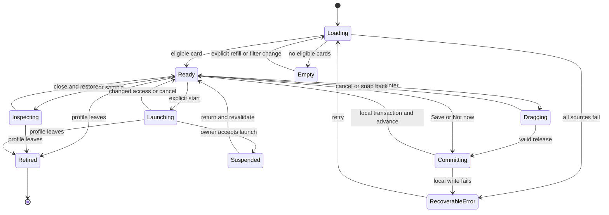

# Engineering contract

All `Discovery*`, `Swipe*` and `Preview*` types below are **proposed**, not APIs claimed to exist. They wrap current domain models without replacing `MediaItem`, `CatalogItem`, `SourceEntry` or their progress owners. New files live under `lib/discovery/` and the proposed screen/widget folders in DELIVERY. Provider-owned clients, authentication and actions remain owned by existing services.

## 1. Domain contracts

| Proposed type | Minimum data / responsibility |
| --- | --- |
| `DiscoveryContext` | Profile identity, active identity generation, source capability generation, session ID, filter generation, locale/direction, network policy, allowed kinds, strict access requirements, intent and optional seed |
| `DiscoveryTarget` (sealed) | Server item; catalog entry; source publication; live program; lending holding. Carries only a typed reference into its owner, never a reusable credential or signed URL |
| `DiscoveryCandidate` | Stable candidate ID, target ref, optional verified work/group refs, edition refs, safe display snapshot, known metadata, useful consumption unit, relation provenance, offers, factual reason and source attribution |
| `DiscoveryEdition` | Media kind, language/translation, narration/abridgment/version, source object identity, fingerprint/revision where relevant; no inferred equivalence of different timelines |
| `DiscoveryOffer` | Source/connection ref, exact target, independent operation capabilities, access state, checked-at and expiry, safe reason, supported output/device facts |
| `ConsumptionUnit` | Whole work / remaining work / next chapter / next episode / user-timed session; source duration if known, speed-adjusted display duration, estimated flag and basis |
| `DiscoveryQuery` | Typed scope/filters, page size and continuation token; distinguishes source cursor from local deck cursor |
| `DiscoveryPage` | Bounded candidates, opaque continuation, hasMore, safe source error and source generation; partial success allowed |
| `DiscoveryDecision` | Operation UUID, profile, session/candidate, action, target scope, previous revision/value, device sequence, timestamp for display, status; immutable event semantics |
| `SavedPick` | Stable discovery identity, chosen edition or unresolved version intent, safe display fallback, origin and causal state; no permanent access claim |
| `DiscoverySession` | Current ID, ordered bounded candidate refs, seen IDs, decisions/undo cursor, seed/filter fingerprints, source cursors and generation; persisted checkpoint excludes active credentials |

`DiscoveryTarget` must not synthesize a Plex `serverId` for a file or borrow a catalog rendering stand-in as a playable item. Every adapter returns typed routes and capabilities; widgets do not branch on server brand strings.

### Identity and grouping rules

1. Local operational identity includes profile plus connection/source namespace plus stable provider item ID and kind. Use structured encoding, not ambiguous delimiter concatenation. Reuse current global/source key helpers at adapter boundaries.
2. Catalog identity uses the provider's entry identity and kind, preserving `CatalogItemIds.entryKey` semantics for season-specific anime. Cross-provider work grouping requires verified compatible IDs; an IMDb show ID alone does not identify a season or episode.
3. Source publication identity uses its source object ID and edition fingerprint/timeline. Same title/author is a possible search hint, never an identity or progress merge. Empty IDs cannot match each other or “everything.”
4. A work group may contain multiple offers for the same work/edition and a separate set of other editions. Do not collapse translated text, different narrators, abridgments, remakes, album releases, omnibus comics or changed multipart order into one playback cursor.
5. An adaptation relation connects different work groups. Store provider relation type, endpoint IDs, provenance and confidence; only verified/provider-supplied or explicitly user-confirmed relations are displayed as fact.
6. Generic unknown metadata falls back to a stable adapter-specific opaque item key, not title-only identity. A missing stable identity excludes mutation until resolved; show safe detail instead.
7. Cross-device portable IDs use provider origin/account namespace and stable object identity, not installation-local connection/profile UUIDs. Sync remaps an offer only to an already connected authorized source, never creates a connection from a sync payload.
8. Replacing/removing a source invalidates offers but can retain the user's Saved pick. Reconnect must verify the same principal/source identity before resolving its old targets.

Save defaults to the **currently presented edition intent**. A generic catalog movie/show may be saved at work level with no selected version; the UI says version not selected until launch resolution. Saving an audiobook with a narrator or a translated ebook retains that edition. Work-level and edition-level saves must not toggle each other unexpectedly.

## 2. Adapter boundaries and execution

`DiscoverySourceAdapter` exposes capabilities, paged query, hydrate, resolve offers and invalidate/cancel. It does not execute network writes through a swipe decision. A separate `DiscoveryActionRouter` delegates explicit actions to canonical owners.

| Adapter/action | Existing integration owner |
| --- | --- |
| Server candidates and library retrieval | `lib/media/media_server_client.dart`, `lib/providers/multi_server_provider.dart`, `LibraryQuery` |
| Catalog candidates/relations/matching | `lib/services/catalog/catalog_source.dart`, `lib/providers/catalog_sources_provider.dart`, `catalog_library_matcher.dart` |
| Server details and video | `lib/utils/media_navigation_helper.dart`, `lib/utils/video_player_navigation.dart` |
| Catalog detail | `lib/utils/catalog_navigation_helper.dart`, `lib/screens/catalog_item_detail_screen.dart` |
| Music | `lib/utils/music_navigation.dart`, `lib/services/music/` |
| Live TV | `lib/utils/live_tv_player_navigation.dart`, `lib/screens/livetv/`, current program guide |
| Seerr request | `lib/widgets/seerr_request_sheet.dart`; use its permission/season/service behavior |
| Provider watchlist | `CatalogSource` and existing watchlist source chooser; keep unsupported sources unsupported |
| Files/books (dependency) | `SourceController`, `SourcePlayback`, source navigation/reader/player screens and `SourceRepository` |
| Lending (dependency) | `lib/lending/lending_service.dart` and existing public-library screens |
| Session teardown | Active profile binder/provider, profile navigation ownership, existing playback coordinator |

Do not call `ExploreProvider.loadAllForRow` or the “load all pages” helper for a swipe deck: retrieve bounded pages directly through the same source contracts. Do not call the private `_pickRandomMovie` method, which plays immediately. Factor a small pure candidate/retrieval helper only where reuse is real.

A `LaunchIntent` contains the exact candidate/edition, selected unit and an operation ID. Resolution checks current profile generation, filters, source identity, access, representation and device capability immediately before launch. Only one launch is accepted; double taps and stale callbacks cannot start a second session. Honor existing user's pre-play, track and detail-vs-direct settings. The button copy must match the resulting route, e.g. **Open episode** if the configured behavior opens details before playing.

For multiple valid offers, use the current preferred-server/version rules where applicable. If choosing would change language, narrator, abridgment, quality constraint or consumption mode, show the existing-style edition chooser with a clear default and explicit confirmation. Availability checks cannot silently downgrade an explicit accessibility requirement.

## 3. Retrieval and ranking

The initial system is deterministic and useful without a remote recommendation service. Runtime recommendations are optional improvements after the safe local path is complete.

Pipeline:

1. Build the **authorized** source set from the active profile and current feature gates. Do this before reading cached metadata or images. Restricted Explore cannot leak through Home's mixed deck.
2. Read a small eligible cache partition and begin bounded source queries. Permission/loan-expired entries cannot enter the active deck from cache. Offline mode performs no provider discovery requests.
3. Use round-robin source paging with cancellation, per-source deadline and cursor tracking. Hydrate only enough metadata for hard filters and the visible/next candidates. No full-library scan, recursive cloud walk or whole-book extraction on entry.
4. Apply strict filters: permission, age/restriction, source, kind, availability policy, language/access needs, unit fit for Finish something, hidden items, session duplicates, edition validity. Unknown required fields need bounded hydration or exclusion, never a fabricated pass.
5. Group verified equivalent offers. Keep distinct editions/relations available without showing the same title repeatedly. Suppress downstream episodes/chapters as independent mixed-deck cards.
6. Rank within medium and interleave by the selected activity mix so library size cannot dominate. Freeze the current card and next two refs; rerank only unseen tail after new results/preferences. An item can still be removed immediately if it becomes unauthorized.
7. Persist session order/seed and cursor checkpoint. Refill when fewer than three usable tail candidates remain. Repeated cursors, duplicate-only pages and exhausted budgets terminate cleanly with Get more / change choices.

Proposed baseline score (tuning default, not measured recommendation quality): `0.30 intentFit + 0.25 explicitTaste + 0.20 accessConvenience + 0.10 novelty + 0.10 continuationFit + 0.05 providerRelevance - exposurePenalty`. Terms are bounded 0–1, exposure penalty 0–0.25. Unknown nonrequired evidence is neutral, not a negative review; unknown required evidence was removed by hard filters. Do not compare raw star ratings across providers/media. Use provider relevance order only within its returned source scope.

- ExplicitTaste uses opted-in profile favorites, saved picks, user-chosen seeds and explicit Less like this traits. Saving is a weak signal, not a declared favorite. A request does not mean a positive review.
- Not now is neutral. Exposure history may temporarily lower repetition of that exact candidate, not its creator/genre. Prolonged hover, accessibility reading time and sample duration are not implicit likes/dislikes.
- A novelty/exploration quota reserves at least one slot per eight-card batch for an eligible less-similar choice if one exists. At most two consecutive cards may be from the same medium while alternatives qualify; at most one same-series work per batch unless user scopes to it. These rules relax only diversity, never hard gates.
- A selected nonempty Watch/Listen/Read group gets an opportunity before replenishing another group's third slot. Respect an explicitly single-medium scope. Store provider-native cursors independently so a failed source does not starve the others.
- Cold start uses available library diversity and existing catalog rows with transparent attribution. Seed selection is optional and comes after the first useful card. Displayed reasons must derive from actual rank evidence, not a generated explanation rationalizing a random choice.
- No permanent popularity cliff: unrated/unmatched items remain eligible; they simply carry less specific evidence. If source order is opaque, say where the item came from instead of assigning a percentage match.

### Time and session fit

`Finish something` requires a known useful unit that fits the budget: remaining movie, eligible episode, complete song/album or next chapter. Listening duration is source-time divided by the actual selected playback rate; speed changes recompute labels, not saved progress. Never invent chapter duration if preceding multipart lengths are unknown.

`Spend this long` may offer a long audiobook/ebook with a bounded session: show the full commitment and session intent separately. Starting it may offer the existing sleep timer/stop-at-chapter control, but never overwrite an existing timer silently. Reading time uses a user-calibrated, edition/language-appropriate basis only when available, labelled **Estimated**. Otherwise offer a timed session and page/chapter context, not a made-up exact finish time. EPUB/comic/PDF page counts are not interchangeable.

Live TV uses server/EPG timestamps to compute remaining duration at display time. `Finish something` cannot promise the beginning of a program already underway. Unknown EPG state yields channel discovery, not a fabricated current show. Upcoming events use the existing guide/details actions, not automatic recording.

### Optional AI reranking

After the baseline passes, an opt-in configured AI service may reorder at most 24 already authorized candidate IDs and optionally select from provided reason codes. It may not invent titles, URLs, identities, durations, relationships, entitlements or actions. Validate a strict schema, uniqueness, allowed IDs and captured generation; ignore extra/unknown IDs and fall back to baseline when insufficient valid results remain. Never block a visible card waiting for a model.

No remote AI is required for any media type. Disclose the exact submitted fields and use the established credential/configuration path if one exists at implementation time; otherwise add a separately reviewed opt-in service setting. Default payload excludes raw filenames/paths, server names/URLs, private notes, publication contents, credentials, full histories, age-restricted/restricted content and guest ballots. Optional local inference uses the same adapter/policy. No AI may loosen a permission/accessibility filter. Provider timeout/failure leaves the ordinary deck intact; no new login cascade.

## 4. State machine and concurrency

The diagram abbreviates a global rule: **every state**, including Loading, Dragging, Committing, Empty, Error and Suspended, can retire. Retirement invalidates epochs before canceling I/O; no subsequent completion may publish state, start a player or touch another profile. All states also handle app background/route coverage by releasing previews and pausing UI work, distinct from permanent profile retirement.

Every async operation carries `(profileId, identityGeneration, sourceGeneration, sessionId, filterGeneration, operationId)`. Capture on dispatch and validate after each await, before database commit, before revealing art/text, and before external action. A filter update retires only its query generation; a profile lock/switch invalidates the whole session, including image requests, dialogs, samples and queued focus restoration.

Use one serialized local decision queue. Disable card decision dispatch only while its own local transaction commits; provider I/O is never on that path. Persist decision, saved membership delta and session cursor in one transaction. Animate after acknowledgement; if animation is interrupted, derive UI from the committed checkpoint. Track decision revision so an Undo cannot revert a later edit. After canceling a pointer, no tap on the same release may activate the new card.

Store each source's cursor independently. Abort HTTP where supported and discard late data even if cancellation is unavailable. Apply strict bounds to imported metadata, dates, durations, relation counts, synopsis length and artwork size. Provider errors map into safe states; never render raw response bodies or credential-bearing URLs.

## 5. Preview is a first-class playback mode

Current `PlaybackCoordinator` coordinates music/video/theme-song ownership and, in the final reconciled main, file playback and narration. It does **not** yet prove isolated previews. Add a small explicit preview ownership contract through it rather than creating a parallel decoder behind its back.

`PreviewSession` owns a disposable preview cursor, profile epoch, cancellation, exact target, transport/source lease and an explicit progress-write policy. No player progress reporting, scrobble, completed flag, audiobook sync, reader last-location, bookmarks, listening statistics, Continue Watching, watch-together events or auto-download rule may observe preview as ordinary consumption. Suppress at the data/reporting boundary, not by undoing a real progress write afterwards.

| Kind | Safe preview path | Fallback |
| --- | --- | --- |
| Movie/show | Provider-authorized trailer or explicit sample asset; own preview transport and captions | Details and ordinary Play; do not arbitrarily seek mid-film or play a later episode |
| Music | Existing authorized sample or explicit short excerpt with isolated queue/reporting | Album/track details and explicit normal Listen |
| Audiobook | Publisher/provider sample; optionally user-owned exact edition excerpt beginning at a clearly labelled point | Narrator/edition details; no silent advancement of book progress |
| EPUB/PDF/CBZ | Sample acquisition or isolated read-only preview locator/page state using the existing sanitized reader | Cover/details or explicit full Read; no bypass of unsupported TV reading |
| Live TV | No automatic tuner allocation or preview in baseline | Explicit Watch live through the ordinary path |

Never call the standard player with “preview” only in the widget while reporters still run. If an adapter cannot isolate progress/server behavior, omit Sample. Reading and media access can still appear in provider access logs; the promise is **unchanged user progress**, not invisible server access.

Only one preview may exist. Starting a sample is explicit and freezes the current card; stopping, Back, swiping after stop, covering the route, backgrounding or profile change disposes it. The active media owner must agree to a preview handoff: if pause/restore cannot be guaranteed, show **Stop current playback to sample** using the normal confirmation, or omit sample. Never stop someone's music merely by focusing a card. Capture a restorable queue/cursor only through that owner; restore only after user choice and only if no newer playback took ownership. Do not auto-resume audio after headphones disconnect, phone interruption or profile change.

Preview to full consumption is a deliberate launch with a fresh capability check and normal resume/start choices. A sample cursor is not imported as real progress. During preview-to-play handoff, await preview teardown before creating the ordinary player. Deadline and cancellation must leave no decoder, stream lease, tuner, browser bridge or audio focus owner behind.

## 6. Persistence, history and optional sync

Add profile-scoped Drift tables via the current database migration mechanism: discovery preferences, decisions/history, saved picks, session checkpoint and optionally source cache metadata. Use the next actual schema version at implementation, not a hard-coded assumption from this audit's version 28. Keep credentials in the existing vault; store no playable URLs in these tables. Profile deletion removes these rows and managed preview data; disconnect preserves useful picks but invalidates access offers.

History provides Restore hidden title, revert explicit taste edits, and remove/restore saved picks. Retain neutral exposure/session data for a bounded 30 days and compact action history to 500 entries per profile initially; saved picks and explicit exclusions persist until user removal. These are proposed retention defaults, surfaced in settings. Destructive clear/reset uses the normal confirmation, distinguishes saved picks from recommendation history, and does not reset watch/read state.

Session-local Undo has no toast expiry but is bounded by retained history and profile ownership. On a sync conflict or externally revised save, show the current state instead of reverting a stale snapshot. If the app crashes after a transaction commits, relaunch must recover exactly one decision and the next valid card.

Local discovery is fully functional without sync. Reuse the **qualified** encrypted source-state sync layer only after its separate recovery/implementation work lands. Define a separately versioned discovery namespace and payload; do not serialize arbitrary whole application state or reimplement five cloud-provider write clients here.

Sync Saved picks and explicit taste/hidden preferences only when the user enables it; raw gestures, guest ballots, preview state and device capabilities stay local. Remote records contain portable work/edition references and causal operation context, never signed URLs, source credentials or device profile UUIDs as portable identity. Re-resolve capabilities on every device.

Use the completed cloud-sync layer's causal register semantics, including deletion tombstones and device identity recovery. Causally later add/remove replaces earlier state; concurrent add/remove or conflicting preference changes remain explicit conflict state until chosen, with current locally visible state retained. Do not use device wall-clock last-write-wins or silent “max progress.” Imported records cannot resurrect a removed profile, deleted namespace or forgotten preference. Clear-everywhere requires an explicit namespace reset/epoch protocol with authenticated reconciliation; until provided, label clearing as **On this device**. This avoids claiming that an offline device will honor an unimplemented global deletion.

Cloud sync failures never roll back a local save or block swiping. Show a quiet sync state on Saved picks; retry through the shared bounded sync scheduler only for the active owning profile. Unsupported schema/corrupt payload must not publish an empty replacement. Enabling discovery sync must not broaden ordinary media-source scopes; use the source sync's existing consent and selected destination.

## 7. Security and profile lifecycle

- All candidates, history, thumbnails and cache partitions belong to one authorized profile/source principal. A shared server's aggregate library is not a user's permitted library. Read only through current user-bound clients.
- Honor Explore PIN/visibility at every route, including Find similar, Saved picks resolution and mixed Home entry. Library restrictions and child profiles apply before cache/materialization, not just before Play.
- Treat catalog descriptions, images, sample links and publication content as untrusted. Use existing sanitization, allowed URL schemes, transport redirect/credential policy and bounded image/reader decoders. Never execute catalog HTML or treat a generated URL as a provider capability.
- Samples reuse secured source gateways/leases and sanitized archives. No file traversal, publication scripts or bearer tokens in webviews, native player URLs, logs or cross-origin art.
- Preference reasons cannot reveal hidden source names or other profiles' histories. Unknown parental/content classification follows the profile's current policy; if strict enforcement lacks evidence, exclude until verified rather than assuming safe.
- No background request/download/borrow/record side effects from recommendation evaluation. Canonical services recheck permissions, quotas and approval at final action. Cancellation after a confirmed external action must reconcile the outcome; don't announce a rollback that never occurred.
- Disconnect/revoke/delete during any await cancels dependent work. A late failure may be logged safely against its retired operation but must not show another profile a toast or card.

## 8. Resource and latency budgets

These are proposed acceptance targets, not benchmark results. Measure on a named low-resource TV/stick and representative phones/desktops in profile/release builds.

| Area | Initial bound/target |
| --- | --- |
| First useful cached card | p95 ≤500 ms after route entry with an already-open local DB and valid authorized cache |
| First useful cold card | p95 ≤2 s against the controlled healthy fixture; do not claim this for arbitrary provider networks |
| Source deadlines | 5 s per initial query, partial results immediately; an 8 s overall initial no-result ceiling yields recoverable UI, not endless spinner |
| Candidate memory | 240 lightweight candidates total, 40 per page, at most 3 in-flight source queries; weighted fair queue across larger source sets |
| Detail hydration | Current plus next two candidates; at most 2 concurrent hydration tasks; cap duplicate/empty continuation loops |
| Images | Existing shared cache, decode to display size; prefetch current plus two only; initial discovery-specific decoded-image budget 32 MiB on low-resource devices |
| Playback | One preview decoder; zero preview media downloaded/decoded before explicit Sample; cancel prefetch on metered/data-saver policy as configured |
| Card decision | p95 ≤100 ms local commit/visible acknowledgement on fixture device; no provider round trip |
| Animation | p95 UI and raster frame cost each within 16.7 ms for 60 Hz target; report actual frame/jank distribution and adapt for slower devices |
| Large library | 100,000-item fixture must not be fully fetched/scanned to render first card; stable bounded memory over 1,000 decisions |
| Cleanup | No ongoing discovery network/rank/image jobs after retirement; no retained decoder/reader temp files after preview teardown |

Avoid repeated full-list sort/rebuild on pointer movement. Drag state belongs to the visible widget; ranking/network/database state belongs to the controller. Move large normalization/ranking work off the UI isolate only when profiling demonstrates need. Use deterministic clocks, seeds and fake paged clients in tests; production behavior must never rely on wall-clock ordering for correctness.

## 9. Observability without engagement farming

Use local debug counters and explicitly opted-in aggregate diagnostics: time to first useful card, decisions before first save/start, successful starts, undo/error rate, empty-deck rate, timeouts, duplication, memory and jank. No media titles, profile names, provider tokens or guest ballots in diagnostic events. Measure stale/revoked action rejection and preview progress leakage as correctness failures.

Usability comparison uses the existing library/random browsing as baseline: time to a satisfactory choice, mistakes, confidence in actions, accessibility effort and whether users can stop comfortably. Set numeric improvement targets after observing a baseline, not by inventing a conversion uplift. Keep a feature gate and the old navigation available for rollback without deleting preferences.
